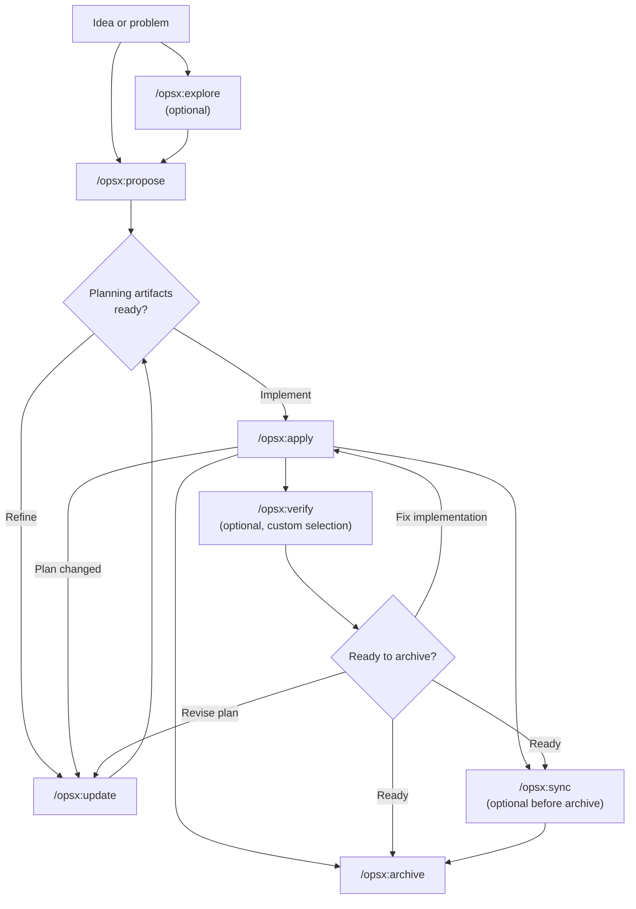
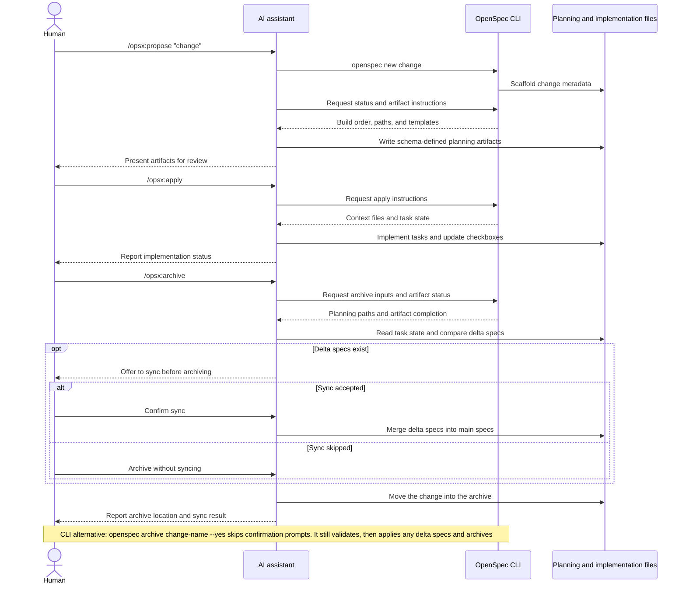

# OpenSpec 快速与扩展工作流

比较默认 core 路线和扩展命令路线，介绍从探索开始、以动作为单位推进和处理不同类型变更的工作模式。

- 来源：OpenSpec
- 资料类型：工作流使用指南
- 存档版本：`9111a7654d78`。
- 文档时间：发表／更新：未知；抓取核验：2026-10-10
- 阅读状态：完整中文机器译文，由 Google 翻译；代码、命令与配置保留原样，未逐句人工校对。

[原文发布页](<https://github.com/Fission-AI/OpenSpec/blob/9111a7654d7800391459431fff4eaf66e33a3d2e/docs/workflows.md>) · [原始文件](<../../../原始抓取备份/原文/GitHub项目/OpenSpec/docs/workflows.md>) · [返回资料总览](<../../资料总览.md>)

[查看原文对照](#原文对照)

## 中文全文

# 工作流程

本指南涵盖 OpenSpec 的常见工作流程模式以及何时使用每种模式。有关基本设置，请参阅[入门](<OpenSpec 入门与首个变更.md>)。命令参考请参见[命令](<OpenSpec AI 聊天命令参考.md>)。

## 理念：行动，而非阶段

传统的工作流程迫使您经历几个阶段：规划、实施、最后完成。但真正的工作并不完全适合盒子。

OPSX采取了不同的方法：

```text
Traditional (phase-locked):

  PLANNING ────────► IMPLEMENTING ────────► DONE
      │                    │
      │   "Can't go back"  │
      └────────────────────┘

OPSX (fluid actions):

  proposal ──► specs ──► design ──► tasks ──► implement
```

**关键原理：**

- **行动，而不是阶段** - 命令是你可以做的事情，而不是你陷入的阶段
- **依赖关系是推动者** - 它们显示什么是可能的，而不是接下来需要什么

> **自定义：** OPSX 工作流程由定义工件序列的模式驱动。有关创建自定义模式的详细信息，请参阅[自定义](<OpenSpec 项目配置与工作流定制.md>)。

## 工作流程一览

默认工作流程保持流畅：探索和验证是可选的，并且
每当实施揭示新内容时，您都可以更新规划工件。



AI 助手驱动工作流程，而 CLI 提供确定性的 
 脚手架、状态和工件指令：



## 两种模式

### 默认快速路径（`core` 配置文件）

新安装默认为 `core`，它提供：
- `/opsx:explore`
- `/opsx:propose`
- `/opsx:apply`
- `/opsx:update`
- `/opsx:sync`
- `/opsx:archive`

典型流程：

```text
/opsx:explore ──► /opsx:propose ──► /opsx:apply ──► /opsx:sync ──► /opsx:archive
  (optional)
```

#### 从探索开始（值得养成的习惯）

`/opsx:explore` 是默认配置文件的一部分，而不是高级附加组件。这是当你遇到问题但还没有计划时要采取的行动，在AI助理的帮助下，大多数情况下都是这样。

```text
You: /opsx:explore

AI:  What would you like to explore?

You: Our search results feel stale. I'm not sure if it's caching,
     indexing, or the query itself.

AI:  Let me look... [reads the search service and cache layer]
     It's the index: it only rebuilds nightly, so edits don't show
     up until the next day. Two options: rebuild on write (simple,
     more load) or a short-TTL cache invalidation (more moving parts,
     less load). Given your write volume is low, rebuild-on-write is
     the cleaner fix. Want to scope it?

You: Yes.

You: /opsx:propose rebuild-search-index-on-write
```

Explore 从不编写代码，也不会编写任何其他内容，除非您提出要求，或者在它提供时答应。这是一次自由、无利害关系的对话，将模糊的担忧变成了精确的改变，因此接下来的建议是尖锐的。已经清楚地知道自己想要什么了吗？跳过它，直接进入`/opsx:propose`。完整指南：[首先探索](<使用 OpenSpec 探索问题与澄清需求.md>)。

### Expanded/Full 工作流程（自定义选择）

如果您需要显式的脚手架和构建命令（`/opsx:new`、`/opsx:continue`、`/opsx:ff`、`/opsx:verify`、`/opsx:bulk-archive`、`/opsx:onboard`），请使用以下命令启用它们：

```bash
openspec config profile
openspec update
```

## 工作流程模式（扩展模式）

### 快速功能

当您知道要构建什么并且只需要执行时：

```text
/opsx:new ──► /opsx:ff ──► /opsx:apply ──► /opsx:verify ──► /opsx:archive
```

**示例对话：**

```text
You: /opsx:new add-logout-button

AI:  Created openspec/changes/add-logout-button/
     Ready to create: proposal

You: /opsx:ff

AI:  Creating all planning artifacts...
     ✓ proposal.md
     ✓ specs/
     ✓ design.md
     ✓ tasks.md
     Ready for implementation!

You: /opsx:apply

AI:  Working through tasks...
     ✓ Added logout button to header
     ✓ Implemented session clearing
     ✓ Added confirmation dialog
     All tasks complete!

You: /opsx:archive

AI:  ✓ Merged specs
     ✓ Archived change
```

**最适合：** 中小型功能、错误修复、简单更改。

### 探索性

当需求不明确或需要先调查时：

```text
/opsx:explore ──► /opsx:new ──► /opsx:continue ──► ... ──► /opsx:apply
```

**示例对话：**

```text
You: /opsx:explore

AI:  What would you like to explore?

You: I want to improve page load performance but I'm not sure
     where the bottlenecks are.

AI:  Let me help investigate...
     [Analyzes bundle sizes, identifies slow queries, reviews
     component render patterns]

     I found three main bottlenecks:
     1. Large unoptimized images
     2. Synchronous data fetching in ProductList
     3. Re-renders from context changes

     Which would you like to address first?

You: Let's tackle the data fetching issue.

You: /opsx:new optimize-product-list-fetching

AI:  Created change. Ready to create: proposal

You: /opsx:continue

AI:  Creating proposal based on our exploration...
     [Writes proposal incorporating investigation insights]

     Ready to create: specs, design
     Which would you like next?

You: /opsx:continue

AI:  Creating specs...
```

**最适合：**性能优化、调试、架构决策、不明确的需求。

### 并行变化

一次处理多个更改：

```text
Change A: /opsx:new ──► /opsx:ff ──► /opsx:apply (in progress)
                                         │
                                    context switch
                                         │
Change B: /opsx:new ──► /opsx:ff ──────► /opsx:apply
```

**示例对话：**

```text
You: I'm working on add-dark-mode but got pulled into a bug fix

You: /opsx:new fix-login-redirect

AI:  Created openspec/changes/fix-login-redirect/

You: /opsx:ff

AI:  ✓ Created planning artifacts

You: /opsx:apply

AI:  Working on fix-login-redirect...
     [Implements the fix]
     All tasks complete!

You: /opsx:archive

AI:  ✓ Archived fix-login-redirect

You: Let's get back to dark mode

You: /opsx:apply add-dark-mode

AI:  Resuming add-dark-mode...
     Picking up at task 2.3: Update Header...
```

**最适合：** 并行工作流、紧急中断、团队协作。

当您有多个已完成的更改时，请使用 `/opsx:bulk-archive`：

```text
You: /opsx:bulk-archive

AI:  Found 3 completed changes:
     - add-dark-mode (all tasks done)
     - fix-login-redirect (all tasks done)
     - update-footer (all tasks done)

     Checking for spec conflicts...
     ⚠ add-dark-mode and update-footer both touch specs/ui/

     Inspecting codebase to resolve...
     Both changes are implemented. Will apply in chronological order.

     Archive all 3 changes?

You: Yes

AI:  ✓ Archived add-dark-mode
     ✓ Archived fix-login-redirect
     ✓ Archived update-footer
     Specs merged in order: add-dark-mode → update-footer
```

批量存档可检测多个更改何时触及相同规范，并通过检查实际实施的内容来解决冲突。

### 完成变更

推荐的完成流程：

```text
/opsx:apply ──► /opsx:verify ──► /opsx:archive
                    │                 │
              validates          prompts to sync
              implementation     if needed
```

#### 验证：检查你的工作

`/opsx:verify` 跨三个维度验证您的工件的实施：

```text
You: /opsx:verify

AI:  Verifying add-auth...

     COMPLETENESS
     ✓ All 12 tasks in tasks.md are checked
     ✓ All requirements in specs have corresponding code
     ⚠ Scenario "Session timeout after inactivity" not tested

     CORRECTNESS
     ✓ Implementation matches spec intent
     ✓ Edge cases from scenarios are handled
     ✓ Error states match spec definitions

     COHERENCE
     ✓ Design decisions reflected in code structure
     ✓ Naming conventions consistent with design.md
     ⚠ Design mentions "event-driven" but implementation uses polling

     SUMMARY
     ─────────────────────────────
     Critical issues: 0
     Warnings: 2
     Ready to archive: Yes (with warnings)

     Recommendations:
     1. Add test for session timeout scenario
     2. Consider refactoring to event-driven as designed, or update design.md
```

**验证检查什么：**

|尺寸|它验证了什么|
|-----------|------------------|
|完整性|所有任务已完成，所有要求已实现，已覆盖场景|
|正确性|实现符合规范意图，处理边缘情况|
|连贯性|设计决策体现在代码中，模式一致|

验证不会阻止存档，但它会显示您可能想要首先解决的问题。

#### 存档：完成更改

`/opsx:archive` 完成更改并将其移至存档：

```text
You: /opsx:archive

AI:  Archiving add-auth...

     Artifact status:
     ✓ proposal.md exists
     ✓ specs/ exists
     ✓ design.md exists
     ✓ tasks.md exists (12/12 tasks complete)

     Delta specs: Not yet synced to main
     → Would you like to sync now?

You: Yes

AI:  ✓ Synced specs to openspec/specs/auth/spec.md
     ✓ Moved to openspec/changes/archive/2025-01-24-add-auth/

     Change archived successfully.
```

如果规格未同步，存档将提示。它不会阻止未完成的任务，但会警告您。

## 何时使用什么

### `/opsx:ff` 与 `/opsx:continue`

|情况|使用|
|-----------|-----|
|明确需求，准备构建| `/opsx:ff` |
|探索中，想回顾每一步| `/opsx:continue` |
|想要在规格之前迭代提案| `/opsx:continue` |
|时间紧迫，需要快速行动| `/opsx:ff` |
|复杂的变化，需要控制| `/opsx:continue` |

**经验法则：**如果您可以预先描述完整范围，请使用`/opsx:ff`。如果您正在解决这个问题，请使用 `/opsx:continue`。

### 何时更新与重新开始

一个常见的问题：什么时候可以更新现有的更改，什么时候应该开始新的更改？

**在以下情况下更新现有更改：**

- 相同的意图，精细的执行
- 范围缩小（先MVP，稍后休息）
- 学习驱动的修正（代码库不是你所期望的）
- 根据实施发现进行设计调整

**在以下情况下开始新的更改：**

- 意图从根本上改变了
- 范围完全扩展到不同的工作
- 原始更改可以独立标记为“完成”
- 补丁只会让人困惑而不是澄清

```text
                     ┌─────────────────────────────────────┐
                     │     Is this the same work?          │
                     └──────────────┬──────────────────────┘
                                    │
                 ┌──────────────────┼──────────────────┐
                 │                  │                  │
                 ▼                  ▼                  ▼
          Same intent?      >50% overlap?      Can original
          Same problem?     Same scope?        be "done" without
                 │                  │          these changes?
                 │                  │                  │
       ┌────────┴────────┐  ┌──────┴──────┐   ┌───────┴───────┐
       │                 │  │             │   │               │
      YES               NO YES           NO  NO              YES
       │                 │  │             │   │               │
       ▼                 ▼  ▼             ▼   ▼               ▼
    UPDATE            NEW  UPDATE       NEW  UPDATE          NEW
```

**示例：“添加深色模式”**

- “还需要支持自定义主题”→新变化（范围爆炸）
- “系统偏好设置检测比预期更难” → 更新（相同意图）
- “让我们先发布切换，稍后添加首选项”→ 更新然后存档，然后进行新更改

## 最佳实践

### 保持变革的重点

每个变更一个逻辑工作单元。如果您正在执行“添加功能 X 并重构 Y”，请考虑两个单独的更改。

**为什么重要：**
- 更容易查看和理解
- 更清晰的存档历史记录
- 可独立发货
- 如果需要更简单的回滚

### 对于不明确的要求使用`/opsx:explore`

在做出改变之前，先探索问题空间：

```text
You: /opsx:explore

AI:  What would you like to explore?

You: How should we handle rate limiting for our API?

AI:  Let me investigate your current setup and options...
     [Researches codebase, considers patterns]

     I see three approaches we could take:
     1. Middleware-based (simple, per-endpoint)
     2. Redis-backed (scalable, shared state)
     3. Token bucket per user (fair, complex)

     Your current stack suggests #1 or #2. What's your scale?
```

在编写任何代码之前，探索可以澄清思路。

### 存档前验证

使用 `/opsx:verify` 检查实现匹配工件：

```text
You: /opsx:verify

AI:  Verifying add-dark-mode...

     ✓ All tasks in tasks.md are checked
     ✓ Requirements in specs have corresponding code
     ✓ Design decisions are reflected in implementation

     Ready to archive!
```

在结束更改之前捕获不匹配的情况。

### 名称变更一目了然

好名字使 `openspec list` 有用：

```text
Good:                          Avoid:
add-dark-mode                  feature-1
fix-login-redirect             update
optimize-product-query         changes
implement-2fa                  wip
```

## 命令快速参考

有关完整命令详细信息和选项，请参阅[命令](<OpenSpec AI 聊天命令参考.md>)。

|命令|目的|何时使用|
|---------|---------|-------------|
| `/opsx:propose` |创建变更+规划工件|快速默认路径（`core` 配置文件）|
| `/opsx:explore` |使用 AI 思考想法|不确定时从这里开始：不清楚的要求、调查、比较选项|
| `/opsx:new` |启动变革脚手架|扩展模式，显式工件控制|
| `/opsx:continue` |创建下一个工件|扩展模式，一步步创建工件|
| `/opsx:ff` |创建所有计划工件|扩展模式，范围清晰|
| `/opsx:apply` |落实任务|准备写代码了|
| `/opsx:verify` |验证实施|归档前的扩展模式|
| `/opsx:sync` |合并增量规格|扩展模式，可选|
| `/opsx:archive` |完成变更|全部工作完成|
| `/opsx:bulk-archive` |存档多项更改|扩展模式，并行工作|

## 下一步

- [编写良好的规范](<编写清晰的 OpenSpec 行为规格.md>) - 强烈的需求和场景是什么样的，以及如何调整变更的大小
- [审查更改](<OpenSpec 变更审阅指南.md>) - 在任何代码之前花两分钟时间浏览起草的计划
- [OpenSpec 在团队中](<OpenSpec 团队协作与 Git 工作流.md>) - 更改如何适应分支和拉取请求
- [命令](<OpenSpec AI 聊天命令参考.md>) - 带选项的完整命令参考
- [概念](<OpenSpec 核心概念与规格结构.md>) - 深入探讨规范、工件和架构
- [自定义](<OpenSpec 项目配置与工作流定制.md>) - 创建自定义工作流程


## 原文对照

<details>
<summary>展开完整原文</summary>

# Workflows

This guide covers common workflow patterns for OpenSpec and when to use each one. For basic setup, see [Getting Started](<OpenSpec 入门与首个变更.md>). For command reference, see [Commands](<OpenSpec AI 聊天命令参考.md>).

## Philosophy: Actions, Not Phases

Traditional workflows force you through phases: planning, then implementation, then done. But real work doesn't fit neatly into boxes.

OPSX takes a different approach:

```text
Traditional (phase-locked):

  PLANNING ────────► IMPLEMENTING ────────► DONE
      │                    │
      │   "Can't go back"  │
      └────────────────────┘

OPSX (fluid actions):

  proposal ──► specs ──► design ──► tasks ──► implement
```

**Key principles:**

- **Actions, not phases** - Commands are things you can do, not stages you're stuck in
- **Dependencies are enablers** - They show what's possible, not what's required next

> **Customization:** OPSX workflows are driven by schemas that define artifact sequences. See [Customization](<OpenSpec 项目配置与工作流定制.md>) for details on creating custom schemas.

## Workflow at a Glance

The default workflow stays fluid: exploration and verification are optional, and
you can update planning artifacts whenever implementation reveals something new.


The AI assistant drives the workflow, while the CLI provides deterministic
scaffolding, status, and artifact instructions:


## Two Modes

### Default Quick Path (`core` profile)

New installs default to `core`, which provides:
- `/opsx:explore`
- `/opsx:propose`
- `/opsx:apply`
- `/opsx:update`
- `/opsx:sync`
- `/opsx:archive`

Typical flow:

```text
/opsx:explore ──► /opsx:propose ──► /opsx:apply ──► /opsx:sync ──► /opsx:archive
  (optional)
```

#### Start by exploring (the habit worth forming)

`/opsx:explore` is part of the default profile, not an advanced add-on. It's the move to make whenever you have a problem but not yet a plan, which, with an AI assistant, is most of the time.

```text
You: /opsx:explore

AI:  What would you like to explore?

You: Our search results feel stale. I'm not sure if it's caching,
     indexing, or the query itself.

AI:  Let me look... [reads the search service and cache layer]
     It's the index: it only rebuilds nightly, so edits don't show
     up until the next day. Two options: rebuild on write (simple,
     more load) or a short-TTL cache invalidation (more moving parts,
     less load). Given your write volume is low, rebuild-on-write is
     the cleaner fix. Want to scope it?

You: Yes.

You: /opsx:propose rebuild-search-index-on-write
```

Explore never writes code, and writes nothing else unless you ask, or say yes when it offers. It's a free, no-stakes conversation that turns a vague worry into a precise change, so the proposal that follows is sharp. Already know exactly what you want? Skip it and go straight to `/opsx:propose`. Full guide: [Explore First](<使用 OpenSpec 探索问题与澄清需求.md>).

### Expanded/Full Workflow (custom selection)

If you want explicit scaffold-and-build commands (`/opsx:new`, `/opsx:continue`, `/opsx:ff`, `/opsx:verify`, `/opsx:bulk-archive`, `/opsx:onboard`), enable them with:

```bash
openspec config profile
openspec update
```

## Workflow Patterns (Expanded Mode)

### Quick Feature

When you know what you want to build and just need to execute:

```text
/opsx:new ──► /opsx:ff ──► /opsx:apply ──► /opsx:verify ──► /opsx:archive
```

**Example conversation:**

```text
You: /opsx:new add-logout-button

AI:  Created openspec/changes/add-logout-button/
     Ready to create: proposal

You: /opsx:ff

AI:  Creating all planning artifacts...
     ✓ proposal.md
     ✓ specs/
     ✓ design.md
     ✓ tasks.md
     Ready for implementation!

You: /opsx:apply

AI:  Working through tasks...
     ✓ Added logout button to header
     ✓ Implemented session clearing
     ✓ Added confirmation dialog
     All tasks complete!

You: /opsx:archive

AI:  ✓ Merged specs
     ✓ Archived change
```

**Best for:** Small to medium features, bug fixes, straightforward changes.

### Exploratory

When requirements are unclear or you need to investigate first:

```text
/opsx:explore ──► /opsx:new ──► /opsx:continue ──► ... ──► /opsx:apply
```

**Example conversation:**

```text
You: /opsx:explore

AI:  What would you like to explore?

You: I want to improve page load performance but I'm not sure
     where the bottlenecks are.

AI:  Let me help investigate...
     [Analyzes bundle sizes, identifies slow queries, reviews
     component render patterns]

     I found three main bottlenecks:
     1. Large unoptimized images
     2. Synchronous data fetching in ProductList
     3. Re-renders from context changes

     Which would you like to address first?

You: Let's tackle the data fetching issue.

You: /opsx:new optimize-product-list-fetching

AI:  Created change. Ready to create: proposal

You: /opsx:continue

AI:  Creating proposal based on our exploration...
     [Writes proposal incorporating investigation insights]

     Ready to create: specs, design
     Which would you like next?

You: /opsx:continue

AI:  Creating specs...
```

**Best for:** Performance optimization, debugging, architectural decisions, unclear requirements.

### Parallel Changes

Work on multiple changes at once:

```text
Change A: /opsx:new ──► /opsx:ff ──► /opsx:apply (in progress)
                                         │
                                    context switch
                                         │
Change B: /opsx:new ──► /opsx:ff ──────► /opsx:apply
```

**Example conversation:**

```text
You: I'm working on add-dark-mode but got pulled into a bug fix

You: /opsx:new fix-login-redirect

AI:  Created openspec/changes/fix-login-redirect/

You: /opsx:ff

AI:  ✓ Created planning artifacts

You: /opsx:apply

AI:  Working on fix-login-redirect...
     [Implements the fix]
     All tasks complete!

You: /opsx:archive

AI:  ✓ Archived fix-login-redirect

You: Let's get back to dark mode

You: /opsx:apply add-dark-mode

AI:  Resuming add-dark-mode...
     Picking up at task 2.3: Update Header...
```

**Best for:** Parallel work streams, urgent interrupts, team collaboration.

When you have multiple completed changes, use `/opsx:bulk-archive`:

```text
You: /opsx:bulk-archive

AI:  Found 3 completed changes:
     - add-dark-mode (all tasks done)
     - fix-login-redirect (all tasks done)
     - update-footer (all tasks done)

     Checking for spec conflicts...
     ⚠ add-dark-mode and update-footer both touch specs/ui/

     Inspecting codebase to resolve...
     Both changes are implemented. Will apply in chronological order.

     Archive all 3 changes?

You: Yes

AI:  ✓ Archived add-dark-mode
     ✓ Archived fix-login-redirect
     ✓ Archived update-footer
     Specs merged in order: add-dark-mode → update-footer
```

Bulk archive detects when multiple changes touch the same specs and resolves conflicts by checking what's actually implemented.

### Completing a Change

The recommended completion flow:

```text
/opsx:apply ──► /opsx:verify ──► /opsx:archive
                    │                 │
              validates          prompts to sync
              implementation     if needed
```

#### Verify: Check Your Work

`/opsx:verify` validates implementation against your artifacts across three dimensions:

```text
You: /opsx:verify

AI:  Verifying add-auth...

     COMPLETENESS
     ✓ All 12 tasks in tasks.md are checked
     ✓ All requirements in specs have corresponding code
     ⚠ Scenario "Session timeout after inactivity" not tested

     CORRECTNESS
     ✓ Implementation matches spec intent
     ✓ Edge cases from scenarios are handled
     ✓ Error states match spec definitions

     COHERENCE
     ✓ Design decisions reflected in code structure
     ✓ Naming conventions consistent with design.md
     ⚠ Design mentions "event-driven" but implementation uses polling

     SUMMARY
     ─────────────────────────────
     Critical issues: 0
     Warnings: 2
     Ready to archive: Yes (with warnings)

     Recommendations:
     1. Add test for session timeout scenario
     2. Consider refactoring to event-driven as designed, or update design.md
```

**What verify checks:**

| Dimension | What it validates |
|-----------|------------------|
| Completeness | All tasks done, all requirements implemented, scenarios covered |
| Correctness | Implementation matches spec intent, edge cases handled |
| Coherence | Design decisions reflected in code, patterns consistent |

Verify won't block archive, but it surfaces issues you might want to address first.

#### Archive: Finalize the Change

`/opsx:archive` completes the change and moves it to the archive:

```text
You: /opsx:archive

AI:  Archiving add-auth...

     Artifact status:
     ✓ proposal.md exists
     ✓ specs/ exists
     ✓ design.md exists
     ✓ tasks.md exists (12/12 tasks complete)

     Delta specs: Not yet synced to main
     → Would you like to sync now?

You: Yes

AI:  ✓ Synced specs to openspec/specs/auth/spec.md
     ✓ Moved to openspec/changes/archive/2025-01-24-add-auth/

     Change archived successfully.
```

Archive will prompt if specs aren't synced. It won't block on incomplete tasks, but it will warn you.

## When to Use What

### `/opsx:ff` vs `/opsx:continue`

| Situation | Use |
|-----------|-----|
| Clear requirements, ready to build | `/opsx:ff` |
| Exploring, want to review each step | `/opsx:continue` |
| Want to iterate on proposal before specs | `/opsx:continue` |
| Time pressure, need to move fast | `/opsx:ff` |
| Complex change, want control | `/opsx:continue` |

**Rule of thumb:** If you can describe the full scope upfront, use `/opsx:ff`. If you're figuring it out as you go, use `/opsx:continue`.

### When to Update vs Start Fresh

A common question: when is updating an existing change okay, and when should you start a new one?

**Update the existing change when:**

- Same intent, refined execution
- Scope narrows (MVP first, rest later)
- Learning-driven corrections (codebase isn't what you expected)
- Design tweaks based on implementation discoveries

**Start a new change when:**

- Intent fundamentally changed
- Scope exploded to different work entirely
- Original change can be marked "done" standalone
- Patches would confuse more than clarify

```text
                     ┌─────────────────────────────────────┐
                     │     Is this the same work?          │
                     └──────────────┬──────────────────────┘
                                    │
                 ┌──────────────────┼──────────────────┐
                 │                  │                  │
                 ▼                  ▼                  ▼
          Same intent?      >50% overlap?      Can original
          Same problem?     Same scope?        be "done" without
                 │                  │          these changes?
                 │                  │                  │
       ┌────────┴────────┐  ┌──────┴──────┐   ┌───────┴───────┐
       │                 │  │             │   │               │
      YES               NO YES           NO  NO              YES
       │                 │  │             │   │               │
       ▼                 ▼  ▼             ▼   ▼               ▼
    UPDATE            NEW  UPDATE       NEW  UPDATE          NEW
```

**Example: "Add dark mode"**

- "Need to also support custom themes" → New change (scope exploded)
- "System preference detection is harder than expected" → Update (same intent)
- "Let's ship toggle first, add preferences later" → Update then archive, then new change

## Best Practices

### Keep Changes Focused

One logical unit of work per change. If you're doing "add feature X and also refactor Y", consider two separate changes.

**Why it matters:**
- Easier to review and understand
- Cleaner archive history
- Can ship independently
- Simpler rollback if needed

### Use `/opsx:explore` for Unclear Requirements

Before committing to a change, explore the problem space:

```text
You: /opsx:explore

AI:  What would you like to explore?

You: How should we handle rate limiting for our API?

AI:  Let me investigate your current setup and options...
     [Researches codebase, considers patterns]

     I see three approaches we could take:
     1. Middleware-based (simple, per-endpoint)
     2. Redis-backed (scalable, shared state)
     3. Token bucket per user (fair, complex)

     Your current stack suggests #1 or #2. What's your scale?
```

Exploration clarifies thinking before any code gets written.

### Verify Before Archiving

Use `/opsx:verify` to check implementation matches artifacts:

```text
You: /opsx:verify

AI:  Verifying add-dark-mode...

     ✓ All tasks in tasks.md are checked
     ✓ Requirements in specs have corresponding code
     ✓ Design decisions are reflected in implementation

     Ready to archive!
```

Catches mismatches before you close out the change.

### Name Changes Clearly

Good names make `openspec list` useful:

```text
Good:                          Avoid:
add-dark-mode                  feature-1
fix-login-redirect             update
optimize-product-query         changes
implement-2fa                  wip
```

## Command Quick Reference

For full command details and options, see [Commands](<OpenSpec AI 聊天命令参考.md>).

| Command | Purpose | When to Use |
|---------|---------|-------------|
| `/opsx:propose` | Create change + planning artifacts | Fast default path (`core` profile) |
| `/opsx:explore` | Think through ideas with the AI | Start here when unsure: unclear requirements, investigation, comparing options |
| `/opsx:new` | Start a change scaffold | Expanded mode, explicit artifact control |
| `/opsx:continue` | Create next artifact | Expanded mode, step-by-step artifact creation |
| `/opsx:ff` | Create all planning artifacts | Expanded mode, clear scope |
| `/opsx:apply` | Implement tasks | Ready to write code |
| `/opsx:verify` | Validate implementation | Expanded mode, before archiving |
| `/opsx:sync` | Merge delta specs | Expanded mode, optional |
| `/opsx:archive` | Complete the change | All work finished |
| `/opsx:bulk-archive` | Archive multiple changes | Expanded mode, parallel work |

## Next Steps

- [Writing Good Specs](<编写清晰的 OpenSpec 行为规格.md>) - What a strong requirement and scenario look like, and how to right-size a change
- [Reviewing a Change](<OpenSpec 变更审阅指南.md>) - The two-minute pass on a drafted plan before any code
- [OpenSpec on a Team](<OpenSpec 团队协作与 Git 工作流.md>) - How changes fit branches and pull requests
- [Commands](<OpenSpec AI 聊天命令参考.md>) - Full command reference with options
- [Concepts](<OpenSpec 核心概念与规格结构.md>) - Deep dive into specs, artifacts, and schemas
- [Customization](<OpenSpec 项目配置与工作流定制.md>) - Create custom workflows


</details>
