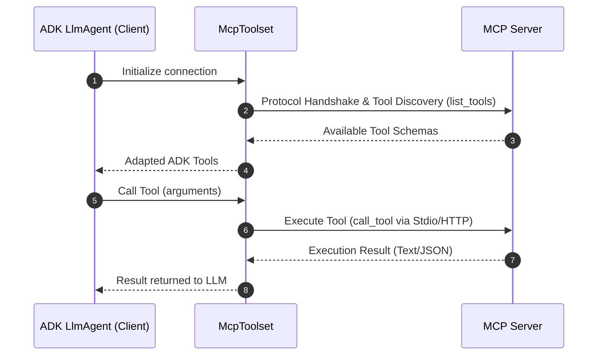

# Google ADK 的 MCP 工具集成

介绍客户端与服务端概念、前提和 McpToolset 接入，以文件系统服务展示本地工具调用方式。

- 来源：Google／Agent Development Kit
- 资料类型：存档文档
- 存档版本：`12712d00d487`。
- 文档时间：源码提交（存档版）：[2026-09-24](<https://github.com/google/adk-docs/commit/b2bf03de977b097338858dd10806b4fe6fa98be3>)；发表/更新：官方未公开；本地归档批次：2026-10-10
- 阅读状态：完整中文机器译文，由 Google 翻译；代码、命令与配置保留原样，未逐句人工校对。

[原文发布页](<https://github.com/google/adk-docs/blob/main/docs/tools-custom/mcp-tools/index.md>) · [原始文件](<../../../../原始抓取备份/原文/官方/Google/Agent Development Kit/docs/tools-custom/mcp-tools/index.md>) · [返回资料总览](<../../../资料总览.md>)

[查看原文对照](#原文对照)

## 中文全文

# Model Context Protocol 工具

<div class="language-support-tag">
 <span class="lst-supported">ADK</span><span class="lst-python">Python v0.1.0</span><span class="lst-typescript">Typescript 支持 v0.2.0</span><span class="lst-go">Go v0.1.0</span><span class="lst-java">Java v0.1.0</span><span class="lst-kotlin">Kotlin v0.1.0</span>
</div>

**Model Context Protocol (MCP)** 是一个开放标准，用于将生成 AI 模型连接到外部数据源、工具和系统。将其视为一种通用连接机制，可简化法学硕士获取上下文、执行操作以及与各种系统交互的方式。

---

## 核心架构和概念

MCP 遵循客户端-服务器架构，定义数据或资源、交互式模板或提示以及可操作功能或工具如何由 MCP 服务器公开并由 MCP 客户端使用，客户端可以是 LLM 主机应用程序或 AI agent。在 ADK 中，您使用 McpToolset 类作为 MCP 服务器和 ADK agents 之间的接口。还可以将 ADK 服务器配置为 MCP 服务器以供其他客户端系统使用。



## 先决条件和设置规则

在开始之前，请确保您已进行以下设置：

- **ADK已安装**：在项目环境中完成标准ADK设置，并附加MCP：`pip install "google-adk[mcp]"`。
- **运行时要求**：Python 3.10+或Java 17+。
- **Node.js 和 `npx`** *（仅限 Python/TS）*：需要运行 npm 打包的社区 MCP 服务器。
- **验证安装**：确认`adk`和`npx`位于激活的虚拟环境中的PATH中：

===“MacOS/Linux”

    ```bash
    # Both commands should print the path to the executables.
    which adk
    which npx
    ```
    
===“Windows PowerShell”

    ```powershell
    # Both commands should print the path to the executables.
    Get-Command adk
    Get-Command npx
    ```
    
！！！警告“部署规则”

Agents部署到生产**必须在`agent.py`中同步定义`McpToolset`**。仅本地调试或自定义独立运行程序支持动态异步 agent 初始化。

---

## 了解用途和集成

存在三种主要的集成模式。本页面介绍了直接集成，
其他实现则在其特定页面中介绍。

1. **直接MCP工具集成**：当ADKagent充当使用`McpToolset`的MCP客户端时。
2. **Agent-公开的MCP服务器**：当您使用`to_mcp_server`构建包装ADK工具的MCP服务器时。
3. **专门子Agent委派**：当agent使用`AgentTool`委派给子agent时。

## MCP 实施选项

当您开始使用 Model Context Protocol (MCP) 和 ADK 进行构建时，这些关键的架构差异将帮助您设计更稳定、更高效的 agents。下表作为比较指南来帮助您构建这些agents。

|尺寸|[**直接MCP工具集成**（`McpToolset`）](<#直接-mcp-工具集成-mcptoolset>)|[**Agent-暴露的MCP服务器**（`to_mcp_server`）](<把 Google ADK Agent 暴露为 MCP 服务.md>)|[**专业子Agent代表团**（`AgentTool`）](<通过子 Agent 管理 Google ADK 的 MCP.md>)|
| :--- | :--- | :--- | :--- |
|**架构**|外部服务器进程或远程服务提供适应主要 `LlmAgent` 工具列表的确定性端点。|自治的 ADK agent 编译成 MCP 服务器，可由外部客户端（Claude Code、IDE、外部主机）调用。|进程内分层 agent 封装，其中父级 agent 调用子级 `LlmAgent` 作为可调用工具。|
|**上下文窗口影响**|**高上下文膨胀**：每个工具定义和原始输出，例如：数据库行或文件 blob，都会进入主 agent 的历史记录。|**隔离**：外部调用者仅收到最终聚合响应text/blocks.|**零上下文膨胀**：中间探索性推理、失败的工具调用和大量原始输出在子agent循环中保持隔离。|
|**AI 模型加载和分层**|单个模型必须同时理解所有工具架构、验证约束和工作流程状态。|独立模型推理专门用于包装任务。|启用 ** 模型分层 **，例如：`gemini-2.5-pro` 用于协调器，`gemini-2.5-flash` 用于使用专用系统指令执行子 agent 工具。|
|**延迟和令牌成本**|**更低的成本和可预测的延迟**：1 LLM轮+ 1确定性工具调用+1响应生成轮。|以客户为导向；延迟取决于内部 agent 执行深度。|**更高的成本和可变延迟**：多个LLM调用，子agent推理在返回父级之前轮流进行。|
|**理想用例**|<ul><li>确定性 API 集成：Postgres、BigQuery、GitHub、Google 地图。</li><li>文件系统操作和静态资源读取。</li><li>重用标准预建社区MCP 服务器。</li></ul>|<ul><li>向外部MCP-兼容的生态系统公开复杂的ADK多agent功能。</li><li>将ADKagents集成到IDE、编辑器或A2A 管道。</li></ul>|<ul><li>需要反复试验的多步骤自主工作流程。例如：代码调试或研究综合。</li><li>需要隔离角色或专门指令的任务。</li><li>使用 >20 工具的场景，其中模式过载会损害准确性。</li></ul>|

！！！注意“状态恢复”

虽然 ADK agents 在生命周期事件期间保留会话状态，但它们在恢复时不会自动重新建立活动的 MCP 连接。 Agents 根据需要重新初始化连接。
   
### 直接 MCP 工具集成 (McpToolset)

`McpToolset`类可以直接添加到你的agent的工具列表中；此类支持与 MCP 服务器的无缝连接、发现其工具并使它们可供您的 agent 使用。初始化时，`McpToolset` 建立并管理与 MCP 服务器的连接。它还可以在 agent 或进程终止时处理正常的连接关闭。
使用 `McpToolset` 将工具从外部 MCP 服务器导入到您的 ADK `LlmAgent`。

#### 示例：本地 Stdio 传输 (FileSystem MCP)

此示例设置一个连接到本地 MCP 文件系统服务器的 ADK agent；它直接在agent的工具列表中实例化McpToolset以启用文件管理功能。

**步骤1**。使用 `McpToolset` 定义您的 agent：

=== "Python"

    ```python
    import os
    from google.adk.agents import LlmAgent
    from google.adk.tools.mcp_tool import McpToolset
    from google.adk.tools.mcp_tool.mcp_session_manager import StdioConnectionParams
    from mcp import StdioServerParameters

    TARGET_FOLDER = os.path.abspath("./accessible_files")

    root_agent = LlmAgent(
        model="gemini-flash-latest",
        name="filesystem_assistant",
        instruction="Help users manage local files.",
        tools=[
            McpToolset(
                connection_params=StdioConnectionParams(
                    server_params=StdioServerParameters(
                        command="npx",
                        args=["-y", "@modelcontextprotocol/server-filesystem", TARGET_FOLDER],
                    ),
                ),
                # Optional: Select specific tools exposed to the agent
                tool_filter=["list_directory", "read_file"],
            )
        ],
    )
    ```
    
**步骤2**：打包并运行Agent，使agent可被ADK发现并开始与其交互，请遵循以下工作流程：
    
      - 启动您的软件包：在与您的agent.py相同的目录中创建一个`__init__.py`文件。 ADK需要此步骤来识别您的agent。
      - 启动网络界面：

        ```bash
        cd ./adk_agent_samples 
        adk web
        ```
    
    - 与【Agent】交互：下拉菜单中选择【`filesystem_assistant`】，提示【Agent】命令：【*】列出当前目录下的文件【*】或【*】的内容是什么another_file.md?*


    ```

=== "TypeScript"

    ```typescript
    import { LlmAgent, MCPToolset } from "@google/adk";
    import path from "path";

    const TARGET_FOLDER = path.resolve("./accessible_files");

    export const rootAgent = new LlmAgent({
        model: "gemini-flash-latest",
        name: "filesystem_assistant",
        instruction: "Help users manage local files.",
        tools: [
            new MCPToolset({
                type: "StdioConnectionParams",
                serverParams: {
                    command: "npx",
                    args: ["-y", "@modelcontextprotocol/server-filesystem", TARGET_FOLDER],
                },
            }, ["list_directory", "read_file"]) // Optional tool filter array
        ],
    });
    ```

=== "Java"

    ```java
    package agents;

    import com.google.adk.agents.LlmAgent;
    import com.google.adk.tools.mcp.McpToolset;
    import com.google.adk.tools.mcp.StdioServerParameters;
    import java.util.List;

    public class FileSystemAgentCreator {
        public static void main(String[] args) throws Exception {
            StdioServerParameters serverParams = StdioServerParameters.builder()
                    .command("npx")
                    .args(List.of("-y", "@modelcontextprotocol/server-filesystem", "/absolute/path/to/folder"))
                    .build();

            try (McpToolset toolset = new McpToolset(serverParams.toServerParameters())) {
                LlmAgent agent = LlmAgent.builder()
                        .model("gemini-flash-latest")
                        .name("filesystem_assistant")
                        .instruction("Help users access their file systems.")
                        .tools(toolset)
                        .build();

                System.out.println("Agent initialized: " + agent.name());
            }
        }
    }
    ```

=== "Go"

    ```go
    package main

    import (
        "context"
        "fmt"
        "os/exec"

        "github.com/modelcontextprotocol/go-sdk/mcp"
        "google.golang.org/adk/v2/agent"
        "google.golang.org/adk/v2/agent/llmagent"
        "google.golang.org/adk/v2/model/gemini"
        "google.golang.org/adk/v2/tool"
        "google.golang.org/adk/v2/tool/mcptoolset"
    )

    func createFilesystemAgent(ctx context.Context) (agent.Agent, error) {
        // 1. Initialize MCP Toolset with CommandTransport and AllowedToolsPredicate
        mcpTools, err := mcptoolset.New(mcptoolset.Config{
            Transport: &mcp.CommandTransport{
                Command: exec.Command("npx", "-y", "@modelcontextprotocol/server-filesystem", "./accessible_files"),
            },
            ToolFilter: tool.AllowedToolsPredicate([]string{"list_directory", "read_file"}),
        })
        if err != nil {
            return nil, fmt.Errorf("failed to create mcp toolset: %w", err)
        }

        // 2. Initialize Gemini model.LLM instance
        llm, err := gemini.NewModel(ctx, "gemini-2.0-flash", nil)
        if err != nil {
            return nil, fmt.Errorf("failed to create gemini model: %w", err)
        }

        // 3. Create the LLM agent returning agent.Agent
        return llmagent.New(llmagent.Config{
            Name:        "filesystem_assistant",
            Model:       llm,
            Instruction: "Help users manage local files.",
            Toolsets:    []tool.Toolset{mcpTools},
        })
    }

    func main() {
        ctx := context.Background()
        ag, err := createFilesystemAgent(ctx)
        if err != nil {
            panic(err)
        }
        fmt.Printf("Successfully created agent: %s\n", ag.Name())
    }
    ```
    
---

#### 示例：远程 HTTP / SSE 传输（Google 地图接地精简版）

在开始之前，请按照 [Google Maps Grounding Lite ](<https://developers.google.com/maps/ai/grounding-lite>) 的说明在您的 Google 云项目上启用该服务并生成您的地图平台 API 密钥。
与之前的本地流程示例不同，此模式将您的 agent 连接到远程，使用服务器发送事件 (SSE) 的云托管 MCP 服务器。它使用 Google Maps Grounding Lite 服务来演示如何将身份验证标头（例如 API 密钥）传递到可扩展端点。

**步骤1**：用`McpToolset`定义您的agent。

=== "Python"

    ```python
    import os
    from google.adk.agents import LlmAgent
    from google.adk.tools.mcp_tool import McpToolset
    from google.adk.tools.mcp_tool.mcp_session_manager import StreamableHTTPConnectionParams
    
    API_KEY = os.getenv("GOOGLE_MAPS_API_KEY")
    
    root_agent = LlmAgent(
        model="gemini-flash-latest",
        name="travel_planner",
        instruction="Plan travel routes and search locations using Google Maps.",
        tools=[
            McpToolset(
                connection_params=StreamableHTTPConnectionParams(
                    url="https://mapstools.googleapis.com/mcp",
                    headers={
                        "X-Goog-Api-Key": API_KEY,
                        "Content-Type": "application/json",
                        "Accept": "application/json, text/event-stream",
                    },
                    timeout=5,
                    sse_read_timeout=300
                )
            )
        ],
    )
    ```
**步骤2**：在运行`adk web`之前设置环境变量，在终端中设置Google API键
      
      ```bash
      export GOOGLE_MAPS_API_KEY="YOUR_ACTUAL_GOOGLE_MAPS_API_KEY"
      ```
      
**步骤 3**：运行 `adk web`：导航到 `mcp_agent` 的父目录并启动 Web 界面。
 **步骤 4**：与UI：
       - 从下拉列表中选择 `travel_planner`。
       - 尝试使用诸如以下的提示：*我明天将在旧金山。天气怎么样*或*查找金门公园附近的咖啡店*
       


=== "TypeScript"

    ```typescript
    import { LlmAgent, MCPToolset } from "@google/adk";

    export const rootAgent = new LlmAgent({
        model: "gemini-flash-latest",
        name: "travel_planner",
        instruction: "Plan travel routes and search locations using Google Maps.",
        tools: [
            new MCPToolset({
                type: "StreamableHTTPConnectionParams",
                url: "https://mapstools.googleapis.com/mcp",
                transportOptions: {
                    requestInit: {
                        headers: {
                            "X-Goog-Api-Key": process.env.GOOGLE_MAPS_API_KEY!,
                            "Content-Type": "application/json",
                            "Accept": "application/json, text/event-stream",
                        },
                    },
                },
                timeout: 5,
                sseReadTimeout: 300,
            }),
        ],
    });
     ``` 
     
---

## 远程MCP身份验证和资源访问

本节向您展示如何使用身份验证连接到远程 MCP 服务器以及如何读取 MCP 服务器公开的数据 ** 资源 **。当 MCP 服务器需要身份验证时，例如通过服务器发送事件 `SseConnectionParams` 或可流式传输 HTTP，`McpToolset` 会自动处理凭证注入和令牌管理。

### 关键认证参数

|参数|类型|描述|
| :--- | :--- | :--- |
| `auth_scheme` | `AuthScheme` |身份验证策略（例如，`Bearer`、`Basic`、`APIKey`、`OAuth2`）。|
| `auth_credential` | `AuthCredential` |秘密凭证有效负载，例如 API 令牌、OAuth 访问令牌、username/password.|

ADK 自动构造所需的 `Authorization` HTTP 标头，并在客户端请求期间管理 OAuth 2.0 令牌刷新。

### 配置身份验证

当 MCP 服务器需要身份验证时，`McpToolset` 自动处理凭证注入和令牌管理。使用本机 `auth_scheme` 和 `auth_credential` 参数，而不是手动注入 HTTP 标头。

*有关常规 ADK 身份验证模式，请参阅我们的 [自定义工具身份验证指南 ](<https://github.com/google/adk-docs/blob/12712d00d48712998f15a2a9d8bd26d708b727a3/docs/tools-custom/authentication.md>)*

=== "Python"

    ```python
    import os
    from google.adk.tools.mcp_tool import McpToolset
    from google.adk.tools.mcp_tool.mcp_session_manager import SseConnectionParams
    
    # Configure Bearer Token Authentication via headers
    toolset = McpToolset(
        connection_params=SseConnectionParams(
            url="https://mcp-server.example.com/sse",
            headers={"Authorization": f"Bearer {os.getenv('MCP_AUTH_TOKEN')}"},
            timeout=5,
        )
    )
    ```

=== "TypeScript"

    ```typescript
    import { MCPToolset } from "@google/adk";
    
    // Configure Bearer Token Authentication via headers
    const toolset = new MCPToolset({
        type: "StreamableHTTPConnectionParams",
        url: "https://mcp-server.example.com/sse",
        transportOptions: {
            requestInit: {
                headers: {
                    "Authorization": `Bearer ${process.env.MCP_AUTH_TOKEN}`,
                },
            },
        },
        timeout: 5,
    });
    
    ```
    
---

## 访问 MCP 资源

除了可执行的 ** 工具 ** 之外，MCP 服务器还可以公开 ** 资源 ** 数据文件、数据库记录或 API 上下文 blob。

`McpToolset`提供了两种核心方法来发现和读取这些数据资源：

### 核心方法

* **`list_resources()`**：返回MCP服务器公开的所有可用数据资源的列表。
* **`read_resource(name)`**：按名称或 URI 检索特定资源的原始内容块、文本或二进制数据。
* **`use_mcp_resources=True`（配置）**：初始化`McpToolset`时，设置此标志会自动为LLM agent配备`LoadMcpResourceTool`。这使得 agent 能够自行动态发现和读取资源，而无需手动编程获取。

#### 尝试一下

=== "Python"

    ```python
      import asyncio
  
      async def fetch_mcp_data(toolset):
          # 1. Discover available resources on the server
          resources = await toolset.list_resources()
          print("Available Resources:", resources)
  
          # 2. Read content from a specific resource
          if resources:
              resource_name = resources[0]
              content_blocks = await toolset.read_resource(name=resource_name)
              print(f"Content of {resource_name}:", content_blocks)
    ```

=== "TypeScript"

    ```typescript
      async function fetchMcpData(toolset: any) {
          // 1. Discover available resources
          const resources = await toolset.listResources();
          console.log("Available Resources:", resources);
  
          // 2. Read a specific resource
          if (resources.length > 0) {
              const content = await toolset.readResource(resources[0]);
              console.log(`Content of ${resources[0]}:`, content);
          }
      }
    ```

---

## 故障排除和最佳实践清单

* **安全和范围界定**：始终在`McpToolset`中提供`tool_filter=[...]`，以便仅向您的LLM公开必要的操作。
* **超时**：在`StdioConnectionParams(timeout=5)`上配置显式超时以防止挂起子进程。
* **生命周期清理**：在非`adk web`运行程序中，调用`await toolset.close()`或使用异步上下文管理器来正常关闭子进程。
* **环境检测**：根据环境变量动态选择连接类型，例如：Cloud Run 的 `K_SERVICE` 与本地开发的 Stdio。

### 配置环境感知连接

```python
import os
from google.adk.tools.mcp_tool import McpToolset
from google.adk.tools.mcp_tool.mcp_session_manager import (
    StdioConnectionParams,
    StreamableHTTPConnectionParams,
)
from mcp import StdioServerParameters

if os.getenv("K_SERVICE"):
  # Running in Production (Cloud Run)
  # Uses Streamable HTTP for stateless scalability and bearer auth headers
  mcp_toolset = McpToolset(
      connection_params=StreamableHTTPConnectionParams(
          url=os.getenv("REMOTE_MCP_URL"),
          headers={"Authorization": f"Bearer {os.getenv('MCP_AUTH_TOKEN')}"},
          timeout=5,
          sse_read_timeout=300,
      )
  )
else:
  # Running in Local Development
  # Uses Stdio Subprocess IPC for zero-network latency testing
  mcp_toolset = McpToolset(
      connection_params=StdioConnectionParams(
          server_params=StdioServerParameters(
              command="npx",
              args=["-y", "@modelcontextprotocol/server-filesystem", "/tmp"],
          ),
          timeout=5,
      )
  )

```

## 更多资源

了解基础知识后，请探索 [高级用例 ](<Google ADK 的高级 MCP 配置.md>) 以实现复杂的实现和自定义集成。


## 原文对照

<details>
<summary>展开完整原文</summary>

# Model Context Protocol tools

<div class="language-support-tag">
  <span class="lst-supported">Supported in ADK</span><span class="lst-python">Python v0.1.0</span><span class="lst-typescript">Typescript v0.2.0</span><span class="lst-go">Go v0.1.0</span><span class="lst-java">Java v0.1.0</span><span class="lst-kotlin">Kotlin v0.1.0</span>
</div>

The **Model Context Protocol (MCP)** is an open standard for connecting generative AI models to external data sources, tools, and systems. Think of it as a universal connection mechanism that simplifies how LLMs obtain context, execute actions, and interact with various systems.

---

## Core architecture and concepts

MCP follows a client-server architecture, defining how data or resources, interactive templates or prompts, and actionable functions or tools are exposed by an MCP server and consumed by an MCP client, which could be an LLM host application or an AI agent. In ADK, you use the McpToolset class as an interface between MCP Servers and ADK agents. It is also possible to configure an ADK server as an MCP server for use by other client systems.


## Prerequisites and setup rules

Before you begin, ensure you have the following set up:

- **ADK Installed**: Complete standard ADK setup in your project environment with the MCP extra: `pip install "google-adk[mcp]"`.
- **Runtime Requirements**: Python 3.10+ or Java 17+.
- **Node.js & `npx`** *(Python/TS only)*: Required to run npm-packaged community MCP servers.
- **Verify installations**: Confirm `adk` and `npx` are in your PATH in the activated virtual environment:

=== "MacOS / Linux"

    ```bash
    # Both commands should print the path to the executables.
    which adk
    which npx
    ```
    
=== "Windows PowerShell"

    ```powershell
    # Both commands should print the path to the executables.
    Get-Command adk
    Get-Command npx
    ```
    
!!! warning "Deployment rule"

    Agents deployed to production **must define `McpToolset` synchronously** in `agent.py`. Dynamic asynchronous agent initialization is only supported for local debugging or custom standalone runners.

---

## Understand uses and integrations

There are three main integration patterns. The direct integration is covered in this page and
the other implementations are covered in their specific pages.

1. **Direct MCP Tool Integration**: When an ADK agent acts as an MCP client using `McpToolset`.
2. **Agent-Exposed MCP Server**: When you build an MCP server that wraps ADK Tools using `to_mcp_server`.
3. **Specialized Sub-Agent Delegation**: When an agent delegates to a sub-agent using `AgentTool`.

## MCP Implementation options

 When you start building with the Model Context Protocol (MCP) and ADK, these key architectural differences will help you design more stable and efficient agents. The following table works as a comparative guide to help you construct those agents.

| Dimension | [**Direct MCP Tool Integration** (`McpToolset`)](<#direct-mcp-tool-integration-mcptoolset>) | [**Agent-Exposed MCP Server** (`to_mcp_server`)](<把 Google ADK Agent 暴露为 MCP 服务.md>) | [**Specialized Sub-Agent Delegation** (`AgentTool`)](<通过子 Agent 管理 Google ADK 的 MCP.md>) |
| :--- | :--- | :--- | :--- |
| **Architecture** | External server process or remote service providing deterministic endpoints adapted into the primary `LlmAgent` tool list. | An autonomous ADK agent compiled into an MCP server, callable by external clients (Claude Code, IDEs, external hosts). | In-process, hierarchical agent encapsulation where a parent agent invokes a child `LlmAgent` as a callable tool. |
| **Context Window Impact** | **High Context Bloat**: Every tool definition and raw output, for example: database rows or file blobs, enters the primary agent's history. | **Isolated**: The external caller only receives the final aggregated response text/blocks. | **Zero Context Bloat**: Intermediate exploratory reasoning, failed tool calls, and large raw outputs remain isolated in the sub-agent loop. |
| **AI Model Load and Tiering** | Single model must understand all tool schemas, validation constraints, and workflow state simultaneously. | Independent model reasoning dedicated solely to the wrapped task. | Enables **model tiering**, for example: `gemini-2.5-pro` for orchestrator, and `gemini-2.5-flash` for sub-agent tool execution with dedicated system instructions. |
| **Latency & Token Cost** | **Lower Cost & Predictable Latency**: 1 LLM turn + 1 deterministic tool invocation + 1 response generation turn. | Client-driven; latency depends on internal agent execution depth. | **Higher Cost & Variable Latency**: Multiple LLM calls, sub-agent reasoning turns before returning to parent. |
| **Ideal Use Cases** | <ul><li>Deterministic API integrations: Postgres, BigQuery, GitHub, Google Maps.</li><li>File system operations & static resource reading.</li><li>Reusing standard pre-built community MCP servers.</li></ul> | <ul><li>Exposing complex ADK multi-agent capabilities to external MCP-compliant ecosystems.</li><li>Integrating ADK agents into IDEs, editors, or A2A pipelines.</li></ul> | <ul><li>Multi-step autonomous workflows requiring trial-and-error. For example: code debugging or research synthesis.</li><li>Tasks needing isolated personas or specialized instructions.</li><li>Scenarios with >20 tools where schema overload harms accuracy.</li></ul> |

!!! note "State restoration"

    While ADK agents preserve session state during lifecycle events, they do not automatically re-establish active MCP connections upon restoration. Agents re-initialize connections as needed.
   
### Direct MCP Tool integration (McpToolset)

The `McpToolset` class can be directly added to your agent's tools list; this class enables seamless connection to an MCP server, discovery of its tools, and making them available for your agent to use. On initialization, `McpToolset` establishes and manages the connection to the MCP server. It also handles graceful connection shutdown when the agent or process terminates.
Use `McpToolset` to import tools from an external MCP server into your ADK `LlmAgent`.

#### Example: Local Stdio Transport (FileSystem MCP)

This example sets up an ADK agent that connects to a local MCP file system server; it instantiates the McpToolset directly within the agent's tools list to enable file management capabilities.

**Step 1**. Define your agent with `McpToolset`:

=== "Python"

    ```python
    import os
    from google.adk.agents import LlmAgent
    from google.adk.tools.mcp_tool import McpToolset
    from google.adk.tools.mcp_tool.mcp_session_manager import StdioConnectionParams
    from mcp import StdioServerParameters

    TARGET_FOLDER = os.path.abspath("./accessible_files")

    root_agent = LlmAgent(
        model="gemini-flash-latest",
        name="filesystem_assistant",
        instruction="Help users manage local files.",
        tools=[
            McpToolset(
                connection_params=StdioConnectionParams(
                    server_params=StdioServerParameters(
                        command="npx",
                        args=["-y", "@modelcontextprotocol/server-filesystem", TARGET_FOLDER],
                    ),
                ),
                # Optional: Select specific tools exposed to the agent
                tool_filter=["list_directory", "read_file"],
            )
        ],
    )
    ```
    
    **Step 2**: Package and Run your Agent to make your agent discoverable to ADK and start interacting with it, follow this workflow:
    
      - Initiate your package: Create an `__init__.py` file in the same directory as your agent.py. This step is required for ADK to recognize your agent.
      - Launch the Web Interface:

        ```bash
        cd ./adk_agent_samples 
        adk web
        ```
    
    - Interact with the Agent: select `filesystem_assistant` from the drop-down menu and prompt the Agent with commands: *List files in the current directory* or *What is the content of another_file.md?*

    
    ```

=== "TypeScript"

    ```typescript
    import { LlmAgent, MCPToolset } from "@google/adk";
    import path from "path";

    const TARGET_FOLDER = path.resolve("./accessible_files");

    export const rootAgent = new LlmAgent({
        model: "gemini-flash-latest",
        name: "filesystem_assistant",
        instruction: "Help users manage local files.",
        tools: [
            new MCPToolset({
                type: "StdioConnectionParams",
                serverParams: {
                    command: "npx",
                    args: ["-y", "@modelcontextprotocol/server-filesystem", TARGET_FOLDER],
                },
            }, ["list_directory", "read_file"]) // Optional tool filter array
        ],
    });
    ```

=== "Java"

    ```java
    package agents;

    import com.google.adk.agents.LlmAgent;
    import com.google.adk.tools.mcp.McpToolset;
    import com.google.adk.tools.mcp.StdioServerParameters;
    import java.util.List;

    public class FileSystemAgentCreator {
        public static void main(String[] args) throws Exception {
            StdioServerParameters serverParams = StdioServerParameters.builder()
                    .command("npx")
                    .args(List.of("-y", "@modelcontextprotocol/server-filesystem", "/absolute/path/to/folder"))
                    .build();

            try (McpToolset toolset = new McpToolset(serverParams.toServerParameters())) {
                LlmAgent agent = LlmAgent.builder()
                        .model("gemini-flash-latest")
                        .name("filesystem_assistant")
                        .instruction("Help users access their file systems.")
                        .tools(toolset)
                        .build();

                System.out.println("Agent initialized: " + agent.name());
            }
        }
    }
    ```

=== "Go"

    ```go
    package main

    import (
        "context"
        "fmt"
        "os/exec"

        "github.com/modelcontextprotocol/go-sdk/mcp"
        "google.golang.org/adk/v2/agent"
        "google.golang.org/adk/v2/agent/llmagent"
        "google.golang.org/adk/v2/model/gemini"
        "google.golang.org/adk/v2/tool"
        "google.golang.org/adk/v2/tool/mcptoolset"
    )

    func createFilesystemAgent(ctx context.Context) (agent.Agent, error) {
        // 1. Initialize MCP Toolset with CommandTransport and AllowedToolsPredicate
        mcpTools, err := mcptoolset.New(mcptoolset.Config{
            Transport: &mcp.CommandTransport{
                Command: exec.Command("npx", "-y", "@modelcontextprotocol/server-filesystem", "./accessible_files"),
            },
            ToolFilter: tool.AllowedToolsPredicate([]string{"list_directory", "read_file"}),
        })
        if err != nil {
            return nil, fmt.Errorf("failed to create mcp toolset: %w", err)
        }

        // 2. Initialize Gemini model.LLM instance
        llm, err := gemini.NewModel(ctx, "gemini-2.0-flash", nil)
        if err != nil {
            return nil, fmt.Errorf("failed to create gemini model: %w", err)
        }

        // 3. Create the LLM agent returning agent.Agent
        return llmagent.New(llmagent.Config{
            Name:        "filesystem_assistant",
            Model:       llm,
            Instruction: "Help users manage local files.",
            Toolsets:    []tool.Toolset{mcpTools},
        })
    }

    func main() {
        ctx := context.Background()
        ag, err := createFilesystemAgent(ctx)
        if err != nil {
            panic(err)
        }
        fmt.Printf("Successfully created agent: %s\n", ag.Name())
    }
    ```
    
---

#### Example: Remote HTTP / SSE Transport (Google Maps Grounding Lite)

Before starting, follow the instructions for [Google Maps Grounding Lite](<https://developers.google.com/maps/ai/grounding-lite>) to enable the service on your Google Cloud project and generate your Maps Platform API Key.
Unlike the previous local process example, this pattern connects your agent to a remote, cloud-hosted MCP server using Server-Sent Events (SSE). It uses the Google Maps Grounding Lite service to demonstrate how to pass authentication headers, such as an API key, to a scalable endpoint.

**Step 1**: Define your agent with `McpToolset`.

=== "Python"

    ```python
    import os
    from google.adk.agents import LlmAgent
    from google.adk.tools.mcp_tool import McpToolset
    from google.adk.tools.mcp_tool.mcp_session_manager import StreamableHTTPConnectionParams
    
    API_KEY = os.getenv("GOOGLE_MAPS_API_KEY")
    
    root_agent = LlmAgent(
        model="gemini-flash-latest",
        name="travel_planner",
        instruction="Plan travel routes and search locations using Google Maps.",
        tools=[
            McpToolset(
                connection_params=StreamableHTTPConnectionParams(
                    url="https://mapstools.googleapis.com/mcp",
                    headers={
                        "X-Goog-Api-Key": API_KEY,
                        "Content-Type": "application/json",
                        "Accept": "application/json, text/event-stream",
                    },
                    timeout=5,
                    sse_read_timeout=300
                )
            )
        ],
    )
    ```
    **Step 2**: Set environment variable before running `adk web`, set you Google API key in your terminal
      
      ```bash
      export GOOGLE_MAPS_API_KEY="YOUR_ACTUAL_GOOGLE_MAPS_API_KEY"
      ```
      
     **Step 3**: Run `adk web`: Navigate to the parent directory of `mcp_agent` and launch the web Interface.
     **Step 4**: Interact with the UI:
       - Select `travel_planner` from the drop-down.
       - Try prompts such as: *I will be in San Francisco tomorrow. What's the weather like* or *Find coffee shops near Golden Gate Park*
       
     

=== "TypeScript"

    ```typescript
    import { LlmAgent, MCPToolset } from "@google/adk";

    export const rootAgent = new LlmAgent({
        model: "gemini-flash-latest",
        name: "travel_planner",
        instruction: "Plan travel routes and search locations using Google Maps.",
        tools: [
            new MCPToolset({
                type: "StreamableHTTPConnectionParams",
                url: "https://mapstools.googleapis.com/mcp",
                transportOptions: {
                    requestInit: {
                        headers: {
                            "X-Goog-Api-Key": process.env.GOOGLE_MAPS_API_KEY!,
                            "Content-Type": "application/json",
                            "Accept": "application/json, text/event-stream",
                        },
                    },
                },
                timeout: 5,
                sseReadTimeout: 300,
            }),
        ],
    });
     ``` 
     
---

## Remote MCP Authentication and resource access

This section shows you how to connect to remote MCP servers using authentication and how to read data **Resources** exposed by an MCP server. When an MCP server requires authentication, such as over Server-Sent Events `SseConnectionParams` or Streamable HTTP, `McpToolset` handles credential injection and token management automatically.

### Key authentication parameters

| Parameter | Type | Description |
| :--- | :--- | :--- |
| `auth_scheme` | `AuthScheme` | The authentication strategy (e.g., `Bearer`, `Basic`, `APIKey`, `OAuth2`). |
| `auth_credential` | `AuthCredential` | The secret credential payload, for example, API token, OAuth access token, username/password. |

ADK automatically constructs the required `Authorization` HTTP headers and manages OAuth 2.0 token refreshes during client requests.

### Configure authentication

When an MCP server requires authentication, `McpToolset` handles credential injection and token management automatically. Use the native `auth_scheme` and `auth_credential` parameters rather than manually injecting HTTP headers.

*For general ADK authentication patterns, see our [Custom Tools Authentication Guide](<https://github.com/google/adk-docs/blob/12712d00d48712998f15a2a9d8bd26d708b727a3/docs/tools-custom/authentication.md>)*

=== "Python"

    ```python
    import os
    from google.adk.tools.mcp_tool import McpToolset
    from google.adk.tools.mcp_tool.mcp_session_manager import SseConnectionParams
    
    # Configure Bearer Token Authentication via headers
    toolset = McpToolset(
        connection_params=SseConnectionParams(
            url="https://mcp-server.example.com/sse",
            headers={"Authorization": f"Bearer {os.getenv('MCP_AUTH_TOKEN')}"},
            timeout=5,
        )
    )
    ```

=== "TypeScript"

    ```typescript
    import { MCPToolset } from "@google/adk";
    
    // Configure Bearer Token Authentication via headers
    const toolset = new MCPToolset({
        type: "StreamableHTTPConnectionParams",
        url: "https://mcp-server.example.com/sse",
        transportOptions: {
            requestInit: {
                headers: {
                    "Authorization": `Bearer ${process.env.MCP_AUTH_TOKEN}`,
                },
            },
        },
        timeout: 5,
    });
    
    ```
    
---

## Accessing MCP Resources

In addition to executable **Tools**, MCP servers can expose **Resources** data files, database records, or API context blobs.

`McpToolset` provides two core methods to discover and read these data resources:

### Core Methods

* **`list_resources()`**: Returns a list of all available data resources exposed by the MCP server.
* **`read_resource(name)`**: Retrieves the raw content blocks, text or binary data, for a specific resource by its name or URI.
* **`use_mcp_resources=True` (Configuration)**: When initializing `McpToolset`, setting this flag automatically equips the LLM agent with the `LoadMcpResourceTool`. This allows the agent to dynamically discover and read resources on its own without requiring manual programmatic fetching.

#### Try it out

=== "Python"

    ```python
      import asyncio
  
      async def fetch_mcp_data(toolset):
          # 1. Discover available resources on the server
          resources = await toolset.list_resources()
          print("Available Resources:", resources)
  
          # 2. Read content from a specific resource
          if resources:
              resource_name = resources[0]
              content_blocks = await toolset.read_resource(name=resource_name)
              print(f"Content of {resource_name}:", content_blocks)
    ```

=== "TypeScript"

    ```typescript
      async function fetchMcpData(toolset: any) {
          // 1. Discover available resources
          const resources = await toolset.listResources();
          console.log("Available Resources:", resources);
  
          // 2. Read a specific resource
          if (resources.length > 0) {
              const content = await toolset.readResource(resources[0]);
              console.log(`Content of ${resources[0]}:`, content);
          }
      }
    ```

---

## Troubleshooting & Best Practices Checklist

* **Security & Scoping**: Always supply `tool_filter=[...]` in `McpToolset` to expose only necessary actions to your LLM.
* **Timeouts**: Configure explicit timeouts on `StdioConnectionParams(timeout=5)` to prevent hanging subprocesses.
* **Lifecycle Cleanup**: In non-`adk web` runners, invoke `await toolset.close()` or use async context managers to gracefully shutdown subprocesses.
* **Environment Detection**: Dynamically pick connection types based on environment variables, for example: `K_SERVICE` for Cloud Run vs Stdio for local dev.

### Configure the environment-aware connection

```python
import os
from google.adk.tools.mcp_tool import McpToolset
from google.adk.tools.mcp_tool.mcp_session_manager import (
    StdioConnectionParams,
    StreamableHTTPConnectionParams,
)
from mcp import StdioServerParameters

if os.getenv("K_SERVICE"):
  # Running in Production (Cloud Run)
  # Uses Streamable HTTP for stateless scalability and bearer auth headers
  mcp_toolset = McpToolset(
      connection_params=StreamableHTTPConnectionParams(
          url=os.getenv("REMOTE_MCP_URL"),
          headers={"Authorization": f"Bearer {os.getenv('MCP_AUTH_TOKEN')}"},
          timeout=5,
          sse_read_timeout=300,
      )
  )
else:
  # Running in Local Development
  # Uses Stdio Subprocess IPC for zero-network latency testing
  mcp_toolset = McpToolset(
      connection_params=StdioConnectionParams(
          server_params=StdioServerParameters(
              command="npx",
              args=["-y", "@modelcontextprotocol/server-filesystem", "/tmp"],
          ),
          timeout=5,
      )
  )

```

## Further resources

Once you understand the basics, explore [Advanced use cases](<Google ADK 的高级 MCP 配置.md>) for complex implementations and custom integrations.


</details>
