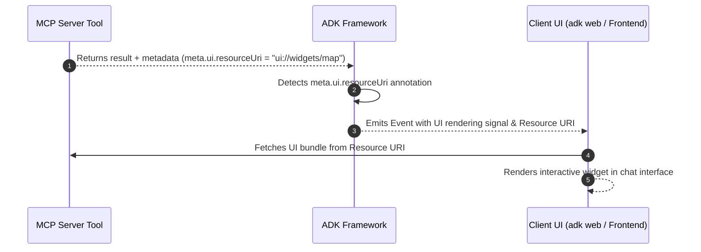

# Google ADK 的高级 MCP 配置

介绍按用户认证、人工审批、进度跟踪、命名空间、日志及交互组件等集成模式；属于 Agent 应用工程参考。

- 来源：Google／Agent Development Kit
- 资料类型：存档文档
- 存档版本：`12712d00d487`。
- 文档时间：源码提交（存档版）：[2026-09-24](<https://github.com/google/adk-docs/commit/b2bf03de977b097338858dd10806b4fe6fa98be3>)；发表/更新：官方未公开；本地归档批次：2026-10-10
- 阅读状态：完整中文机器译文，由 Google 翻译；代码、命令与配置保留原样，未逐句人工校对。

[原文发布页](<https://github.com/google/adk-docs/blob/main/docs/tools-custom/mcp-tools/advanced.md>) · [原始文件](<../../../../原始抓取备份/原文/官方/Google/Agent Development Kit/docs/tools-custom/mcp-tools/Google ADK 的高级 MCP 配置.md>) · [返回资料总览](<../../../资料总览.md>)

[查看原文对照](#原文对照)

## 中文全文

# 高级MCP配置

<div class="language-support-tag">
 <span class="lst-supported">ADK</span><span class="lst-python">Python v0.1.0</span>
</div> 支持

本指南介绍了 ADK 中 Model Context Protocol (MCP) 的高级集成模式。它提供了动态每用户身份验证、人机交互批准、长期运行进度跟踪、自定义运行时执行和企业云部署的生产模式。

## 高级配置模式

使用下面的矩阵为您的生产工作负载选择正确的配置机制：

|开发者要求|推荐机制|主要 API / 参数|典型场景|
| :--- | :--- | :--- | :--- |
|**注入每用户凭据或动态会话令牌**|动态标头提供者| `header_provider=...` |多租户应用程序，每用户 JWTs/OAuth 令牌|
|**危险工具调用之前需要批准**|工具确认| `require_confirmation=...` |数据库突变，破坏性 shell/file 操作|
|**长时间操作的流实时进度**|进度回调和工厂| `progress_callback=...` |大量 SQL 查询、网络抓取、数据索引|
|**在FastAPI中运行agents/没有`adk web`**的后端服务|程序化跑步者生命周期| `Runner` + `await toolset.close()` |自定义微服务、CLI 工具、工作队列|
|**解决跨服务器的工具命名冲突**|工具命名空间和过滤| `tool_name_prefix`, `tool_filter` |聚合多个MCP服务器（DB + GitHub）|
|**处理服务器请求的采样或身份验证挑战**|双向协议回调| `sampling_callback`, `elicitation_callback` |服务器启动的 LLM 生成和身份验证提示|
|**检查原始STDERR诊断流**|诊断流记录| `errlog=sys.stderr` |对 MCP 子进程崩溃进行故障排除|
|**在聊天中呈现丰富的交互式视觉小部件**|实验 UI 渲染| `meta.ui.resourceUri` |地图、图表、天气卡或自定义表格|

---

## 动态身份验证和每用户标头 (`header_provider`)

在多租户或面向用户的系统中，将凭据硬编码到连接参数中是不安全的。 `McpToolset` 支持 `header_provider`，这是一个异步或同步可调用函数，它接收活动的 `ReadonlyContext` 以在每次工具调用时动态构造身份验证标头。

```python
from google.adk.agents import LlmAgent
from google.adk.agents.readonly_context import ReadonlyContext
from google.adk.tools.mcp_tool import McpToolset, StreamableHTTPConnectionParams

async def extract_per_user_headers(context: ReadonlyContext) -> dict[str, str]:
    """Dynamically extracts session state or per-user token on every turn."""
    user_token = context.state.get("user_access_token", "ANONYMOUS_TOKEN")
    return {
        "Authorization": f"Bearer {user_token}",
        "X-User-ID": context.user_id,
        "X-Session-ID": context.session.id,  # Fixed: access session.id
    }

toolset = McpToolset(
    connection_params=StreamableHTTPConnectionParams(
        url="https://mcp-server.example.com/mcp",
        timeout=5,
        sse_read_timeout=300,
    ),
    header_provider=extract_per_user_headers,
)
```

---

## 人机交互和工具确认 (`require_confirmation`)

MCP 服务器可以公开高影响力的功能，例如：数据库架构修改或记录删除。您可以在工具集中的所有工具中全局强制确认，或者通过检查工具参数的谓词函数有条件地强制确认。

```python
from typing import Any
from google.adk.agents import LlmAgent
from google.adk.tools.mcp_tool import McpToolset
from google.adk.tools.mcp_tool.mcp_session_manager import StdioConnectionParams
from mcp import StdioServerParameters

def should_require_approval(query: str = "", **kwargs) -> bool:
    query_str = str(query).lower()
    destructive_keywords = ["drop", "delete", "truncate", "alter", "update"]
    return any(keyword in query_str for keyword in destructive_keywords)

toolset = McpToolset(
    connection_params=StdioConnectionParams(
        server_params=StdioServerParameters(
            command="npx",
            args=["-y", "@modelcontextprotocol/server-postgres", "postgresql://localhost/db"],
        ),
        timeout=5,
    ),
    require_confirmation=should_require_approval,  # Can also be a boolean (True)
)

root_agent = LlmAgent(
    model="gemini-flash-latest",
    name="db_administrator",
    instruction="Execute database queries safely with explicit approval for mutations.",
    tools=[toolset],
)
```

---

## 实时进度跟踪（`progress_callback`）

长时间运行的 MCP 操作（例如抓取大型网站或训练作业）会通过 `notifications/progress` 通道发送中间进度通知。

### 选项A：全局回调函数
为简单的日志记录或进度报告分配共享回调：

```python
async def on_mcp_progress(progress: float, total: float | None, message: str | None) -> None:
    percentage = (progress / total * 100) if total else progress
    print(f"[MCP Progress] {percentage:.1f}% complete: {message or 'Working...'}")

toolset = McpToolset(
    connection_params=...,
    progress_callback=on_mcp_progress,
)
```

### 选项 B：每个工具回调工厂（会话感知）
使用 `ProgressCallbackFactory` 注入具有对 `ToolContext.state` 写访问权限的工具特定回调：

```python
from google.adk.tools.tool_context import ToolContext

def create_tool_progress_tracker(tool_name: str, callback_context: ToolContext, **kwargs):
    """Generates custom progress handlers and updates active agent session state."""
    async def progress_handler(progress: float, total: float | None, message: str | None):
        callback_context.state[f"{tool_name}_status"] = message
        callback_context.state[f"{tool_name}_progress"] = progress
    return progress_handler

toolset = McpToolset(
    connection_params=...,
    progress_callback=create_tool_progress_tracker,
)
```

---

## 独立运行程序执行（外部 `adk web`）

将 ADK agents 嵌入自定义 FastAPI 应用程序、后台工作人员或独立 CLI 脚本时，实例化 `Runner` 并通过 `await toolset.close()` 显式管理生命周期拆卸。

```python
import asyncio
import os
from google.genai import types
from google.adk.agents import LlmAgent
from google.adk.runners import Runner
from google.adk.sessions import InMemorySessionService
from google.adk.tools.mcp_tool import McpToolset
from google.adk.tools.mcp_tool.mcp_session_manager import StdioConnectionParams
from mcp import StdioServerParameters

async def run_standalone_mcp_agent():
    # 1. Define McpToolset and Agent synchronously
    toolset = McpToolset(
        connection_params=StdioConnectionParams(
            server_params=StdioServerParameters(
                command="npx",
                args=["-y", "@modelcontextprotocol/server-filesystem", os.path.abspath("./data")],
            ),
            timeout=5,
        ),
        tool_filter=["list_directory", "read_file"],
    )

    agent = LlmAgent(
        model="gemini-flash-latest",
        name="filesystem_assistant",
        instruction="Assist users with file management.",
        tools=[toolset],
    )

    # 2. Setup Session and Runner
    session_service = InMemorySessionService()
    session = await session_service.create_session(
        app_name="standalone_mcp_app",
        user_id="user_001",
    )

    runner = Runner(
        app_name="standalone_mcp_app",
        agent=agent,
        session_service=session_service,
    )

    try:
        # 3. Stream agent execution
        user_message = types.Content(
            role="user",
            parts=[types.Part(text="List the files available in the directory.")],
        )

        async for event in runner.run_async(
            session_id=session.id,
            user_id=session.user_id,
            new_message=user_message,
        ):
            if event.content and event.content.parts:
                for part in event.content.parts:
                    if part.text:
                        print(part.text, end="", flush=True)
    finally:
        # 4. Gracefully terminate subprocesses and network connections
        print("\nTerminating MCP connection...")
        await toolset.close()

if __name__ == "__main__":
    asyncio.run(run_standalone_mcp_agent())
```

---

## 名称冲突和工具命名空间 (`tool_name_prefix`)

当您连接到多个 MCP 服务器时，工具名称（例如 `query` 或 `search`）可能会发生冲突。使用 `tool_name_prefix` 自动命名空间发现工具：

```python
from google.adk.tools.mcp_tool import McpToolset
from google.adk.tools.mcp_tool.mcp_session_manager import StdioConnectionParams
from mcp import StdioServerParameters

postgres_toolset = McpToolset(
    connection_params=StdioConnectionParams(
        server_params=StdioServerParameters(
            command="npx",
            args=["-y", "@modelcontextprotocol/server-postgres", "postgresql://localhost/db"],
        )
    ),
    tool_name_prefix="pg_",  # Generates pg_query, pg_list_tables
)

github_toolset = McpToolset(
    connection_params=StdioConnectionParams(
        server_params=StdioServerParameters(
            command="npx",
            args=["-y", "@modelcontextprotocol/server-github"],
        )
    ),
    tool_name_prefix="gh_",  # Generates gh_search_repositories, gh_create_issue
)
```

---

## 双向协议挂钩：采样和启发

Model Context Protocol 支持双向交互，服务器可以向客户端请求操作：
- **采样（`sampling_callback`）**：允许MCP服务器要求ADK主机生成LLM完成。
- **诱导 (`elicitation_callback`)**：允许 MCP 服务器请求带外用户交互或身份验证流。

```python
from mcp import SamplingCapability
from google.adk.tools.mcp_tool import McpToolset

async def handle_server_sampling(params):
    """Processes server-initiated LLM generation requests."""
    return {
        "role": "assistant",
        "content": {"type": "text", "text": "Generated response from ADK"},
    }

async def handle_server_elicitation(params):
    """Handles authentication or interactive challenges from the server."""
    print(f"Elicitation requested: {params}")
    return {"action": "approved"}

toolset = McpToolset(
    connection_params=...,
    sampling_callback=handle_server_sampling,
    sampling_capabilities=SamplingCapability(),
    elicitation_callback=handle_server_elicitation,
)
```

---

## 诊断日志记录和错误流 (`errlog`)

默认情况下，MCP 子进程错误会记录到标准错误中。您可以将 STDERR 流重定向到外部文件或诊断缓冲区以进行根本原因调试：

```python
import sys
from google.adk.tools.mcp_tool import McpToolset

error_file = open("mcp_server_errors.log", "a")
try:
    toolset = McpToolset(connection_params=..., errlog=error_file)
    # Run agent...
finally:
    await toolset.close()
    error_file.close()
```

## 渲染交互式 UI 小部件

标准 MCP 工具返回纯文本或 JSON 输出。此功能使 MCP 工具能够直接在聊天界面内返回丰富的交互式视觉小部件，例如地图、图表或表单。



### 它是如何运作的

1. **工具注册**：MCP工具在`tools/list`：`meta.ui.resourceUri = "ui://widgets/weather-card"`期间在其架构定义元数据中声明UI资源链接。
2. **ADK 检测**：ADK 读取架构定义来检测`meta.ui.resourceUri`，并知道此工具支持交互式UI。
3. **客户端显示**：工具执行时，ADK向网络UI（`adk web`或自定义前端）发出信号以获取UI资源并呈现交互式小部件而不是纯文本。


```python
from mcp import types as mcp_types
from mcp.server.lowlevel import Server

app = Server("weather-mcp-server")


@app.list_tools()
async def list_mcp_tools() -> list[mcp_types.Tool]:
  """Declares the tool and attaches UI rendering metadata."""
  return [
      mcp_types.Tool(
          name="get_weather",
          description="Get weather forecast for a city.",
          inputSchema={
              "type": "object",
              "properties": {"city": {"type": "string"}},
              "required": ["city"],
          },
          meta={"ui": {"resourceUri": "ui://widgets/weather-card"}},
      )
  ]


@app.call_tool()
async def call_mcp_tool(name: str, arguments: dict) -> list[mcp_types.Content]:
  """Executes the tool and returns standard text/data content."""
  if name == "get_weather":
    city = arguments.get("city", "Unknown")
    return [
        mcp_types.TextContent(
            type="text", text=f"Weather in {city}: 72°F Sunny"
        )
    ]
  return [
      mcp_types.TextContent(type="text", text=f"Unknown tool: '{name}'")
  ]

``` 

---

## 下一步

* 返回[Model Context Protocol概述](<Google ADK 的 MCP 工具集成.md>)进行基本设置。
* 探索 [ 自定义功能工具 ](<https://github.com/google/adk-docs/blob/12712d00d48712998f15a2a9d8bd26d708b727a3/docs/tools-custom/function-tools.md>) 以获取进程内 Python 工具。
* 请阅读 [ADK 部署指南 ](<https://github.com/google/adk-docs/blob/12712d00d48712998f15a2a9d8bd26d708b727a3/docs/deploy/index.md>) 了解完整的云配置选项。


## 原文对照

<details>
<summary>展开完整原文</summary>

# Advanced MCP configuration

<div class="language-support-tag">
  <span class="lst-supported">Supported in ADK</span><span class="lst-python">Python v0.1.0</span>
</div>

This guide covers advanced integration patterns for the Model Context Protocol (MCP) in ADK. It provides production patterns for dynamic per-user authentication, human-in-the-loop approvals, long-running progress tracking, custom runtime execution, and enterprise cloud deployments.

## Advanced configuration patterns

Use the matrix below to select the right configuration mechanism for your production workload:

| Developer Requirement | Recommended Mechanism | Primary API / Parameter | Typical Scenario |
| :--- | :--- | :--- | :--- |
| **Inject per-user credentials or dynamic session tokens** | Dynamic Header Provider | `header_provider=...` | Multi-tenant apps, per-user JWTs/OAuth tokens |
| **Require approval before dangerous tool calls** | Tool Confirmation | `require_confirmation=...` | Database mutations, destructive shell/file ops |
| **Stream real-time progress for long operations** | Progress Callback & Factory | `progress_callback=...` | Heavy SQL queries, web scraping, data indexing |
| **Run agents in FastAPI / backend services without `adk web`** | Programmatic Runner Lifecycle | `Runner` + `await toolset.close()` | Custom microservices, CLI tools, worker queues |
| **Resolve tool naming collisions across servers** | Tool Namespacing & Filtering | `tool_name_prefix`, `tool_filter` | Aggregating multiple MCP servers (DB + GitHub) |
| **Handle server-requested sampling or auth challenges** | Bi-directional Protocol Callbacks | `sampling_callback`, `elicitation_callback` | Server-initiated LLM generation & auth prompts |
| **Inspect raw STDERR diagnostic streams** | Diagnostic Stream Logging | `errlog=sys.stderr` | Troubleshooting MCP subprocess crashes |
| **Render rich, interactive visual widgets in chat** | Experimental UI Rendering | `meta.ui.resourceUri` | Maps, charts, weather cards, or custom forms |

---

## Dynamic authentication and per-user headers (`header_provider`)

In multi-tenant or user-facing systems, hardcoding credentials into connection parameters is insecure. `McpToolset` supports `header_provider`, an asynchronous or synchronous callable that receives the active `ReadonlyContext` to dynamically construct authentication headers on every tool invocation.

```python
from google.adk.agents import LlmAgent
from google.adk.agents.readonly_context import ReadonlyContext
from google.adk.tools.mcp_tool import McpToolset, StreamableHTTPConnectionParams

async def extract_per_user_headers(context: ReadonlyContext) -> dict[str, str]:
    """Dynamically extracts session state or per-user token on every turn."""
    user_token = context.state.get("user_access_token", "ANONYMOUS_TOKEN")
    return {
        "Authorization": f"Bearer {user_token}",
        "X-User-ID": context.user_id,
        "X-Session-ID": context.session.id,  # Fixed: access session.id
    }

toolset = McpToolset(
    connection_params=StreamableHTTPConnectionParams(
        url="https://mcp-server.example.com/mcp",
        timeout=5,
        sse_read_timeout=300,
    ),
    header_provider=extract_per_user_headers,
)
```

---

## Human-in-the-loop and tool confirmations (`require_confirmation`)

MCP servers can expose high-impact capabilities, for example: database schema modifications or record deletions. You can enforce confirmation globally across all tools in the toolset or conditionally via a predicate function that inspects tool arguments.

```python
from typing import Any
from google.adk.agents import LlmAgent
from google.adk.tools.mcp_tool import McpToolset
from google.adk.tools.mcp_tool.mcp_session_manager import StdioConnectionParams
from mcp import StdioServerParameters

def should_require_approval(query: str = "", **kwargs) -> bool:
    query_str = str(query).lower()
    destructive_keywords = ["drop", "delete", "truncate", "alter", "update"]
    return any(keyword in query_str for keyword in destructive_keywords)

toolset = McpToolset(
    connection_params=StdioConnectionParams(
        server_params=StdioServerParameters(
            command="npx",
            args=["-y", "@modelcontextprotocol/server-postgres", "postgresql://localhost/db"],
        ),
        timeout=5,
    ),
    require_confirmation=should_require_approval,  # Can also be a boolean (True)
)

root_agent = LlmAgent(
    model="gemini-flash-latest",
    name="db_administrator",
    instruction="Execute database queries safely with explicit approval for mutations.",
    tools=[toolset],
)
```

---

## Real-time progress tracking (`progress_callback`)

Long-running MCP operations, such as scraping large websites or training jobs, send intermediate progress notifications over the `notifications/progress` channel.

### Option A: Global callback function
Assign a shared callback for simple logging or progress reporting:

```python
async def on_mcp_progress(progress: float, total: float | None, message: str | None) -> None:
    percentage = (progress / total * 100) if total else progress
    print(f"[MCP Progress] {percentage:.1f}% complete: {message or 'Working...'}")

toolset = McpToolset(
    connection_params=...,
    progress_callback=on_mcp_progress,
)
```

### Option B: Per-tool callback factory (Session-Aware)
Use `ProgressCallbackFactory` to inject tool-specific callbacks with write access to `ToolContext.state`:

```python
from google.adk.tools.tool_context import ToolContext

def create_tool_progress_tracker(tool_name: str, callback_context: ToolContext, **kwargs):
    """Generates custom progress handlers and updates active agent session state."""
    async def progress_handler(progress: float, total: float | None, message: str | None):
        callback_context.state[f"{tool_name}_status"] = message
        callback_context.state[f"{tool_name}_progress"] = progress
    return progress_handler

toolset = McpToolset(
    connection_params=...,
    progress_callback=create_tool_progress_tracker,
)
```

---

## Standalone runner execution (Outside `adk web`)

When embedding ADK agents into custom FastAPI applications, background workers, or standalone CLI scripts, instantiate `Runner` and manage lifecycle teardown explicitly via `await toolset.close()`.

```python
import asyncio
import os
from google.genai import types
from google.adk.agents import LlmAgent
from google.adk.runners import Runner
from google.adk.sessions import InMemorySessionService
from google.adk.tools.mcp_tool import McpToolset
from google.adk.tools.mcp_tool.mcp_session_manager import StdioConnectionParams
from mcp import StdioServerParameters

async def run_standalone_mcp_agent():
    # 1. Define McpToolset and Agent synchronously
    toolset = McpToolset(
        connection_params=StdioConnectionParams(
            server_params=StdioServerParameters(
                command="npx",
                args=["-y", "@modelcontextprotocol/server-filesystem", os.path.abspath("./data")],
            ),
            timeout=5,
        ),
        tool_filter=["list_directory", "read_file"],
    )

    agent = LlmAgent(
        model="gemini-flash-latest",
        name="filesystem_assistant",
        instruction="Assist users with file management.",
        tools=[toolset],
    )

    # 2. Setup Session and Runner
    session_service = InMemorySessionService()
    session = await session_service.create_session(
        app_name="standalone_mcp_app",
        user_id="user_001",
    )

    runner = Runner(
        app_name="standalone_mcp_app",
        agent=agent,
        session_service=session_service,
    )

    try:
        # 3. Stream agent execution
        user_message = types.Content(
            role="user",
            parts=[types.Part(text="List the files available in the directory.")],
        )

        async for event in runner.run_async(
            session_id=session.id,
            user_id=session.user_id,
            new_message=user_message,
        ):
            if event.content and event.content.parts:
                for part in event.content.parts:
                    if part.text:
                        print(part.text, end="", flush=True)
    finally:
        # 4. Gracefully terminate subprocesses and network connections
        print("\nTerminating MCP connection...")
        await toolset.close()

if __name__ == "__main__":
    asyncio.run(run_standalone_mcp_agent())
```

---

## Name collisions and tool namespacing (`tool_name_prefix`)

When you connect to multiple MCP servers, tool names such as `query` or `search` can conflict. Use `tool_name_prefix` to automatically namespace discovered tools:

```python
from google.adk.tools.mcp_tool import McpToolset
from google.adk.tools.mcp_tool.mcp_session_manager import StdioConnectionParams
from mcp import StdioServerParameters

postgres_toolset = McpToolset(
    connection_params=StdioConnectionParams(
        server_params=StdioServerParameters(
            command="npx",
            args=["-y", "@modelcontextprotocol/server-postgres", "postgresql://localhost/db"],
        )
    ),
    tool_name_prefix="pg_",  # Generates pg_query, pg_list_tables
)

github_toolset = McpToolset(
    connection_params=StdioConnectionParams(
        server_params=StdioServerParameters(
            command="npx",
            args=["-y", "@modelcontextprotocol/server-github"],
        )
    ),
    tool_name_prefix="gh_",  # Generates gh_search_repositories, gh_create_issue
)
```

---

## Bi-directional protocol hooks: sampling and elicitation

The Model Context Protocol supports bi-directional interaction where servers can request actions from clients:
- **Sampling (`sampling_callback`)**: Allows the MCP server to ask the ADK host to generate an LLM completion.
- **Elicitation (`elicitation_callback`)**: Allows the MCP server to request out-of-band user interactions or authentication flows.

```python
from mcp import SamplingCapability
from google.adk.tools.mcp_tool import McpToolset

async def handle_server_sampling(params):
    """Processes server-initiated LLM generation requests."""
    return {
        "role": "assistant",
        "content": {"type": "text", "text": "Generated response from ADK"},
    }

async def handle_server_elicitation(params):
    """Handles authentication or interactive challenges from the server."""
    print(f"Elicitation requested: {params}")
    return {"action": "approved"}

toolset = McpToolset(
    connection_params=...,
    sampling_callback=handle_server_sampling,
    sampling_capabilities=SamplingCapability(),
    elicitation_callback=handle_server_elicitation,
)
```

---

## Diagnostic logging and error streams (`errlog`)

By default, MCP subprocess errors are logged to standard error. You can redirect STDERR streams to an external file or diagnostic buffer for root-cause debugging:

```python
import sys
from google.adk.tools.mcp_tool import McpToolset

error_file = open("mcp_server_errors.log", "a")
try:
    toolset = McpToolset(connection_params=..., errlog=error_file)
    # Run agent...
finally:
    await toolset.close()
    error_file.close()
```

## Render interactive UI widgets

Standard MCP tools return plain text or JSON output. This feature enables MCP tools to return rich, interactive visual widgets, such as maps, charts, or forms, directly inside the chat interface.


### How it works

1. **Tool Registration**: The MCP tool declares a UI resource link in its schema definition metadata during `tools/list`: `meta.ui.resourceUri = "ui://widgets/weather-card"`.
2. **ADK Detection**: ADK reads the schema definition to detect `meta.ui.resourceUri` and knows this tool supports an interactive UI.
3. **Client Display**: Upon tool execution, ADK signals the web UI (`adk web` or custom frontend) to fetch the UI resource and render an interactive widget instead of plain text.


```python
from mcp import types as mcp_types
from mcp.server.lowlevel import Server

app = Server("weather-mcp-server")


@app.list_tools()
async def list_mcp_tools() -> list[mcp_types.Tool]:
  """Declares the tool and attaches UI rendering metadata."""
  return [
      mcp_types.Tool(
          name="get_weather",
          description="Get weather forecast for a city.",
          inputSchema={
              "type": "object",
              "properties": {"city": {"type": "string"}},
              "required": ["city"],
          },
          meta={"ui": {"resourceUri": "ui://widgets/weather-card"}},
      )
  ]


@app.call_tool()
async def call_mcp_tool(name: str, arguments: dict) -> list[mcp_types.Content]:
  """Executes the tool and returns standard text/data content."""
  if name == "get_weather":
    city = arguments.get("city", "Unknown")
    return [
        mcp_types.TextContent(
            type="text", text=f"Weather in {city}: 72°F Sunny"
        )
    ]
  return [
      mcp_types.TextContent(type="text", text=f"Unknown tool: '{name}'")
  ]

``` 

---

## Next Steps

* Return to the [Model Context Protocol Overview](<Google ADK 的 MCP 工具集成.md>) for basic setup.
* Explore [Custom Function Tools](<https://github.com/google/adk-docs/blob/12712d00d48712998f15a2a9d8bd26d708b727a3/docs/tools-custom/function-tools.md>) for in-process Python tools.
* Read the [ADK Deployment Guide](<https://github.com/google/adk-docs/blob/12712d00d48712998f15a2a9d8bd26d708b727a3/docs/deploy/index.md>) for full cloud configuration options.


</details>
