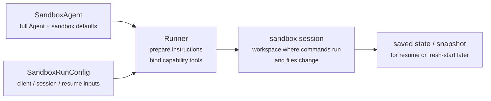
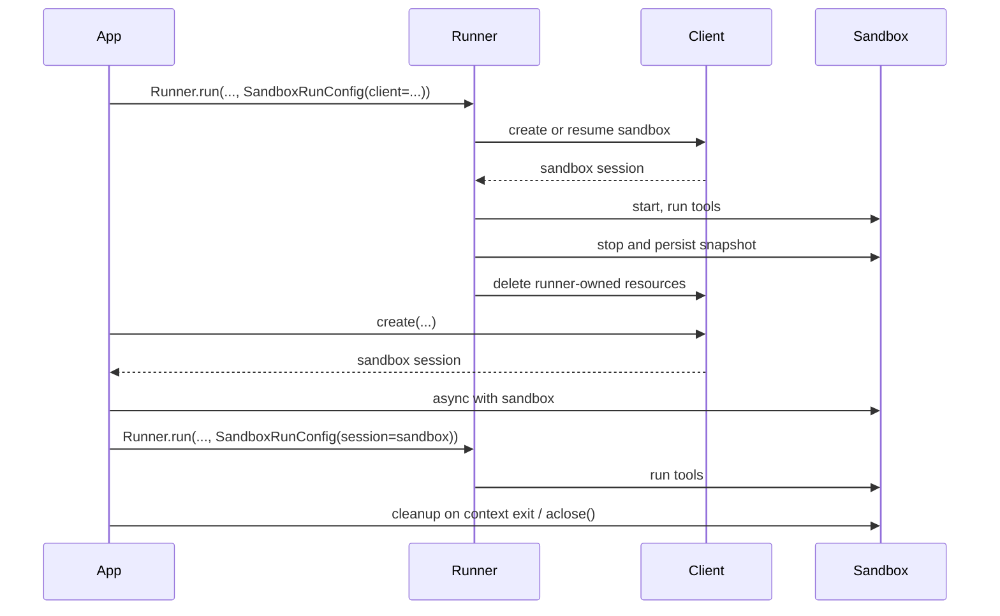

# OpenAI 沙箱 Agent 核心概念

解释工作区、文件清单、权限、快照、运行配置和生命周期，并用编码任务展示如何组合这些能力。

- 来源：OpenAI／Agents SDK
- 资料类型：存档文档
- 存档版本：`125efa029b4b`。
- 文档时间：源码提交（存档版）：[2026-10-04](<https://github.com/openai/openai-agents-python/commit/7968d7a0bdbb3f15f32171fdac7616512a1c4c43>)；发表/更新：官方未公开；本地归档批次：2026-10-10
- 阅读状态：完整中文机器译文，由 Google 翻译；代码、命令与配置保留原样，未逐句人工校对。

[原文发布页](<https://github.com/openai/openai-agents-python/blob/main/docs/sandbox/guide.md>) · [原始文件](<../../../../原始抓取备份/原文/官方/OpenAI/Agents SDK/docs/sandbox/guide.md>) · [返回资料总览](<../../../资料总览.md>)

[查看原文对照](#原文对照)

## 中文全文

# 概念

现代 agents 在可以操作文件系统中的真实文件时效果最佳。 **沙箱Agents**可以利用专门的工具和shell命令来搜索和操作大型文档集、编辑文件、生成工件和运行命令。沙箱为模型提供了一个持久的工作空间，agent 可以使用该工作空间代表您完成工作。 Agents SDK 中的沙箱 Agents 可帮助您轻松运行与沙箱环境配对的 agents，从而轻松在文件系统上获取正确的文件并编排沙箱，从而轻松大规模启动、停止和恢复任务。

您可以围绕 agent 所需的数据定义工作区。它可以从 GitHub 存储库、本地文件和目录、合成任务文件、远程文件系统（例如 S3 或 Azure Blob 存储）以及您提供的其他沙箱输入开始。

<div class="sandbox-harness-image" markdown="1">


</div>

`SandboxAgent` 仍然是 `Agent`。它保留了常用的agent表面，例如`instructions`、`prompt`、`tools`、`handoffs`、`mcp_servers`、`model_settings`、`output_type`、护栏和挂钩，并且它仍然通过正常的 `Runner` API 运行。改变的是执行边界：

- `SandboxAgent` 定义了 agent 本身：通常的 agent 配置加上沙箱特定的默认值，如 `default_manifest`、`base_instructions`、`run_as` 以及文件系统工具、shell 访问、技能、内存或压缩等功能。
- `Manifest` 声明新沙箱工作空间所需的起始内容和布局，包括文件、存储库、安装和环境。
- 沙箱会话是命令运行和文件更改的实时执行环境。会话提供的隔离取决于其后端和配置。
- [`SandboxRunConfig`][agents.run_config.SandboxRunConfig] 决定运行如何获取沙箱会话，例如直接注入、从序列化沙箱会话状态重新连接或通过沙箱客户端创建新的沙箱会话。
- 保存的沙箱状态和快照允许以后的运行重新连接到之前的工作或从保存的内容中播种新的沙箱会话。

`Manifest` 是新会话工作区合约，而不是每个实时沙箱的完整事实来源。运行的有效工作空间可以来自重用的沙箱会话、序列化的沙箱会话状态或运行时选择的快照。

在本页中，“沙箱会话”是指由沙箱客户端管理的实时执行环境。它不同于 SDK是会话式的 [`Session`][agents.内存.会话.会话] 中描述的接口 [会议](<https://github.com/openai/openai-agents-python/blob/125efa029b4bfd84238bd2c4fd69c3406f802663/docs/sessions/index.md>).

外部运行时仍然拥有批准、跟踪、移交和跟踪恢复运行所需的状态。沙箱会话通过其后端管理命令和文件更改。后端决定应用哪些隔离控制；会话本身并不保证 OS- 级别的限制。

### 各个部分如何组合在一起

沙箱运行将 agent 定义与每次运行的沙箱配置相结合。运行程序准备 agent，将其绑定到实时沙箱会话，并可以保存状态以供以后运行。



特定于沙箱的默认值保留在 `SandboxAgent`。每次运行的沙箱会话选择保留在 `SandboxRunConfig` 中。

考虑三个阶段的生命周期：

1. 使用 `SandboxAgent`、`Manifest` 和功能定义 agent 和新工作空间合约。
2. 通过为 `Runner` 提供注入、恢复或创建沙箱会话的 `SandboxRunConfig` 来执行运行。
3. Continue 稍后来自运行程序管理的 `RunState`、显式沙箱 `session_state` 或保存的工作区快照。

如果 shell 访问只是您偶尔使用的一种工具，请从 [ 工具指南 ](<https://github.com/openai/openai-agents-python/blob/125efa029b4bfd84238bd2c4fd69c3406f802663/docs/tools.md>) 中的托管 shell 开始。当工作区隔离、沙箱客户端选择或沙箱会话恢复行为是设计的一部分时，请使用沙箱 agents。

## 何时使用它们

沙箱 agents 非常适合以工作空间为中心的工作流程，例如：

- 编码和调试，例如为 GitHub 存储库中的问题报告编排自动修复并运行有针对性的测试
- 文档处理和编辑，例如从用户的财务文档中提取信息并创建完整的纳税表草稿
- 基于文件的审查或分析，例如在回答之前检查入职数据包、生成的报告或工件包
- 具有独立工作空间的多agent模式，例如为每个审阅者或编码子agent提供自己的工作空间
- 多步骤工作区任务，例如修复一次运行中的错误并稍后添加回归测试，或者从快照或沙箱会话状态恢复

如果您不需要访问文件或有状态、可变的文件系统，请继续使用 `Agent`。如果 shell 访问只是一种偶尔的功能，请添加托管 shell；如果工作区边界本身是功能的一部分，请使用沙箱 agents。

## 选择沙箱客户端

使用 `UnixLocalSandboxClient` 在 macOS 或 Linux 上或在外部隔离环境中进行可信本地开发。在 Linux 上，此后端作为主机进程运行命令，而无需添加 OS- 级别限制。在macOS上，它通过`sandbox-exec`应用文件系统限制，但不提供网络隔离。

默认情况下，新的 Unix 本地会话接收单独的临时工作区。如果您使用相同的自定义 `Manifest.root` 配置会话，则这些会话共享工作区。单独的会话不能保证 OS- 级别的隔离。

对于不受信任的命令，包括受不受信任输入影响的命令，请选择适当配置的 `DockerSandboxClient` 或托管提供程序，或提供外部隔离。在 Windows 上，使用 Docker 或托管提供商。在选择本地后端之前，请参阅 [Unix 本地执行限制 ](<选择 OpenAI 沙箱客户端.md#决策指南>)。

在大多数情况下，`SandboxAgent` 定义保持不变，而沙箱客户端及其选项在 [`SandboxRunConfig`][agents.run_config.SandboxRunConfig] 中发生更改。有关本地、Docker、托管和远程安装选项，请参阅 [沙箱客户端 ](<选择 OpenAI 沙箱客户端.md>)。

## 核心件

<div class="sandbox-nowrap-first-column-table" markdown="1">

|图层|主要SDK件|它回答什么|
| --- | --- | --- |
|Agent 定义|`SandboxAgent`、`Manifest`、功能|agent 将运行什么，它应该从哪个新会话工作区合约开始？|
|沙箱执行|`SandboxRunConfig`，沙箱客户端和实时沙箱会话|此运行如何获得实时沙箱会话，以及工作在哪里执行？|
|保存的沙箱状态|`RunState` 沙箱负载、`session_state` 和快照|此工作流程如何重新连接到之前的沙箱工作或从保存的内容中播种新的沙箱会话？|

</div>

主要的 SDK 部分映射到这些层上，如下所示：

<div class="sandbox-nowrap-first-column-table" markdown="1">

|件|它拥有什么|问这个问题|
| --- | --- | --- |
|[`SandboxAgent`][agents.沙箱.sandbox_agent.SandboxAgent]|agent 定义|这个 agent 应该做什么，以及哪些默认值应该随之变化？|
|[`Manifest`][agents.sandbox.manifest.Manifest]|新会话工作区文件和文件夹|运行开始时文件系统上应存在哪些文件和文件夹？|
|[`Capability`][agents.sandbox.capability.capability.Capability]|沙盒本机行为|哪些工具、指令片段或运行时行为应附加到此 agent？|
| [`SandboxRunConfig`][agents.run_config.SandboxRunConfig] |每次运行的沙箱客户端和沙箱会话源|是否应该运行注入、恢复或创建沙箱会话？|
| [`RunState`][agents.run_state.RunState] |运行者管理的已保存沙箱状态|我是否可以恢复之前由运行者管理的工作流程并自动向前推进其沙箱状态？|
| [`SandboxRunConfig.session_state`][agents.run_config.SandboxRunConfig.session_state] |显式序列化沙箱会话状态|我是否想从已在 `RunState` 外部序列化的沙箱状态恢复？|
|[`SandboxRunConfig.snapshot`][agents.run_config.SandboxRunConfig.快照]|为新的沙箱会话保存工作区内容|新的沙箱会话是否应该从保存的文件和工件开始？|

</div>

实用的设计顺序是：

1. 使用 `Manifest` 定义新会话工作区合同。
2. 用 `SandboxAgent` 定义 agent。
3. 添加内置或自定义功能。
4. 决定每次运行应如何在 `RunConfig(sandbox=SandboxRunConfig(...))` 中获取其沙箱会话。

## 如何准备沙箱运行

在运行时，运行程序将该定义转换为具体的沙箱支持的运行：

1. 它解析来自 `SandboxRunConfig` 的沙箱会话。如果您传递 `session=...`，它将重用该实时沙箱会话。否则，它使用 `client=...` 创建或恢复一个。
2. 它确定运行的有效工作区输入。如果运行注入或恢复沙箱会话，则现有沙箱状态获胜。否则，运行程序将从一次性清单覆盖或 `agent.default_manifest` 开始。这就是为什么 `Manifest` 单独没有定义每次运行的最终实时工作区。
3. 它让功能能够处理生成的清单。这就是功能在准备最终的 agent 之前添加文件、挂载或其他工作区范围行为的方式。
4. 它以固定顺序构建最终指令：SDK的默认沙箱提示符，或`base_instructions`（如果您显式覆盖它），然后是`instructions`，然后是功能指令片段，然后是任何远程挂载策略文本，然后是渲染的文件系统树。
5. 它将功能工具绑定到实时沙箱会话，并通过正常的 `Runner` API 运行准备好的 agent。

沙盒不会改变回合的含义。回合仍然是一个模型步骤，而不是单个 shell 命令或沙箱操作。沙箱端操作和回合之间没有固定的 1:1 映射：某些工作可能保留在沙箱执行层内，而其他操作返回需要另一个模型步骤的信息，例如工具结果、批准或其他类型的状态。作为实际规则，仅当 agent 运行时在沙箱工作发生后需要另一个模型响应时才会消耗另一个回合。

这些准备步骤就是为什么 `default_manifest`、`instructions`、`base_instructions`、`capabilities` 和 `run_as` 是设计 `SandboxAgent` 时要考虑的主要沙箱特定选项。

## `SandboxAgent` 选项

这些是常见 `Agent` 字段之上的特定于沙箱的选项：

<div class="sandbox-nowrap-first-column-table" markdown="1">

|选项|最佳使用|
| --- | --- |
| `default_manifest` |运行者创建的新沙箱会话的默认工作区。|
| `instructions` |SDK 沙箱提示后附加了其他角色、工作流程和成功标准。|
| `base_instructions` |高级逃生舱口取代了 SDK 沙箱提示。|
| `capabilities` |沙盒本机工具和行为应随此 agent 一起移动。|
| `run_as` |面向模型的沙箱工具（例如 shell 命令、文件读取和补丁）的用户身份。|

</div>

沙箱客户端选择、沙箱会话重用、清单覆盖和快照选择属于 [`SandboxRunConfig`][agents.run_config.SandboxRunConfig]，而不是 agent。

### `default_manifest`

`default_manifest` 是运行程序为此 agent 创建新沙箱会话时使用的默认 [`Manifest`][agents.sandbox.manifest.Manifest]。将其用于文件、存储库、辅助材料、输出目录以及通常应以 agent 开头的安装。

这只是默认设置。运行可以使用 `SandboxRunConfig(manifest=...)` 覆盖它，并且重用或恢复的沙箱会话会保留其现有工作区状态。

### `instructions` 和 `base_instructions`

使用 `instructions` 来制定应该在不同提示下仍然存在的简短规则。在 `SandboxAgent` 中，这些说明附加在 SDK 的沙箱基本提示之后，因此您可以保留内置沙箱指导并添加您自己的角色、工作流程和成功标准。

仅当您想要替换 SDK 沙箱基本提示时才使用 `base_instructions`。大多数agents不应该设置它。

<div class="sandbox-nowrap-first-column-table" markdown="1">

|把它放进去...|用它来|示例|
| --- | --- | --- |
| `instructions` |agent 的稳定角色、工作流程规则和成功标准。|“检查入职文档，然后移交。”，“将最终文件写入 `output/`。”|
| `base_instructions` |完全替代 SDK 沙箱基本提示符。|自定义低级沙箱包装提示。|
|用户提示|本次运行的一次性请求。|“总结一下这个工作空间。”|
|清单中的工作区文件|更长的任务规范、存储库本地说明或有限的参考材料。|`repo/task.md`，文档包，样本包。|

</div>

`instructions` 的良好用途包括：

- 当 PTY 状态很重要时，[examples/sandbox/unix_local_pty.py](<https://github.com/openai/openai-agents-python/blob/main/examples/sandbox/unix_local_pty.py>) 将 agent 保留在一个交互进程中。
- [examples/sandbox/handoffs.py](<https://github.com/openai/openai-agents-python/blob/main/examples/sandbox/handoffs.py>)禁止沙盒审核者在检查后直接回答用户。
- [examples/sandbox/tax_prep.py](<https://github.com/openai/openai-agents-python/blob/main/examples/sandbox/tax_prep.py>)要求最终填充的文件实际落在`output/`中。
- [examples/sandbox/docs/coding_task.py](<https://github.com/openai/openai-agents-python/blob/main/examples/sandbox/docs/coding_task.py>) 固定确切的验证命令，并阐明当未设置 `SandboxRunConfig.cwd` 时，补丁路径是相对于工作空间根目录的。

避免将用户的一次性任务复制到 `instructions`、嵌入清单中的长参考材料、重述已注入的内置功能的工具文档，或者混合模型在运行时不需要的本地安装注释。

如果省略 `instructions`，SDK 仍包含默认沙箱提示。这对于低级包装器来说已经足够了，但是大多数面向用户的 agents 仍然应该提供显式的 `instructions`。

### `capabilities`

功能将沙箱本机行为附加到 `SandboxAgent`。他们可以在运行开始之前调整工作区，附加沙箱特定的指令，公开绑定到实时沙箱会话的工具，并调整模型行为或输入处理agent。

内置功能包括：

<div class="sandbox-nowrap-first-column-table" markdown="1">

|能力|添加它当|注释|
| --- | --- | --- |
| `Shell` |agent 需要 shell 访问权限。|添加`exec_command`，当沙箱客户端支持PTY交互时添加`write_stdin`。|
| `Filesystem` |agent需要编辑文件或检查本地图像。|添加`apply_patch`和`view_image`；相对路径默认使用工作空间根目录，配置后使用 `SandboxRunConfig.cwd`。|
| `Skills` |您希望在沙盒中发现和实现技能。|优于手动安装 `.agents` 或 `.agents/skills`； `Skills` 为您将技能索引并具体化到沙箱中。|
| `Memory` |后续运行应该读取或生成内存工件。|需要`Shell`；在运行期间更新内存工件也需要 `Filesystem`。|
| `Compaction` |长时间运行的流程需要在压缩项目后进行上下文修剪。|调整模型采样和输入处理。|

</div>

默认情况下，`SandboxAgent.capabilities`使用`Capabilities.default()`，其中包括`Filesystem()`、`Shell()`和`Compaction()`。如果您传递 `capabilities=[...]`，该列表将替换默认列表，因此请包含您仍然需要的任何默认功能。

`view_image` 工具根据文件内容（而不是文件扩展名）识别 PNG、JPEG、GIF、WebP、BMP 和 TIFF 光栅图像。当不支持其内容时，具有光栅图像扩展名的文件名将被拒绝，而即使文件名没有图像扩展名，也可以加载受支持的光栅内容。对于 `.svg` 和 `.svgz` 文件，该工具除了从文件内容中识别 SVG 标记之外，还保留基于文件名的兼容性。

对于技能，请根据您希望其实现的方式选择来源：

- 对于较大的本地技能目录，`Skills(lazy_from=LocalDirLazySkillSource(...))` 是一个很好的默认值，因为模型可以首先发现索引并仅加载它需要的内容。
- `LocalDirLazySkillSource(source=LocalDir(src=...))` 从运行 SDK 进程的文件系统中读取。传递原始主机端技能目录，而不是仅存在于沙箱映像或工作区中的路径。
- `Skills(from_=LocalDir(src=...))` 更适合您想要预先上演的小型本地捆绑包。
- 当技能本身应该来自存储库时，`Skills(from_=GitRepo(repo=..., ref=...))` 是正确的选择。

`LocalDir.src` 是SDK 主机上的源路径。 `skills_path` 是调用 `load_skill` 时在沙箱工作区中暂存技能的相对目标路径。

如果您的技能已经存在于磁盘上的 `.agents/skills/<name>/SKILL.md` 下，请将 `LocalDir(...)` 指向该源根目录，并仍然使用 `Skills(...)` 来公开它们。保留默认值 `skills_path=".agents"`，除非您有依赖于不同沙箱内布局的现有工作区合同。

在合适的情况下优先选择内置功能。仅当您需要内置工具未涵盖的特定于沙箱的工具或指令界面时，才编写自定义功能。

## 概念

### 清单

[`Manifest`][agents.sandbox.manifest.Manifest] 描述了新沙箱会话的工作区。它可以设置工作区 `root`、声明文件和目录、复制本地文件、克隆 Git 存储库、附加远程存储挂载、设置环境变量、定义用户或组以及授予对工作区外特定绝对路径的访问权限。

清单条目路径是与工作空间相关的。它们不能是绝对路径，也不能使用 `..` 转义工作区，这使得工作区合约可以在本地、Docker 和托管客户端之间移植。

在工作开始之前，使用 agent 所需材料的清单条目：

<div class="sandbox-nowrap-first-column-table" markdown="1">

|舱单条目|用它来|
| --- | --- |
| `File`, `Dir` |小型合成输入、帮助文件或输出目录。|
| `LocalFile`, `LocalDir` |托管应具体化到沙箱中的文件或目录。|
| `GitRepo` |应提取到工作区中的存储库。|
|安装如 `S3Mount`、`GCSMount`、`R2Mount`、`AzureBlobMount`、`BoxMount`、`S3FilesMount`|应出现在沙箱内的外部存储。|

</div>

`GitRepo` 需要在存储库具体化的沙箱内的 `PATH` 上有 `git` 可执行文件。对于 `UnixLocalSandboxClient`，在本地计算机上安装 Git。对于 Docker 或托管沙箱客户端，请在应用清单之前将 Git 包含在沙箱映像或环境中。安装 Python SDK 不会安装 Git。

`Dir` 在沙箱工作区中从合成子项创建一个目录或作为输出位置；它不从主机文件系统读取。当应将现有主机目录复制到沙箱工作区时，请使用 `LocalDir`。

默认情况下，`LocalFile.src` 和 `LocalDir.src` 根据 SDK 进程工作目录进行解析。源必须保留在该基本目录下，除非它被 `extra_path_grants` 覆盖。这使本地源具体化与沙箱清单的其余部分保持在同一主机路径信任边界内。

挂载条目描述了要公开的存储；挂载策略描述了沙箱后端如何附加该存储。请参阅[沙箱客户端](<选择 OpenAI 沙箱客户端.md#安装和远程存储>)以获取安装选项和提供程序支持。

良好的清单设计通常意味着保持工作空间契约狭窄，将长任务配方放入工作空间文件中，例如 `repo/task.md`，并在指令中使用相对工作空间路径，例如 `repo/task.md` 或 `output/report.md`。如果agent使用`Filesystem`功能的`apply_patch`工具编辑文件，请记住补丁路径默认使用沙箱工作空间根目录或配置时使用`SandboxRunConfig.cwd`；他们不使用外壳`workdir`。

仅当 agent 需要工作区之外的具体绝对路径或清单需要复制 SDK 进程工作目录之外的受信任本地源时，才使用 `extra_path_grants`。示例包括用于临时工具输出的 `/tmp`、用于只读运行时的 `/opt/toolchain` 或应具体化到沙箱中的生成技能目录。拨款适用于本地源实现和 SDK 文件 API。当后端可以强制执行文件系统策略时，它也适用于 shell 执行：

```python
from agents.sandbox import Manifest, SandboxPathGrant

manifest = Manifest(
    extra_path_grants=(
        SandboxPathGrant(path="/tmp"),
        SandboxPathGrant(path="/opt/toolchain", read_only=True),
    ),
)
```

当 Docker 应该在容器内的绝对 POSIX `path` 处绑定安装不同的绝对主机路径时，设置 `host_path`。 `UnixLocalSandboxClient` 仅支持仅路径授权，其中两条路径相同，并拒绝 `host_path`。对于沙箱不应修改的主机数据使用 `read_only=True`，或者在副本足够时使用 `LocalFile` 或 `LocalDir`。

Unix 本地路径授权控制哪些主机源可以复制到工作区以及 SDK 文件 API 可以访问哪些路径。 `read_only=True` 阻止 SDK 文件 API 写入授予的路径。在 Linux 上，这些设置不限制任意 shell 命令：命令可以访问进程权限和任何外部隔离允许的主机路径，即使这些路径没有授予。 macOS 文件系统配置文件和 Docker 绑定挂载将各自的授予限制应用于命令。

将包含 `extra_path_grants` 的清单视为可信配置。不要从模型输出或其他不受信任的负载加载授权，除非您的应用程序已经批准了这些主机路径。

快照和 `persist_workspace()` 仍然仅包含工作区根目录。额外授予的路径是运行时访问，而不是持久的工作空间状态。

### 权限

`Permissions` 控制清单条目的文件系统权限。它与沙箱具体化的文件有关，而不是模型权限、批准策略或 API 凭据。

默认情况下，清单条目按组和其他为 owner-readable/writable/executable 和 readable/executable。当暂存文件应该是私有、只读或可执行时覆盖此设置：

```python
from agents.sandbox import FileMode, Permissions
from agents.sandbox.entries import File

private_notes = File(
    content=b"internal notes",
    permissions=Permissions(
        owner=FileMode.READ | FileMode.WRITE,
        group=FileMode.NONE,
        other=FileMode.NONE,
    ),
)
```

`Permissions` 存储单独的所有者、组和其他位，以及该条目是否是目录。您可以直接构建它，使用 `Permissions.from_str(...)` 从模式字符串解析它，或者使用 `Permissions.from_mode(...)` 从 OS 模式派生它。

用户是可以执行工作的沙箱身份。当您希望沙箱中存在该身份时，将 `User` 添加到清单中，然后当面向模型的沙箱工具（例如 shell 命令、文件读取和补丁）应以该用户身份运行时设置 `SandboxAgent.run_as`。如果 `run_as` 指向清单中尚未存在的用户，运行程序会将其添加到有效清单中。

```python
from agents import Runner
from agents.run import RunConfig
from agents.sandbox import FileMode, Manifest, Permissions, SandboxAgent, SandboxRunConfig, User
from agents.sandbox.entries import Dir, LocalDir
from agents.sandbox.sandboxes.unix_local import UnixLocalSandboxClient

analyst = User(name="analyst")

agent = SandboxAgent(
    name="Dataroom analyst",
    instructions="Review the files in `dataroom/` and write findings to `output/`.",
    default_manifest=Manifest(
        # Declare the sandbox user so manifest entries can grant access to it.
        users=[analyst],
        entries={
            "dataroom": LocalDir(
                src="./dataroom",
                # Let the analyst traverse and read the mounted dataroom, but not edit it.
                group=analyst,
                permissions=Permissions(
                    owner=FileMode.READ | FileMode.EXEC,
                    group=FileMode.READ | FileMode.EXEC,
                    other=FileMode.NONE,
                ),
            ),
            "output": Dir(
                # Give the analyst a writable scratch/output directory for artifacts.
                group=analyst,
                permissions=Permissions(
                    owner=FileMode.ALL,
                    group=FileMode.ALL,
                    other=FileMode.NONE,
                ),
            ),
        },
    ),
    # Run model-facing sandbox actions as this user, so those permissions apply.
    run_as=analyst,
)

result = await Runner.run(
    agent,
    "Summarize the contracts and call out renewal dates.",
    run_config=RunConfig(
        sandbox=SandboxRunConfig(client=UnixLocalSandboxClient()),
    ),
)
```

如果您还需要文件级共享规则，请将用户与清单组和条目 `group` 元数据结合起来。 `run_as` 用户控制谁执行沙箱本机操作； `Permissions` 控制沙箱具体化工作区后用户可以读取、写入或执行哪些文件。

### SnapshotSpec

`SnapshotSpec` 告诉一个新的沙盒会话，保存的工作区内容应从中恢复并保留回。它是沙箱工作区的快照策略，而`session_state`是用于恢复特定沙箱后端的序列化连接状态。

当您的应用程序提供远程快照客户端时，请使用 `LocalSnapshotSpec` 进行本地持久快照，并使用 `RemoteSnapshotSpec`。当本地快照设置不可用时，无操作快照用作后备，高级调用者在不希望工作区快照持久化时可以显式使用无操作快照。

```python
from pathlib import Path

from agents.run import RunConfig
from agents.sandbox import LocalSnapshotSpec, SandboxRunConfig
from agents.sandbox.sandboxes.unix_local import UnixLocalSandboxClient

run_config = RunConfig(
    sandbox=SandboxRunConfig(
        client=UnixLocalSandboxClient(),
        snapshot=LocalSnapshotSpec(base_path=Path("/tmp/my-sandbox-snapshots")),
    )
)
```

当运行器创建新的沙箱会话时，沙箱客户端会为该会话构建快照实例。启动时，如果快照可恢复，则沙箱会在继续运行之前恢复保存的工作区内容。在清理时，运行者拥有的沙箱会话会存档工作区并通过快照将其保留回来。

如果省略 `snapshot`，则运行时会尽可能尝试使用默认本地快照位置。如果无法设置，则会退回到无操作快照。已安装路径和临时路径不会作为持久工作区内容复制到快照中。

### 沙盒生命周期

有两种生命周期模式：**SDK-拥有**和**开发者拥有**。

<div class="sandbox-lifecycle-diagram" markdown="1">



</div>

当沙箱仅需要运行一次时，使用 SDK- 拥有的生命周期。传递 `client`，可选的 `manifest` 和 `snapshot`，以及您需要的任何客户端 `options`；运行程序创建或恢复沙箱，启动它，运行 agent，保留快照支持的工作区状态，结束沙箱会话，并让客户端清理运行程序拥有的资源。

```python
result = await Runner.run(
    agent,
    "Inspect the workspace and summarize what changed.",
    run_config=RunConfig(
        sandbox=SandboxRunConfig(client=UnixLocalSandboxClient()),
    ),
)
```

当您想要急切地创建一个沙箱、在多次运行中重复使用一个实时沙箱、在运行后检查文件、通过您自己创建的沙箱进行流式传输或准确决定何时进行清理时，请使用开发人员拥有的生命周期。传递 `session=...` 会告诉跑步者使用该实时沙箱，但不要为您关闭它。

```python
sandbox = await client.create(manifest=agent.default_manifest)

async with sandbox:
    run_config = RunConfig(sandbox=SandboxRunConfig(session=sandbox))
    await Runner.run(agent, "Analyze the files.", run_config=run_config)
    await Runner.run(agent, "Write the final report.", run_config=run_config)
```

上下文管理器是通常的形状：它在进入时启动沙箱并在退出时运行会话清理生命周期。如果您的应用程序无法使用上下文管理器，请直接调用生命周期方法：

```python
sandbox = await client.create(
    manifest=agent.default_manifest,
    snapshot=LocalSnapshotSpec(base_path=Path("/tmp/my-sandbox-snapshots")),
)
try:
    await sandbox.start()
    await Runner.run(
        agent,
        "Analyze the files.",
        run_config=RunConfig(sandbox=SandboxRunConfig(session=sandbox)),
    )
    # Persist a checkpoint of the live workspace before doing more work.
    # `aclose()` also calls `stop()`, so this is only needed for an explicit mid-lifecycle save.
    await sandbox.stop()
finally:
    await sandbox.aclose()
```

`stop()` 仅保留快照支持的工作区内容；它不会破坏沙箱。 `aclose()` 是完整的会话清理路径：它运行预停止挂钩，调用 `stop()`，关闭沙箱资源，并关闭会话范围的依赖项。

## `SandboxRunConfig` 选项

[`SandboxRunConfig`][agents.run_config.SandboxRunConfig] 保存每次运行的选项，这些选项决定沙箱会话来自何处以及如何初始化新会话。

### 沙盒源码

这些选项决定运行程序是否应重用、恢复或创建沙箱会话：

<div class="sandbox-nowrap-first-column-table" markdown="1">

|选项|当|注释|
| --- | --- | --- |
| `client` |您希望运行程序为您创建、恢复和清理沙箱会话。|除非您提供实时沙箱 `session`，否则是必需的。|
| `session` |您已经自己创建了一个实时沙箱会话。|调用者拥有生命周期；运行者重用该实时沙箱会话。|
| `session_state` |您已序列化沙箱会话状态，但没有序列化实时沙箱会话对象。|需要`client`；运行者从该显式状态恢复并拥有恢复会话的生命周期。|

</div>

在实践中，运行程序按以下顺序解析沙箱会话：

1. 如果您注入`run_config.sandbox.session`，则直接重用该实时沙箱会话。
2. 否则，如果运行从 `RunState` 恢复，则将恢复存储的沙箱会话状态。
3. 否则，如果您传递 `run_config.sandbox.session_state`，运行程序将从该显式序列化沙箱会话状态恢复。
4. 否则，运行程序将创建一个新的沙箱会话。对于该新会话，如果提供，则使用 `run_config.sandbox.manifest`，如果没有，则使用 `agent.default_manifest`。

### 新会话输入

这些选项仅在运行者创建新的沙箱会话时才重要：

<div class="sandbox-nowrap-first-column-table" markdown="1">

|选项|当|注释|
| --- | --- | --- |
| `manifest` |您想要一次性的新会话工作区覆盖。|省略时回落到 `agent.default_manifest`。|
| `snapshot` |应从快照中播种新的沙箱会话。|对于类似简历的流程或远程快照客户端很有用。|
| `options` |沙箱客户端需要创建时选项。|适用于 Docker 映像、模态应用程序名称、E2B 模板、超时和类似的客户端特定设置。|

</div>

### 面向模型的工作目录

当多次运行应共享一个沙箱会话但在单独的子目录中操作时，请将 `cwd` 设置为 POSIX 工作区相对目录。当运行程序验证 `cwd` 时，该目录必须存在并且可供配置的沙箱用户访问。对于新会话，运行程序首先具体化清单，因此清单可以在此验证之前创建目录。

```python
from agents import Runner
from agents.run import RunConfig
from agents.sandbox import SandboxRunConfig

result = await Runner.run(
    agent,
    "Work only on task A.",
    run_config=RunConfig(
        sandbox=SandboxRunConfig(
            session=shared_sandbox,
            cwd="tasks/task-a",
        ),
    ),
)
```

内置 `exec_command`、`view_image` 和 `apply_patch` 工具使用的相对路径从 `cwd` 解析。对于 `cwd` 值本身，绝对路径、父段（例如 `..`）和空值将被拒绝。字符串值必须使用正斜杠。相对 `PurePath` 值标准化为 POSIX 形式，而绝对 `PurePath` 值仍然无效。直接 `BaseSandboxSession` 文件 API 保持工作区根相对关系，因此 `cwd` 不会更改 `Manifest.root` 或会话的基础工作区边界。该设置仅更改相对路径分辨率：它不会将运行限制为 `cwd` 或阻止访问共享会话的工作区策略允许的其他路径。

解析模型提供的相对路径时，自定义路径承载功能必须应用其绑定的 [`SandboxWorkspaceScope`][agents.sandbox.workspace_paths.SandboxWorkspaceScope]。请参阅 [examples/sandbox/shared_session_workdirs.py](<https://github.com/openai/openai-agents-python/blob/main/examples/sandbox/shared_session_workdirs.py>) 了解两个并发运行，它们共享一个沙箱会话，同时保持其面向模型的工作目录分离。

### 物化控制

`concurrency_limits` 控制可以并行运行多少沙箱具体化工作。当大型清单或本地目录副本需要更严格的资源控制时，请使用 `SandboxConcurrencyLimits(manifest_entries=..., local_dir_files=...)`。将任一值设置为 `None` 以禁用该特定限制。

`archive_limits` 控制 SDK- 存档提取的端资源检查。设置 `archive_limits=SandboxArchiveLimits()` 以启用 SDK 默认阈值，或在存档需要更严格的资源控制时传递显式值，例如 `SandboxArchiveLimits(max_input_bytes=..., max_extracted_bytes=..., max_members=...)`。保留 `archive_limits=None` 以保留默认行为，没有 SDK 存档资源限制，或将单个字段设置为 `None` 以仅禁用该限制。

有一些含义值得牢记：

- 全新会话：`manifest=` 和 `snapshot=` 仅在跑步者创建全新沙盒会话时适用。
- 恢复与快照：`session_state=` 重新连接到之前序列化的沙箱状态，而 `snapshot=` 从保存的工作区内容中播种新的沙箱会话。
- 客户端特定选项：`options=`取决于沙箱客户端； Docker 和许多托管客户端都需要它。
- 注入的实时会话：如果您传递正在运行的沙箱`session`，功能驱动的清单更新可以添加兼容的非安装条目。他们不能更改`manifest.root`、`manifest.environment`、`manifest.users`或`manifest.groups`；删除现有条目；替换条目类型；或添加或更改安装条目。
- 运行器 API：`SandboxAgent` 执行仍使用正常的 `Runner.run()`、`Runner.run_sync()` 和 `Runner.run_streamed()` API。

## 完整示例：编码任务

这个编码风格的例子是一个很好的默认起点：

```python
import asyncio
from pathlib import Path

from agents import ModelSettings, Runner
from agents.run import RunConfig
from agents.sandbox import Manifest, SandboxAgent, SandboxRunConfig
from agents.sandbox.capabilities import (
    Capabilities,
    LocalDirLazySkillSource,
    Skills,
)
from agents.sandbox.entries import LocalDir
from agents.sandbox.sandboxes.unix_local import UnixLocalSandboxClient

EXAMPLE_DIR = Path(__file__).resolve().parent
HOST_REPO_DIR = EXAMPLE_DIR / "repo"
HOST_SKILLS_DIR = EXAMPLE_DIR / "skills"
TARGET_TEST_CMD = "sh tests/test_credit_note.sh"


def build_agent(model: str) -> SandboxAgent[None]:
    return SandboxAgent(
        name="Sandbox engineer",
        model=model,
        instructions=(
            "Inspect the repo, make the smallest correct change, run the most relevant checks, "
            "and summarize the file changes and risks. "
            "Read `repo/task.md` before editing files. Stay grounded in the repository, preserve "
            "existing behavior, and mention the exact verification command you ran. "
            "Use the `$credit-note-fixer` skill before editing files. "
            "This example leaves `SandboxRunConfig.cwd` unset, so `apply_patch` paths stay "
            "relative to the sandbox workspace root and edits still target `repo/...`."
        ),
        # Put repos and task files in the manifest.
        default_manifest=Manifest(
            entries={
                "repo": LocalDir(src=HOST_REPO_DIR),
            }
        ),
        capabilities=Capabilities.default()
        + [
            Skills(
                lazy_from=LocalDirLazySkillSource(
                    # This is a host path read by the SDK process.
                    # Requested skills are copied into `skills_path` in the sandbox.
                    source=LocalDir(src=HOST_SKILLS_DIR),
                )
            ),
        ],
        model_settings=ModelSettings(tool_choice="required"),
    )


async def main(model: str, prompt: str) -> None:
    result = await Runner.run(
        build_agent(model),
        prompt,
        run_config=RunConfig(
            sandbox=SandboxRunConfig(client=UnixLocalSandboxClient()),
            workflow_name="Sandbox coding example",
        ),
    )
    print(result.final_output)


if __name__ == "__main__":
    asyncio.run(
        main(
            model="gpt-5.6-sol",
            prompt=(
                "Open `repo/task.md`, use the `$credit-note-fixer` skill, fix the bug, "
                f"run `{TARGET_TEST_CMD}`, and summarize the change."
            ),
        )
    )
```

参见[examples/sandbox/docs/coding_task.py](<https://github.com/openai/openai-agents-python/blob/main/examples/sandbox/docs/coding_task.py>)。它使用一个基于 shell 的小型存储库，因此可以在 Unix 本地运行中确定性地验证该示例。您的真实任务存储库当然可以是 Python、JavaScript 或其他任何内容。

## 常见模式

从上面的完整示例开始。在许多情况下，相同的 `SandboxAgent` 可以保持不变，而只有沙箱客户端、沙箱会话源或工作区源发生更改。

### 切换沙箱客户端

保持 agent 定义相同，仅更改运行配置。当您需要容器隔离或映像奇偶校验时，请使用 Docker；当您需要提供程序管理的执行时，请使用托管提供程序。有关示例和提供程序选项，请参阅 [沙盒客户端 ](<选择 OpenAI 沙箱客户端.md>)。

### 覆盖工作区

保持 agent 定义相同并仅交换新会话清单：

```python
from agents.run import RunConfig
from agents.sandbox import Manifest, SandboxRunConfig
from agents.sandbox.entries import GitRepo
from agents.sandbox.sandboxes.unix_local import UnixLocalSandboxClient

run_config = RunConfig(
    sandbox=SandboxRunConfig(
        client=UnixLocalSandboxClient(),
        manifest=Manifest(
            entries={
                "repo": GitRepo(repo="openai/openai-agents-python", ref="main"),
            }
        ),
    ),
)
```

当相同的 agent 角色应该针对不同的存储库、数据包或任务包运行而不重建 agent 时，请使用此选项。上面经过验证的编码示例显示了与 `default_manifest` 相同的模式，而不是一次性覆盖。

### 注入沙箱会话

当您需要显式生命周期控制、运行后检查或输出复制时，注入实时沙箱会话：

```python
from agents import Runner
from agents.run import RunConfig
from agents.sandbox import SandboxRunConfig
from agents.sandbox.sandboxes.unix_local import UnixLocalSandboxClient

client = UnixLocalSandboxClient()
sandbox = await client.create(manifest=agent.default_manifest)

async with sandbox:
    result = await Runner.run(
        agent,
        prompt,
        run_config=RunConfig(
            sandbox=SandboxRunConfig(session=sandbox),
        ),
    )
```

当您想要在运行或流式传输已启动的沙箱会话后检查工作区时，请使用此选项。参见[examples/sandbox/docs/coding_task.py](<https://github.com/openai/openai-agents-python/blob/main/examples/sandbox/docs/coding_task.py>)和[examples/sandbox/docker/docker_runner.py](<https://github.com/openai/openai-agents-python/blob/main/examples/sandbox/docker/docker_runner.py>)。

### 从会话状态恢复

如果您已经在 `RunState` 之外序列化沙箱状态，请让运行程序从该状态重新连接：

```python
from agents.run import RunConfig
from agents.sandbox import SandboxRunConfig

serialized = load_saved_payload()
restored_state = client.deserialize_session_state(serialized)

run_config = RunConfig(
    sandbox=SandboxRunConfig(
        client=client,
        session_state=restored_state,
    ),
)
```

当沙箱状态位于您自己的存储或作业系统中并且您希望 `Runner` 直接从中恢复时，请使用此选项。有关 serialize/deserialize 流程，请参阅 [examples/sandbox/extensions/blaxel_runner.py](<https://github.com/openai/openai-agents-python/blob/main/examples/sandbox/extensions/blaxel_runner.py>)。

会话状态序列化忽略本机 `host_path` 值。要恢复主机支持的授权，请通过 `SandboxRunConfig.manifest` 或 `agent.default_manifest` 提供当前的可信清单；否则在沙箱启动之前恢复会失败。切勿从序列化或其他不受信任的输入中派生主机路径。

会话状态和 `RunState` 序列化还会删除云安装凭证、凭证承载帮助程序配置和容器内凭证公开确认。对于支持恢复挂载会话的后端，当状态包含经过编辑的挂载权限时，通过 `SandboxRunConfig.manifest` 或 `agent.default_manifest` 提供当前受信任清单。当名为 `"data"` 的挂载条目需要挂载范围确认时，请在恢复之前使用 `trusted_manifest = trusted_manifest.with_in_container_mount_credential_exposure_acknowledged("data")` 保留复制的清单。使用 `trusted_manifest = trusted_manifest.with_in_container_mount_broad_credential_exposure_acknowledged("data")` 获得广泛的权限，并在挂载使用两个权限类时调用这两个方法。传递每个需要确认的确切安装路径。仅当当前受信任清单具有与持久状态完全相同的无凭据安装拓扑时，Agents SDK 才会恢复凭据。可信配置缺失或不匹配导致沙箱启动前恢复失败；序列化状态永远不会自行授予权限。 `VercelSandboxClient` 无法恢复已安装的会话，因此请使用受信任的清单启动一个新的沙箱。

### 从快照开始

从保存的文件和工件中播种新的沙箱：

```python
from pathlib import Path

from agents.run import RunConfig
from agents.sandbox import LocalSnapshotSpec, SandboxRunConfig
from agents.sandbox.sandboxes.unix_local import UnixLocalSandboxClient

run_config = RunConfig(
    sandbox=SandboxRunConfig(
        client=UnixLocalSandboxClient(),
        snapshot=LocalSnapshotSpec(base_path=Path("/tmp/my-sandbox-snapshot")),
    ),
)
```

当创建新沙箱会话的运行应从保存的工作区内容而不是仅从 `agent.default_manifest` 开始时，请使用此选项。本地快照流程请参见[examples/sandbox/memory.py](<https://github.com/openai/openai-agents-python/blob/main/examples/sandbox/memory.py>)，远程快照客户端请参见[examples/sandbox/sandbox_agent_with_remote_snapshot.py](<https://github.com/openai/openai-agents-python/blob/main/examples/sandbox/sandbox_agent_with_remote_snapshot.py>)。

### 从 Git 加载技能

将本地技能源替换为存储库支持的技能源：

```python
from agents.sandbox.capabilities import Capabilities, Skills
from agents.sandbox.entries import GitRepo

capabilities = Capabilities.default() + [
    Skills(from_=GitRepo(repo="sdcoffey/tax-prep-skills", ref="main")),
]
```

当技能包有自己的发布节奏或应该在沙箱之间共享时使用此选项。参见[examples/sandbox/tax_prep.py](<https://github.com/openai/openai-agents-python/blob/main/examples/sandbox/tax_prep.py>)。

### 暴露为工具

工具-agents 可以获取自己的沙箱边界，也可以重复使用父运行中的实时沙箱。重用对于快速只读浏览器 agent 非常有用：它可以检查父运行正在使用的确切工作空间，而无需付费创建、水合或快照另一个沙箱。

```python
from agents import Runner
from agents.run import RunConfig
from agents.sandbox import FileMode, Manifest, Permissions, SandboxAgent, SandboxRunConfig, User
from agents.sandbox.entries import Dir, File
from agents.sandbox.sandboxes.unix_local import UnixLocalSandboxClient

coordinator = User(name="coordinator")
explorer = User(name="explorer")

manifest = Manifest(
    users=[coordinator, explorer],
    entries={
        "pricing_packet": Dir(
            group=coordinator,
            permissions=Permissions(
                owner=FileMode.ALL,
                group=FileMode.ALL,
                other=FileMode.READ | FileMode.EXEC,
                directory=True,
            ),
            children={
                "pricing.md": File(
                    content=b"Pricing packet contents...",
                    group=coordinator,
                    permissions=Permissions(
                        owner=FileMode.ALL,
                        group=FileMode.ALL,
                        other=FileMode.READ,
                    ),
                ),
            },
        ),
        "work": Dir(
            group=coordinator,
            permissions=Permissions(
                owner=FileMode.ALL,
                group=FileMode.ALL,
                other=FileMode.NONE,
                directory=True,
            ),
        ),
    },
)

pricing_explorer = SandboxAgent(
    name="Pricing Explorer",
    instructions="Read `pricing_packet/` and summarize commercial risk. Do not edit files.",
    run_as=explorer,
)

client = UnixLocalSandboxClient()
sandbox = await client.create(manifest=manifest)

async with sandbox:
    shared_run_config = RunConfig(
        sandbox=SandboxRunConfig(session=sandbox),
    )

    orchestrator = SandboxAgent(
        name="Revenue Operations Coordinator",
        instructions="Coordinate the review and write final notes to `work/`.",
        run_as=coordinator,
        tools=[
            pricing_explorer.as_tool(
                tool_name="review_pricing_packet",
                tool_description="Inspect the pricing packet and summarize commercial risk.",
                run_config=shared_run_config,
                max_turns=2,
            ),
        ],
    )

    result = await Runner.run(
        orchestrator,
        "Review the pricing packet, then write final notes to `work/summary.md`.",
        run_config=shared_run_config,
    )
```

这里，父级 agent 作为 `coordinator` 运行，浏览器工具 - agent 在同一实时沙箱会话中作为 `explorer` 运行。 `pricing_packet/` 条目可供 `other` 用户读取，因此浏览器可以快速检查它们，但它没有写入位。 `work/` 目录仅对协调者的 user/group 可用，因此父级可以在资源管理器保持只读状态时写入最终工件。

当工具agent需要自己的容器时，给它一个沙箱`RunConfig`来创建Docker会话：

```python
from docker import from_env as docker_from_env

from agents.run import RunConfig
from agents.sandbox import SandboxAgent, SandboxRunConfig
from agents.sandbox.sandboxes.docker import DockerSandboxClient, DockerSandboxClientOptions

rollout_agent = SandboxAgent(
    name="Rollout Reviewer",
    instructions="Inspect the rollout packet and summarize implementation risk.",
)

rollout_agent.as_tool(
    tool_name="review_rollout_risk",
    tool_description="Inspect the rollout packet and summarize implementation risk.",
    run_config=RunConfig(
        sandbox=SandboxRunConfig(
            client=DockerSandboxClient(docker_from_env()),
            options=DockerSandboxClientOptions(image="python:3.14-slim"),
        ),
    ),
)
```

当工具 agent 应该独立编辑文件时，请使用单独的工作区；当需要不同的后端或图像时，请使用单独的会话。对于不受信任的命令，选择提供所需隔离的后端和配置；单独的 Unix 本地会话不提供 Linux OS 限制。有关单独的本地工作区，请参阅 [examples/sandbox/sandbox_agents_as_tools.py](<https://github.com/openai/openai-agents-python/blob/main/examples/sandbox/sandbox_agents_as_tools.py>)。

### 结合本地工具和MCP

保留沙箱工作区，同时仍然在同一 agent 上使用普通工具：

```python
from agents.sandbox import SandboxAgent
from agents.sandbox.capabilities import Shell

agent = SandboxAgent(
    name="Workspace reviewer",
    instructions="Inspect the workspace and call host tools when needed.",
    tools=[get_discount_approval_path],
    mcp_servers=[server],
    capabilities=[Shell()],
)
```

当工作区检查只是 agent 工作的一部分时使用此功能。参见[examples/sandbox/sandbox_agent_with_tools.py](<https://github.com/openai/openai-agents-python/blob/main/examples/sandbox/sandbox_agent_with_tools.py>)。

## 内存

当未来的沙箱 agent 运行应从先前的运行中学习时，请使用 `Memory` 功能。内存与 SDK 的会话 `Session` 内存是分开的：它将课程提取到沙箱工作区中的文件中，然后稍后的运行可以读取这些文件。

有关设置、read/generate 行为、多轮对话和布局隔离，请参阅 [Agent 内存 ](<OpenAI 沙箱 Agent 的经验记忆.md>)。

## 构图模式

一旦明确了单agent模式，下一个设计问题就是沙箱边界在更大系统中的归属。

沙箱 agents 仍然与 SDK 的其余部分组成：

- [交接](<https://github.com/openai/openai-agents-python/blob/125efa029b4bfd84238bd2c4fd69c3406f802663/docs/handoffs.md>)：将非沙箱摄入量agent中的大量文档工作交给沙箱审阅者。
- [Agents 作为工具](<https://github.com/openai/openai-agents-python/blob/125efa029b4bfd84238bd2c4fd69c3406f802663/docs/tools.md#agents-as-tools>)：将多个沙箱 agents 公开为工具，通常通过在每个 `Agent.as_tool(...)` 调用上传递 `run_config=RunConfig(sandbox=SandboxRunConfig(...))`，以便每个工具都有自己的会话。后端和配置决定了每个会话提供的隔离。
- 【[MCP](<OpenAI Agents SDK 的 MCP 集成.md>)】和普通功能工具：沙箱功能可以与【`mcp_servers`】和普通【Python】工具共存。
- [运行agents](<https://github.com/openai/openai-agents-python/blob/125efa029b4bfd84238bd2c4fd69c3406f802663/docs/running_agents.md>)：沙箱运行仍然使用正常的`Runner` API。

有两种模式特别常见：

- 非沙箱 agent 仅针对需要工作区隔离的工作流程部分将其移交给沙箱 agent
- 编排器将多个沙箱 agents 公开为工具，通常每个 `Agent.as_tool(...)` 调用都有一个单独的沙箱 `RunConfig`，因此每个工具都有自己的工作区

### 转弯和沙盘跑

它有助于分别解释切换和 agent-as-tool 调用。

进行交接后，仍然存在 1 次顶级运行和 1 次顶级转弯循环。活动的 agent 发生更改，但运行不会变为嵌套。如果非沙箱摄入量 agent 移交给沙箱审核者，则同一运行中的下一个模型调用将为沙箱 agent 准备，并且该沙箱 agent 将成为下一轮的沙箱。换句话说，切换会改变 agent 拥有同一运行的下一回合。参见[examples/sandbox/handoffs.py](<https://github.com/openai/openai-agents-python/blob/main/examples/sandbox/handoffs.py>)。

对于`Agent.as_tool(...)`，关系就不同了。外部协调器使用一个外部轮来决定调用该工具，并且该工具调用启动沙箱的嵌套运行agent。嵌套运行有自己的轮回循环`max_turns`、批准，通常还有自己的沙箱`RunConfig`。它可能会在一个嵌套回合中完成，也可能需要几个回合。从外部协调器的角度来看，所有这些工作仍然位于一个工具调用之后，因此嵌套轮次不会增加外部运行的轮次计数器。请参阅[examples/sandbox/sandbox_agents_as_tools.py](<https://github.com/openai/openai-agents-python/blob/main/examples/sandbox/sandbox_agents_as_tools.py>)。

批准行为遵循相同的划分：

- 通过切换，批准保持在相同的顶级运行中，因为沙箱 agent 现在是该运行中的活动 agent
- 对于 `Agent.as_tool(...)`，沙箱工具内部提出的批准 - agent 仍然出现在外部运行中，但它们来自存储的嵌套运行状态，并在外部运行恢复时恢复嵌套沙箱运行

## 进一步阅读

- [快速入门](<OpenAI 沙箱 Agent 入门.md>)：运行一个沙箱agent。
- [沙盒客户端](<选择 OpenAI 沙箱客户端.md>)：选择本地、Docker、托管和挂载选项。
- [Agent内存](<OpenAI 沙箱 Agent 的经验记忆.md>)：保留和重用之前沙箱运行的经验教训。
- [examples/sandbox/](<https://github.com/openai/openai-agents-python/tree/main/examples/sandbox>)：可运行的本地、编码、内存、切换和agent-组合模式。


## 原文对照

<details>
<summary>展开完整原文</summary>

# Concepts

Modern agents work best when they can operate on real files in a filesystem. **Sandbox Agents** can make use of specialized tools and shell commands to search over and manipulate large document sets, edit files, generate artifacts, and run commands. The sandbox provides the model with a persistent workspace that the agent can use to do work on your behalf. Sandbox Agents in the Agents SDK help you easily run agents paired with a sandbox environment, making it easy to get the right files on the filesystem and orchestrate the sandboxes to make it easy to start, stop, and resume tasks at scale.

You define the workspace around the data the agent needs. It can start from GitHub repos, local files and directories, synthetic task files, remote filesystems such as S3 or Azure Blob Storage, and other sandbox inputs you provide.

<div class="sandbox-harness-image" markdown="1">


</div>

`SandboxAgent` is still an `Agent`. It keeps the usual agent surface such as `instructions`, `prompt`, `tools`, `handoffs`, `mcp_servers`, `model_settings`, `output_type`, guardrails, and hooks, and it still runs through the normal `Runner` APIs. What changes is the execution boundary:

- `SandboxAgent` defines the agent itself: the usual agent configuration plus sandbox-specific defaults like `default_manifest`, `base_instructions`, `run_as`, and capabilities such as filesystem tools, shell access, skills, memory, or compaction.
- `Manifest` declares the desired starting contents and layout for a fresh sandbox workspace, including files, repos, mounts, and environment.
- A sandbox session is the live execution environment where commands run and files change. The isolation provided by a session depends on its backend and configuration.
- [`SandboxRunConfig`][agents.run_config.SandboxRunConfig] decides how the run gets that sandbox session, for example by injecting one directly, reconnecting from serialized sandbox session state, or creating a fresh sandbox session through a sandbox client.
- Saved sandbox state and snapshots let later runs reconnect to prior work or seed a fresh sandbox session from saved contents.

`Manifest` is the fresh-session workspace contract, not the full source of truth for every live sandbox. The effective workspace for a run can instead come from a reused sandbox session, serialized sandbox session state, or a snapshot chosen at run time.

Throughout this page, "sandbox session" means the live execution environment managed by a sandbox client. It is different from the SDK's conversational [`Session`][agents.memory.session.Session] interfaces described in [Sessions](<https://github.com/openai/openai-agents-python/blob/125efa029b4bfd84238bd2c4fd69c3406f802663/docs/sessions/index.md>).

The outer runtime still owns approvals, tracing, handoffs, and tracking the state needed to resume runs. The sandbox session manages commands and file changes through its backend. The backend determines which isolation controls apply; a session does not itself guarantee OS-level confinement.

### How the pieces fit together

A sandbox run combines an agent definition with per-run sandbox configuration. The runner prepares the agent, binds it to a live sandbox session, and can save state for later runs.


Sandbox-specific defaults stay on `SandboxAgent`. Per-run sandbox-session choices stay in `SandboxRunConfig`.

Think about the lifecycle in three phases:

1. Define the agent and the fresh-workspace contract with `SandboxAgent`, `Manifest`, and capabilities.
2. Execute a run by giving `Runner` a `SandboxRunConfig` that injects, resumes, or creates the sandbox session.
3. Continue later from runner-managed `RunState`, explicit sandbox `session_state`, or a saved workspace snapshot.

If shell access is just one tool that you use occasionally, start with hosted shell in the [tools guide](<https://github.com/openai/openai-agents-python/blob/125efa029b4bfd84238bd2c4fd69c3406f802663/docs/tools.md>). Reach for sandbox agents when workspace isolation, sandbox client choice, or sandbox-session resume behavior are part of the design.

## When to use them

Sandbox agents are a good fit for workspace-centric workflows, for example:

- coding and debugging, for example orchestrating automated fixes for issue reports in a GitHub repo and running targeted tests
- document processing and editing, for example extracting information from a user's financial documents and creating a completed tax-form draft
- file-grounded review or analysis, for example checking onboarding packets, generated reports, or artifact bundles before answering
- multi-agent patterns with separate workspaces, for example giving each reviewer or coding sub-agent its own workspace
- multi-step workspace tasks, for example fixing a bug in one run and adding a regression test later, or resuming from snapshot or sandbox session state

If you do not need access to files or a stateful, mutable filesystem, keep using `Agent`. If shell access is just one occasional capability, add hosted shell; if the workspace boundary itself is part of the feature, use sandbox agents.

## Choose a sandbox client

Use `UnixLocalSandboxClient` for trusted local development on macOS or Linux, or within an externally isolated environment. On Linux, this backend runs commands as host processes without adding OS-level confinement. On macOS, it applies filesystem restrictions through `sandbox-exec`, but does not provide network isolation.

By default, new Unix-local sessions receive separate temporary workspaces. If you configure sessions with the same custom `Manifest.root`, those sessions share the workspace. Separate sessions do not guarantee OS-level isolation.

For untrusted commands, including commands influenced by untrusted inputs, choose an appropriately configured `DockerSandboxClient` or hosted provider, or supply external isolation. On Windows, use Docker or a hosted provider. See [Unix-local execution limits](<选择 OpenAI 沙箱客户端.md#decision-guide>) before choosing a local backend.

In most cases, the `SandboxAgent` definition stays the same while the sandbox client and its options change in [`SandboxRunConfig`][agents.run_config.SandboxRunConfig]. See [Sandbox clients](<选择 OpenAI 沙箱客户端.md>) for local, Docker, hosted, and remote-mount options.

## Core pieces

<div class="sandbox-nowrap-first-column-table" markdown="1">

| Layer | Main SDK pieces | What it answers |
| --- | --- | --- |
| Agent definition | `SandboxAgent`, `Manifest`, capabilities | What agent will run, and what fresh-session workspace contract should it start from? |
| Sandbox execution | `SandboxRunConfig`, the sandbox client, and the live sandbox session | How does this run get a live sandbox session, and where does the work execute? |
| Saved sandbox state | `RunState` sandbox payload, `session_state`, and snapshots | How does this workflow reconnect to prior sandbox work or seed a fresh sandbox session from saved contents? |

</div>

The main SDK pieces map onto those layers like this:

<div class="sandbox-nowrap-first-column-table" markdown="1">

| Piece | What it owns | Ask this question |
| --- | --- | --- |
| [`SandboxAgent`][agents.sandbox.sandbox_agent.SandboxAgent] | The agent definition | What should this agent do, and which defaults should travel with it? |
| [`Manifest`][agents.sandbox.manifest.Manifest] | Fresh-session workspace files and folders | What files and folders should be present on the filesystem when the run starts? |
| [`Capability`][agents.sandbox.capabilities.capability.Capability] | Sandbox-native behavior | Which tools, instruction fragments, or runtime behavior should attach to this agent? |
| [`SandboxRunConfig`][agents.run_config.SandboxRunConfig] | Per-run sandbox client and sandbox-session source | Should this run inject, resume, or create a sandbox session? |
| [`RunState`][agents.run_state.RunState] | Runner-managed saved sandbox state | Am I resuming a prior runner-managed workflow and carrying its sandbox state forward automatically? |
| [`SandboxRunConfig.session_state`][agents.run_config.SandboxRunConfig.session_state] | Explicit serialized sandbox session state | Do I want to resume from sandbox state I already serialized outside `RunState`? |
| [`SandboxRunConfig.snapshot`][agents.run_config.SandboxRunConfig.snapshot] | Saved workspace contents for fresh sandbox sessions | Should a new sandbox session start from saved files and artifacts? |

</div>

A practical design order is:

1. Define the fresh-session workspace contract with `Manifest`.
2. Define the agent with `SandboxAgent`.
3. Add built-in or custom capabilities.
4. Decide how each run should obtain its sandbox session in `RunConfig(sandbox=SandboxRunConfig(...))`.

## How a sandbox run is prepared

At run time, the runner turns that definition into a concrete sandbox-backed run:

1. It resolves the sandbox session from `SandboxRunConfig`. If you pass `session=...`, it reuses that live sandbox session. Otherwise it uses `client=...` to create or resume one.
2. It determines the effective workspace inputs for the run. If the run injects or resumes a sandbox session, that existing sandbox state wins. Otherwise the runner starts from a one-off manifest override or `agent.default_manifest`. This is why `Manifest` alone does not define the final live workspace for every run.
3. It lets capabilities process the resulting manifest. This is how capabilities can add files, mounts, or other workspace-scoped behavior before the final agent is prepared.
4. It builds the final instructions in a fixed order: the SDK's default sandbox prompt, or `base_instructions` if you explicitly override it, then `instructions`, then capability instruction fragments, then any remote-mount policy text, then a rendered filesystem tree.
5. It binds capability tools to the live sandbox session and runs the prepared agent through the normal `Runner` APIs.

Sandboxing does not change what a turn means. A turn is still a model step, not a single shell command or sandbox action. There is no fixed 1:1 mapping between sandbox-side operations and turns: some work may stay inside the sandbox execution layer, while other actions return information that requires another model step, such as a tool result, an approval, or another kind of state. As a practical rule, another turn is consumed only when the agent runtime needs another model response after sandbox work has happened.

Those preparation steps are why `default_manifest`, `instructions`, `base_instructions`, `capabilities`, and `run_as` are the main sandbox-specific options to think about when designing a `SandboxAgent`.

## `SandboxAgent` options

These are the sandbox-specific options on top of the usual `Agent` fields:

<div class="sandbox-nowrap-first-column-table" markdown="1">

| Option | Best use |
| --- | --- |
| `default_manifest` | The default workspace for fresh sandbox sessions created by the runner. |
| `instructions` | Additional role, workflow, and success criteria appended after the SDK sandbox prompt. |
| `base_instructions` | Advanced escape hatch that replaces the SDK sandbox prompt. |
| `capabilities` | Sandbox-native tools and behavior that should travel with this agent. |
| `run_as` | User identity for model-facing sandbox tools such as shell commands, file reads, and patches. |

</div>

Sandbox client choice, sandbox-session reuse, manifest override, and snapshot selection belong in [`SandboxRunConfig`][agents.run_config.SandboxRunConfig], not on the agent.

### `default_manifest`

`default_manifest` is the default [`Manifest`][agents.sandbox.manifest.Manifest] used when the runner creates a fresh sandbox session for this agent. Use it for the files, repos, helper material, output directories, and mounts the agent should usually start with.

This is only the default. A run can override it with `SandboxRunConfig(manifest=...)`, and a reused or resumed sandbox session keeps its existing workspace state.

### `instructions` and `base_instructions`

Use `instructions` for short rules that should survive different prompts. In a `SandboxAgent`, these instructions are appended after the SDK's sandbox base prompt, so you keep the built-in sandbox guidance and add your own role, workflow, and success criteria.

Use `base_instructions` only when you want to replace the SDK sandbox base prompt. Most agents should not set it.

<div class="sandbox-nowrap-first-column-table" markdown="1">

| Put it in... | Use it for | Examples |
| --- | --- | --- |
| `instructions` | Stable role, workflow rules, and success criteria for the agent. | "Inspect onboarding documents, then hand off.", "Write final files into `output/`." |
| `base_instructions` | A full replacement for the SDK sandbox base prompt. | Custom low-level sandbox wrapper prompts. |
| the user prompt | The one-off request for this run. | "Summarize this workspace." |
| workspace files in the manifest | Longer task specs, repo-local instructions, or bounded reference material. | `repo/task.md`, document bundles, sample packets. |

</div>

Good uses for `instructions` include:

- [examples/sandbox/unix_local_pty.py](<https://github.com/openai/openai-agents-python/blob/main/examples/sandbox/unix_local_pty.py>) keeps the agent in one interactive process when PTY state matters.
- [examples/sandbox/handoffs.py](<https://github.com/openai/openai-agents-python/blob/main/examples/sandbox/handoffs.py>) forbids the sandbox reviewer from answering the user directly after inspection.
- [examples/sandbox/tax_prep.py](<https://github.com/openai/openai-agents-python/blob/main/examples/sandbox/tax_prep.py>) requires the final filled files to actually land in `output/`.
- [examples/sandbox/docs/coding_task.py](<https://github.com/openai/openai-agents-python/blob/main/examples/sandbox/docs/coding_task.py>) pins the exact verification command and clarifies that patch paths are workspace-root relative when `SandboxRunConfig.cwd` is unset.

Avoid copying the user's one-off task into `instructions`, embedding long reference material that belongs in the manifest, restating tool docs that built-in capabilities already inject, or mixing in local installation notes the model does not need at run time.

If you omit `instructions`, the SDK still includes the default sandbox prompt. That is enough for low-level wrappers, but most user-facing agents should still provide explicit `instructions`.

### `capabilities`

Capabilities attach sandbox-native behavior to a `SandboxAgent`. They can shape the workspace before a run starts, append sandbox-specific instructions, expose tools that bind to the live sandbox session, and adjust model behavior or input handling for that agent.

Built-in capabilities include:

<div class="sandbox-nowrap-first-column-table" markdown="1">

| Capability | Add it when | Notes |
| --- | --- | --- |
| `Shell` | The agent needs shell access. | Adds `exec_command`, plus `write_stdin` when the sandbox client supports PTY interaction. |
| `Filesystem` | The agent needs to edit files or inspect local images. | Adds `apply_patch` and `view_image`; relative paths use the workspace root by default and `SandboxRunConfig.cwd` when configured. |
| `Skills` | You want skill discovery and materialization in the sandbox. | Prefer this over manually mounting `.agents` or `.agents/skills`; `Skills` indexes and materializes skills into the sandbox for you. |
| `Memory` | Follow-on runs should read or generate memory artifacts. | Requires `Shell`; updating memory artifacts during a run also requires `Filesystem`. |
| `Compaction` | Long-running flows need context trimming after compaction items. | Adjusts model sampling and input handling. |

</div>

By default, `SandboxAgent.capabilities` uses `Capabilities.default()`, which includes `Filesystem()`, `Shell()`, and `Compaction()`. If you pass `capabilities=[...]`, that list replaces the default, so include any default capabilities you still want.

The `view_image` tool identifies PNG, JPEG, GIF, WebP, BMP, and TIFF raster images from their file content, not from the filename extension. A filename with a raster-image extension is rejected when its content is unsupported, while supported raster content can be loaded even when the filename has no image extension. For `.svg` and `.svgz` files, the tool retains filename-based compatibility in addition to recognizing SVG markup from file content.

For skills, choose the source based on how you want them materialized:

- `Skills(lazy_from=LocalDirLazySkillSource(...))` is a good default for larger local skill directories because the model can discover the index first and load only what it needs.
- `LocalDirLazySkillSource(source=LocalDir(src=...))` reads from the filesystem where the SDK process is running. Pass the original host-side skills directory, not a path that only exists inside the sandbox image or workspace.
- `Skills(from_=LocalDir(src=...))` is better for a small local bundle you want staged up front.
- `Skills(from_=GitRepo(repo=..., ref=...))` is the right fit when the skills themselves should come from a repository.

`LocalDir.src` is the source path on the SDK host. `skills_path` is the relative destination path inside the sandbox workspace where skills are staged when `load_skill` is called.

If your skills already live on disk under something like `.agents/skills/<name>/SKILL.md`, point `LocalDir(...)` at that source root and still use `Skills(...)` to expose them. Keep the default `skills_path=".agents"` unless you have an existing workspace contract that depends on a different in-sandbox layout.

Prefer built-in capabilities when they fit. Write a custom capability only when you need a sandbox-specific tool or instruction surface that the built-ins do not cover.

## Concepts

### Manifest

A [`Manifest`][agents.sandbox.manifest.Manifest] describes the workspace for a fresh sandbox session. It can set the workspace `root`, declare files and directories, copy in local files, clone Git repos, attach remote storage mounts, set environment variables, define users or groups, and grant access to specific absolute paths outside the workspace.

Manifest entry paths are workspace-relative. They cannot be absolute paths or escape the workspace with `..`, which keeps the workspace contract portable across local, Docker, and hosted clients.

Use manifest entries for the material the agent needs before work begins:

<div class="sandbox-nowrap-first-column-table" markdown="1">

| Manifest entry | Use it for |
| --- | --- |
| `File`, `Dir` | Small synthetic inputs, helper files, or output directories. |
| `LocalFile`, `LocalDir` | Host files or directories that should be materialized into the sandbox. |
| `GitRepo` | A repository that should be fetched into the workspace. |
| mounts such as `S3Mount`, `GCSMount`, `R2Mount`, `AzureBlobMount`, `BoxMount`, `S3FilesMount` | External storage that should appear inside the sandbox. |

</div>

`GitRepo` requires the `git` executable on `PATH` inside the sandbox where the repository is materialized. For `UnixLocalSandboxClient`, install Git on the local machine. For Docker or hosted sandbox clients, include Git in the sandbox image or environment before applying the manifest. Installing the Python SDK does not install Git.

`Dir` creates a directory inside the sandbox workspace from synthetic children or as an output location; it does not read from the host filesystem. Use `LocalDir` when an existing host directory should be copied into the sandbox workspace.

`LocalFile.src` and `LocalDir.src` are resolved against the SDK process working directory by default. The source must stay under that base directory unless it is covered by `extra_path_grants`. This keeps local source materialization inside the same host-path trust boundary as the rest of the sandbox manifest.

Mount entries describe what storage to expose; mount strategies describe how a sandbox backend attaches that storage. See [Sandbox clients](<选择 OpenAI 沙箱客户端.md#mounts-and-remote-storage>) for mount options and provider support.

Good manifest design usually means keeping the workspace contract narrow, putting long task recipes in workspace files such as `repo/task.md`, and using relative workspace paths in instructions, for example `repo/task.md` or `output/report.md`. If the agent edits files with the `Filesystem` capability's `apply_patch` tool, remember that patch paths use the sandbox workspace root by default or `SandboxRunConfig.cwd` when configured; they do not use the shell `workdir`.

Use `extra_path_grants` only when the agent needs a concrete absolute path outside the workspace or the manifest needs to copy a trusted local source outside the SDK process working directory. Examples include `/tmp` for temporary tool output, `/opt/toolchain` for a read-only runtime, or a generated skills directory that should be materialized into the sandbox. A grant applies to local source materialization and SDK file APIs. It also applies to shell execution when the backend can enforce filesystem policy:

```python
from agents.sandbox import Manifest, SandboxPathGrant

manifest = Manifest(
    extra_path_grants=(
        SandboxPathGrant(path="/tmp"),
        SandboxPathGrant(path="/opt/toolchain", read_only=True),
    ),
)
```

Set `host_path` when Docker should bind-mount a different absolute host path at the absolute POSIX `path` inside the container. `UnixLocalSandboxClient` supports only path-only grants, where both paths are the same, and rejects `host_path`. Use `read_only=True` for host data the sandbox should not modify, or use `LocalFile` or `LocalDir` when a copy is sufficient.

Unix-local path grants govern which host sources may be copied into the workspace and which paths SDK file APIs may access. `read_only=True` prevents SDK file API writes to a granted path. On Linux, these settings do not constrain arbitrary shell commands: a command can access host paths allowed by the process's permissions and any external isolation, even when those paths have no grant. The macOS filesystem profile and Docker bind mounts apply their respective grant restrictions to commands.

Treat manifests that contain `extra_path_grants` as trusted configuration. Do not load grants from model output or other untrusted payloads unless your application has already approved those host paths.

Snapshots and `persist_workspace()` still include only the workspace root. Extra granted paths are runtime access, not durable workspace state.

### Permissions

`Permissions` controls filesystem permissions for manifest entries. It is about the files the sandbox materializes, not model permissions, approval policy, or API credentials.

By default, manifest entries are owner-readable/writable/executable and readable/executable by group and others. Override this when staged files should be private, read-only, or executable:

```python
from agents.sandbox import FileMode, Permissions
from agents.sandbox.entries import File

private_notes = File(
    content=b"internal notes",
    permissions=Permissions(
        owner=FileMode.READ | FileMode.WRITE,
        group=FileMode.NONE,
        other=FileMode.NONE,
    ),
)
```

`Permissions` stores separate owner, group, and other bits, plus whether the entry is a directory. You can build it directly, parse it from a mode string with `Permissions.from_str(...)`, or derive it from an OS mode with `Permissions.from_mode(...)`.

Users are the sandbox identities that can execute work. Add a `User` to the manifest when you want that identity to exist in the sandbox, then set `SandboxAgent.run_as` when model-facing sandbox tools such as shell commands, file reads, and patches should run as that user. If `run_as` points at a user that is not already in the manifest, the runner adds it to the effective manifest for you.

```python
from agents import Runner
from agents.run import RunConfig
from agents.sandbox import FileMode, Manifest, Permissions, SandboxAgent, SandboxRunConfig, User
from agents.sandbox.entries import Dir, LocalDir
from agents.sandbox.sandboxes.unix_local import UnixLocalSandboxClient

analyst = User(name="analyst")

agent = SandboxAgent(
    name="Dataroom analyst",
    instructions="Review the files in `dataroom/` and write findings to `output/`.",
    default_manifest=Manifest(
        # Declare the sandbox user so manifest entries can grant access to it.
        users=[analyst],
        entries={
            "dataroom": LocalDir(
                src="./dataroom",
                # Let the analyst traverse and read the mounted dataroom, but not edit it.
                group=analyst,
                permissions=Permissions(
                    owner=FileMode.READ | FileMode.EXEC,
                    group=FileMode.READ | FileMode.EXEC,
                    other=FileMode.NONE,
                ),
            ),
            "output": Dir(
                # Give the analyst a writable scratch/output directory for artifacts.
                group=analyst,
                permissions=Permissions(
                    owner=FileMode.ALL,
                    group=FileMode.ALL,
                    other=FileMode.NONE,
                ),
            ),
        },
    ),
    # Run model-facing sandbox actions as this user, so those permissions apply.
    run_as=analyst,
)

result = await Runner.run(
    agent,
    "Summarize the contracts and call out renewal dates.",
    run_config=RunConfig(
        sandbox=SandboxRunConfig(client=UnixLocalSandboxClient()),
    ),
)
```

If you also need file-level sharing rules, combine users with manifest groups and entry `group` metadata. The `run_as` user controls who executes sandbox-native actions; `Permissions` controls which files that user can read, write, or execute once the sandbox has materialized the workspace.

### SnapshotSpec

`SnapshotSpec` tells a fresh sandbox session where saved workspace contents should be restored from and persisted back to. It is the snapshot policy for the sandbox workspace, while `session_state` is the serialized connection state for resuming a specific sandbox backend.

Use `LocalSnapshotSpec` for local durable snapshots and `RemoteSnapshotSpec` when your app provides a remote snapshot client. A no-op snapshot is used as a fallback when local snapshot setup is unavailable, and advanced callers can use one explicitly when they do not want workspace snapshot persistence.

```python
from pathlib import Path

from agents.run import RunConfig
from agents.sandbox import LocalSnapshotSpec, SandboxRunConfig
from agents.sandbox.sandboxes.unix_local import UnixLocalSandboxClient

run_config = RunConfig(
    sandbox=SandboxRunConfig(
        client=UnixLocalSandboxClient(),
        snapshot=LocalSnapshotSpec(base_path=Path("/tmp/my-sandbox-snapshots")),
    )
)
```

When the runner creates a fresh sandbox session, the sandbox client builds a snapshot instance for that session. On start, if the snapshot is restorable, the sandbox restores saved workspace contents before the run continues. On cleanup, runner-owned sandbox sessions archive the workspace and persist it back through the snapshot.

If you omit `snapshot`, the runtime tries to use a default local snapshot location when it can. If that cannot be set up, it falls back to a no-op snapshot. Mounted and ephemeral paths are not copied into snapshots as durable workspace contents.

### Sandbox lifecycle

There are two lifecycle modes: **SDK-owned** and **developer-owned**.

<div class="sandbox-lifecycle-diagram" markdown="1">


</div>

Use SDK-owned lifecycle when the sandbox only needs to live for one run. Pass a `client`, optionally a `manifest` and `snapshot`, and any client `options` you need; the runner creates or resumes the sandbox, starts it, runs the agent, persists snapshot-backed workspace state, ends the sandbox session, and lets the client clean up runner-owned resources.

```python
result = await Runner.run(
    agent,
    "Inspect the workspace and summarize what changed.",
    run_config=RunConfig(
        sandbox=SandboxRunConfig(client=UnixLocalSandboxClient()),
    ),
)
```

Use developer-owned lifecycle when you want to eagerly create a sandbox, reuse one live sandbox across multiple runs, inspect files after a run, stream over a sandbox you created yourself, or decide exactly when cleanup happens. Passing `session=...` tells the runner to use that live sandbox, but not to close it for you.

```python
sandbox = await client.create(manifest=agent.default_manifest)

async with sandbox:
    run_config = RunConfig(sandbox=SandboxRunConfig(session=sandbox))
    await Runner.run(agent, "Analyze the files.", run_config=run_config)
    await Runner.run(agent, "Write the final report.", run_config=run_config)
```

The context manager is the usual shape: it starts the sandbox on entry and runs the session cleanup lifecycle on exit. If your app cannot use a context manager, call the lifecycle methods directly:

```python
sandbox = await client.create(
    manifest=agent.default_manifest,
    snapshot=LocalSnapshotSpec(base_path=Path("/tmp/my-sandbox-snapshots")),
)
try:
    await sandbox.start()
    await Runner.run(
        agent,
        "Analyze the files.",
        run_config=RunConfig(sandbox=SandboxRunConfig(session=sandbox)),
    )
    # Persist a checkpoint of the live workspace before doing more work.
    # `aclose()` also calls `stop()`, so this is only needed for an explicit mid-lifecycle save.
    await sandbox.stop()
finally:
    await sandbox.aclose()
```

`stop()` only persists snapshot-backed workspace contents; it does not tear down the sandbox. `aclose()` is the full session cleanup path: it runs pre-stop hooks, calls `stop()`, shuts down sandbox resources, and closes session-scoped dependencies.

## `SandboxRunConfig` options

[`SandboxRunConfig`][agents.run_config.SandboxRunConfig] holds the per-run options that decide where the sandbox session comes from and how a fresh session should be initialized.

### Sandbox source

These options decide whether the runner should reuse, resume, or create the sandbox session:

<div class="sandbox-nowrap-first-column-table" markdown="1">

| Option | Use it when | Notes |
| --- | --- | --- |
| `client` | You want the runner to create, resume, and clean up sandbox sessions for you. | Required unless you provide a live sandbox `session`. |
| `session` | You already created a live sandbox session yourself. | The caller owns lifecycle; the runner reuses that live sandbox session. |
| `session_state` | You have serialized sandbox session state but not a live sandbox session object. | Requires `client`; the runner resumes from that explicit state and owns the resumed session's lifecycle. |

</div>

In practice, the runner resolves the sandbox session in this order:

1. If you inject `run_config.sandbox.session`, that live sandbox session is reused directly.
2. Otherwise, if the run is resuming from `RunState`, the stored sandbox session state is resumed.
3. Otherwise, if you pass `run_config.sandbox.session_state`, the runner resumes from that explicit serialized sandbox session state.
4. Otherwise, the runner creates a fresh sandbox session. For that fresh session, it uses `run_config.sandbox.manifest` when provided, or `agent.default_manifest` if not.

### Fresh-session inputs

These options only matter when the runner is creating a fresh sandbox session:

<div class="sandbox-nowrap-first-column-table" markdown="1">

| Option | Use it when | Notes |
| --- | --- | --- |
| `manifest` | You want a one-off fresh-session workspace override. | Falls back to `agent.default_manifest` when omitted. |
| `snapshot` | A fresh sandbox session should be seeded from a snapshot. | Useful for resume-like flows or remote snapshot clients. |
| `options` | The sandbox client needs creation-time options. | Common for Docker images, Modal app names, E2B templates, timeouts, and similar client-specific settings. |

</div>

### Model-facing working directory

Set `cwd` to a POSIX workspace-relative directory when several runs should share one sandbox session but operate in separate subdirectories. The directory must exist and be accessible to the configured sandbox user when the runner validates `cwd`. For a fresh session, the runner materializes the manifest first, so the manifest can create the directory before this validation.

```python
from agents import Runner
from agents.run import RunConfig
from agents.sandbox import SandboxRunConfig

result = await Runner.run(
    agent,
    "Work only on task A.",
    run_config=RunConfig(
        sandbox=SandboxRunConfig(
            session=shared_sandbox,
            cwd="tasks/task-a",
        ),
    ),
)
```

Relative paths used by the built-in `exec_command`, `view_image`, and `apply_patch` tools resolve from `cwd`. For the `cwd` value itself, absolute paths, parent segments such as `..`, and empty values are rejected. String values must use forward slashes. Relative `PurePath` values are normalized to POSIX form, while absolute `PurePath` values remain invalid. Direct `BaseSandboxSession` file APIs remain workspace-root relative, so `cwd` does not change `Manifest.root` or the session's underlying workspace boundary. The setting changes relative-path resolution only: it does not confine the run to `cwd` or prevent access to other paths allowed by the shared session's workspace policy.

Custom path-bearing capabilities must apply their bound [`SandboxWorkspaceScope`][agents.sandbox.workspace_paths.SandboxWorkspaceScope] when resolving model-provided relative paths. See [examples/sandbox/shared_session_workdirs.py](<https://github.com/openai/openai-agents-python/blob/main/examples/sandbox/shared_session_workdirs.py>) for two concurrent runs that share one sandbox session while keeping their model-facing working directories separate.

### Materialization controls

`concurrency_limits` controls how much sandbox materialization work can run in parallel. Use `SandboxConcurrencyLimits(manifest_entries=..., local_dir_files=...)` when large manifests or local directory copies need tighter resource control. Set either value to `None` to disable that specific limit.

`archive_limits` controls SDK-side resource checks for archive extraction. Set `archive_limits=SandboxArchiveLimits()` to enable the SDK default thresholds, or pass explicit values such as `SandboxArchiveLimits(max_input_bytes=..., max_extracted_bytes=..., max_members=...)` when archives need tighter resource control. Leave `archive_limits=None` to keep the default behavior with no SDK archive resource limits, or set an individual field to `None` to disable only that limit.

A few implications are worth keeping in mind:

- Fresh sessions: `manifest=` and `snapshot=` only apply when the runner is creating a fresh sandbox session.
- Resume vs snapshot: `session_state=` reconnects to previously serialized sandbox state, whereas `snapshot=` seeds a new sandbox session from saved workspace contents.
- Client-specific options: `options=` depends on the sandbox client; Docker and many hosted clients require it.
- Injected live sessions: if you pass a running sandbox `session`, capability-driven manifest updates can add compatible non-mount entries. They cannot change `manifest.root`, `manifest.environment`, `manifest.users`, or `manifest.groups`; remove existing entries; replace entry types; or add or change mount entries.
- Runner API: `SandboxAgent` execution still uses the normal `Runner.run()`, `Runner.run_sync()`, and `Runner.run_streamed()` APIs.

## Full example: coding task

This coding-style example is a good default starting point:

```python
import asyncio
from pathlib import Path

from agents import ModelSettings, Runner
from agents.run import RunConfig
from agents.sandbox import Manifest, SandboxAgent, SandboxRunConfig
from agents.sandbox.capabilities import (
    Capabilities,
    LocalDirLazySkillSource,
    Skills,
)
from agents.sandbox.entries import LocalDir
from agents.sandbox.sandboxes.unix_local import UnixLocalSandboxClient

EXAMPLE_DIR = Path(__file__).resolve().parent
HOST_REPO_DIR = EXAMPLE_DIR / "repo"
HOST_SKILLS_DIR = EXAMPLE_DIR / "skills"
TARGET_TEST_CMD = "sh tests/test_credit_note.sh"


def build_agent(model: str) -> SandboxAgent[None]:
    return SandboxAgent(
        name="Sandbox engineer",
        model=model,
        instructions=(
            "Inspect the repo, make the smallest correct change, run the most relevant checks, "
            "and summarize the file changes and risks. "
            "Read `repo/task.md` before editing files. Stay grounded in the repository, preserve "
            "existing behavior, and mention the exact verification command you ran. "
            "Use the `$credit-note-fixer` skill before editing files. "
            "This example leaves `SandboxRunConfig.cwd` unset, so `apply_patch` paths stay "
            "relative to the sandbox workspace root and edits still target `repo/...`."
        ),
        # Put repos and task files in the manifest.
        default_manifest=Manifest(
            entries={
                "repo": LocalDir(src=HOST_REPO_DIR),
            }
        ),
        capabilities=Capabilities.default()
        + [
            Skills(
                lazy_from=LocalDirLazySkillSource(
                    # This is a host path read by the SDK process.
                    # Requested skills are copied into `skills_path` in the sandbox.
                    source=LocalDir(src=HOST_SKILLS_DIR),
                )
            ),
        ],
        model_settings=ModelSettings(tool_choice="required"),
    )


async def main(model: str, prompt: str) -> None:
    result = await Runner.run(
        build_agent(model),
        prompt,
        run_config=RunConfig(
            sandbox=SandboxRunConfig(client=UnixLocalSandboxClient()),
            workflow_name="Sandbox coding example",
        ),
    )
    print(result.final_output)


if __name__ == "__main__":
    asyncio.run(
        main(
            model="gpt-5.6-sol",
            prompt=(
                "Open `repo/task.md`, use the `$credit-note-fixer` skill, fix the bug, "
                f"run `{TARGET_TEST_CMD}`, and summarize the change."
            ),
        )
    )
```

See [examples/sandbox/docs/coding_task.py](<https://github.com/openai/openai-agents-python/blob/main/examples/sandbox/docs/coding_task.py>). It uses a tiny shell-based repo so the example can be verified deterministically across Unix-local runs. Your real task repo can of course be Python, JavaScript, or anything else.

## Common patterns

Start from the full example above. In many cases, the same `SandboxAgent` can stay intact while only the sandbox client, sandbox-session source, or workspace source changes.

### Switch sandbox clients

Keep the agent definition the same and change only the run config. Use Docker when you want container isolation or image parity, or a hosted provider when you want provider-managed execution. See [Sandbox clients](<选择 OpenAI 沙箱客户端.md>) for examples and provider options.

### Override the workspace

Keep the agent definition the same and swap only the fresh-session manifest:

```python
from agents.run import RunConfig
from agents.sandbox import Manifest, SandboxRunConfig
from agents.sandbox.entries import GitRepo
from agents.sandbox.sandboxes.unix_local import UnixLocalSandboxClient

run_config = RunConfig(
    sandbox=SandboxRunConfig(
        client=UnixLocalSandboxClient(),
        manifest=Manifest(
            entries={
                "repo": GitRepo(repo="openai/openai-agents-python", ref="main"),
            }
        ),
    ),
)
```

Use this when the same agent role should run against different repos, packets, or task bundles without rebuilding the agent. The validated coding example above shows the same pattern with `default_manifest` instead of a one-off override.

### Inject a sandbox session

Inject a live sandbox session when you need explicit lifecycle control, post-run inspection, or output copying:

```python
from agents import Runner
from agents.run import RunConfig
from agents.sandbox import SandboxRunConfig
from agents.sandbox.sandboxes.unix_local import UnixLocalSandboxClient

client = UnixLocalSandboxClient()
sandbox = await client.create(manifest=agent.default_manifest)

async with sandbox:
    result = await Runner.run(
        agent,
        prompt,
        run_config=RunConfig(
            sandbox=SandboxRunConfig(session=sandbox),
        ),
    )
```

Use this when you want to inspect the workspace after the run or stream over an already-started sandbox session. See [examples/sandbox/docs/coding_task.py](<https://github.com/openai/openai-agents-python/blob/main/examples/sandbox/docs/coding_task.py>) and [examples/sandbox/docker/docker_runner.py](<https://github.com/openai/openai-agents-python/blob/main/examples/sandbox/docker/docker_runner.py>).

### Resume from session state

If you already serialized sandbox state outside `RunState`, let the runner reconnect from that state:

```python
from agents.run import RunConfig
from agents.sandbox import SandboxRunConfig

serialized = load_saved_payload()
restored_state = client.deserialize_session_state(serialized)

run_config = RunConfig(
    sandbox=SandboxRunConfig(
        client=client,
        session_state=restored_state,
    ),
)
```

Use this when sandbox state lives in your own storage or job system and you want `Runner` to resume from it directly. See [examples/sandbox/extensions/blaxel_runner.py](<https://github.com/openai/openai-agents-python/blob/main/examples/sandbox/extensions/blaxel_runner.py>) for the serialize/deserialize flow.

Session-state serialization omits native `host_path` values. To resume host-backed grants, provide the current trusted manifest through `SandboxRunConfig.manifest` or `agent.default_manifest`; otherwise resume fails before the sandbox starts. Never derive host paths from serialized or other untrusted input.

Session-state and `RunState` serialization also remove cloud mount credentials, credential-bearing helper configuration, and in-container credential-exposure acknowledgements. For a backend that supports resuming mounted sessions, provide the current trusted manifest through `SandboxRunConfig.manifest` or `agent.default_manifest` when the state contains redacted mount authority. When the mount entry named `"data"` needs mount-scoped acknowledgement, retain the copied manifest with `trusted_manifest = trusted_manifest.with_in_container_mount_credential_exposure_acknowledged("data")` before resuming. Use `trusted_manifest = trusted_manifest.with_in_container_mount_broad_credential_exposure_acknowledged("data")` for broad authority, and call both methods when the mount uses both authority classes. Pass every exact mount path that needs an acknowledgement. The Agents SDK restores credentials only when the current trusted manifest has exactly the same credential-free mount topology as the persisted state. Missing or mismatched trusted configuration causes resume to fail before the sandbox starts; serialized state never grants authority by itself. `VercelSandboxClient` cannot resume a mounted session, so start a new sandbox with the trusted manifest instead.

### Start from a snapshot

Seed a new sandbox from saved files and artifacts:

```python
from pathlib import Path

from agents.run import RunConfig
from agents.sandbox import LocalSnapshotSpec, SandboxRunConfig
from agents.sandbox.sandboxes.unix_local import UnixLocalSandboxClient

run_config = RunConfig(
    sandbox=SandboxRunConfig(
        client=UnixLocalSandboxClient(),
        snapshot=LocalSnapshotSpec(base_path=Path("/tmp/my-sandbox-snapshot")),
    ),
)
```

Use this when a run that creates a fresh sandbox session should start from saved workspace contents rather than only `agent.default_manifest`. See [examples/sandbox/memory.py](<https://github.com/openai/openai-agents-python/blob/main/examples/sandbox/memory.py>) for a local snapshot flow and [examples/sandbox/sandbox_agent_with_remote_snapshot.py](<https://github.com/openai/openai-agents-python/blob/main/examples/sandbox/sandbox_agent_with_remote_snapshot.py>) for a remote snapshot client.

### Load skills from Git

Swap the local skill source for a repository-backed one:

```python
from agents.sandbox.capabilities import Capabilities, Skills
from agents.sandbox.entries import GitRepo

capabilities = Capabilities.default() + [
    Skills(from_=GitRepo(repo="sdcoffey/tax-prep-skills", ref="main")),
]
```

Use this when the skills bundle has its own release cadence or should be shared across sandboxes. See [examples/sandbox/tax_prep.py](<https://github.com/openai/openai-agents-python/blob/main/examples/sandbox/tax_prep.py>).

### Expose as tools

Tool-agents can either get their own sandbox boundary or reuse a live sandbox from the parent run. Reuse is useful for a fast read-only explorer agent: it can inspect the exact workspace the parent run is using without paying to create, hydrate, or snapshot another sandbox.

```python
from agents import Runner
from agents.run import RunConfig
from agents.sandbox import FileMode, Manifest, Permissions, SandboxAgent, SandboxRunConfig, User
from agents.sandbox.entries import Dir, File
from agents.sandbox.sandboxes.unix_local import UnixLocalSandboxClient

coordinator = User(name="coordinator")
explorer = User(name="explorer")

manifest = Manifest(
    users=[coordinator, explorer],
    entries={
        "pricing_packet": Dir(
            group=coordinator,
            permissions=Permissions(
                owner=FileMode.ALL,
                group=FileMode.ALL,
                other=FileMode.READ | FileMode.EXEC,
                directory=True,
            ),
            children={
                "pricing.md": File(
                    content=b"Pricing packet contents...",
                    group=coordinator,
                    permissions=Permissions(
                        owner=FileMode.ALL,
                        group=FileMode.ALL,
                        other=FileMode.READ,
                    ),
                ),
            },
        ),
        "work": Dir(
            group=coordinator,
            permissions=Permissions(
                owner=FileMode.ALL,
                group=FileMode.ALL,
                other=FileMode.NONE,
                directory=True,
            ),
        ),
    },
)

pricing_explorer = SandboxAgent(
    name="Pricing Explorer",
    instructions="Read `pricing_packet/` and summarize commercial risk. Do not edit files.",
    run_as=explorer,
)

client = UnixLocalSandboxClient()
sandbox = await client.create(manifest=manifest)

async with sandbox:
    shared_run_config = RunConfig(
        sandbox=SandboxRunConfig(session=sandbox),
    )

    orchestrator = SandboxAgent(
        name="Revenue Operations Coordinator",
        instructions="Coordinate the review and write final notes to `work/`.",
        run_as=coordinator,
        tools=[
            pricing_explorer.as_tool(
                tool_name="review_pricing_packet",
                tool_description="Inspect the pricing packet and summarize commercial risk.",
                run_config=shared_run_config,
                max_turns=2,
            ),
        ],
    )

    result = await Runner.run(
        orchestrator,
        "Review the pricing packet, then write final notes to `work/summary.md`.",
        run_config=shared_run_config,
    )
```

Here the parent agent runs as `coordinator`, and the explorer tool-agent runs as `explorer` inside the same live sandbox session. The `pricing_packet/` entries are readable by `other` users, so the explorer can inspect them quickly, but it does not have write bits. The `work/` directory is only available to the coordinator's user/group, so the parent can write the final artifact while the explorer stays read-only.

When a tool-agent needs its own container, give it a sandbox `RunConfig` that creates a Docker session:

```python
from docker import from_env as docker_from_env

from agents.run import RunConfig
from agents.sandbox import SandboxAgent, SandboxRunConfig
from agents.sandbox.sandboxes.docker import DockerSandboxClient, DockerSandboxClientOptions

rollout_agent = SandboxAgent(
    name="Rollout Reviewer",
    instructions="Inspect the rollout packet and summarize implementation risk.",
)

rollout_agent.as_tool(
    tool_name="review_rollout_risk",
    tool_description="Inspect the rollout packet and summarize implementation risk.",
    run_config=RunConfig(
        sandbox=SandboxRunConfig(
            client=DockerSandboxClient(docker_from_env()),
            options=DockerSandboxClientOptions(image="python:3.14-slim"),
        ),
    ),
)
```

Use a separate workspace when the tool-agent should edit files independently, or a separate session when it needs a different backend or image. For untrusted commands, choose a backend and configuration that provide the required isolation; a separate Unix-local session alone does not provide Linux OS confinement. See [examples/sandbox/sandbox_agents_as_tools.py](<https://github.com/openai/openai-agents-python/blob/main/examples/sandbox/sandbox_agents_as_tools.py>) for separate local workspaces.

### Combine with local tools and MCP

Keep the sandbox workspace while still using ordinary tools on the same agent:

```python
from agents.sandbox import SandboxAgent
from agents.sandbox.capabilities import Shell

agent = SandboxAgent(
    name="Workspace reviewer",
    instructions="Inspect the workspace and call host tools when needed.",
    tools=[get_discount_approval_path],
    mcp_servers=[server],
    capabilities=[Shell()],
)
```

Use this when workspace inspection is only one part of the agent's job. See [examples/sandbox/sandbox_agent_with_tools.py](<https://github.com/openai/openai-agents-python/blob/main/examples/sandbox/sandbox_agent_with_tools.py>).

## Memory

Use the `Memory` capability when future sandbox-agent runs should learn from prior runs. Memory is separate from the SDK's conversational `Session` memory: it distills lessons into files inside the sandbox workspace, then later runs can read those files.

See [Agent memory](<OpenAI 沙箱 Agent 的经验记忆.md>) for setup, read/generate behavior, multi-turn conversations, and layout isolation.

## Composition patterns

Once the single-agent pattern is clear, the next design question is where the sandbox boundary belongs in a larger system.

Sandbox agents still compose with the rest of the SDK:

- [Handoffs](<https://github.com/openai/openai-agents-python/blob/125efa029b4bfd84238bd2c4fd69c3406f802663/docs/handoffs.md>): hand document-heavy work from a non-sandbox intake agent into a sandbox reviewer.
- [Agents as tools](<https://github.com/openai/openai-agents-python/blob/125efa029b4bfd84238bd2c4fd69c3406f802663/docs/tools.md#agents-as-tools>): expose multiple sandbox agents as tools, usually by passing `run_config=RunConfig(sandbox=SandboxRunConfig(...))` on each `Agent.as_tool(...)` call so each tool gets its own session. The backend and configuration determine the isolation provided by each session.
- [MCP](<OpenAI Agents SDK 的 MCP 集成.md>) and normal function tools: sandbox capabilities can coexist with `mcp_servers` and ordinary Python tools.
- [Running agents](<https://github.com/openai/openai-agents-python/blob/125efa029b4bfd84238bd2c4fd69c3406f802663/docs/running_agents.md>): sandbox runs still use the normal `Runner` APIs.

Two patterns are especially common:

- a non-sandbox agent hands off into a sandbox agent only for the part of the workflow that needs workspace isolation
- an orchestrator exposes multiple sandbox agents as tools, usually with a separate sandbox `RunConfig` per `Agent.as_tool(...)` call so each tool gets its own workspace

### Turns and sandbox runs

It helps to explain handoffs and agent-as-tool calls separately.

With a handoff, there is still one top-level run and one top-level turn loop. The active agent changes, but the run does not become nested. If a non-sandbox intake agent hands off to a sandbox reviewer, the next model call in that same run is prepared for the sandbox agent, and that sandbox agent becomes the one taking the next turn. In other words, handoffs change which agent owns the next turn of the same run. See [examples/sandbox/handoffs.py](<https://github.com/openai/openai-agents-python/blob/main/examples/sandbox/handoffs.py>).

With `Agent.as_tool(...)`, the relationship is different. The outer orchestrator uses one outer turn to decide to call the tool, and that tool call starts a nested run for the sandbox agent. The nested run has its own turn loop, `max_turns`, approvals, and usually its own sandbox `RunConfig`. It may finish in one nested turn or take several. From the outer orchestrator's point of view, all of that work still sits behind one tool invocation, so the nested turns do not increment the outer run's turn counter. See [examples/sandbox/sandbox_agents_as_tools.py](<https://github.com/openai/openai-agents-python/blob/main/examples/sandbox/sandbox_agents_as_tools.py>).

Approval behavior follows the same split:

- with handoffs, approvals stay on the same top-level run because the sandbox agent is now the active agent in that run
- with `Agent.as_tool(...)`, approvals raised inside the sandbox tool-agent still surface on the outer run, but they come from stored nested run state and resume the nested sandbox run when the outer run resumes

## Further reading

- [Quickstart](<OpenAI 沙箱 Agent 入门.md>): get one sandbox agent running.
- [Sandbox clients](<选择 OpenAI 沙箱客户端.md>): choose local, Docker, hosted, and mount options.
- [Agent memory](<OpenAI 沙箱 Agent 的经验记忆.md>): preserve and reuse lessons from prior sandbox runs.
- [examples/sandbox/](<https://github.com/openai/openai-agents-python/tree/main/examples/sandbox>): runnable local, coding, memory, handoff, and agent-composition patterns.


</details>
