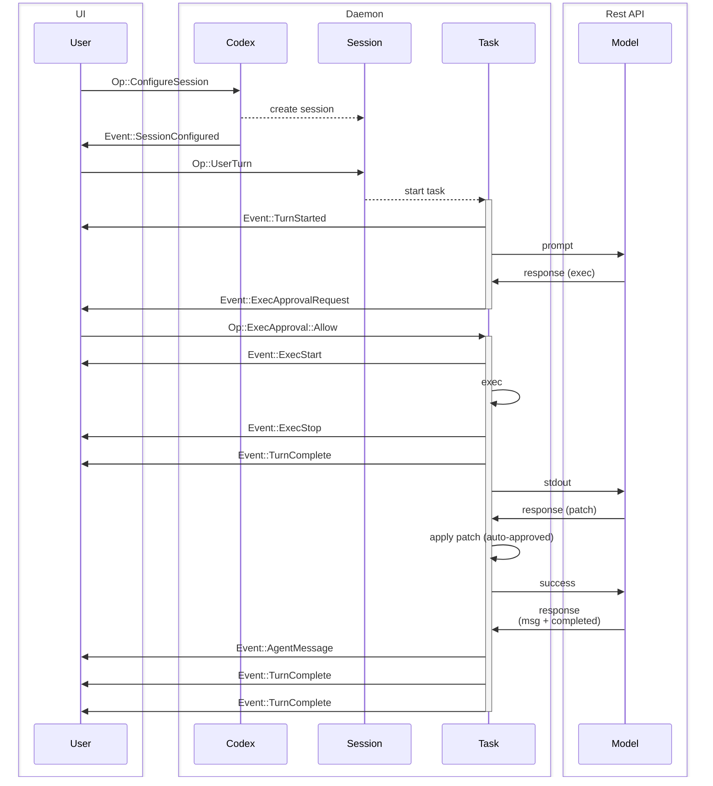
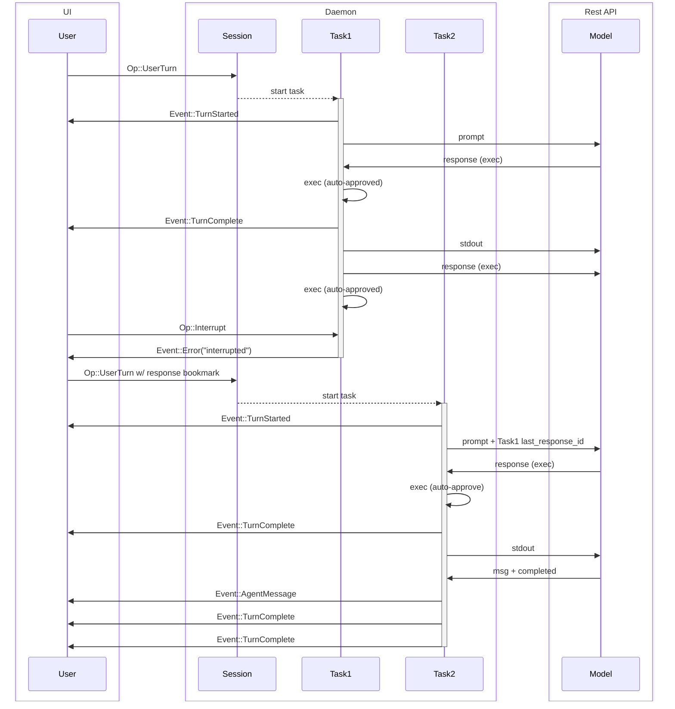

# Codex 内部协议实体与交互流程

解释协议术语、输入项、传输、界面流程和任务中断；正文提示部分实现与规格仍有差异，属于内部架构参考。

- 来源：OpenAI／Codex
- 资料类型：存档文档
- 存档版本：`5ef96ab2785f`。
- 文档时间：源码提交（存档版）：[2026-10-08](<https://github.com/openai/codex/commit/3b6ab3471a2d4d994c9fad322fca749564bc05e0>)；发表/更新：官方未公开；本地归档批次：2026-10-10
- 阅读状态：完整中文机器译文，由 Google 翻译；代码、命令与配置保留原样，未逐句人工校对。

[原文发布页](<https://github.com/openai/codex/blob/main/codex-rs/docs/protocol_v1.md>) · [原始文件](<../../../../原始抓取备份/原文/官方/OpenAI/Codex/Codex 内部协议实体与交互流程.md>) · [返回资料总览](<../../../资料总览.md>)

[查看原文对照](#原文对照)

## 中文全文

[protocol.rs](<https://github.com/openai/codex/blob/5ef96ab2785f3ecddf279639eff7b1b42c906fa4/codex-rs/protocol/src/protocol.rs>) 和 [agent.rs](<https://github.com/openai/codex/blob/5ef96ab2785f3ecddf279639eff7b1b42c906fa4/codex-rs/core/src/agent.rs>) 中定义的协议概述。

本文档的目标是定义系统中使用的术语并解释系统的预期行为。

NOTE：代码可能不完全符合此规范。审查此规范后需要进行一些小的更改，这不会改变现有的 TUI 的功能。

## 实体

这些是 Codex 后端的实体。本节的目的是为 `Codex` 核心系统建立词汇并构建共享心理模型。

0. `Model`
   - 在我们的例子中，这是响应 REST API
1. `Codex`
   - Codex的核心引擎
   - 在后台线程或单独进程中本地运行
   - 通过队列对进行通信 – SQ（提交队列）/EQ（事件队列）
   - 接受用户输入，向 `Model` 发出请求，执行命令并应用补丁。
2. `Session`
   - `Codex`的当前配置和状态
   - `Codex`开头没有`Session`，由`Op::ConfigureSession`初始化，这应该是UI发送的第一条消息。
   - 当前的 `Session` 可以通过附加的 `Op::ConfigureSession` 调用进行重新配置。
   - 重新配置会话时，任何正在运行的执行都会中止。
3. `Task`
   - `Task`是`Codex`响应用户输入执行工作。
   - `Session` 一次最多运行一个 `Task`。
   - 接收用户轮流输入启动 `Task`
   - 由一系列`Turn`组成
   - `Task` 执行到：
     - `Model` 完成任务，并且没有输出可馈送到附加的 `Turn`
     - 额外的用户轮流输入会中止当前任务并开始新任务
     - UI 用 `Op::Interrupt` 中断
     - 遇到致命错误，例如。 `Model` 连接超出重试限制
     - 被用户批准阻止（执行命令或补丁）
4. `Turn`
   - `Task` 中的一个迭代周期包括：
     - 对 `Model` 的请求 - （初始）提示 + （可选）`last_response_id`，或（循环中）上一轮输出
     - `Model` 在 SSE 中流式传输响应，这些响应将被收集，直到“完成”消息并且 SSE 终止
     - `Codex` 然后执行命令，应用补丁，并输出 `Model` 返回的消息
     - 必要时暂停请求批准
   - 一个`Turn`的输出是下一个`Turn`的输入
   - 不产生任何输出的 `Turn` 终止 `Task`

术语“UI”用于指驱动`Codex`的应用程序。这可能是用户操作的类似CLI / TUI聊天的界面，也可能是类似VSCode扩展的GUI界面。 UI 位于 `Codex` 外部，因为 `Codex` 旨在由任意 UI 实现进行操作。

当 `Turn` 完成时，`Model` 的最终 `response.completed` 消息中的 `response_id` 将存储在 `Session` 状态中，以在下一个用户轮流时恢复线程。 `response_id` 也会在 `EventMsg::TurnComplete` 中返回到 UI，通过在未来的用户回合中提供它，可用于从较早的点分叉线程。

由于一次只能运行 1 `Task`，因此对于并行任务，建议为每个工作线程运行一个 `Codex`。

## 接口

- `Codex`
  - 通过`SQ`（提交队列）和`EQ`（事件队列）与UI通信。
- `Submission`
  - 这些是在 `SQ` (UI -> `Codex`) 上发送的消息
  - 有一个由UI提供的字符串ID，简称为`sub_id`
  - `Op` 指的是所有可能的 `Submission` 有效负载的枚举
  - 在当前的代码库中，这些主要是进程中的 Rust 类型，而不是稳定的 serde 线合约
    - 该枚举为 `non_exhaustive`；可以在未来的日期添加变体
- `Event`
  - 这些是在 `EQ` (`Codex` -> UI) 上发送的消息
  - 每个 `Event` 都有一个非唯一的 ID，与启动当前任务的用户轮操作中的 `sub_id` 相匹配。
  - `EventMsg` 指的是所有可能的 `Event` 有效负载的枚举
    - 该枚举为 `non_exhaustive`；可以在未来的日期添加变体
    - 预计随着时间的推移，将会添加新的 `EventMsg` 变体，以公开有关模型操作的更多详细信息。

有关 `Op` 和 `EventMsg` 变体的完整文档，请参阅 [protocol.rs](<https://github.com/openai/codex/blob/5ef96ab2785f3ecddf279639eff7b1b42c906fa4/codex-rs/protocol/src/protocol.rs>)。一些示例有效负载类型：

- `Op`

  - `Op::UserTurn` – 用户启动 `Turn` 的任何输入，包括完整的每回合上下文，例如 cwd、模型、沙箱、批准策略和可选 `approvals_reviewer`
  - `Op::Interrupt` – 中断正在运行的转弯
  - `Op::ExecApproval` – 批准或拒绝代码执行
  - `Op::UserInputAnswer` – 为 `request_user_input` 工具调用提供答案

- `EventMsg`
  - `EventMsg::AgentMessage` – 来自`Model`的消息
  - `EventMsg::AgentMessageContentDelta` – 流媒体助手文本
  - `EventMsg::PlanDelta` – 当模型在计划模式下发出 `<proposed_plan>` 块时流式传输建议的计划文本
  - `EventMsg::ExecApprovalRequest` – 请求用户批准执行命令
  - `EventMsg::RequestUserInput` – 请求用户输入工具调用（问题可以包括选项加上 `isOther` 以添加自由格式的选择）
  - `EventMsg::TurnStarted` – 启动元数据包括 `model_context_window` 和 `collaboration_mode_kind`
  - `EventMsg::TurnComplete` – 转弯成功完成
  - `EventMsg::Error` – 转弯因错误而停止
  - `EventMsg::Warning` – 客户端应向用户显示的非致命警告
  - `EventMsg::TurnComplete` – 包含本回合最后执行的 `response_id` 的 `response_id` 书签。这可以用于在稍后的时间点继续转动，也许需要额外的用户输入。

### UserInput 项目

`Op::UserTurn` 内容项可以包括：

- `text` – 纯文本加上可选的 UI 文本元素。
- `image` / `local_image` – 图像输入。
- `skill` – 显式技能选择（`name`、`path` 到 `SKILL.md`）。
- `mention` – 显式 app/connector 选择（`name`、`path` 以 `app://{connector_id}` 形式）。

注：为了实现 v1 线路兼容性，`EventMsg::TurnStarted` 和 `EventMsg::TurnComplete` 序列号为 `task_started` / `task_complete`。解串器接受 `task_*` 和 `turn_*` 标签。

每轮返回的`response_id`与存储在API的`/responses`端点中的OpenAI`response_id`匹配。它可以被存储并在将来使用`Sessions`来恢复工作线程。

## 交通

可以在任何支持双向流传输的传输上运行。 - 交叉线程通道 - IPC 通道 - stdin/stdout - TCP - HTTP2 - gRPC

对于非帧传输，事件仍然干净地序列化为换行符分隔的 JSON，例如 stdin/stdout 和 TCP。提交有效负载应被视为实现细节，除非特定传输拥有显式适配器。

## 示例流程

常见交互的序列图示例。在每个图中，为了简单起见，可以消除一些不重要的事件。

### 基本UI流程

单个用户输入，后跟 2 轮转任务

### 任务中断

中断任务并继续执行其他用户输入。

## 原文对照

展开完整原文

Overview of Protocol defined in [protocol.rs](<https://github.com/openai/codex/blob/5ef96ab2785f3ecddf279639eff7b1b42c906fa4/codex-rs/protocol/src/protocol.rs>) and [agent.rs](<https://github.com/openai/codex/blob/5ef96ab2785f3ecddf279639eff7b1b42c906fa4/codex-rs/core/src/agent.rs>).

The goal of this document is to define terminology used in the system and explain the expected behavior of the system.

NOTE: The code might not completely match this spec. There are a few minor changes that need to be made after this spec has been reviewed, which will not alter the existing TUI's functionality.

## Entities

These are entities exit on the codex backend. The intent of this section is to establish vocabulary and construct a shared mental model for the `Codex` core system.

0. `Model`
   - In our case, this is the Responses REST API
1. `Codex`
   - The core engine of codex
   - Runs locally, either in a background thread or separate process
   - Communicated to via a queue pair – SQ (Submission Queue) / EQ (Event Queue)
   - Takes user input, makes requests to the `Model`, executes commands and applies patches.
2. `Session`
   - The `Codex`'s current configuration and state
   - `Codex` starts with no `Session`, and it is initialized by `Op::ConfigureSession`, which should be the first message sent by the UI.
   - The current `Session` can be reconfigured with additional `Op::ConfigureSession` calls.
   - Any running execution is aborted when the session is reconfigured.
3. `Task`
   - A `Task` is `Codex` executing work in response to user input.
   - `Session` has at most one `Task` running at a time.
   - Receiving user turn input starts a `Task`
   - Consists of a series of `Turn`s
   - The `Task` executes to until:
     - The `Model` completes the task and there is no output to feed into an additional `Turn`
     - Additional user-turn input aborts the current task and starts a new one
     - UI interrupts with `Op::Interrupt`
     - Fatal errors are encountered, eg. `Model` connection exceeding retry limits
     - Blocked by user approval (executing a command or patch)
4. `Turn`
   - One cycle of iteration in a `Task`, consists of:
     - A request to the `Model` - (initially) prompt + (optional) `last_response_id`, or (in loop) previous turn output
     - The `Model` streams responses back in an SSE, which are collected until "completed" message and the SSE terminates
     - `Codex` then executes command(s), applies patch(es), and outputs message(s) returned by the `Model`
     - Pauses to request approval when necessary
   - The output of one `Turn` is the input to the next `Turn`
   - A `Turn` yielding no output terminates the `Task`

The term "UI" is used to refer to the application driving `Codex`. This may be the CLI / TUI chat-like interface that users operate, or it may be a GUI interface like a VSCode extension. The UI is external to `Codex`, as `Codex` is intended to be operated by arbitrary UI implementations.

When a `Turn` completes, the `response_id` from the `Model`'s final `response.completed` message is stored in the `Session` state to resume the thread given the next user turn. The `response_id` is also returned in the `EventMsg::TurnComplete` to the UI, which can be used to fork the thread from an earlier point by providing it in a future user turn.

Since only 1 `Task` can be run at a time, for parallel tasks it is recommended that a single `Codex` be run for each thread of work.

## Interface

- `Codex`
  - Communicates with UI via a `SQ` (Submission Queue) and `EQ` (Event Queue).
- `Submission`
  - These are messages sent on the `SQ` (UI -> `Codex`)
  - Has an string ID provided by the UI, referred to as `sub_id`
  - `Op` refers to the enum of all possible `Submission` payloads
  - In the current codebase these are primarily in-process Rust types rather than a stable serde wire contract
    - This enum is `non_exhaustive`; variants can be added at future dates
- `Event`
  - These are messages sent on the `EQ` (`Codex` -> UI)
  - Each `Event` has a non-unique ID, matching the `sub_id` from the user-turn op that started the current task.
  - `EventMsg` refers to the enum of all possible `Event` payloads
    - This enum is `non_exhaustive`; variants can be added at future dates
    - It should be expected that new `EventMsg` variants will be added over time to expose more detailed information about the model's actions.

For complete documentation of the `Op` and `EventMsg` variants, refer to [protocol.rs](<https://github.com/openai/codex/blob/5ef96ab2785f3ecddf279639eff7b1b42c906fa4/codex-rs/protocol/src/protocol.rs>). Some example payload types:

- `Op`

  - `Op::UserTurn` – Any input from the user to kick off a `Turn`, including full per-turn context such as cwd, model, sandbox, approval policy, and optional `approvals_reviewer`
  - `Op::Interrupt` – Interrupts a running turn
  - `Op::ExecApproval` – Approve or deny code execution
  - `Op::UserInputAnswer` – Provide answers for a `request_user_input` tool call

- `EventMsg`
  - `EventMsg::AgentMessage` – Messages from the `Model`
  - `EventMsg::AgentMessageContentDelta` – Streaming assistant text
  - `EventMsg::PlanDelta` – Streaming proposed plan text when the model emits a `<proposed_plan>` block in plan mode
  - `EventMsg::ExecApprovalRequest` – Request approval from user to execute a command
  - `EventMsg::RequestUserInput` – Request user input for a tool call (questions can include options plus `isOther` to add a free-form choice)
  - `EventMsg::TurnStarted` – Turn start metadata including `model_context_window` and `collaboration_mode_kind`
  - `EventMsg::TurnComplete` – A turn completed successfully
  - `EventMsg::Error` – A turn stopped with an error
  - `EventMsg::Warning` – A non-fatal warning that the client should surface to the user
  - `EventMsg::TurnComplete` – Contains a `response_id` bookmark for last `response_id` executed by the turn. This can be used to continue the turn at a later point in time, perhaps with additional user input.

### UserInput items

`Op::UserTurn` content items can include:

- `text` – Plain text plus optional UI text elements.
- `image` / `local_image` – Image inputs.
- `skill` – Explicit skill selection (`name`, `path` to `SKILL.md`).
- `mention` – Explicit app/connector selection (`name`, `path` in `app://{connector_id}` form).

Note: For v1 wire compatibility, `EventMsg::TurnStarted` and `EventMsg::TurnComplete` serialize as `task_started` / `task_complete`. The deserializer accepts both `task_*` and `turn_*` tags.

The `response_id` returned from each turn matches the OpenAI `response_id` stored in the API's `/responses` endpoint. It can be stored and used in future `Sessions` to resume threads of work.

## Transport

Can operate over any transport that supports bi-directional streaming. - cross-thread channels - IPC channels - stdin/stdout - TCP - HTTP2 - gRPC

Events still serialize cleanly to newline-delimited JSON for non-framed transports, such as stdin/stdout and TCP. Submission payloads should be treated as implementation details unless a specific transport owns an explicit adapter.

## Example Flows

Sequence diagram examples of common interactions. In each diagram, some unimportant events may be eliminated for simplicity.

### Basic UI Flow

A single user input, followed by a 2-turn task

### Task Interrupt

Interrupting a task and continuing with additional user input.

