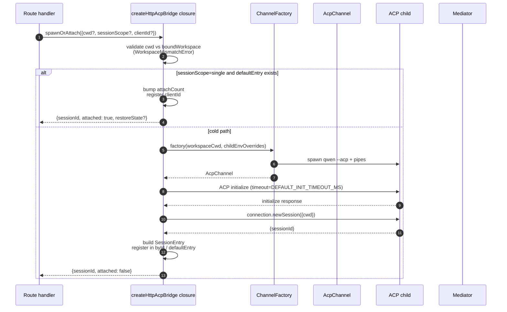
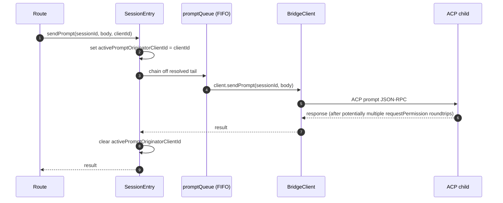
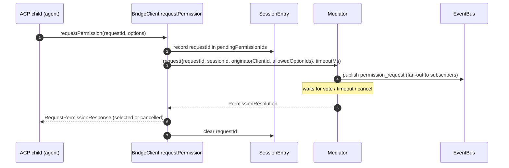
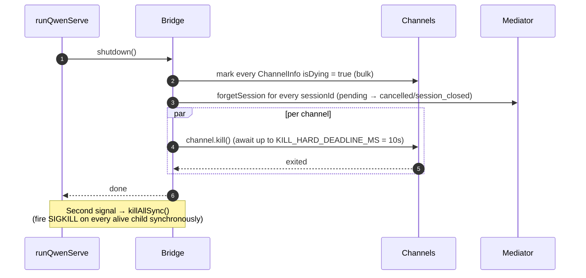

# Qwen Code ACP 桥接架构

解释 HTTP 层与 Agent 子进程之间的职责、启动附接、提示串行化、权限转发、关闭和已知限制。

- 来源：Qwen／Qwen Code
- 资料类型：存档文档
- 存档版本：`7e3de59d3aba`。
- 文档时间：源码提交（存档版）：[2026-09-12](<https://github.com/QwenLM/qwen-code/commit/e14ba73a2af823de00b7736e54e1f07ee9814020>)；发表/更新：官方未公开；本地归档批次：2026-10-10
- 阅读状态：完整中文机器译文，由 Google 翻译；代码、命令与配置保留原样，未逐句人工校对。

[原文发布页](<https://github.com/QwenLM/qwen-code/blob/main/docs/developers/daemon/03-acp-bridge.md>) · [原始文件](<../../../../原始抓取备份/原文/官方/Qwen/Qwen Code/docs/developers/daemon/03-acp-bridge.md>) · [返回资料总览](<../../../资料总览.md>)

[查看原文对照](#原文对照)

## 中文全文

# ACP 桥

## 概述

`packages/acp-bridge/` 拥有守护进程的 HTTP 层和 ACP 子进程之间的边界。它由 `packages/cli/src/serve/`（`qwen serve` 守护进程）消耗，并在 #4175 F1 步骤 3 中提取，因此未来的消费者（`channels/base/AcpBridge.ts`、VS Code IDE伴侣）可以使用相同的桥接核心，而无需进入 CLI 封装。

每个活动的 `WorkspaceRuntime` 拥有一个 `HttpAcpBridge` 实例。生产尝试预热受信任的主要子项以实现兼容性；受信任的辅助节点在第一个运行时命令或会话上打开其 `AcpChannel`，不受信任的辅助节点无法启动 ACP。旧主路由保留其现有的兼容性行为。在运行时内，桥接器通过通道、每个会话 `EventBus`、`MultiClientPermissionMediator`、`BridgeFileSystem` 适配器和面向 ACP- 的帮助程序（`spawnOrAttach`、`loadSession`、 `resumeSession`、`sendPrompt`、`cancelSession`、`respondToPermission`，以及用于工作区状态的 extMethod RPC 和 MCP 重新启动）。桥和子节点永远不会在工作空间运行时之间共享。

## 职责

- 通过可插入的 `ChannelFactory` 生成或附加到 ACP 子级。默认工厂：`defaultSpawnChannelFactory`（子进程`qwen --acp`）。测试注入`inMemoryChannel`。
- 维护`aliveChannels`（通道注册表）和`byId`（会话注册表）。
- 通过 `connection.newSession()` 将一个工作区运行时的 N 个 HTTP- 端会话复用到其 ACP 子级上。
- 通过 `promptQueue` 序列化每个会话提示（ACP 强制每个会话有一个活动提示）。
- `setSessionModel` 调用的每个会话 FIFO，因此不同模型的并发连接不会与 agent 竞争。
- 驱动 `GET /session/:id/events` 的每个会话 `EventBus`（请参阅 [`10-event-bus.md`](<https://github.com/QwenLM/qwen-code/blob/7e3de59d3aba5cab80767ac5b121c0b3b4e35267/docs/developers/daemon/10-event-bus.md>)）。
- 权限流程：`BridgeClient.requestPermission`→`MultiClientPermissionMediator.request`→扇出→投票收集→ACP响应（参见[`04-permission-mediation.md`](<Qwen Code 多客户端权限协调.md>)）。
- 文件I/O：`BridgeFileSystem`适配器，用于ACP读写；同一主机守护进程运行时会通告 `readTextFile: false`，因此正常的文本读取会保留在子进程中，而最终的文本写入仍会被委托（请参阅 [`07-workspace-filesystem.md`](<https://github.com/QwenLM/qwen-code/blob/7e3de59d3aba5cab80767ac5b121c0b3b4e35267/docs/developers/daemon/07-workspace-filesystem.md>)）。
- extMethod 用于工作区级别状态的 RPC（`/workspace/mcp`、`/workspace/skills`、`/workspace/providers`）、MCP 重新启动以及可选的私有托管 Tool Guard 回调。
- 生命周期：每个通道优雅的`shutdown()`和`KILL_HARD_DEADLINE_MS`（10秒）；同步 `killAllSync()` 用于第二个信号强制退出。

## 建筑

**公开条目**：`packages/acp-bridge/src/bridge.ts`中的`createHttpAcpBridge(opts: BridgeOptions): HttpAcpBridge`。

**按键类型**：

|类型|文件|角色|
| ------------------------------- | ----------------------- | --------------------------------------------------------------------------------------------------------------------------------------------------------------------------------------------------------------------- |
| `HttpAcpBridge`                 | `bridgeTypes.ts`        |公共接口：`spawnOrAttach`、`loadSession`、`resumeSession`、`sendPrompt`、`cancelSession`、`subscribeEvents`、`respondToPermission`、`getWorkspaceMcpStatus`、 `restartMcpServer`、`shutdown`、`killAllSync`、...|
| `BridgeSession`                 | `bridgeTypes.ts`        |`{ sessionId, workspaceCwd, attached, clientId?, createdAt? }` 返回到 HTTP 处理程序。|
| `BridgeOptions`                 | `bridgeOptions.ts`      |构建时配置（参见[配置](<#配置>)）。|
| `AcpChannel`                    | `channel.ts`            |`{ stream, kill(), killSync(), exited }` — 一个 ACP NDJSON 通道。|
| `ChannelFactory`                | `channel.ts`            | `(workspaceCwd, childEnvOverrides?) => Promise<AcpChannel>`.                                                                                                                                                          |
| `BridgeClient`                  | `bridgeClient.ts`       |包裹一个 ACP `ClientSideConnection`；实现 ACP `Client`（`requestPermission`、`readTextFile`、`writeTextFile`、`sessionUpdate`、`extNotification`）。|
| `EventBus`                      | `eventBus.ts`           |每个会话内存中 pub/sub. 请参阅 [`10-event-bus.md`](<https://github.com/QwenLM/qwen-code/blob/7e3de59d3aba5cab80767ac5b121c0b3b4e35267/docs/developers/daemon/10-event-bus.md>)。|
| `MultiClientPermissionMediator` | `permissionMediator.ts` |四政策调解者。参见[`04-permission-mediation.md`](<Qwen Code 多客户端权限协调.md>)。|

**内部状态（被`createHttpAcpBridge`关闭）**：

|状态|形状|目的|
| --------------- | ------------------------------- | -------------------------------------------------------------------------------------------------------------------------------------------------------------------------------------------------------------------------------------------------------------------------------------------------------------------------------------------------------------------------------------------------------- |
| `aliveChannels` | `Map<string, ChannelInfo>`      |频道注册表由频道 ID 键入。每个`ChannelInfo`保存`channel`、`connection`、`client`（每个通道一个`BridgeClient`）、`sessionIds: Set<string>`、`pendingRestoreIds`、`statusClosedReject?`、 `isDying: boolean`。|
| `byId`          | `Map<string, SessionEntry>`     |会话注册表键为 sessionId。每个`SessionEntry`持有`channel`、`connection`、`events: EventBus`、`promptQueue: Promise<void>`、`modelChangeQueue: Promise<void>`、`pendingPermissionIds: Set<string>`、`clientIds: Map<string, count>`、 `activePromptOriginatorClientId?`、`attachCount`、`spawnOwnerWantedKill`、`restoreState?`、`sessionLastSeenAt?`、`clientLastSeenAt: Map<string, ms>`。|
| `defaultEntry`  | `SessionEntry \| null`          |`sessionScope: 'single'` 时使用的“单个”会话。|
| `defaultPolicy` | `PermissionPolicy`              |通过`BridgeOptions.permissionPolicy`配置。|
| `mediator`      | `MultiClientPermissionMediator` |每个桥实例一个。|
|常数| —                               | `DEFAULT_INIT_TIMEOUT_MS = 10_000`, `MCP_RESTART_TIMEOUT_MS = 300_000`, `DEFAULT_MAX_SESSIONS = 32`, `MAX_EVENT_RING_SIZE = 1_000_000`, `DEFAULT_PERMISSION_TIMEOUT_MS = 0`, `DEFAULT_MAX_PENDING_PER_SESSION = 64`.                                                                                                                                                                                     |

**`isDying` 不变的**：必须设置任何拆卸路径 `ChannelInfo.isDying = true` 同步地 **之前** 等待 `channel.kill()`. `ensureChannel` 将垂死的通道视为不存在并生成一个新的通道。如果没有此标志，则并发 `spawnOrAttach` 期间抵达 SIGTERM 宽限窗口（最多 10 秒）将附加到即将关闭的传输以及调用者的 sessionId 会 404 在每一次后续行动中。拆卸包括初始化失败、空通道生成失败、工作区空闲到期和关闭；关闭最后一个会话仅释放其租约并安排工作空间空闲策略。

**`channelInfo`保留不变**：设置`isDying = true`时，执行**而不是**清除`channelInfo`。 `killAllSync` 仍必须在 SIGTERM 宽限窗口期间找到通道，才能在 `process.exit(1)` 上触发 SIGKILL。 `aliveChannels` 保留垂死的条目，直到 `channel.exited` 触发。

**BridgeClient 有界缓冲 **：ACP `extNotification` 帧到达 `BridgeClient`，但 sessionId 尚未到达 `byId`（因为 `connection.newSession` 的响应尚未到达）返回，但 `newSession` 内的 MCP 发现已触发预算事件）被缓冲到以 `MAX_EARLY_EVENT_SESSIONS = 64` × `MAX_EARLY_EVENTS_PER_SESSION = 32` × `EARLY_EVENT_TTL_MS = 60_000` 为界的早期事件队列中。最坏的情况大约是堆的400KB。如果没有缓冲，新会话的第一个 SSE 重播环槽将丢失在其创建期间触发的事件。

## 工作流程

### `spawnOrAttach`（主要入口点）



要点：

- `sessionScope='single'` 与现有的 `defaultEntry` 仅碰撞
`attachCount`，寄存器`clientId`，并返回`attached: true`。
- 冷路径运行ChannelFactory，执行ACP `initialize`
(`DEFAULT_INIT_TIMEOUT_MS=10s`)，调用`connection.newSession({cwd})`，然后
注册新的`SessionEntry`。
- `byId.size >= maxSessions` 时抛出 `SessionLimitExceededError`。
- 如果 `X-Qwen-Client-Id` 位于外部，则抛出 `InvalidClientIdError`
  `[A-Za-z0-9._:-]{1,128}`.
- `server.ts` 中的断开收割者通过以下方式跟踪生成所有者
`attachCount`/`spawnOwnerWantedKill` 以避免拆除 
 生成所有者已断开连接但其他客户端已连接的会话（查看 #3889
 BQ9tV）。

### 提示序列化



队列尾部的失败将被**吞掉**，以便先前提示的拒绝不会毒害后续提示；原始调用者仍然会因其返回的承诺而收到拒绝。会话中缓存的 `transportClosedReject` 会与 `channel.exited` 竞争提示承诺，因此崩溃的子进程会立即浮出水面，而不是挂起。

### 资源链接提示元数据

当 ACP 子级将具有非 `file://` URI 的 `resource_link` 转换为模型输入时，它会保留 `@URI` 引用，并包含客户端提供的 `name` 作为原始文件名。例如，`{ "type": "resource_link", "uri": "https://example.com/objects/7f9a2c", "name": "季度报告.csv" }` 变为：

```text
@https://example.com/objects/7f9a2c (original filename: "季度报告.csv")
```

该名称被 JSON- 引用，因此引号和换行符仍然是明确的元数据。空名称和没有名称的旧输入仅保留 ​​URI- 文本。此转换不会获取非文件资源或从 URI 路径推断文件名； `file://` 链接继续通过现有的文件解析路径。

### 权限流程（高级）



当线路投票尝试通过正常的 `optionId` 字段注入 `CANCEL_VOTE_SENTINEL` 时，`InvalidPermissionOptionError` 会被抛出预调解器 - 哨兵是网桥唯一的逃生口，可以将请求短路为 `cancelled / agent_cancelled`，并且不能意外地从线路到达。请参阅[`04-permission-mediation.md`](<Qwen Code 多客户端权限协调.md>)。

### 关机



## 渠道工厂

`AcpChannel` (`channel.ts`) 是网桥的传输抽象。生产环境在 `spawnChannel.ts` 中使用 `defaultSpawnChannelFactory`，它将 `qwen --acp` 作为具有 stdio 管道对的子进程运行。测试注入 `inMemoryChannel` 以在进程中运行 agent。桥对底层机制一无所知——它只需要`{ stream, kill, killSync, exited }`。

`ChannelFactory` 接受 `childEnvOverrides`，因此每个守护进程句柄都可以传递自己的 MCP- 预算环境变量（`QWEN_SERVE_MCP_CLIENT_BUDGET`、`QWEN_SERVE_MCP_BUDGET_MODE`），而无需改变 `process.env`（当两个嵌入式守护进程在同一节点进程中运行时，这会发生竞争）。

## 状态和生命周期

- 桥梁建设同步进行。呼叫者可以在第一个会话之前预热通道；否则第一个 `spawnOrAttach` 冷启动 ACP 子项。预热失败会使第一次使用可以重试。
- `defaultEntry`是`sessionScope: 'single'`下可重用的逻辑Session。会话关闭仅删除其会话租约。在所有会话、恢复、工作区控制、发现、身份验证和运行时操作工作耗尽并且没有显式确保保持活动窗口待处理之后，省略或零的 `channelIdleTimeoutMs` 会立即收获子级。普通预热会保留供首次使用，并且不会自行武装立即收割机。正值或活动的保活窗口会延迟收获；剩余延迟时间越长获胜。
- `MAX_EVENT_RING_SIZE = 1_000_000` 是 `BridgeOptions.eventRingSize` 的软上限，用于在 ~500 MB 每会话 OOM 之前捕获操作员拼写错误。
- `DEFAULT_PERMISSION_TIMEOUT_MS = 0` 默认情况下允许人类权限和问题无限期等待。 `permissionResponseTimeoutMs` 在操作员需要时启用挂钟上限；如果没有它，选民取消、会话取消和关闭仍然可用。
- `DEFAULT_MAX_PENDING_PER_SESSION = 64` 镜子 `DEFAULT_MAX_SUBSCRIBERS`；多余的 `requestPermission` 调用解析为已取消，并带有 stderr 警告。

## 依赖关系

|上游|下游|
| ---------------------------------------------------------------------------------- | ---------------------------------------------- |
|`@agentclientprotocol/sdk` — `ClientSideConnection`、`PROTOCOL_VERSION`、ACP 类型|`packages/cli/src/serve/`（守护进程）|
| `@qwen-code/qwen-code-core` — `ApprovalMode`, `TrustGateError`                     |`packages/channels/base/`（计划中，F4）|
| `node:crypto`, `node:fs`, `node:path`                                              |`packages/vscode-ide-companion/`（计划中，F4）|

## 配置

`BridgeOptions` (`bridgeOptions.ts`):

|钥匙|默认|目的|
| --------------------------------------------- | -------------------------------------------------- | ------------------------------------------------------------------------------------------------------------------------------------------------------------ |
| `boundWorkspace`                              |（必填）|桥强制执行的规范工作空间路径。|
| `sessionScope`                                | `'single'`                                         |`'single'` 在所有客户端之间共享一个会话； `'thread'` 为每个对话线程创建一个单独的会话。|
| `channelFactory`                              | `defaultSpawnChannelFactory`                       |可插拔ACP子工厂。|
| `initializeTimeoutMs`                         | `DEFAULT_INIT_TIMEOUT_MS = 10_000`                 |ACP `initialize` 握手超时。|
| `sessionRestoreTimeoutMs`                     | `60_000`                                           |ACP `loadSession` / `unstable_resumeSession` 超时；默认为 60 秒，显式配置的初始化超时可以提高它，但永远不会降低它。|
| `maxSessions`                                 | `DEFAULT_MAX_SESSIONS = 32`                        |盖上 `byId.size`。 `0` / `Infinity` = 无限制； NaN/negative 抛出。|
| `eventRingSize`                               |`DEFAULT_RING_SIZE`（来自`eventBus.ts`）|每会话事件环；软上限为 `MAX_EVENT_RING_SIZE`。|
| `permissionResponseTimeoutMs`                 | `DEFAULT_PERMISSION_TIMEOUT_MS = 0`                |中介者的按请求挂钟； `0` 禁用它。|
| `maxPendingPermissionsPerSession`             | `DEFAULT_MAX_PENDING_PER_SESSION = 64`             |高容量上的背压 agents。|
| `childEnvOverrides`                           | `{}`                                               |ACP 子项的每个句柄环境添加/磨砂。|
| `externalToolGuard`                           |（无）|用于私有子到父预执行决策的可选处理程序。桥接器仅从当前活动提示的所属通道接受它。|
| `persistApprovalMode`, `persistDisabledTools` | —                                                  |Wave 4 突变路线的设置写入挂钩。|
| `statusProvider`                              |（无）|守护进程主机预检单元 (`DaemonStatusProvider`)。|
| `delegateReadTextFileToClient`                | `true`                                             |仅针对同一主机运行时设置 `false`，以便每个子 `FileSystemService.readTextFile` 使用者使用常规 CLI 文件系统服务。|
| `fileSystem`                                  |（无）|`BridgeFileSystem` 适用于 ACP `readTextFile` / `writeTextFile` 的适配器。|
| `permissionPolicy`                            |来自 `settings.json` 的 `policy.permissionStrategy`|`first-responder` / `designated` / `consensus` / `local-only` 之一。|
| `permissionConsensusQuorum`                   |来自`settings.json`|N 代表共识政策。|
| `permissionAudit`                             | `createNoOpPermissionAuditPublisher()`             |电汇至 `PermissionAuditRing` 以获取审计跟踪。|
| `channelIdleTimeoutMs`                        | `0`                                                |自动收割延迟；简单的预热在第一次状态读取后仍然存在，并且主动保持连接可能会延长它。|

在当前ACPSDK中，超时恢复不可取消。因此，桥会保留结算围栏和容量准入，直到真正的请求得到解决或其传输关闭。迟到的结果只会被关闭一次并且从未注册。清理不确定性仅隔离该工作区上的新会话工作；现有的会话和工作区控制流量将继续，直到通道耗尽并被回收。

## 附加桥接方法

除了核心 `spawnOrAttach`、`sendPrompt`、`cancelSession`、
`respondToPermission`、`loadSession` 和 `resumeSession` 调用之外，
`HttpAcpBridge` 接口现在还包括这些面向守护进程的帮助程序：

|方法|目的|
| ------------------------------------------------------------ | --------------------------------------------- |
| `generateSessionRecap(sessionId, context?)`                  |生成一行会话回顾。|
| `generateSessionBtw(sessionId, question, signal?, context?)` |回答一个附带问题/顺便说一句提示。|
| `executeShellCommand(sessionId, command, signal?, context?)` |在守护进程主机上运行 shell 命令。|
| `getSessionContextUsageStatus(sessionId, opts?)`             |返回上下文窗口的使用情况。|
| `getSessionSupportedCommandsStatus(sessionId)`               |返回可用的斜杠命令。|
| `getSessionTasksStatus(sessionId)`                           |返回后台任务快照。|
| `getSessionStatsStatus(sessionId)`                           |返回会话使用统计信息。|
| `setSessionApprovalMode(sessionId, mode, opts, context?)`    |更新会话的批准模式。|
| `detachClient(sessionId, clientId?)`                         |显式分离客户端。|
| `addRuntimeMcpServer(name, config, originatorClientId)`      |在运行时添加 MCP 服务器。|
| `removeRuntimeMcpServer(name, originatorClientId)`           |在运行时删除 MCP 服务器。|
| `manageMcpServer(serverName, action, originatorClientId)`    |启用/禁用/验证/清除验证。|
| `generateWorkspaceAgent(description, originatorClientId)`    |使用 AI 生成子代理定义。|
| `preheat()`                                                  |在第一次训练前对 ACP 孩子进行保暖。|
| `getSessionLastEventId(sessionId)`                           |读取会话的单调事件 ID。|
| `getWorkspaceToolsStatus()`                                  |返回内置工具注册表快照。|
| `getWorkspaceMcpToolsStatus(serverName)`                     |返回特定 MCP 服务器的工具。|

`BridgeSpawnRequest.sessionScope` 由 `'per-client'` 更名为 
`'thread'`。 `BridgeRestoredSession` 现在包含 `compactedReplay`、
`liveJournal` 和 `lastEventId`。这些重播字段是实时会话的有界内存中
窗口，上限为`BridgeOptions.compactedReplayMaxBytes`
（默认4 MiB，硬上限256 MiB）。飞行中的 `liveJournal` 是 
，分别由 `BridgeOptions.maxJournalEvents`（默认 10 000 重播 
 条目）和 `BridgeOptions.maxJournalBytes`（默认序列化的 
 源事件的 8 MiB）。连续的兼容文本或思想块共享一个重播
条目，每个条目最多包含256个源事件；其他事件和归因
边界保持不变。如果旧的保留重放被删除，
`compactedReplay[0]` 是无 id 的 `history_truncated` 标记；如果日志 
 条目被删除，则 `liveJournal[0]` 带有 `history_truncated` 标记 
 和 `scope: 'live_journal'`。其保留和截断计数描述源事件，而不是重播条目。完整的持久记录保留在
磁盘上，并且不会被此桥响应公开。
`BridgeClientRequestContext`是通过桥
调用线程化的请求上下文；它带有`clientId`、`fromLoopback: boolean`和`promptId`。

## 注意事项和已知限制

- `MCP_RESTART_TIMEOUT_MS = 300_000` (5 分钟) — `/workspace/mcp/:server/restart` 的网桥超时故意设置得较大，因为对于 stdio 服务器，`McpClientManager.MAX_DISCOVERY_TIMEOUT_MS` 可以达到 5 分钟。较短的期限会产生错误的超时，而 ACP 子进程会在后台不断重新连接。
- `BridgeOptions.eventRingSize > 1_000_000` 抛出施工。
- `connection.unstable_resumeSession`通过稳定的`session_resume`守护进程能力公开； `unstable_session_resume` 仍然作为旧版 SDK 的已弃用兼容性别名进行宣传。客户端应进行功能检测 `session_resume`。
- 桥接包是`@qwen-code/acp-bridge`。当前代码直接从包子路径导入事件总线和状态原语； `serve/acp-session-bridge.ts` 仍然是更广泛桥梁表面的 CLI- 本地兼容性立面。

## 参考文献

- `packages/acp-bridge/src/bridge.ts`（尤其是 `createHttpAcpBridge` 行 350+）
- `packages/acp-bridge/src/bridgeClient.ts`
- `packages/acp-bridge/src/bridgeTypes.ts`
- `packages/acp-bridge/src/bridgeOptions.ts`
- `packages/acp-bridge/src/channel.ts`
- `packages/acp-bridge/src/spawnChannel.ts`
- `packages/acp-bridge/src/bridgeErrors.ts`
- 问题：[#3803](<https://github.com/QwenLM/qwen-code/issues/3803>)、[#4175](<https://github.com/QwenLM/qwen-code/issues/4175>)。


## 原文对照

<details>
<summary>展开完整原文</summary>

# ACP Bridge

## Overview

`packages/acp-bridge/` owns the boundary between the daemon's HTTP layer and the ACP child process. It is consumed by `packages/cli/src/serve/` (the `qwen serve` daemon) and was extracted in #4175 F1 step 3 so future consumers (`channels/base/AcpBridge.ts`, the VS Code IDE companion) can use the same bridge core without reaching into the CLI package.

Each active `WorkspaceRuntime` owns one `HttpAcpBridge` instance. Production attempts to preheat the trusted primary child for compatibility; trusted secondaries open their `AcpChannel` on the first runtime command or Session, and untrusted secondaries cannot start ACP. Legacy primary routes retain their existing compatibility behavior. Within the runtime, the bridge provides multiplexed sessions over the channel, per-session `EventBus`es, a `MultiClientPermissionMediator`, a `BridgeFileSystem` adapter, and ACP-oriented helpers (`spawnOrAttach`, `loadSession`, `resumeSession`, `sendPrompt`, `cancelSession`, `respondToPermission`, plus extMethod RPCs for workspace status and MCP restart). Bridges and children are never shared across workspace runtimes.

## Responsibilities

- Spawn or attach to the ACP child via a pluggable `ChannelFactory`. Default factory: `defaultSpawnChannelFactory` (subprocess `qwen --acp`). Tests inject `inMemoryChannel`.
- Maintain `aliveChannels` (channel registry) and `byId` (session registry).
- Multiplex N HTTP-side sessions for one workspace runtime onto its ACP child via `connection.newSession()`.
- Serialize per-session prompts through `promptQueue` (ACP enforces one active prompt per session).
- Per-session FIFO for `setSessionModel` calls so concurrent attaches with different models do not race the agent.
- Per-session `EventBus` that drives `GET /session/:id/events` (see [`10-event-bus.md`](<https://github.com/QwenLM/qwen-code/blob/7e3de59d3aba5cab80767ac5b121c0b3b4e35267/docs/developers/daemon/10-event-bus.md>)).
- Permission flow: `BridgeClient.requestPermission` → `MultiClientPermissionMediator.request` → fan-out → vote collection → ACP response (see [`04-permission-mediation.md`](<Qwen Code 多客户端权限协调.md>)).
- File I/O: `BridgeFileSystem` adapter for ACP reads and writes; same-host daemon runtimes advertise `readTextFile: false` so normal text reads stay in the child while final text writes remain delegated (see [`07-workspace-filesystem.md`](<https://github.com/QwenLM/qwen-code/blob/7e3de59d3aba5cab80767ac5b121c0b3b4e35267/docs/developers/daemon/07-workspace-filesystem.md>)).
- extMethod RPCs for workspace-level status (`/workspace/mcp`, `/workspace/skills`, `/workspace/providers`), MCP restart, and the optional private managed Tool Guard callback.
- Lifecycle: graceful `shutdown()` with `KILL_HARD_DEADLINE_MS` (10s) per channel; synchronous `killAllSync()` for second-signal force-exit.

## Architecture

**Public entry**: `createHttpAcpBridge(opts: BridgeOptions): HttpAcpBridge` in `packages/acp-bridge/src/bridge.ts`.

**Key types**:

| Type                            | File                    | Role                                                                                                                                                                                                                  |
| ------------------------------- | ----------------------- | --------------------------------------------------------------------------------------------------------------------------------------------------------------------------------------------------------------------- |
| `HttpAcpBridge`                 | `bridgeTypes.ts`        | Public interface: `spawnOrAttach`, `loadSession`, `resumeSession`, `sendPrompt`, `cancelSession`, `subscribeEvents`, `respondToPermission`, `getWorkspaceMcpStatus`, `restartMcpServer`, `shutdown`, `killAllSync`, … |
| `BridgeSession`                 | `bridgeTypes.ts`        | `{ sessionId, workspaceCwd, attached, clientId?, createdAt? }` returned to HTTP handlers.                                                                                                                             |
| `BridgeOptions`                 | `bridgeOptions.ts`      | Construction-time config (see [Configuration](<#configuration>)).                                                                                                                                                       |
| `AcpChannel`                    | `channel.ts`            | `{ stream, kill(), killSync(), exited }` — one ACP NDJSON channel.                                                                                                                                                    |
| `ChannelFactory`                | `channel.ts`            | `(workspaceCwd, childEnvOverrides?) => Promise<AcpChannel>`.                                                                                                                                                          |
| `BridgeClient`                  | `bridgeClient.ts`       | Wraps one ACP `ClientSideConnection`; implements ACP `Client` (`requestPermission`, `readTextFile`, `writeTextFile`, `sessionUpdate`, `extNotification`).                                                             |
| `EventBus`                      | `eventBus.ts`           | Per-session in-memory pub/sub. See [`10-event-bus.md`](<https://github.com/QwenLM/qwen-code/blob/7e3de59d3aba5cab80767ac5b121c0b3b4e35267/docs/developers/daemon/10-event-bus.md>).                                                                                                                                            |
| `MultiClientPermissionMediator` | `permissionMediator.ts` | Four-policy mediator. See [`04-permission-mediation.md`](<Qwen Code 多客户端权限协调.md>).                                                                                                                               |

**Internal state (closed over by `createHttpAcpBridge`)**:

| State           | Shape                           | Purpose                                                                                                                                                                                                                                                                                                                                                                                                  |
| --------------- | ------------------------------- | -------------------------------------------------------------------------------------------------------------------------------------------------------------------------------------------------------------------------------------------------------------------------------------------------------------------------------------------------------------------------------------------------------- |
| `aliveChannels` | `Map<string, ChannelInfo>`      | Channel registry keyed by channel id. Each `ChannelInfo` holds `channel`, `connection`, `client` (one `BridgeClient` per channel), `sessionIds: Set<string>`, `pendingRestoreIds`, `statusClosedReject?`, `isDying: boolean`.                                                                                                                                                                            |
| `byId`          | `Map<string, SessionEntry>`     | Session registry keyed by sessionId. Each `SessionEntry` holds `channel`, `connection`, `events: EventBus`, `promptQueue: Promise<void>`, `modelChangeQueue: Promise<void>`, `pendingPermissionIds: Set<string>`, `clientIds: Map<string, count>`, `activePromptOriginatorClientId?`, `attachCount`, `spawnOwnerWantedKill`, `restoreState?`, `sessionLastSeenAt?`, `clientLastSeenAt: Map<string, ms>`. |
| `defaultEntry`  | `SessionEntry \| null`          | The "single" session used when `sessionScope: 'single'`.                                                                                                                                                                                                                                                                                                                                                 |
| `defaultPolicy` | `PermissionPolicy`              | Configured via `BridgeOptions.permissionPolicy`.                                                                                                                                                                                                                                                                                                                                                         |
| `mediator`      | `MultiClientPermissionMediator` | One per bridge instance.                                                                                                                                                                                                                                                                                                                                                                                 |
| Constants       | —                               | `DEFAULT_INIT_TIMEOUT_MS = 10_000`, `MCP_RESTART_TIMEOUT_MS = 300_000`, `DEFAULT_MAX_SESSIONS = 32`, `MAX_EVENT_RING_SIZE = 1_000_000`, `DEFAULT_PERMISSION_TIMEOUT_MS = 0`, `DEFAULT_MAX_PENDING_PER_SESSION = 64`.                                                                                                                                                                                     |

**`isDying` invariant**: any teardown path must set `ChannelInfo.isDying = true` synchronously **before** awaiting `channel.kill()`. `ensureChannel` treats a dying channel as absent and spawns a fresh one. Without this flag a concurrent `spawnOrAttach` arriving during the SIGTERM grace window (up to 10s) would attach to a transport about to close and the caller's sessionId would 404 on every follow-up. Teardown includes initialization failures, failed empty-channel spawns, workspace idle expiry, and shutdown; closing the last Session only releases its lease and schedules the workspace idle policy.

**`channelInfo` retention invariant**: do **not** clear `channelInfo` when setting `isDying = true`. `killAllSync` must still find the channel during the SIGTERM grace window to fire SIGKILL on `process.exit(1)`. `aliveChannels` holds the dying entry until `channel.exited` fires.

**BridgeClient bounded buffering**: ACP `extNotification` frames arriving on `BridgeClient` for a sessionId not yet in `byId` (because `connection.newSession`'s response has not returned, but MCP discovery inside `newSession` already fired budget events) are buffered into an early-events queue bounded by `MAX_EARLY_EVENT_SESSIONS = 64` × `MAX_EARLY_EVENTS_PER_SESSION = 32` × `EARLY_EVENT_TTL_MS = 60_000`. The worst case is roughly 400 KB of heap. Without buffering, the first SSE replay-ring slot for a new session would be missing events that fired during its creation.

## Workflow

### `spawnOrAttach` (primary entry point)


Key points:

- `sessionScope='single'` with an existing `defaultEntry` only bumps
  `attachCount`, registers `clientId`, and returns `attached: true`.
- The cold path runs the ChannelFactory, performs ACP `initialize`
  (`DEFAULT_INIT_TIMEOUT_MS=10s`), calls `connection.newSession({cwd})`, then
  registers the new `SessionEntry`.
- `SessionLimitExceededError` is thrown when `byId.size >= maxSessions`.
- `InvalidClientIdError` is thrown if `X-Qwen-Client-Id` is outside
  `[A-Za-z0-9._:-]{1,128}`.
- The disconnect-reaper in `server.ts` tracks the spawn owner via
  `attachCount`/`spawnOwnerWantedKill` to avoid tearing down a session whose
  spawn owner disconnected but other clients already attached (review #3889
  BQ9tV).

### Prompt serialization


Failures at the queue tail are **swallowed** so that a prior prompt's rejection does not poison subsequent prompts; the original caller still receives the rejection on its own returned promise. The `transportClosedReject` cached on the session races the prompt promise against `channel.exited` so a crashed child surfaces immediately rather than hanging.

### Resource-link prompt metadata

When the ACP child converts a `resource_link` with a non-`file://` URI into model input, it retains the `@URI` reference and includes the client-provided `name` as an original filename. For example, `{ "type": "resource_link", "uri": "https://example.com/objects/7f9a2c", "name": "季度报告.csv" }` becomes:

```text
@https://example.com/objects/7f9a2c (original filename: "季度报告.csv")
```

The name is JSON-quoted so quotes and newlines remain unambiguous metadata. Empty names and legacy inputs without a name keep the URI-only text. This conversion does not fetch non-file resources or infer filenames from URI paths; `file://` links continue through the existing file-resolution path.

### Permission flow (high-level)


`InvalidPermissionOptionError` is thrown pre-mediator when a wire vote tries to inject `CANCEL_VOTE_SENTINEL` via the normal `optionId` field — the sentinel is the bridge's only escape hatch to short-circuit a request as `cancelled / agent_cancelled` and must not be reachable from the wire by accident. See [`04-permission-mediation.md`](<Qwen Code 多客户端权限协调.md>).

### Shutdown


## Channel factory

`AcpChannel` (`channel.ts`) is the bridge's transport abstraction. Production uses `defaultSpawnChannelFactory` in `spawnChannel.ts`, which runs `qwen --acp` as a subprocess with a stdio pipe pair. Tests inject `inMemoryChannel` to run the agent in-process. The bridge knows nothing about the underlying mechanism — it only needs `{ stream, kill, killSync, exited }`.

`ChannelFactory` accepts `childEnvOverrides` so each daemon handle can pass its own MCP-budget env vars (`QWEN_SERVE_MCP_CLIENT_BUDGET`, `QWEN_SERVE_MCP_BUDGET_MODE`) without mutating `process.env` (which would race when two embedded daemons run in the same Node process).

## State & Lifecycle

- Bridge construction is synchronous. A caller may preheat the channel before the first session; otherwise the first `spawnOrAttach` cold-starts the ACP child. A failed preheat leaves first use free to retry.
- `defaultEntry` is the reusable logical Session under `sessionScope: 'single'`. Session close removes only its Session lease. After all Session, restore, workspace-control, discovery, authentication, and runtime-operation work drains and no explicit-ensure keepalive window is pending, an omitted or zero `channelIdleTimeoutMs` reaps the child immediately. Plain preheat is preserved for first use and does not arm that immediate reaper by itself. A positive value or active keepalive window delays reaping; the longer remaining delay wins.
- `MAX_EVENT_RING_SIZE = 1_000_000` is a soft upper bound on `BridgeOptions.eventRingSize` to catch operator typos before ~500 MB per-session OOMs.
- `DEFAULT_PERMISSION_TIMEOUT_MS = 0` lets human permissions and questions wait indefinitely by default. `permissionResponseTimeoutMs` enables a wall-clock cap when operators need one; voter cancellation, session cancellation, and shutdown remain available without it.
- `DEFAULT_MAX_PENDING_PER_SESSION = 64` mirrors `DEFAULT_MAX_SUBSCRIBERS`; excess `requestPermission` calls resolve as cancelled with a stderr warning.

## Dependencies

| Upstream                                                                           | Downstream                                     |
| ---------------------------------------------------------------------------------- | ---------------------------------------------- |
| `@agentclientprotocol/sdk` — `ClientSideConnection`, `PROTOCOL_VERSION`, ACP types | `packages/cli/src/serve/` (the daemon)         |
| `@qwen-code/qwen-code-core` — `ApprovalMode`, `TrustGateError`                     | `packages/channels/base/` (planned, F4)        |
| `node:crypto`, `node:fs`, `node:path`                                              | `packages/vscode-ide-companion/` (planned, F4) |

## Configuration

`BridgeOptions` (`bridgeOptions.ts`):

| Key                                           | Default                                            | Purpose                                                                                                                                                      |
| --------------------------------------------- | -------------------------------------------------- | ------------------------------------------------------------------------------------------------------------------------------------------------------------ |
| `boundWorkspace`                              | (required)                                         | Canonical workspace path the bridge enforces.                                                                                                                |
| `sessionScope`                                | `'single'`                                         | `'single'` shares one session across all clients; `'thread'` creates a separate session for each conversation thread.                                        |
| `channelFactory`                              | `defaultSpawnChannelFactory`                       | Pluggable ACP child factory.                                                                                                                                 |
| `initializeTimeoutMs`                         | `DEFAULT_INIT_TIMEOUT_MS = 10_000`                 | ACP `initialize` handshake timeout.                                                                                                                          |
| `sessionRestoreTimeoutMs`                     | `60_000`                                           | ACP `loadSession` / `unstable_resumeSession` timeout; defaults to 60s, and an explicitly configured initialize timeout can raise it but never lower it.      |
| `maxSessions`                                 | `DEFAULT_MAX_SESSIONS = 32`                        | Cap on `byId.size`. `0` / `Infinity` = unlimited; NaN/negative throws.                                                                                       |
| `eventRingSize`                               | `DEFAULT_RING_SIZE` (from `eventBus.ts`)           | Per-session event ring; soft-capped at `MAX_EVENT_RING_SIZE`.                                                                                                |
| `permissionResponseTimeoutMs`                 | `DEFAULT_PERMISSION_TIMEOUT_MS = 0`                | Per-request wallclock for the mediator; `0` disables it.                                                                                                     |
| `maxPendingPermissionsPerSession`             | `DEFAULT_MAX_PENDING_PER_SESSION = 64`             | Backpressure on high-volume agents.                                                                                                                          |
| `childEnvOverrides`                           | `{}`                                               | Per-handle env additions / scrubs for the ACP child.                                                                                                         |
| `externalToolGuard`                           | (none)                                             | Optional handler for the private child-to-parent pre-execution decision. The bridge accepts it only from the owning channel for the currently active Prompt. |
| `persistApprovalMode`, `persistDisabledTools` | —                                                  | Settings-write hooks for the Wave 4 mutation routes.                                                                                                         |
| `statusProvider`                              | (none)                                             | Daemon-host preflight cells (`DaemonStatusProvider`).                                                                                                        |
| `delegateReadTextFileToClient`                | `true`                                             | Set `false` only for same-host runtimes so every child `FileSystemService.readTextFile` consumer uses the regular CLI filesystem service.                    |
| `fileSystem`                                  | (none)                                             | `BridgeFileSystem` adapter for ACP `readTextFile` / `writeTextFile`.                                                                                         |
| `permissionPolicy`                            | from `settings.json`'s `policy.permissionStrategy` | One of `first-responder` / `designated` / `consensus` / `local-only`.                                                                                        |
| `permissionConsensusQuorum`                   | from `settings.json`                               | N for consensus policy.                                                                                                                                      |
| `permissionAudit`                             | `createNoOpPermissionAuditPublisher()`             | Wire to `PermissionAuditRing` for the audit trail.                                                                                                           |
| `channelIdleTimeoutMs`                        | `0`                                                | Auto-reap delay; plain preheat survives its first status read, and active keepalive may extend it.                                                           |

Timed-out restores are not cancellable in the current ACP SDK. The bridge therefore keeps a settlement fence and capacity admission until the real request settles or its transport closes. A late result is closed exactly once and never registered. Cleanup uncertainty quarantines only fresh session work on that workspace; existing session and workspace-control traffic continues until the channel drains and is recycled.

## Additional bridge methods

In addition to the core `spawnOrAttach`, `sendPrompt`, `cancelSession`,
`respondToPermission`, `loadSession`, and `resumeSession` calls, the
`HttpAcpBridge` interface now includes these daemon-facing helpers:

| Method                                                       | Purpose                                       |
| ------------------------------------------------------------ | --------------------------------------------- |
| `generateSessionRecap(sessionId, context?)`                  | Generate a one-line session recap.            |
| `generateSessionBtw(sessionId, question, signal?, context?)` | Answer a side question / btw prompt.          |
| `executeShellCommand(sessionId, command, signal?, context?)` | Run a shell command on the daemon host.       |
| `getSessionContextUsageStatus(sessionId, opts?)`             | Return context-window usage.                  |
| `getSessionSupportedCommandsStatus(sessionId)`               | Return available slash commands.              |
| `getSessionTasksStatus(sessionId)`                           | Return a background-task snapshot.            |
| `getSessionStatsStatus(sessionId)`                           | Return session usage statistics.              |
| `setSessionApprovalMode(sessionId, mode, opts, context?)`    | Update approval mode for a session.           |
| `detachClient(sessionId, clientId?)`                         | Explicitly detach a client.                   |
| `addRuntimeMcpServer(name, config, originatorClientId)`      | Add an MCP server at runtime.                 |
| `removeRuntimeMcpServer(name, originatorClientId)`           | Remove an MCP server at runtime.              |
| `manageMcpServer(serverName, action, originatorClientId)`    | Enable / disable / authenticate / clear auth. |
| `generateWorkspaceAgent(description, originatorClientId)`    | Generate a subagent definition with AI.       |
| `preheat()`                                                  | Warm the ACP child before the first session.  |
| `getSessionLastEventId(sessionId)`                           | Read the session's monotonic event id.        |
| `getWorkspaceToolsStatus()`                                  | Return the built-in tool registry snapshot.   |
| `getWorkspaceMcpToolsStatus(serverName)`                     | Return tools for a specific MCP server.       |

`BridgeSpawnRequest.sessionScope` was renamed from `'per-client'` to
`'thread'`. `BridgeRestoredSession` now carries `compactedReplay`,
`liveJournal`, and `lastEventId`. Those replay fields are a bounded in-memory
window for live sessions, capped by `BridgeOptions.compactedReplayMaxBytes`
(default 4 MiB, hard ceiling 256 MiB). The in-flight `liveJournal` is
separately capped by `BridgeOptions.maxJournalEvents` (default 10 000 replay
entries) and `BridgeOptions.maxJournalBytes` (default 8 MiB of serialized
source events). Consecutive compatible text or thought chunks share a replay
entry, with at most 256 source events per entry; other event and attribution
boundaries remain intact. If older retained replay was dropped,
`compactedReplay[0]` is the id-less `history_truncated` marker; if journal
entries were dropped, `liveJournal[0]` carries a `history_truncated` marker
with `scope: 'live_journal'`. Its retained and truncated counts describe source events, not replay entries. The full persisted transcript remains on
disk and is not exposed by this bridge response.
`BridgeClientRequestContext` is the request context threaded through bridge
calls; it carries `clientId`, `fromLoopback: boolean`, and `promptId`.

## Caveats & Known Limits

- `MCP_RESTART_TIMEOUT_MS = 300_000` (5 min) — the bridge timeout for `/workspace/mcp/:server/restart` is intentionally large because `McpClientManager.MAX_DISCOVERY_TIMEOUT_MS` can be up to 5 min for stdio servers. A shorter deadline would produce false timeouts while the ACP child kept reconnecting in the background.
- `BridgeOptions.eventRingSize > 1_000_000` throws at construction.
- `connection.unstable_resumeSession` is exposed through the stable `session_resume` daemon capability; `unstable_session_resume` remains advertised as a deprecated compatibility alias for older SDKs. Clients should feature-detect `session_resume`.
- The bridge package is `@qwen-code/acp-bridge`. Current code imports event-bus and status primitives directly from package subpaths; `serve/acp-session-bridge.ts` remains as the CLI-local compatibility facade for the broader bridge surface.

## References

- `packages/acp-bridge/src/bridge.ts` (esp. `createHttpAcpBridge` at line 350+)
- `packages/acp-bridge/src/bridgeClient.ts`
- `packages/acp-bridge/src/bridgeTypes.ts`
- `packages/acp-bridge/src/bridgeOptions.ts`
- `packages/acp-bridge/src/channel.ts`
- `packages/acp-bridge/src/spawnChannel.ts`
- `packages/acp-bridge/src/bridgeErrors.ts`
- Issues: [#3803](<https://github.com/QwenLM/qwen-code/issues/3803>), [#4175](<https://github.com/QwenLM/qwen-code/issues/4175>).


</details>
