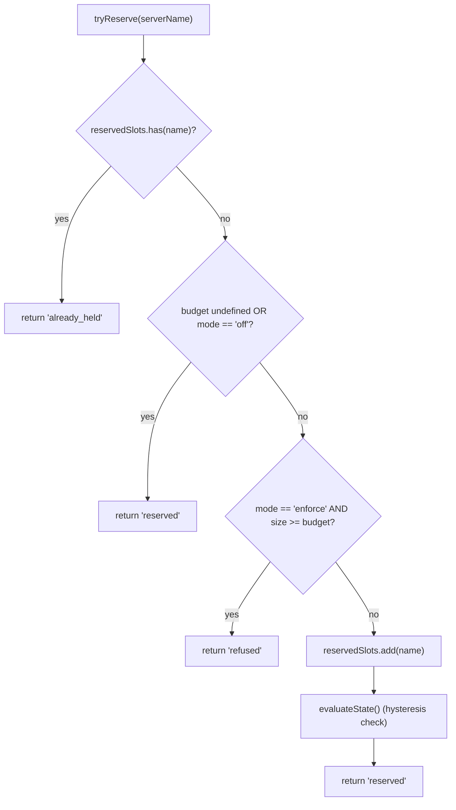
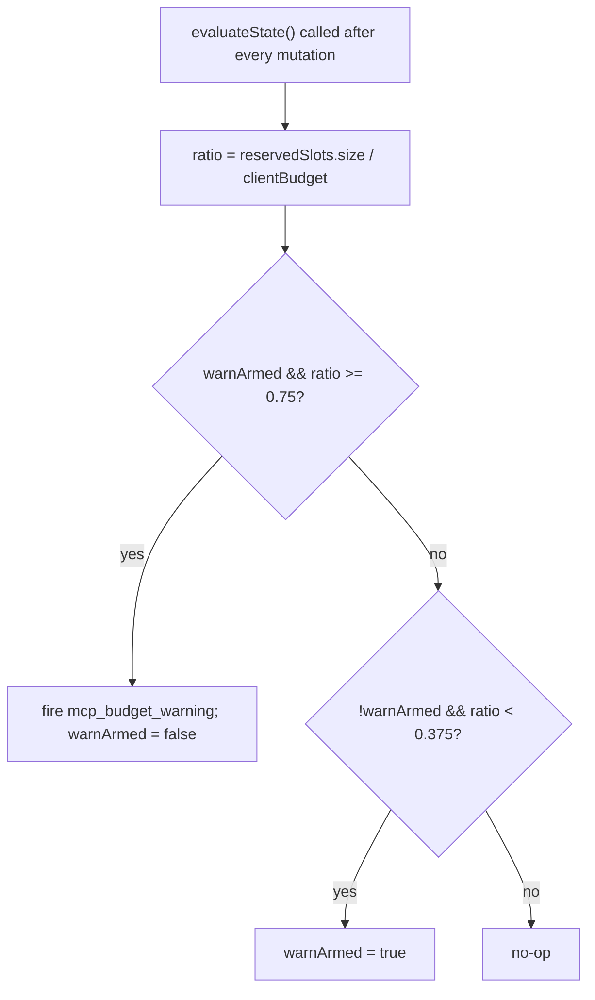

# Qwen Code MCP 工作区预算控制

说明连接名额预留、阈值提示、拒绝合并、状态机及生命周期；属于 MCP 资源管理的内部架构参考。

- 来源：Qwen／Qwen Code
- 资料类型：存档文档
- 存档版本：`7e3de59d3aba`。
- 文档时间：源码提交（存档版）：[2026-07-16](<https://github.com/QwenLM/qwen-code/commit/357660f32be9ee63b8d5e7598e8d96a5ca5fc918>)；发表/更新：官方未公开；本地归档批次：2026-10-10
- 阅读状态：完整中文机器译文，由 Google 翻译；代码、命令与配置保留原样，未逐句人工校对。

[原文发布页](<https://github.com/QwenLM/qwen-code/blob/main/docs/developers/daemon/06-mcp-budget-guardrails.md>) · [原始文件](<../../../../原始抓取备份/原文/官方/Qwen/Qwen Code/docs/developers/daemon/06-mcp-budget-guardrails.md>) · [返回资料总览](<../../../资料总览.md>)

[查看原文对照](#原文对照)

## 中文全文

# MCP 工作空间预算护栏

## 概述

`WorkspaceMcpBudget` (`packages/core/src/tools/mcp-workspace-budget.ts`) 是来自 F2 (#4175 提交 6) 的工作区范围 MCP 客户端预算控制器。它拥有相同的状态机 `McpClientManager` 进行内联（插槽预留、75% 滞后警告、跨 `discoverAllMcpTools*` 通道拒绝批量合并），但在 `McpTransportPool` 内每个工作区 ** 驻留 ** 一次，而不是每个工作区驻留一次每个 ACP 孩子的经理内的会话。池委托 `acquire` 和 `release` 在此调用，因此上限适用于 ** 工作空间 **，而不是每个会话。

传统的 `McpClientManager` 预算机制保留用于独立 qwen 和 SDK MCP 服务器（每次提交 4 修复都会绕过池）。池模式 → `WorkspaceMcpBudget` 强制执行；独立 / SDK MCP → 经理的内联机制强制执行。不会重复计算，因为池模式发现永远不会调用管理器的 `tryReserveSlot`。

## 职责

- 跟踪当前持有的服务器NAMES的`reservedSlots: Set<string>`（槽位密钥是每个NAME，匹配PR 14 v1）。
- `tryReserve(name) → 'reserved' | 'already_held' | 'refused'` — 原子和同步，因此并发 `Promise.all` 获取无法通过等待边界处的上限。
- `release(name) → boolean` — 幂等（`Set.delete` 语义）。
- 向上 75% 穿过 `reservedSlots.size / clientBudget` 时，开火 `mcp_budget_warning`；仅在 37.5% 向下穿越后重新布防。
- 在批量发现过程中合并每个服务器的拒绝 - `beginBulkPass()` / `endBulkPass()` 括号将拒绝累积到单个 `mcp_child_refused_batch` 事件中。
- 为快照使用者 (`GET /workspace/mcp`) 维护 `lastRefusedServerNames` — 在下一个批量传递的 START 处清除，在发出时 NOT，因此传递之间的快照仍然会看到最后的拒绝集。

## 建筑

### 配置

```ts
new WorkspaceMcpBudget({
  clientBudget?: number,           // undefined = unlimited
  mode: 'off' | 'warn' | 'enforce',
  onEvent?: (event: McpBudgetEvent) => void,
});
```

`mode` 语义：

- `off` — 每个方法无操作； `tryReserve`无条件返回`'reserved'`；没有事件发生。
- `warn` — 槽被跟踪并且 `mcp_budget_warning` 向 75% 开火，但 `tryReserve` NEVER 拒绝。
- `enforce` — `tryReserve` 拒绝过去的 `clientBudget`； `recordRefusal` 按服务器拒绝排队； `endBulkPass` 发出 `mcp_child_refused_batch`。

### 来自 `mcp-client-manager.ts` 的常量

- `MCP_BUDGET_WARN_FRACTION = 0.75` — 向上阈值。
- `MCP_BUDGET_REARM_FRACTION = 0.375` — 向下磁滞重新启动。
- `McpBudgetMode = 'off' | 'warn' | 'enforce'`.

### 内部状态

|状态|目的|
| -------------------------------------------------- | ------------------------------------------------------------------------------------------------------------ |
| `reservedSlots: Set<string>`                       |权威预订套；迟滞评估`size / clientBudget`。|
| `pendingRefusalNames: Set<string>`                 |当前`beginBulkPass`/`endBulkPass`窗口期间累计的拒绝名称；在`endBulkPass`上耗尽。|
| `pendingRefusalTransports: Map<string, transport>` |Sidecar 因此发出的批次承载每个被拒绝的服务器的传输。|
| `lastRefusedServerNames: readonly string[]`        |最近完成的通过的快照可见拒绝列表。在下一轮开始时清除。|
| `warnArmed: boolean`                               |迟滞状态 — true = 准备好触发，false = 自上次 37.5% 耗尽以来已触发。|
| `bulkPassDepth: number`                            |嵌套批量传递的重入计数器（嵌套传递不得双重发射）。|

## 工作流程

### `tryReserve`



`tryReserve`是**同步**。池的 `acquire` 是异步的，但预留发生在任何 `await` 之前，因此不同名称的两个并发 `Promise.all` 获取不能同时超过上限。

### 迟滞



当工作负载在 75% 附近振荡时，滞后可避免重复警告。第一次穿越火线；后续的交叉而不下降到 37.5% 则不会。

### 拒绝批次合并

```mermaid
sequenceDiagram
    autonumber
    participant POOL as pool.discoverAllMcpToolsViaPool
    participant BDG as WorkspaceMcpBudget
    participant EB as EventBus

    POOL->>BDG: beginBulkPass()
    BDG->>BDG: bulkPassDepth++<br/>clear lastRefusedServerNames if outermost
    loop per server in pass
        POOL->>BDG: tryReserve(name)
        alt refused
            POOL->>BDG: recordRefusal(name, transport)
            BDG->>BDG: pendingRefusalNames.add; pendingRefusalTransports.set
            Note over BDG: NO event yet (coalesce)
        end
    end
    POOL->>BDG: endBulkPass()
    BDG->>BDG: bulkPassDepth--
    alt outermost (depth == 0) AND pending non-empty
        BDG->>EB: emit mcp_child_refused_batch<br/>{refusedServers, budget, liveCount, reservedCount, mode: 'enforce', scope?: 'workspace'}
        BDG->>BDG: lastRefusedServerNames = drain pendingRefusalNames
    end
```

Out-of-pass 拒绝（例如，完全绕过批量传递的惰性 `readResource` 生成）发出内联长度 1 批次，以实现形状一致性。嵌套通道 (`bulkPassDepth > 0`) 不会触发；只有最外面的通道末端才会发出合并的批次。

## 状态和生命周期

- 预算控制器在池初始化时为每个工作区构建一次。
- `clientBudget` 构造后不可变；运行时更改需要重建池。
- `mode` 也是不可变的（当 `mode === 'off'` 作为深度防御时，`onEvent` 被隐藏为 `undefined`）。
- `warnArmed` 开始为真；通过 37.5% 向下交叉重置为真。
- `lastRefusedServerNames` 在 `endBulkPass` 发出时被 NOT 清除 — 仅在下一个批量传递的 START 处清除。这使得在传递之间调用的快照路由仍然报告最后的拒绝集（否则仪表板将在交付拒绝批次事件后立即显示空拒绝）。

## 依赖关系

- `packages/core/src/tools/mcp-client-manager.ts` — 重复使用 `McpBudgetEvent`、`McpBudgetMode`、`McpRefusedServer`、`MCP_BUDGET_WARN_FRACTION`、`MCP_BUDGET_REARM_FRACTION`、`BudgetExhaustedError`（由池的 `acquire` 抛出）拒绝）。
- `packages/core/src/tools/mcp-transport-pool.ts` — 消耗预算；通过池的 `onEvent` 管道将事件传递到守护进程 EventBus。
- 守护进程快照路由 `GET /workspace/mcp` — 读取 `getReservedSlots()`、`getRefusedServerNames()`、`getReservedCount()`、`getBudget()`、`getMode()`。

## 配置

|来源|旋钮|效果|
| --------------- | ---------------------------------------------------------------------------------------- | -------------------------------------------------------------------------------------------- |
|旗帜| `--mcp-client-budget=N`                                                                  |为工作区控制器设置`clientBudget`。|
|旗帜| `--mcp-budget-mode={off,warn,enforce}`                                                   |设置 `mode`。 `enforce`需要正数`clientBudget`；否则引导会显式失败。|
|环境| `QWEN_SERVE_MCP_CLIENT_BUDGET`, `QWEN_SERVE_MCP_BUDGET_MODE`                             |通过`childEnvOverrides`转发给ACP孩子；孩子的 `readBudgetFromEnv()` 接他们。|
|能力标签|`mcp_guardrails`（始终；`modes: ['warn', 'enforce']`）、`mcp_guardrail_events`（始终）|参见[`11-capabilities-versioning.md`](<https://github.com/QwenLM/qwen-code/blob/7e3de59d3aba5cab80767ac5b121c0b3b4e35267/docs/developers/daemon/11-capabilities-versioning.md>)。|

## 注意事项和已知限制

- **保留密钥是每个NAME。**具有相同服务器名称但不同指纹的两个池条目（例如注入不同OAuth标头的会话）一起消耗ONE插槽。子进程记帐通过池快照的 `subprocessCount` 单独公开。运营商应将预算视为“配置的服务器插槽”而不是“子进程数”。
- **滞后在预留计数上触发，而不是实时 (CONNECTED) 计数。** 预留包括正在进行的连接并能承受瞬时断开连接，因此滞后在重新连接周期内保持稳定。对于需要该镜头的 SDK 消费者，实时计数在事件有效负载中显示为 `liveCount`。
- **`warn` 模式从不拒绝。** 它仍然跟踪预订并触发 `mcp_budget_warning`，但 `tryReserve` 始终返回 `'reserved'`。拒绝语义仅限于 `enforce`。
- **工作区范围的预算事件带有 `scope: 'workspace'`**，因此它们同时扇出到每个附加会话。 SDK 缩减器的 `mcpBudgetWarningCount` / `mcpChildRefusedBatchCount` 增量在同一连接上的会话之间锁步。来自 `McpClientManager` 的每会话遗留事件不携带 `scope`（语义上默认为 `'session'`）。
- **终止开关`QWEN_SERVE_NO_MCP_POOL=1`**完全禁用池；工作区预算也被禁用，并且每个会话 `McpClientManager` 预算接管。能力范围下降 `mcp_workspace_pool` 和 `mcp_pool_restart` 以准确报告这一点。
- **`ServeMcpBudgetStatusCell.scope` 是功能驱动且向前兼容的。** 快照单元公开 `budgets[]`，而不是单个 `budget?` 字段。使用 `mcp_workspace_pool`，所选运行时会发出 `scope: 'workspace'`；当池被禁用或不可用时，旧管理器会发出 `scope: 'session'`。消费者必须通过丢弃而不是失败来容忍额外的未知 `scope` 值。

## 参考文献

- `packages/core/src/tools/mcp-workspace-budget.ts`（全班）
- `packages/core/src/tools/mcp-client-manager.ts`（`BudgetExhaustedError`、`McpBudgetEvent`、滞后常数）
- `packages/core/src/tools/mcp-transport-pool.ts`（矿池的 `acquire` 站点调用 `tryReserve`）
- F2 设计文档 (v2.2)：[`../../design/f2-mcp-transport-pool.md`](<https://github.com/QwenLM/qwen-code/blob/7e3de59d3aba5cab80767ac5b121c0b3b4e35267/docs/design/f2-mcp-transport-pool.md>) §11 用于工作区级别预算，以及 v2.2 有关预算和指纹后续工作的变更日志条目。
- F2 设计说明：问题 [#4175](<https://github.com/QwenLM/qwen-code/issues/4175>) 提交 6。


## 原文对照

<details>
<summary>展开完整原文</summary>

# MCP Workspace Budget Guardrails

## Overview

`WorkspaceMcpBudget` (`packages/core/src/tools/mcp-workspace-budget.ts`) is the workspace-scoped MCP client budget controller from F2 (#4175 commit 6). It owns the same state machine `McpClientManager` carries inline (slot reservation, 75% hysteresis warning, refused-batch coalescing across a `discoverAllMcpTools*` pass), but lives **once per workspace** inside `McpTransportPool` instead of once per session inside each ACP child's manager. The pool delegates `acquire` and `release` calls here so the cap applies to the **workspace**, not each session.

The legacy `McpClientManager` budget machinery stays for standalone qwen and SDK MCP servers (which bypass the pool per commit 4 fix). Pool mode → `WorkspaceMcpBudget` enforces; standalone / SDK MCP → manager's inline machinery enforces. No double counting because pool-mode discovery never calls the manager's `tryReserveSlot`.

## Responsibilities

- Track `reservedSlots: Set<string>` of currently-held server NAMES (slot key is per-NAME, matching PR 14 v1).
- `tryReserve(name) → 'reserved' | 'already_held' | 'refused'` — atomic and synchronous so concurrent `Promise.all` acquires cannot pass the cap at an await boundary.
- `release(name) → boolean` — idempotent (`Set.delete` semantics).
- Fire `mcp_budget_warning` once on upward 75% crossing of `reservedSlots.size / clientBudget`; re-arm only after a 37.5% downward crossing.
- Coalesce per-server refusals across a bulk discovery pass — `beginBulkPass()` / `endBulkPass()` brackets accumulate refusals into a single `mcp_child_refused_batch` event.
- Maintain `lastRefusedServerNames` for snapshot consumers (`GET /workspace/mcp`) — cleared at the START of the next bulk pass, NOT on emit, so a snapshot between passes still sees the last refusal set.

## Architecture

### Configuration

```ts
new WorkspaceMcpBudget({
  clientBudget?: number,           // undefined = unlimited
  mode: 'off' | 'warn' | 'enforce',
  onEvent?: (event: McpBudgetEvent) => void,
});
```

`mode` semantics:

- `off` — every method no-ops; `tryReserve` returns `'reserved'` unconditionally; no events fire.
- `warn` — slots are tracked and `mcp_budget_warning` fires at 75%, but `tryReserve` NEVER refuses.
- `enforce` — `tryReserve` refuses past `clientBudget`; `recordRefusal` queues per-server refusals; `endBulkPass` emits `mcp_child_refused_batch`.

### Constants from `mcp-client-manager.ts`

- `MCP_BUDGET_WARN_FRACTION = 0.75` — upward threshold.
- `MCP_BUDGET_REARM_FRACTION = 0.375` — downward hysteresis re-arm.
- `McpBudgetMode = 'off' | 'warn' | 'enforce'`.

### Internal state

| State                                              | Purpose                                                                                                      |
| -------------------------------------------------- | ------------------------------------------------------------------------------------------------------------ |
| `reservedSlots: Set<string>`                       | Authoritative reservation set; hysteresis evaluates `size / clientBudget`.                                   |
| `pendingRefusalNames: Set<string>`                 | Refusal names accumulated during the current `beginBulkPass`/`endBulkPass` window; drained on `endBulkPass`. |
| `pendingRefusalTransports: Map<string, transport>` | Sidecar so the emitted batch carries each refused server's transport.                                        |
| `lastRefusedServerNames: readonly string[]`        | Snapshot-visible refusal list from the most recent completed pass. Cleared at the start of the next pass.    |
| `warnArmed: boolean`                               | Hysteresis state — true = ready to fire, false = already fired since last 37.5% drain.                       |
| `bulkPassDepth: number`                            | Re-entrancy counter for nested bulk passes (nested passes must not double-emit).                             |

## Workflow

### `tryReserve`


`tryReserve` is **synchronous**. Pool's `acquire` is async, but reservation happens before any `await`, so two concurrent `Promise.all` acquires for different names cannot both pass the cap.

### Hysteresis


Hysteresis avoids repeated warnings when a workload oscillates around 75%. The first crossing fires; subsequent crossings without dropping to 37.5% do not.

### Refused-batch coalescing

```mermaid
sequenceDiagram
    autonumber
    participant POOL as pool.discoverAllMcpToolsViaPool
    participant BDG as WorkspaceMcpBudget
    participant EB as EventBus

    POOL->>BDG: beginBulkPass()
    BDG->>BDG: bulkPassDepth++<br/>clear lastRefusedServerNames if outermost
    loop per server in pass
        POOL->>BDG: tryReserve(name)
        alt refused
            POOL->>BDG: recordRefusal(name, transport)
            BDG->>BDG: pendingRefusalNames.add; pendingRefusalTransports.set
            Note over BDG: NO event yet (coalesce)
        end
    end
    POOL->>BDG: endBulkPass()
    BDG->>BDG: bulkPassDepth--
    alt outermost (depth == 0) AND pending non-empty
        BDG->>EB: emit mcp_child_refused_batch<br/>{refusedServers, budget, liveCount, reservedCount, mode: 'enforce', scope?: 'workspace'}
        BDG->>BDG: lastRefusedServerNames = drain pendingRefusalNames
    end
```

Out-of-pass refusals (e.g. lazy `readResource` spawn that bypasses the bulk pass entirely) emit length-1 batches inline for shape consistency. Nested passes (`bulkPassDepth > 0`) do not fire; only the outermost end-of-pass emits the coalesced batch.

## State & Lifecycle

- Budget controller is constructed once per workspace at pool init.
- `clientBudget` is immutable after construction; runtime changes require pool reconstruction.
- `mode` is also immutable (`onEvent` is stashed as `undefined` when `mode === 'off'` as defense in depth).
- `warnArmed` starts true; resets to true via the 37.5% downward crossing.
- `lastRefusedServerNames` is NOT cleared on `endBulkPass` emit — only at the START of the next bulk pass. This lets a snapshot route called between passes still report the last refusal set (otherwise dashboards would show empty refusals immediately after a refused-batch event was delivered).

## Dependencies

- `packages/core/src/tools/mcp-client-manager.ts` — re-uses `McpBudgetEvent`, `McpBudgetMode`, `McpRefusedServer`, `MCP_BUDGET_WARN_FRACTION`, `MCP_BUDGET_REARM_FRACTION`, `BudgetExhaustedError` (thrown by pool's `acquire` on refusal).
- `packages/core/src/tools/mcp-transport-pool.ts` — consumes the budget; passes events through to the daemon EventBus via the pool's `onEvent` plumbing.
- Daemon snapshot route `GET /workspace/mcp` — reads `getReservedSlots()`, `getRefusedServerNames()`, `getReservedCount()`, `getBudget()`, `getMode()`.

## Configuration

| Source          | Knob                                                                                     | Effect                                                                                       |
| --------------- | ---------------------------------------------------------------------------------------- | -------------------------------------------------------------------------------------------- |
| Flag            | `--mcp-client-budget=N`                                                                  | Sets `clientBudget` for the workspace controller.                                            |
| Flag            | `--mcp-budget-mode={off,warn,enforce}`                                                   | Sets `mode`. `enforce` requires a positive `clientBudget`; otherwise boot fails explicitly.  |
| Env             | `QWEN_SERVE_MCP_CLIENT_BUDGET`, `QWEN_SERVE_MCP_BUDGET_MODE`                             | Forwarded to ACP child via `childEnvOverrides`; child's `readBudgetFromEnv()` picks them up. |
| Capability tags | `mcp_guardrails` (always; `modes: ['warn', 'enforce']`), `mcp_guardrail_events` (always) | See [`11-capabilities-versioning.md`](<https://github.com/QwenLM/qwen-code/blob/7e3de59d3aba5cab80767ac5b121c0b3b4e35267/docs/developers/daemon/11-capabilities-versioning.md>).                      |

## Caveats & Known Limits

- **Reservation key is per-NAME.** Two pool entries with the same server name but different fingerprints (e.g. sessions injecting divergent OAuth headers) consume ONE slot together. Subprocess accounting is exposed separately via the pool snapshot's `subprocessCount`. Operators should think of budget as "configured server slots" not "subprocess count".
- **Hysteresis triggers on reservation count, not live (CONNECTED) count.** Reservations include in-flight connects and survive transient disconnects, so hysteresis stays stable across reconnect cycles. Live count is exposed in event payloads as `liveCount` for SDK consumers that want that lens.
- **`warn` mode never refuses.** It still tracks reservations and fires `mcp_budget_warning`, but `tryReserve` always returns `'reserved'`. Refusal semantics are `enforce`-only.
- **Workspace-scoped budget events carry `scope: 'workspace'`** so they fan out to every attached session simultaneously. SDK reducers' `mcpBudgetWarningCount` / `mcpChildRefusedBatchCount` increment in lockstep across sessions on the same connection. Per-session legacy events from `McpClientManager` carry no `scope` (defaults to `'session'` semantically).
- **The kill switch `QWEN_SERVE_NO_MCP_POOL=1`** disables the pool entirely; the workspace budget is also disabled, and the per-session `McpClientManager` budget takes over. The capabilities envelope drops `mcp_workspace_pool` and `mcp_pool_restart` to report this accurately.
- **`ServeMcpBudgetStatusCell.scope` is capability-driven and forward-compatible.** Snapshot cells expose `budgets[]`, not a single `budget?` field. With `mcp_workspace_pool`, the selected runtime emits `scope: 'workspace'`; with the pool disabled or unavailable, the legacy manager emits `scope: 'session'`. Consumers must tolerate additional unknown `scope` values by dropping them rather than failing.

## References

- `packages/core/src/tools/mcp-workspace-budget.ts` (entire class)
- `packages/core/src/tools/mcp-client-manager.ts` (`BudgetExhaustedError`, `McpBudgetEvent`, hysteresis constants)
- `packages/core/src/tools/mcp-transport-pool.ts` (pool's `acquire` site that calls `tryReserve`)
- F2 design document (v2.2): [`../../design/f2-mcp-transport-pool.md`](<https://github.com/QwenLM/qwen-code/blob/7e3de59d3aba5cab80767ac5b121c0b3b4e35267/docs/design/f2-mcp-transport-pool.md>) §11 for workspace-level budget and the v2.2 changelog entries about budget and fingerprint follow-ups.
- F2 design notes: issue [#4175](<https://github.com/QwenLM/qwen-code/issues/4175>) commit 6.


</details>
