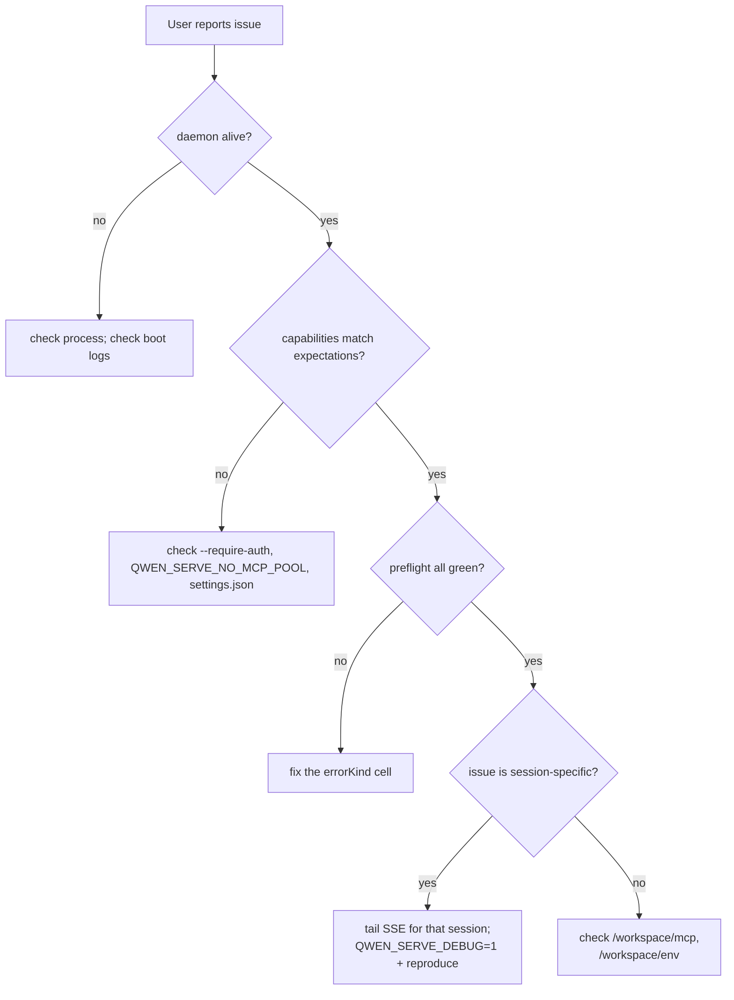

# Qwen Code 可观测性与调试

通过追踪、文件日志、访问日志和权限审计检查服务、会话流、慢客户端、MCP、关闭与内存问题，并列出缺失能力。

- 来源：Qwen／Qwen Code
- 资料类型：存档文档
- 存档版本：`7e3de59d3aba`。
- 文档时间：源码提交（存档版）：[2026-08-13](<https://github.com/QwenLM/qwen-code/commit/3378212b5f4800de53ccc007ebb62ee4c11381c1>)；发表/更新：官方未公开；本地归档批次：2026-10-10
- 阅读状态：完整中文机器译文，由 Google 翻译；代码、命令与配置保留原样，未逐句人工校对。

[原文发布页](<https://github.com/QwenLM/qwen-code/blob/main/docs/developers/daemon/19-observability.md>) · [原始文件](<../../../../原始抓取备份/原文/官方/Qwen/Qwen Code/docs/developers/daemon/19-observability.md>) · [返回资料总览](<../../../资料总览.md>)

[查看原文对照](#原文对照)

## 中文全文

# 可观察性和调试

## 概述

`qwen serve` 目前附带 **OpenTelemetry 跨度检测 **、** 结构化文件日志 ** (`DaemonLogger`)、** 每个请求访问日志 **、调试 stderr 日志、结构化预检单元和内存中权限审核环。本页是当前可观察性表面以及分类过程中要记住的差距的实用指南。

## 今天存在什么

|表面|地点|目的|
| ------------------------------------------- | ------------------------------------------------------ | ----------------------------------------------------------------------------------------------------------------------------------------------------------------------------------------------------------------------------------------------------------------------------------------------------------------------------------------------------- |
|`QWEN_SERVE_DEBUG` stderr 日志|`bridge.ts` 和调用站点|环境值 `1` / `true` / `on` / `yes` （不区分大小写）将 `qwen serve debug: ...` 行打印到 stderr。|
|OpenTelemetry量程仪表| `server.ts` `daemonTelemetryMiddleware`                |到达遥测中间件的分类守护进程API请求被包装在`withDaemonRequestSpan`中；属性包括规范路由、解析时的工作区哈希、sessionId、clientId 和状态代码。权限路线有专用的跨度。提示生命周期是端到端跟踪的。配置位于 `settings.json` `telemetry` 中。|
|OpenTelemetry 守护进程性能指标| `telemetry/*event-loop-lag*`, `daemon-metrics`         |守护进程和 ACP 子进程的事件循环滞后量表，以及守护进程子管道消息字节直方图。|
|`DaemonLogger`结构化文件日志| `serve/daemon-logger.ts`                               |附加到稳定的、大小旋转的 `daemon.log`。通过活动、记录、采样 OTel 范围发出的呼叫者 `info` / `warn` / `error` 记录包括 `trace_id` 和 `span_id`；文件记录还包括`runId`和PID。开机打印选择的【stable/fallback】路径；完整状态显示运行状况、问题和文件副本丢失计数器。|
|按请求访问日志中间件| `server/access-log.ts`                                 |每次请求后记录 method/path、状态、持续时间、会话和第一个原始客户端 ID。每秒 60 令牌突发/2 存储桶将多余流量聚合到五个固定状态计数器中。健康、心跳和成功的 SSE 排除仍然存在。|
| `/health`                                   |`server.ts`路线|活性探针； `?deep=1` 返回扩展详细信息。|
| `/capabilities`                             |`server.ts`路线|预检功能发现。参见[`11-capabilities-versioning.md`](<https://github.com/QwenLM/qwen-code/blob/7e3de59d3aba5cab80767ac5b121c0b3b4e35267/docs/developers/daemon/11-capabilities-versioning.md>)。|
| `/workspace/preflight`                      |路线 -> `DaemonStatusProvider`|结构化准备单元：节点版本、CLI 条目、ripgrep、git、npm，以及孩子存活后的 ACP- 级别单元。|
| `/workspace/env`                            |路线 -> `DaemonStatusProvider`|守护进程环境快照。秘密环境变量仅报告存在；代理 URL 凭据被删除。|
| `/workspace/mcp`                            |路线 -> 桥梁 extMethod|池、预算和拒绝快照。|
| `/workspace/skills`, `/workspace/providers` |路线|ACP-侧面实时快照；当不存在会话时返回空空闲数据。|
|每个会话 SSE| `GET /session/:id/events`                              |实时事件流。|
|网络外壳 UI| `GET /` (`packages/cli/src/serve/web-shell-static.ts`) |浏览器 UI 由捆绑的 Web Shell 资产提供服务：聊天、会话列表、工作区检查器和权限 UX。在环回时，`http://127.0.0.1:4170/` 是最快的端到端验证路径，无需编写 SDK 代码。注册规则见[`02-serve-runtime.md`](<https://github.com/QwenLM/qwen-code/blob/7e3de59d3aba5cab80767ac5b121c0b3b4e35267/docs/developers/daemon/02-serve-runtime.md>)。|
| `PermissionAuditRing`                       | `permission-audit.ts`                                  |512 权限决策的内存中 FIFO。|
|调解员`decisionReason`审核| `permissionMediator.ts`                                |内部结构化记录解释了为什么权限请求会以这种方式解决。|

## 今天不存在的东西

- **没有 Prometheus / 指标端点。** 可以导出 OTel 指标，但守护程序不会公开 Prometheus 抓取端点。
- **`PermissionAuditRing` 没有外部审计接收器。** 环存在，但到 SIEM 或外部存储的扇出挂钩未接线。

## 调试菜谱

### 1。恶魔还活着吗？

```bash
curl -s http://127.0.0.1:4170/health
# {"status":"ok"}

curl -s 'http://127.0.0.1:4170/health?deep=1' | jq
# {"status":"ok","workspaceCount":N,"sessions":N,...}
```

深度运行状况总计所有托管工作区运行时间，包括仍在
耗尽的运行时间。它是一个信息计数器快照，而不是每个工作空间的准备情况；
当单个工作空间或传输诊断很重要时使用`/daemon/status`。

环回上的 401 意味着 `--require-auth` 可能已启用。启动时使用`QWEN_SERVE_DEBUG=1`查看启动日志。

### 2。宣传了哪些功能？

```bash
curl -s http://127.0.0.1:4170/capabilities | jq
```

检查 `mcp_workspace_pool`（F2 池已开启？）、`require_auth`（强化？）、`permission_mediation.modes`（支持的策略）和 `policy.permission`（活动策略）。

### 3。守护进程主机准备情况是否良好？

```bash
curl -s http://127.0.0.1:4170/workspace/preflight | jq
```

`status: 'not_started'` 单元格为 ACP- 级别，并且仅在第一个会话附加后填充。 `status: 'fail'` 单元包含封闭的 `errorKind`；渲染来自 [`18-error-taxonomy.md`](<https://github.com/QwenLM/qwen-code/blob/7e3de59d3aba5cab80767ac5b121c0b3b4e35267/docs/developers/daemon/18-error-taxonomy.md>) 的结构化修复。

### 4。尾随会话 SSE 流

```bash
curl -N -H 'Accept: text/event-stream' \
     -H 'Authorization: Bearer XYZ' \
     -H 'X-Qwen-Client-Id: debug-tail' \
     -H 'Last-Event-ID: 0' \
     'http://127.0.0.1:4170/session/<sid>/events'
```

`-N` 禁用curl 输出缓冲。 `Last-Event-ID: 0` 请求重播 `id > 0` 的响铃事件。

### 5。为什么权限请求会以这种方式解决？

`PermissionAuditRing` 位于内存中，并且今天没有 HTTP 表面。启用`QWEN_SERVE_DEBUG=1`并重现；调解员为每次投票和决定打印结构化行，包括 `decisionReason.type`。后来的PR可以通过HTTP暴露戒指。

### 6。哪个消费者速度慢？

当队列达到 75% 时，`slow_client_warning` 在每个溢出事件中触发一次。订阅会话SSE流并查找合成帧；有效负载包括`queueSize`、`maxQueued`和`lastEventId`。重复的警告指向被卡住的消费者，通常是被阻塞的 SDK `for await` 循环。

### 7。为什么 MCP 服务器被拒绝？

组合 `/workspace/mcp` 每个单元格 `disabledReason: 'budget'`、`refusedServerNames` 列表和 `mcp_child_refused_batch` SSE 事件。将它们与 `/capabilities` `mcp_guardrails.modes`（`enforce` 处于活动状态？）以及通过 `getReservedSlots()` 可见的实时 `--mcp-client-budget` 状态进行比较。

### 8。守护进程不会关闭

第一个信号触发正常关闭（请参阅[`02-serve-runtime.md`](<https://github.com/QwenLM/qwen-code/blob/7e3de59d3aba5cab80767ac5b121c0b3b4e35267/docs/developers/daemon/02-serve-runtime.md>)）。如果挂起超过 10 秒，请检查：

- ACP 子进程没有响应优雅关闭。
- 长 SSE 连接在 `SHUTDOWN_FORCE_CLOSE_MS` 后保持 HTTP `server.close()` 打开（5 秒）。

**第二个** SIGTERM/SIGINT故意触发`bridge.killAllSync()` + `process.exit(1)`。

### 9。守护程序事件循环、提示队列或 ACP 管道是否过载？

当生产守护进程运行时注入性能快照提供程序时，`GET /daemon/status` 可能包括 `runtime.perf`：

```json
{
  "runtime": {
    "perf": {
      "eventLoop": { "meanMs": 1.2, "p50Ms": 1.0, "p99Ms": 9.5, "maxMs": 25 },
      "promptQueueWait": {
        "count": 3,
        "meanMs": 12.5,
        "maxMs": 35,
        "lastMs": 4
      },
      "pipe": {
        "inbound": { "count": 42, "totalBytes": 100000, "maxBytes": 12000 },
        "outbound": { "count": 41, "totalBytes": 90000, "maxBytes": 11000 }
      }
    }
  }
}
```

状态负载仅限于守护进程。 `promptQueueWait` 总结了在守护进程中观察到的提示 FIFO 队列等待样本。 ACP 子事件循环滞后故意不聚合到 `/daemon/status` 中；它可以通过 OTel 仪表 `qwen-code.acp.event_loop.lag` 和转发到守护程序日志的 stderr 停顿线看到。

### 10。文件日志记录是否降级或丢失记录？

使用完整的守护进程状态：

```bash
curl -s 'http://127.0.0.1:4170/daemon/status?detail=full' | \
  jq '{status, issues, daemon: {runId: .daemon.runId, logMode: .daemon.logMode, logHealth: .daemon.logHealth, logPath: .daemon.logPath, logIssues: .daemon.logIssues, droppedRecords: .daemon.logDroppedRecords, droppedBytes: .daemon.logDroppedBytes}}'
```

`stable` 是普通所有者，`fallback` 表示另一个守护进程拥有稳定的 
 系列，`stderr-only` 表示文件日志记录已禁用或不可用。
`fallback/ok` 预计在有意并发情况下。 A
`daemon_log_degraded`警告不包含路径；请求 
 实际路径和记录器问题代码的完整详细信息。使用`runId`在
稳定文件内单独重新启动。

新的 OTel 指标名称：

- `qwen-code.daemon.event_loop.lag`，以毫秒为单位`stat=mean|p50|p99|max`。
- `qwen-code.acp.event_loop.lag`，以毫秒为单位`stat=mean|p50|p99|max`。
- `qwen-code.daemon.prompt.queue_wait`，以毫秒为单位的直方图。
- `qwen-code.daemon.pipe.message_bytes`，以字节为单位的直方图`direction=inbound|outbound`。

### 11。守护进程是否面临内存压力？

```bash
curl -s 'http://127.0.0.1:4170/daemon/status' | \
  jq '.runtime.memory.pressure'
```

`level` 是 `normal` / `soft` / `hard` / `critical`，分类为 `ratio` —
 中最差的 `rssRatio` （RSS针对检测到的cgroup/host内存，这就是
OOM杀手手表）和`heapRatio`（针对此进程的
`heap_size_limit`使用的V8堆 - 整个堆，而不仅仅是旧空间
`--max-old-space-size` 的名字）。 `source` 说明是哪一个生产的。操作前检查 `source`：
`unknown` 表示守护进程无法测量任何一侧，因此 `normal` 存在 
 缺少读数，而不是健康状况的证据。仅当 
 的分子和分母都可用时才会报告边，因此 `source` 也可以告诉 
 零 `rssBytes` / `heapUsedBytes` 与真实的不同。

**`rssRatio` 的好坏取决于它的分母，并且
`limits.memory.availableMemorySource` 是它的评分标准。** 在一个cgroup下
(`constrained`）这正是极限 OOM 杀手强制执行，所以比率
意思就是它所说的。在裸机上（`host`）为整机尺寸，
而守护进程实际上死亡时 _机器_ 用完——这取决于
盒子上的所有其他过程。一个守护进程持有 20% 的一个 64 GB 主机旁边
55 GB 邻居报告 `level: normal, source: rss` 直到它是
被杀了。下 `source: 'host'`, 读 `rssRatio` 作为 **下限** 真实的
压力。这与未校准的阈值不同：无阈值
选择修正了衡量错误事物的分母。

** 没有** 涵盖的另外两件事。它只是守护进程 **root** 进程，因此 
 其 `qwen --acp` 子进程正在增长的守护进程可以报告 `normal`
 整个过程 - 阅读它旁边的 `runtime.memory.children`，它总结了现场
孩子自己的RSS（并通过`sampled`说明实际报告了多少人）。
没有任何补救措施：离开`normal`会引发`daemon_memory_pressure`
警告并且不会改变任何行为。

在 `--memory-pressure-mode off` 下，仍然会报告上面的每个数字，并且不会提出 
 问题，因此顶级 `status` 保持其本来应有的状态 
。在针对实际工作负载校准阈值时，或者如果您 
 在 `status` 上发出警报并且不希望未校准的信号移动它，请使用 `off`。

## 流量

### 典型的分流流程



## 状态和生命周期

- 每次通过`isServeDebugMode()`从`debug-mode.ts`检查时都会读取`QWEN_SERVE_DEBUG`；切换它不需要重新启动。除非在启动时设置了环境，否则启动日志不可用。
- `PermissionAuditRing` 的边界为 512 FIFO 条目；旧记录被悄悄删除。
- `DaemonStatusProvider` 根据请求重建单元并且不缓存；避免不必要的高频轮询。

## 依赖关系

- `process.stderr.write` 用于调试 stderr。
- `DaemonLogger` 用于结构化文件日志。
- OpenTelemetry SDK 到 `initializeTelemetry` 和 `createDaemonBridgeTelemetry`。
- `node:perf_hooks.monitorEventLoopDelay` 用于守护进程和 ACP 事件循环滞后量表。
- `node:process` 用于环境和信号检查。

## 配置

|旋钮|效果|
| ------------------------------- | -------------------------------------------------------------------------------------------- |
| `QWEN_SERVE_DEBUG`              |启用详细的 stderr 日志。参见[`17-configuration.md`](<https://github.com/QwenLM/qwen-code/blob/7e3de59d3aba5cab80767ac5b121c0b3b4e35267/docs/developers/daemon/17-configuration.md>)。|
| `settings.json` `telemetry`     |控制 OTel 行为：`enabled`、`otlpEndpoint`、`otlpProtocol` 和每个信号端点。|
|`DaemonLogger` 日志路径|稳定 `debug/daemon/daemon.log`，或在启动时选择特定于运行的后备。|
|`PermissionAuditRing`尺寸|今天硬编码为 512。|
|`slow_client_warning`阈值|`0.75` / `0.375`，硬编码在`eventBus.ts`中。|

## 注意事项和已知限制

- **DaemonLogger文件日志是结构化文本**，其中`trace_id`、`span_id`、`route`、`sessionId`和`clientId`字段可以通过正则表达式搜索或提取。仅当日志呼叫使用活动、记录、采样 OTel 范围运行时，呼叫者 `info` / `warn` / `error` 记录才包含跟踪字段。 `raw` 和引导记录、文件删除摘要和访问日志抑制摘要有意省略它们。相关性是尽力而为的：导出器失败可能会使后端的采样跟踪不可用。这些高基数标识符用于诊断查找，而不是度量标签或聚合。 `QWEN_SERVE_DEBUG` stderr 日志仍然是非结构化文本。
- **接受的提示、继续和取消突变具有生命周期日志。** `prompt enqueued`、`continuation enqueued` 和 `cancel sent` 包括 `sessionId`、`promptId`（如果适用），以及`clientId` 供应时；提示内容不记录。为每个独立控制器使用不同的稳定客户端 ID。故意共享 ID 的控制者在这些记录中无法区分。
- **DaemonLogger 保留是基于大小的，而不是基于年龄的。** 活动文件和四个档案受每个系列的限制；实时后备所有者永远不会被删除。
- **访问摘要是有意丢失的记录。** A WARN `access logs suppressed` 表示从 stderr 和文件中省略的各个访问记录；它并不表示已删除的 HTTP 请求。
- **外部 logrotate 不得改变活动系列。**使用 reads/copies 的托运人并在替换后重新打开稳定路径名。
- **OpenTelemetry跨度包括每个请求的相关性。**通过承载身份验证、速率限制和正文解析的分类守护进程API请求携带规范路由、sessionId、clientId和（唯一解析时）`qwen-code.workspace.hash`属性。被早期中间件网关拒绝的请求没有这些请求跨度。
- **HTTP 指标是守护程序全局的。** OpenTelemetry HTTP 请求指标和 Web Shell 状态指标环不包含工作区维度。成功的会话 SSE 连接具有请求跨度，但被排除在普通请求 count/duration 指标之外，因为其生命周期不是请求延迟；失败的SSE握手正常计数。
- **`runtime.perf` 仅限守护进程。** 设计时不会报告子事件循环滞后；对 ACP 子停顿使用 OTel 或转发的 stderr 停顿警告。
- **ACP-级别`/workspace/preflight`单元需要实时会话。**在空闲守护进程上，身份验证/MCP/技能/提供者可能会显示`status: 'not_started'`；这是预期的。
- **`/workspace/env` 仅报告秘密的存在，而不报告值。** 不要公开仅存在秘密就敏感的响应。
- **审计环是进程本地的**并且历史记录在守护进程重新启动时丢失。
- **此处没有记录负载测试配方。**性能基线位于`test/perf-daemon-baseline`分支上。

## 参考文献

- `packages/cli/src/serve/daemon-status-provider.ts`
- `packages/cli/src/serve/daemon-logger.ts` (`DaemonLogger`, `buildDaemonLogLine`)
- `packages/cli/src/serve/debug-mode.ts` (`isServeDebugMode`)
- `packages/acp-bridge/src/permissionMediator.ts` (`PermissionDecisionReason`)
- `packages/cli/src/serve/server.ts`（`daemonTelemetryMiddleware`，访问日志中间件）
- 配置：[`17-configuration.md`](<https://github.com/QwenLM/qwen-code/blob/7e3de59d3aba5cab80767ac5b121c0b3b4e35267/docs/developers/daemon/17-configuration.md>)
- 错误分类：[`18-error-taxonomy.md`](<https://github.com/QwenLM/qwen-code/blob/7e3de59d3aba5cab80767ac5b121c0b3b4e35267/docs/developers/daemon/18-error-taxonomy.md>)
- 用户操作指南：[`../../users/qwen-serve.md`](<Qwen Code 守护进程模式.md>)


## 原文对照

<details>
<summary>展开完整原文</summary>

# Observability & Debugging

## Overview

`qwen serve` currently ships with **OpenTelemetry span instrumentation**, **structured file logs** (`DaemonLogger`), **per-request access logs**, debug stderr logs, structured preflight cells, and an in-memory permission audit ring. This page is a practical guide to the current observability surface and the gaps to remember during triage.

## What exists today

| Surface                                     | Location                                               | Purpose                                                                                                                                                                                                                                                                                                                                               |
| ------------------------------------------- | ------------------------------------------------------ | ----------------------------------------------------------------------------------------------------------------------------------------------------------------------------------------------------------------------------------------------------------------------------------------------------------------------------------------------------- |
| `QWEN_SERVE_DEBUG` stderr logs              | `bridge.ts` and call sites                             | Env values `1` / `true` / `on` / `yes` (case-insensitive) print `qwen serve debug: ...` lines to stderr.                                                                                                                                                                                                                                              |
| OpenTelemetry span instrumentation          | `server.ts` `daemonTelemetryMiddleware`                | Classified daemon API requests that reach the telemetry middleware are wrapped in `withDaemonRequestSpan`; attributes include canonical route, workspace hash when resolved, sessionId, clientId, and status code. Permission routes have dedicated spans. Prompt lifecycle is traced end-to-end. Configuration lives in `settings.json` `telemetry`. |
| OpenTelemetry daemon perf metrics           | `telemetry/*event-loop-lag*`, `daemon-metrics`         | Event loop lag gauges for daemon and ACP child processes, plus daemon-child pipe message byte histograms.                                                                                                                                                                                                                                             |
| `DaemonLogger` structured file logs         | `serve/daemon-logger.ts`                               | Appends to a stable, size-rotated `daemon.log`. Caller `info` / `warn` / `error` records emitted with an active, recording, sampled OTel span include `trace_id` and `span_id`; file records also include `runId` and PID. Boot prints the selected stable/fallback path; full status exposes health, issues, and file-copy loss counters.            |
| Per-request access-log middleware           | `server/access-log.ts`                                 | Logs method/path, status, duration, session, and first raw client ID after each request. A 60-token burst / 2-per-second bucket aggregates excess traffic into five fixed status counters. Health, heartbeat, and successful SSE exclusions remain.                                                                                                   |
| `/health`                                   | `server.ts` route                                      | Liveness probe; `?deep=1` returns extended details.                                                                                                                                                                                                                                                                                                   |
| `/capabilities`                             | `server.ts` route                                      | Preflight feature discovery. See [`11-capabilities-versioning.md`](<https://github.com/QwenLM/qwen-code/blob/7e3de59d3aba5cab80767ac5b121c0b3b4e35267/docs/developers/daemon/11-capabilities-versioning.md>).                                                                                                                                                                                                                                                  |
| `/workspace/preflight`                      | Route -> `DaemonStatusProvider`                        | Structured readiness cells: Node version, CLI entry, ripgrep, git, npm, plus ACP-level cells once a child is alive.                                                                                                                                                                                                                                   |
| `/workspace/env`                            | Route -> `DaemonStatusProvider`                        | Daemon process env snapshot. Secret env vars report only presence; proxy URL credentials are stripped.                                                                                                                                                                                                                                                |
| `/workspace/mcp`                            | Route -> bridge extMethod                              | Pool, budget, and refusal snapshot.                                                                                                                                                                                                                                                                                                                   |
| `/workspace/skills`, `/workspace/providers` | Routes                                                 | ACP-side live snapshots; return empty idle data when no session exists.                                                                                                                                                                                                                                                                               |
| Per-session SSE                             | `GET /session/:id/events`                              | Real-time event stream.                                                                                                                                                                                                                                                                                                                               |
| Web Shell UI                                | `GET /` (`packages/cli/src/serve/web-shell-static.ts`) | Browser UI served from the bundled Web Shell assets: chat, session list, workspace inspector, and permission UX. On loopback, `http://127.0.0.1:4170/` is the quickest end-to-end validation path without writing SDK code. Registration rules are in [`02-serve-runtime.md`](<https://github.com/QwenLM/qwen-code/blob/7e3de59d3aba5cab80767ac5b121c0b3b4e35267/docs/developers/daemon/02-serve-runtime.md>).                                                 |
| `PermissionAuditRing`                       | `permission-audit.ts`                                  | In-memory FIFO of 512 permission decisions.                                                                                                                                                                                                                                                                                                           |
| Mediator `decisionReason` audit             | `permissionMediator.ts`                                | Internal structured record explaining why a permission request resolved the way it did.                                                                                                                                                                                                                                                               |

## What does not exist today

- **No Prometheus / metrics endpoint.** OTel metrics can be exported, but the daemon does not expose a Prometheus scrape endpoint.
- **No external audit sink for `PermissionAuditRing`.** The ring exists, but fan-out hooks to SIEM or external storage are not wired.

## Debugging recipes

### 1. Is the daemon alive?

```bash
curl -s http://127.0.0.1:4170/health
# {"status":"ok"}

curl -s 'http://127.0.0.1:4170/health?deep=1' | jq
# {"status":"ok","workspaceCount":N,"sessions":N,...}
```

Deep health totals all managed workspace runtimes, including runtimes still
draining. It is an informational counter snapshot, not per-workspace readiness;
use `/daemon/status` when individual workspace or transport diagnostics matter.

A 401 on loopback means `--require-auth` is likely enabled. Use `QWEN_SERVE_DEBUG=1` at startup to see boot logs.

### 2. Which features are advertised?

```bash
curl -s http://127.0.0.1:4170/capabilities | jq
```

Check `mcp_workspace_pool` (F2 pool on?), `require_auth` (hardened?), `permission_mediation.modes` (supported policies), and `policy.permission` (active policy).

### 3. Is daemon-host readiness healthy?

```bash
curl -s http://127.0.0.1:4170/workspace/preflight | jq
```

`status: 'not_started'` cells are ACP-level and populate only after the first session attaches. `status: 'fail'` cells include a closed `errorKind`; render structured remediation from [`18-error-taxonomy.md`](<https://github.com/QwenLM/qwen-code/blob/7e3de59d3aba5cab80767ac5b121c0b3b4e35267/docs/developers/daemon/18-error-taxonomy.md>).

### 4. Tail a session SSE stream

```bash
curl -N -H 'Accept: text/event-stream' \
     -H 'Authorization: Bearer XYZ' \
     -H 'X-Qwen-Client-Id: debug-tail' \
     -H 'Last-Event-ID: 0' \
     'http://127.0.0.1:4170/session/<sid>/events'
```

`-N` disables curl output buffering. `Last-Event-ID: 0` requests replay for ring events with `id > 0`.

### 5. Why did a permission request resolve this way?

`PermissionAuditRing` is in-memory and has no HTTP surface today. Enable `QWEN_SERVE_DEBUG=1` and reproduce; the mediator prints structured lines for each vote and decision, including `decisionReason.type`. A later PR can expose the ring through HTTP.

### 6. Which consumer is slow?

`slow_client_warning` fires once per overflow episode when the queue reaches 75%. Subscribe to the session SSE stream and look for the synthetic frame; payload includes `queueSize`, `maxQueued`, and `lastEventId`. Repeated warnings point at a stuck consumer, usually a blocked SDK `for await` loop.

### 7. Why was an MCP server refused?

Combine `/workspace/mcp` per-cell `disabledReason: 'budget'`, the `refusedServerNames` list, and `mcp_child_refused_batch` SSE events. Compare them with `/capabilities` `mcp_guardrails.modes` (`enforce` active?) and the live `--mcp-client-budget` state visible through `getReservedSlots()`.

### 8. The daemon will not shut down

The first signal triggers graceful shutdown (see [`02-serve-runtime.md`](<https://github.com/QwenLM/qwen-code/blob/7e3de59d3aba5cab80767ac5b121c0b3b4e35267/docs/developers/daemon/02-serve-runtime.md>)). If it hangs past 10s, check:

- ACP child process did not respond to graceful close.
- Long SSE connections kept HTTP `server.close()` open past `SHUTDOWN_FORCE_CLOSE_MS` (5s).

A **second** SIGTERM/SIGINT intentionally triggers `bridge.killAllSync()` + `process.exit(1)`.

### 9. Is the daemon event loop, prompt queue, or ACP pipe overloaded?

`GET /daemon/status` may include `runtime.perf` when the production daemon runtime injects the perf snapshot provider:

```json
{
  "runtime": {
    "perf": {
      "eventLoop": { "meanMs": 1.2, "p50Ms": 1.0, "p99Ms": 9.5, "maxMs": 25 },
      "promptQueueWait": {
        "count": 3,
        "meanMs": 12.5,
        "maxMs": 35,
        "lastMs": 4
      },
      "pipe": {
        "inbound": { "count": 42, "totalBytes": 100000, "maxBytes": 12000 },
        "outbound": { "count": 41, "totalBytes": 90000, "maxBytes": 11000 }
      }
    }
  }
}
```

The status payload is daemon-only. `promptQueueWait` summarizes prompt FIFO queue wait samples observed in the daemon process. ACP child event loop lag is intentionally not aggregated into `/daemon/status`; it is visible through OTel gauge `qwen-code.acp.event_loop.lag` and through stderr stall lines forwarded into daemon logs.

### 10. Did file logging degrade or lose records?

Use full daemon status:

```bash
curl -s 'http://127.0.0.1:4170/daemon/status?detail=full' | \
  jq '{status, issues, daemon: {runId: .daemon.runId, logMode: .daemon.logMode, logHealth: .daemon.logHealth, logPath: .daemon.logPath, logIssues: .daemon.logIssues, droppedRecords: .daemon.logDroppedRecords, droppedBytes: .daemon.logDroppedBytes}}'
```

`stable` is the normal owner, `fallback` means another daemon owns the stable
family, and `stderr-only` means file logging is disabled or unavailable.
`fallback/ok` is expected under intentional concurrency. A
`daemon_log_degraded` warning contains no path; request full detail for the
actual path and logger issue codes. Use `runId` to separate restarts inside the
stable file.

New OTel metric names:

- `qwen-code.daemon.event_loop.lag`, gauge in milliseconds with `stat=mean|p50|p99|max`.
- `qwen-code.acp.event_loop.lag`, gauge in milliseconds with `stat=mean|p50|p99|max`.
- `qwen-code.daemon.prompt.queue_wait`, histogram in milliseconds.
- `qwen-code.daemon.pipe.message_bytes`, histogram in bytes with `direction=inbound|outbound`.

### 11. Is the daemon under memory pressure?

```bash
curl -s 'http://127.0.0.1:4170/daemon/status' | \
  jq '.runtime.memory.pressure'
```

`level` is `normal` / `soft` / `hard` / `critical`, classified from `ratio` —
the worse of `rssRatio` (RSS against detected cgroup/host memory, which is what
the OOM killer watches) and `heapRatio` (V8 heap used against this process's
`heap_size_limit` — the whole heap, not only the old space that
`--max-old-space-size` names). `source` says which one produced it. Check `source` before acting:
`unknown` means the daemon could measure neither side, so `normal` there is the
absence of a reading, not evidence of health. A side is only reported when both
its numerator and its denominator were usable, so `source` is also what tells a
zero `rssBytes` / `heapUsedBytes` apart from a real one.

**`rssRatio` is only as good as its denominator, and
`limits.memory.availableMemorySource` is what grades it.** Under a cgroup
(`constrained`) it is exactly the limit the OOM killer enforces, so the ratio
means what it says. On bare metal (`host`) it is the size of the whole machine,
while the daemon actually dies when the _machine_ runs out — which depends on
every other process on the box. A daemon holding 20% of a 64 GB host beside a
55 GB neighbour reports `level: normal, source: rss` right up until it is
killed. Under `source: 'host'`, read `rssRatio` as a **lower bound** on real
pressure. This is separate from the thresholds being uncalibrated: no threshold
choice fixes a denominator that is measuring the wrong thing.

Two further things this does **not** cover. It is the daemon **root** process only, so
a daemon whose `qwen --acp` children are the ones growing can report `normal`
throughout — read `runtime.memory.children` beside it, which sums the live
children's own RSS (and says via `sampled` how many actually reported).
And nothing remediates: leaving `normal` raises a `daemon_memory_pressure`
warning and changes no behaviour.

Under `--memory-pressure-mode off` every figure above is still reported and the
issue is not raised, so the top-level `status` stays whatever it would have
been. Use `off` while calibrating thresholds against a real workload, or if you
alert on `status` and do not want an uncalibrated signal moving it.

## Flow

### Typical triage flow


## State and lifecycle

- `QWEN_SERVE_DEBUG` is read on every check through `isServeDebugMode()` from `debug-mode.ts`; toggling it does not require restart. Boot logs are not available unless the env was set at boot.
- `PermissionAuditRing` is bounded at 512 FIFO entries; older records are silently dropped.
- `DaemonStatusProvider` rebuilds cells per request and does not cache; avoid unnecessary high-frequency polling.

## Dependencies

- `process.stderr.write` for debug stderr.
- `DaemonLogger` for structured file logs.
- OpenTelemetry SDK through `initializeTelemetry` and `createDaemonBridgeTelemetry`.
- `node:perf_hooks.monitorEventLoopDelay` for daemon and ACP event loop lag gauges.
- `node:process` for env and signal inspection.

## Configuration

| Knob                            | Effect                                                                                       |
| ------------------------------- | -------------------------------------------------------------------------------------------- |
| `QWEN_SERVE_DEBUG`              | Enables verbose stderr logs. See [`17-configuration.md`](<https://github.com/QwenLM/qwen-code/blob/7e3de59d3aba5cab80767ac5b121c0b3b4e35267/docs/developers/daemon/17-configuration.md>).             |
| `settings.json` `telemetry`     | Controls OTel behavior: `enabled`, `otlpEndpoint`, `otlpProtocol`, and per-signal endpoints. |
| `DaemonLogger` log path         | Stable `debug/daemon/daemon.log`, or a run-specific fallback selected at boot.               |
| `PermissionAuditRing` size      | Hard-coded to 512 today.                                                                     |
| `slow_client_warning` threshold | `0.75` / `0.375`, hard-coded in `eventBus.ts`.                                               |

## Caveats and known limits

- **DaemonLogger file logs are structured text** whose `trace_id`, `span_id`, `route`, `sessionId`, and `clientId` fields can be searched or extracted with a regular expression. Caller `info` / `warn` / `error` records include trace fields only when the log call runs with an active, recording, sampled OTel span. `raw` and boot records, file-drop summaries, and access-log suppression summaries intentionally omit them. Correlation is best-effort: exporter failure can leave a sampled trace unavailable in the backend. These high-cardinality identifiers are for diagnostic lookup, not metric labels or aggregation. `QWEN_SERVE_DEBUG` stderr logs remain unstructured text.
- **Accepted prompt, continuation, and cancellation mutations have lifecycle logs.** `prompt enqueued`, `continuation enqueued`, and `cancel sent` include `sessionId`, `promptId` when applicable, and `clientId` when supplied; prompt content is not logged. Use a distinct stable client ID for each independent controller. Controllers that intentionally share an ID are indistinguishable in these records.
- **DaemonLogger retention is size based, not age based.** The active file and four archives are bounded per family; live fallback owners are never deleted.
- **Access summaries are intentional loss accounting.** A WARN `access logs suppressed` represents individual access records omitted from both stderr and file; it does not indicate dropped HTTP requests.
- **External logrotate must not mutate the active family.** Use a shipper that reads/copies and reopens the stable pathname after replacement.
- **OpenTelemetry spans include per-request correlation.** Classified daemon API requests that pass bearer authentication, rate limiting, and body parsing carry canonical route, sessionId, clientId, and (when uniquely resolved) `qwen-code.workspace.hash` attributes. Requests rejected by an earlier middleware gate do not have these request spans.
- **HTTP metrics are daemon-global.** OpenTelemetry HTTP request metrics and the Web Shell status metrics ring do not include a workspace dimension. A successful session SSE connection has a request span but is excluded from ordinary request count/duration metrics because its lifetime is not request latency; failed SSE handshakes are counted normally.
- **`runtime.perf` is daemon-only.** Child event loop lag is not reported there by design; use OTel or forwarded stderr stall warnings for ACP child stalls.
- **ACP-level `/workspace/preflight` cells require a live session.** On an idle daemon, auth / MCP / skills / providers may show `status: 'not_started'`; this is expected.
- **`/workspace/env` only reports secret presence, not values.** Do not expose the response where the mere presence of a secret is sensitive.
- **The audit ring is process-local** and history is lost on daemon restart.
- **No load-test recipe is documented here.** The performance baseline lives on the `test/perf-daemon-baseline` branch.

## References

- `packages/cli/src/serve/daemon-status-provider.ts`
- `packages/cli/src/serve/daemon-logger.ts` (`DaemonLogger`, `buildDaemonLogLine`)
- `packages/cli/src/serve/debug-mode.ts` (`isServeDebugMode`)
- `packages/acp-bridge/src/permissionMediator.ts` (`PermissionDecisionReason`)
- `packages/cli/src/serve/server.ts` (`daemonTelemetryMiddleware`, access-log middleware)
- Configuration: [`17-configuration.md`](<https://github.com/QwenLM/qwen-code/blob/7e3de59d3aba5cab80767ac5b121c0b3b4e35267/docs/developers/daemon/17-configuration.md>)
- Error taxonomy: [`18-error-taxonomy.md`](<https://github.com/QwenLM/qwen-code/blob/7e3de59d3aba5cab80767ac5b121c0b3b4e35267/docs/developers/daemon/18-error-taxonomy.md>)
- User operations guide: [`../../users/qwen-serve.md`](<Qwen Code 守护进程模式.md>)


</details>
