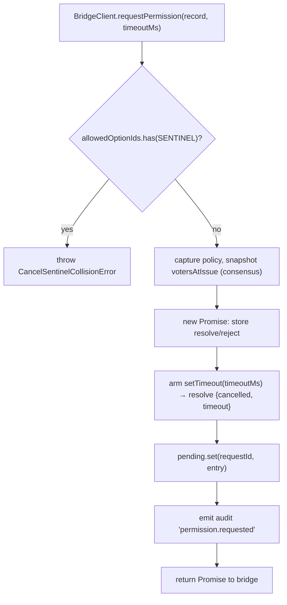
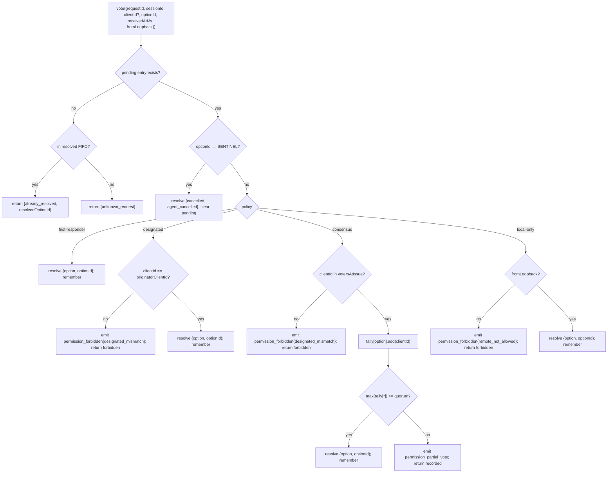

# Qwen Code 多客户端权限协调

解释多个客户端的审批请求、投票、取消、已决状态和共识规则，防止并发客户端造成权限冲突。

- 来源：Qwen／Qwen Code
- 资料类型：存档文档
- 存档版本：`7e3de59d3aba`。
- 文档时间：源码提交（存档版）：[2026-08-24](<https://github.com/QwenLM/qwen-code/commit/1fffa5108d35a0a0a11b64e61593c2fa71c04e70>)；发表/更新：官方未公开；本地归档批次：2026-10-10
- 阅读状态：完整中文机器译文，由 Google 翻译；代码、命令与配置保留原样，未逐句人工校对。

[原文发布页](<https://github.com/QwenLM/qwen-code/blob/main/docs/developers/daemon/04-permission-mediation.md>) · [原始文件](<../../../../原始抓取备份/原文/官方/Qwen/Qwen Code/docs/developers/daemon/04-permission-mediation.md>) · [返回资料总览](<../../../资料总览.md>)

[查看原文对照](#原文对照)

## 中文全文

# 多客户端权限调解

## 概述

当 ACP 子进程的 agent 调用 `requestPermission` 时，守护进程不会简单地将其转发给一个客户端。在`sessionScope: 'single'`下，每个连接的客户端都会看到该请求，并且它们中的任何一个都可以响应。如果没有调解，迟到的投票将无处可去，两个客户端可以竞争同一请求，并且单个流氓客户端可以覆盖发起者。

`MultiClientPermissionMediator` (`packages/acp-bridge/src/permissionMediator.ts`) 实现 `PermissionMediator` 合约 (`packages/acp-bridge/src/permission.ts`) 并拥有桥的所有待处理和已解决的权限状态。它通过 `PermissionPolicy` 中声明的四项政策之一发送投票：

|政策|决议规则|使用案例|
| ----------------- | ---------------------------------------------------------------------------------------------------------------------- | ------------------------------------------------------------------------ |
| `first-responder` |第一个有效投票获胜；后来选民得到`permission_already_resolved`。|实时跨客户端协作 UX（默认）。|
| `designated`      |只有提示的`originatorClientId`可以解决；其他参见`permission_forbidden{designated_mismatch}`。|每个租户 SaaS，其中 UI 表面必须拥有自己的批准。|
| `consensus`       |v1 客户端 ID 快照中的 N-of-M 仲裁；中间 `permission_partial_vote` 事件让 UI 呈现进度。|两个运营商必须同意的企业变更审查。|
| `local-only`      |拒绝任何非环回投票者；阻塞直到环回客户端解析。|远程控制的工作站绝不能授予权限升级。|

> **v1安全限制**：`X-Qwen-Client-Id`是自我报告的。 `designated` 和 
> `consensus` 尚未拥有所有权证明。观察
> `originatorClientId`的客户端可以重用该id。 `{outcome:'cancelled'}` 还在策略调度之前通过取消标记路由 
> ，因此即使 `local-only`
>  也无法将取消视为受策略保护的解析。为了实现强隔离，请将 
>  守护进程绑定到环回或将其置于经过身份验证的反向代理后面。请参阅
> [安全说明：v1客户端身份是自我报告的](<#安全说明v1-客户身份是自我报告的>)。

## 职责

- 跟踪每个待处理的请求（`request → vote → resolved` 生命周期）。
- 启用和禁用每个请求的挂钟超时（**N1 不变量 **：必须在 `request()` 内同步启用超时，以便立即取消的会话不会泄漏永久挂起的关闭）。
- 通过在 `request()` 时间捕获的策略调度投票（在运行中更改守护程序策略不会影响运行中的请求）。
- 维护最近解决的请求的有限 FIFO (`MAX_RESOLVED_PERMISSION_RECORDS = 512`)，以便重复投票获得结构化的 `already_resolved` 而不是 `unknown_request`。
- 在每个会话 EventBus 上发出 `permission_partial_vote`（共识）和 `permission_forbidden`（指定/共识/仅限本地）。
- 在会话拆除时通过 `forgetSession(sessionId)` 将待处理请求解析为 `{kind: 'cancelled', reason: 'session_closed'}`。
- 拒绝通过线路（`InvalidPermissionOptionError`）和通过agent发布的选项标签（`CancelSentinelCollisionError`）恶意或意外注入`CANCEL_VOTE_SENTINEL`。

## 建筑

### 公共面

```ts
interface PermissionMediator {
  readonly policy: PermissionPolicy;
  request(
    record: PermissionRequestRecord,
    timeoutMs: number,
  ): Promise<PermissionResolution>;
  vote(vote: PermissionVote): PermissionVoteOutcome;
  forgetSession(sessionId: string): void;
}
```

`MultiClientPermissionMediator` 添加：`peekSessionFor(requestId)`、`pendingCount(sessionId)`、内部审计发布者等。`BridgeClient` 仅取决于 `request()` 一半（结构子类型 - 参见 `bridgeClient.ts`）。

### `PermissionPolicy` 和 `PermissionVoteOutcome`

```ts
type PermissionPolicy =
  | 'first-responder'
  | 'designated'
  | 'consensus'
  | 'local-only';

type PermissionVoteOutcome =
  | { kind: 'resolved'; resolvedOptionId: string }
  | { kind: 'recorded'; votesNeeded: number } // consensus partial
  | { kind: 'already_resolved'; resolvedOptionId: string }
  | { kind: 'forbidden'; reason: 'designated_mismatch' | 'remote_not_allowed' }
  | { kind: 'unknown_request' };

type PermissionResolution =
  | { kind: 'option'; optionId: string }
  | {
      kind: 'cancelled';
      reason: 'timeout' | 'session_closed' | 'agent_cancelled';
    };
```

### 取消哨兵

`CANCEL_VOTE_SENTINEL = '__cancelled__'`。在 ** 调用 `mediator.vote` 之前，桥将选民 `{outcome:'cancelled'}` 映射到此哨兵 **。中介者在 ** 策略调度之前路由哨兵 ** — 投票者取消在每个策略下都有效，无论 `clientId`/环回/成员身份如何。两名警卫：

1. **`bridge.ts`** 拒绝 `optionId === CANCEL_VOTE_SENTINEL` 与 `InvalidPermissionOptionError` 的电汇投票（恶意电汇客户端不得通过谎报 `optionId` 来注入取消）。
2. **`mediator.request`** 拒绝 `allowedOptionIds` 包含具有 `CancelSentinelCollisionError` 标记的记录（合法发布 `'__cancelled__'` 作为选项标签的 agent 必须无法伪装）。

这种故意的跨策略逃逸记录在 `permissionMediator.ts` 中，因此未来的维护人员不会意外删除绕过。

### 待处理状态

每个待处理请求均以 `requestId` 为键并携带：

- `policy` — 在 `request()` 时间捕获。
- `record: PermissionRequestRecord` (requestId, sessionId, originatorClientId, allowedOptionIds, issuedAtMs).
- `resolve` / `reject` 关闭。
- `votesAtIssue`（仅限共识）- 发布时会话的已注册 `clientIds` 的快照；如果不在这组中，后面的投票将被拒绝。
- `tally`（仅限共识）- `Map<optionId, Set<clientId>>` 计算每个选项的票数。
- `timeoutHandle` — `request()` 内配备的节点超时（N1 不变）。
- `auditTrail[]` — 每票审核记录。

### 已解决 FIFO

`MAX_RESOLVED_PERMISSION_RECORDS = 512`。驱逐是通过 `resolvedOrder.shift()` 的 FIFO（DeepSeek 评论 #4335 / 3271627446 — 镜像 `PermissionAuditRing`）。仅存储 `{requestId, sessionId, outcome}`，因此 512 记录在正常 UI reconnect/race 窗口中保留在 100 KB 下。

## 工作流程

### `request()`（N1 不变）



计时器在**条目在其他地方可见之前就已启动**。如果没有这个，到达 `pending.set` 和 `setTimeout` 之间的 `forgetSession` 将使条目处于挂起状态，不会超时 - 桥的每个会话 `promptQueue` 将永远挂起。

### `vote()` 调度



### `forgetSession()`

在会话关闭、驱逐和网桥关闭时调用。对于每个 `record.sessionId === sessionId` 的待处理条目：

1. 取消超时。
2. 使用 `{kind: 'cancelled', reason: 'session_closed'}` 解决待处理的 Promise。
3. 附加审核记录。
4. 从`pending`中删除。

桥接器的会话拆卸路径始终在 ** 通道终止窗口之前调用 `forgetSession` **，因此挂起的权限不会超过其会话的寿命。

## 状态和生命周期

- `policy` 根据请求捕获。更改守护程序范围的策略（未来表面）不会影响正在进行的请求。
- `votesAtIssue`（共识）在`request()`时间被捕获；在请求之后到达的客户端可以投票，但如果他们的 `clientId` 在发出时尚未在会话中注册，则他们的投票将被拒绝为 `designated_mismatch`。这是故意重用`designated`策略的不匹配原因来保持合约关闭；如果 SDK 消费者需要区分，未来版本可能会分裂联盟。
- 已解决的条目最多存在于 FIFO 中 `MAX_RESOLVED_PERMISSION_RECORDS` (512)。驱逐后，对同一 `requestId` 的重复投票将返回 `{unknown_request}`。
- `permission_partial_vote` 仅针对 `consensus` 触发。不要依赖任何其他策略。
- `permission_forbidden` 会针对 `designated`、`consensus` 和 `local-only` 触发 — 而不是 `first-responder`。

## 依赖关系

- [`03-acp-bridge.md`](<Qwen Code ACP 桥接架构.md>) — 电桥如何将 `BridgeClient.requestPermission` 连接到 `mediator.request`。
- [`10-event-bus.md`](<https://github.com/QwenLM/qwen-code/blob/7e3de59d3aba5cab80767ac5b121c0b3b4e35267/docs/developers/daemon/10-event-bus.md>) — 部分投票和禁止帧如何到达客户端。
- [`09-event-schema.md`](<https://github.com/QwenLM/qwen-code/blob/7e3de59d3aba5cab80767ac5b121c0b3b4e35267/docs/developers/daemon/09-event-schema.md>) — `permission_*` 事件的有效负载合约。
- [`08-session-lifecycle.md`](<https://github.com/QwenLM/qwen-code/blob/7e3de59d3aba5cab80767ac5b121c0b3b4e35267/docs/developers/daemon/08-session-lifecycle.md>) — 每次会话终止时都会调用 `forgetSession()`。
- [`02-serve-runtime.md`](<https://github.com/QwenLM/qwen-code/blob/7e3de59d3aba5cab80767ac5b121c0b3b4e35267/docs/developers/daemon/02-serve-runtime.md>) — `PermissionAuditRing`（512-审核记录条目 FIFO）。

## 配置

|来源|旋钮|效果|
| ------------------- | ------------------------------------------------------------------------------------------------------ | ------------------------------------- |
| `settings.json`     | `policy.permissionStrategy`                                                                            |积极的调解政策。|
| `settings.json`     | `policy.consensusQuorum`                                                                               |N 表示共识。|
| `BridgeOptions`     | `permissionPolicy`, `permissionConsensusQuorum`, `permissionAudit`                                     |程序化覆盖。|
|能力标签|`permission_mediation`（始终；`modes: ['first-responder', 'designated', 'consensus', 'local-only']`）|构建支持集。|
|能力范围| `policy.permission`                                                                                    |该守护进程正在运行的活动策略。|

如果未显式配置 `policy.permissionStrategy`，则守护程序使用 
`first-responder`。 `designated`、`consensus`和`local-only`仅在`settings.json`中设置时才对
生效。

## 共识仲裁：默认公式和 M=2 边

当 `consensus` 策略处于活动状态并且未设置 `policy.consensusQuorum` 时，
中介器通过 `consensusQuorumFor` 计算 **N = 下限(M/2) + 1**在
`permissionMediator.ts`中：

```ts
Math.max(1, Math.floor(m / 2) + 1);
```

| M (`votersAtIssue.size`) |默认N|行为|
| ------------------------ | --------- | ------------------------------- |
| 1                        | 1         |一名选民立即做出决定。|
| 2                        | 2         |需要一致同意。|
| 3                        | 2         |多数。|
| 4                        | 3         |超过一半。|
| 5                        | 3         |多数。|
| 6                        | 4         |超过一半。|

对于 **M = 2**，分割投票（A 选择 X，B 选择 Y）只能通过 
 投票者取消、会话取消或可选的交互超时来解决：
 没有选项达成一致。 `permissionResponseTimeoutMs`默认被
禁用；配置后，未解决的拆分将在该截止日期解析为
`{cancelled, timeout}`。提前投票路径将 
 适用的行为记录到操作员的 stderr 中。

想要 M = 2 的先投票获胜行为的操作员可以显式设置 
`policy.consensusQuorum: 1`。更严格的配置，例如要求 
 一致同意 M = 4，则使用相同的字段。

## 启动时策略验证

`runQwenServe.validatePolicyConfig(policyConfig)`
(`packages/cli/src/serve/run-qwen-serve.ts`) 在启动时验证合并的 `settings.json`
`policy.*` 并针对操作员错误抛出 `InvalidPolicyConfigError`：

- `policy.permissionStrategy` 已设置，但不在四种支持的模式中。的
有效集在运行时从 
 `SERVE_CAPABILITY_REGISTRY.permission_mediation.modes` 派生，这是能力通告的 
 事实的单一来源。
- `policy.consensusQuorum`已设置，但不是正整数。

当设置 `consensusQuorum` while
`permissionStrategy !== 'consensus'`; 时，还会出现软 stderr 警告；否则，在非共识策略下，覆盖将被默默地
忽略。

导出 `InvalidPolicyConfigError` 用于 `instanceof` 测试。 `runQwenServe`
使用它来区分操作员配置错误（作为
显式启动故障重新抛出）和设置读取I/O故障（回退到
默认值）。

## 安全说明：v1 客户身份是自我报告的

`X-Qwen-Client-Id`由HTTP客户端提供。在 v1 中，守护进程验证 
 格式 (`[A-Za-z0-9._:-]{1,128}`) 并跟踪 
`clientIds` 中附加的客户端 ID，但它不执行所有权证明。任何可以
观察SSE中的`originatorClientId`的客户端都可以使用相同的ID进行注册，并
在以后的请求中模拟该发起者。

政策影响：

- **`first-responder`** 不受影响，因为它不依赖于身份。
- **`designated`** 可以被远程客户端重复使用来欺骗
  `originatorClientId`.
- **`consensus`** 发行时间 `votersAtIssue` 快照上的盖茨；如果被欺骗
发出请求时已经附加了 id，可以投票。
- **`local-only`** 不受 id 欺骗的影响，因为 `fromLoopback: boolean` 是
由守护程序从连接远程地址标记，而不是由 
 客户端提供。

未来的配对令牌机制将从 
`POST /session` 发出每个会话的秘密，并要求在 `designated` / `consensus` 投票中使用它。 
机制在v1中不存在。

## 交叉连接投票路由

### 投票传递路径

许可投票可以通过两条独立的传输路径到达桥调解器：

1. **ACP 传输（同一连接响应）**：`permission_request` 桥接事件作为 `session/request_permission` JSON-RPC 请求传递到所属连接的会话范围 SSE/WS 流。客户端在同一连接上以 JSON-RPC 响应进行应答。调度程序的 `resolveClientResponse` 将连接本地 JSON-RPC id 映射回网桥的 `requestId` 并调用 `bridge.respondToSessionPermission`。

2. **REST API（交叉连接）**：任何 HTTP 客户端 — 包括不同 ACP 连接上的客户端或根本没有 ACP 连接的客户端 — 可以通过 `POST /session/:id/permission/:requestId` 投票。旧版 `POST /permission/:requestId` 路由（URL 中没有会话）使用 `peekSessionFor(requestId)` 解析会话，然后再委派到同一 `respondToSessionPermission` 路径。

### 连接本地权限请求 ID

ACP 传输使用两级 ID 方案在线路和网桥之间进行映射：

|图层|ID 格式|适用范围|目的|
| ------------------- | ---------------------------------------------------- | ---------------- | --------------------------------------------------------------------------------------------- |
|JSON-RPC 消息 ID|`_qwen_perm_N`（字符串，每个连接单调）|本地连接|关联会话流上的 JSON-RPC 请求→响应对。|
|桥接请求 ID|不透明字符串（UUID 由 agent/mediator 生成）|守护进程-全局|识别所有路由和中介者的 pending/resolved 映射的权限请求。|

桥接请求 ID 通过 `_meta` 供应商扩展进行线程化，因此客户端可以在通过 REST 路径投票时包含它：

```json
{
  "method": "session/request_permission",
  "id": "_qwen_perm_3",
  "params": {
    "sessionId": "<session-id>",
    "toolCall": { "name": "shell" },
    "options": [{ "optionId": "allow", "name": "Allow" }],
    "_meta": { "qwen": { "requestId": "<bridge-request-id>" } }
  }
}
```

连接将映射存储在 `conn.pending: Map<jsonRpcId, PendingClientRequest>` 中，其中 `PendingClientRequest.bridgeRequestId` 是网桥级别 ID。

### 投票授权规则

`respondToSessionPermission(sessionId, requestId, response, context)` 按顺序 ** 应用以下检查 **：

1. **会话存在** — `sessionId` 寻址的会话必须处于活动状态 (`byId.has(sessionId)`)。否则`SessionNotFoundError`。

2. **跨会话拒绝** - `peekSessionFor(requestId)`解析请求实际所属的会话。如果它属于 _ 不同的 _ 会话，则投票将被拒绝（返回 `false` / 404），而不暴露会话成员信息。

3. **未知请求守卫** - 当`peekSessionFor`返回`undefined`（请求超时，LRU-被驱逐或从未存在）时，投票被拒绝（返回`false` / 404) **在**任何`clientId`验证之前。这可以防止预言机攻击：没有它，带有伪造的 `clientId` 的探测器可以区分“会话具有此客户端”（通过验证 → 404）与“客户端未知”（`InvalidClientIdError` → 400）。

4. **客户端身份验证** - `resolveTrustedClientId(entry, context?.clientId)`验证提供的`X-Qwen-Client-Id`（REST）或桥标记`clientId`（ACP）是否已在会话的`clientIds` 地图。匿名投票（`clientId === undefined`）通过——策略调度处理它们。未注册的 ID 抛出 `InvalidClientIdError`（通过路由处理程序映射到 400）。

5. **取消哨兵执行** — `{ outcome: "selected", optionId: "__cancelled__" }` 的电汇投票被 `InvalidPermissionOptionError` 拒绝，以防止哨兵注入。

6. **调解者 `vote()` 调度 ** — 经过验证的投票被转发到应用活动策略的 `permissionMediator.vote(...)`（请参阅 [ 工作流程 → `vote()` 调度 ](<#vote-调度>)）。

### 环回评估

`fromLoopback` 位根据请求 ** 计算 **，而不是根据连接计算：

- **ACP传输**：`reqLoopback`是从POST请求的内核级`req.socket.remoteAddress`在HTTP层进行标记并传递到`dispatcher.handle(conn, msg, sessionHeader, isLoopbackReq(req))`。这意味着来自与 `initialize` 请求不同的对等方的许可投票 POST 会获得自己的环回评估。
- **REST API**：`detectFromLoopback(req)` 评估相同的套接字级远程地址。

两条路径均不会从可伪造标头（`X-Forwarded-For`、`Forwarded` 等）中派生环回。

### ACP传输投票响应格式

客户端使用标准 JSON-RPC 响应来响应 `session/request_permission`：

**接受（选择一个选项）**：

```json
{
  "jsonrpc": "2.0",
  "id": "_qwen_perm_3",
  "result": {
    "outcome": { "outcome": "selected", "optionId": "allow" }
  }
}
```

**取消**：

```json
{
  "jsonrpc": "2.0",
  "id": "_qwen_perm_3",
  "result": {
    "outcome": { "outcome": "cancelled" }
  }
}
```

**错误响应**（映射为由调度程序取消）：

```json
{
  "jsonrpc": "2.0",
  "id": "_qwen_perm_3",
  "error": { "code": -32000, "message": "user declined" }
}
```

### `resolveClientResponse` 中的故障恢复

当 `bridge.respondToSessionPermission` 抛出时（例如，格式错误的投票主体），调度程序会回退到显式取消 (`cancelAbandonedPermission`)，因此调解器永远不会永久卡住。如果投票和取消都抛出（双重失败），则 `pending` 条目将被 ** 保留 **，因此连接的最终拆卸 (`abandonPendingForSession`) 可以重试。

## 注意事项和已知限制

- **根据设计取消哨兵路由BEFORE策略调度** - `local-only`守护进程和`consensus`守护进程都可以被发布`{outcome: 'cancelled'}`的任何选民取消。这记录在 `permissionMediator.ts` 中，并且是 agent 端中止路径。
- **`designated`和`consensus`在`PermissionVoteOutcome`中过载`designated_mismatch`**。调解器发出单独的审计记录，但线路形状是单一的。未来的协议版本可能会分裂联盟。
- **匿名选民（无`X-Qwen-Client-Id`）**仅在`first-responder`和`local-only`（环回）下被接受； `designated`和`consensus`拒绝它们。
- **跨策略逃生舱口**意味着取消不能由策略控制。如果部署需要策略控制取消，这将是未来合同的变更——不要掩盖路由级别的检查。
- **`votesAtIssue`快照语义**意味着具有搅动客户端集的共识部署可能会拒绝合法客户端，因为它们是在发出请求后连接的。操作员应在发出变更审核提示之前预先注册协作者客户端 ID。

## 参考文献

- `packages/acp-bridge/src/permission.ts`（冻结合约）
- `packages/acp-bridge/src/permissionMediator.ts`（F3中介实现）
- `packages/acp-bridge/src/bridgeClient.ts`（在 `PermissionMediator` 上使用结构子类型）
- `packages/acp-bridge/src/bridge.ts`（`respondToSessionPermission` — 投票路由和授权）
- `packages/acp-bridge/src/bridgeErrors.ts` (`CancelSentinelCollisionError`, `InvalidPermissionOptionError`, `PermissionForbiddenError`, `InvalidClientIdError`)
- `packages/cli/src/serve/acp-http/dispatch.ts`（`resolveClientResponse` — ACP传输投票路径）
- `packages/cli/src/serve/acp-http/connection-registry.ts`（`AcpConnection.pending` — 连接本地请求映射）
- `packages/cli/src/serve/routes/permission.ts`（REST投票路线）
- `packages/cli/src/serve/permission-audit.ts`（审核环+发布者）
- 发行：[#4175](<https://github.com/QwenLM/qwen-code/issues/4175>)F3系列。


## 原文对照

<details>
<summary>展开完整原文</summary>

# Multi-Client Permission Mediation

## Overview

When the ACP child's agent calls `requestPermission`, the daemon does not simply forward it to one client. Under `sessionScope: 'single'`, every connected client sees the request and any of them may respond. Without mediation, late votes have nowhere to go, two clients can race the same request, and a single rogue client can override the originator.

`MultiClientPermissionMediator` (`packages/acp-bridge/src/permissionMediator.ts`) implements the `PermissionMediator` contract (`packages/acp-bridge/src/permission.ts`) and owns all pending and resolved permission state for the bridge. It dispatches votes through one of four policies declared in `PermissionPolicy`:

| Policy            | Resolution rule                                                                                                        | Use case                                                                 |
| ----------------- | ---------------------------------------------------------------------------------------------------------------------- | ------------------------------------------------------------------------ |
| `first-responder` | First valid vote wins; later voters get `permission_already_resolved`.                                                 | Live cross-client collaboration UX (default).                            |
| `designated`      | Only the prompt's `originatorClientId` may resolve; others see `permission_forbidden{designated_mismatch}`.            | Per-tenant SaaS where the UI surface must own its own approvals.         |
| `consensus`       | N-of-M quorum across the v1 client-id snapshot; intermediate `permission_partial_vote` events let UIs render progress. | Enterprise change review where two operators must agree.                 |
| `local-only`      | Refuses any non-loopback voter; blocks until a loopback client resolves.                                               | Workstations where remote control must never grant privilege escalation. |

> **v1 security limit**: `X-Qwen-Client-Id` is self-reported. `designated` and
> `consensus` do not yet have proof-of-possession. A client that observes
> `originatorClientId` can reuse that id. `{outcome:'cancelled'}` also routes
> through the cancel sentinel before policy dispatch, so even `local-only`
> cannot treat cancel as a policy-protected resolve. For strong isolation, bind
> the daemon to loopback or put it behind an authenticated reverse proxy. See
> [Security note: v1 client identity is self-reported](<#security-note-v1-client-identity-is-self-reported>).

## Responsibilities

- Track every pending request (`request → vote → resolved` lifecycle).
- Arm and disarm per-request wallclock timeouts (the **N1 invariant**: the timeout must be armed synchronously inside `request()` so an immediately cancelled session cannot leak a permanently pending closure).
- Dispatch votes through the policy captured at `request()` time (changing daemon policy mid-flight does not affect in-flight requests).
- Maintain a bounded FIFO (`MAX_RESOLVED_PERMISSION_RECORDS = 512`) of recently-resolved requests so duplicate votes get a structured `already_resolved` rather than `unknown_request`.
- Emit `permission_partial_vote` (consensus) and `permission_forbidden` (designated / consensus / local-only) on the per-session EventBus.
- Resolve pending requests as `{kind: 'cancelled', reason: 'session_closed'}` via `forgetSession(sessionId)` on session teardown.
- Reject malicious or accidental injection of `CANCEL_VOTE_SENTINEL` through the wire (`InvalidPermissionOptionError`) and through agent-published option labels (`CancelSentinelCollisionError`).

## Architecture

### Public surface

```ts
interface PermissionMediator {
  readonly policy: PermissionPolicy;
  request(
    record: PermissionRequestRecord,
    timeoutMs: number,
  ): Promise<PermissionResolution>;
  vote(vote: PermissionVote): PermissionVoteOutcome;
  forgetSession(sessionId: string): void;
}
```

`MultiClientPermissionMediator` adds: `peekSessionFor(requestId)`, `pendingCount(sessionId)`, internal audit publisher, etc. `BridgeClient` only depends on the `request()` half (structural sub-typing — see `bridgeClient.ts`).

### `PermissionPolicy` and `PermissionVoteOutcome`

```ts
type PermissionPolicy =
  | 'first-responder'
  | 'designated'
  | 'consensus'
  | 'local-only';

type PermissionVoteOutcome =
  | { kind: 'resolved'; resolvedOptionId: string }
  | { kind: 'recorded'; votesNeeded: number } // consensus partial
  | { kind: 'already_resolved'; resolvedOptionId: string }
  | { kind: 'forbidden'; reason: 'designated_mismatch' | 'remote_not_allowed' }
  | { kind: 'unknown_request' };

type PermissionResolution =
  | { kind: 'option'; optionId: string }
  | {
      kind: 'cancelled';
      reason: 'timeout' | 'session_closed' | 'agent_cancelled';
    };
```

### Cancel sentinel

`CANCEL_VOTE_SENTINEL = '__cancelled__'`. The bridge maps voter `{outcome:'cancelled'}` to this sentinel **before** calling `mediator.vote`. The mediator routes the sentinel **before** policy dispatch — voter-cancel works under every policy regardless of `clientId` / loopback / membership. Two guards:

1. **`bridge.ts`** rejects wire votes whose `optionId === CANCEL_VOTE_SENTINEL` with `InvalidPermissionOptionError` (a malicious wire client must not be able to inject cancel by lying about an `optionId`).
2. **`mediator.request`** rejects records whose `allowedOptionIds` contains the sentinel with `CancelSentinelCollisionError` (an agent legitimately publishing `'__cancelled__'` as an option label must not be able to masquerade).

This deliberate cross-policy escape is documented at `permissionMediator.ts` so a future maintainer does not accidentally remove the bypass.

### Pending state

Each pending request is keyed by `requestId` and carries:

- `policy` — captured at `request()` time.
- `record: PermissionRequestRecord` (requestId, sessionId, originatorClientId, allowedOptionIds, issuedAtMs).
- `resolve` / `reject` closures.
- `votesAtIssue` (consensus only) — snapshot of registered `clientIds` for the session at issue time; later votes are rejected if not in this set.
- `tally` (consensus only) — `Map<optionId, Set<clientId>>` counting votes per option.
- `timeoutHandle` — Node timeout armed inside `request()` (N1 invariant).
- `auditTrail[]` — per-vote audit records.

### Resolved FIFO

`MAX_RESOLVED_PERMISSION_RECORDS = 512`. Eviction is FIFO via `resolvedOrder.shift()` (DeepSeek review #4335 / 3271627446 — mirrors `PermissionAuditRing`). Stores only `{requestId, sessionId, outcome}`, so 512 records stay under 100 KB across normal UI reconnect/race windows.

## Workflow

### `request()` (N1 invariant)


The timer is armed **before** the entry is even visible elsewhere. Without this, a `forgetSession` arriving between `pending.set` and `setTimeout` would leave the entry pending with no timeout — the bridge's per-session `promptQueue` would hang forever.

### `vote()` dispatch


### `forgetSession()`

Called on session close, eviction, and bridge shutdown. For every pending entry whose `record.sessionId === sessionId`:

1. Cancel the timeout.
2. Resolve the pending Promise with `{kind: 'cancelled', reason: 'session_closed'}`.
3. Append an audit record.
4. Remove from `pending`.

The bridge's session-teardown path always calls `forgetSession` **before** the channel-kill window so pending permissions do not outlive their session.

## State & Lifecycle

- `policy` is captured per-request. Changing daemon-wide policy (future surface) does not affect in-flight requests.
- `votesAtIssue` (consensus) is captured at `request()` time; clients that arrive after the request can vote, but if their `clientId` was not already registered with the session at issue time, their vote is rejected as `designated_mismatch`. This intentionally reuses the `designated` policy's mismatch reason to keep the contract closed; future versions may split the union if SDK consumers need to distinguish.
- Resolved entries live in the FIFO for at most `MAX_RESOLVED_PERMISSION_RECORDS` (512). After eviction a duplicate vote on the same `requestId` returns `{unknown_request}`.
- `permission_partial_vote` only fires for `consensus`. Don't depend on it under any other policy.
- `permission_forbidden` fires for `designated`, `consensus`, and `local-only` — not `first-responder`.

## Dependencies

- [`03-acp-bridge.md`](<Qwen Code ACP 桥接架构.md>) — how the bridge wires `BridgeClient.requestPermission` to `mediator.request`.
- [`10-event-bus.md`](<https://github.com/QwenLM/qwen-code/blob/7e3de59d3aba5cab80767ac5b121c0b3b4e35267/docs/developers/daemon/10-event-bus.md>) — how partial-vote and forbidden frames reach clients.
- [`09-event-schema.md`](<https://github.com/QwenLM/qwen-code/blob/7e3de59d3aba5cab80767ac5b121c0b3b4e35267/docs/developers/daemon/09-event-schema.md>) — payload contracts for `permission_*` events.
- [`08-session-lifecycle.md`](<https://github.com/QwenLM/qwen-code/blob/7e3de59d3aba5cab80767ac5b121c0b3b4e35267/docs/developers/daemon/08-session-lifecycle.md>) — `forgetSession()` is called on every session termination.
- [`02-serve-runtime.md`](<https://github.com/QwenLM/qwen-code/blob/7e3de59d3aba5cab80767ac5b121c0b3b4e35267/docs/developers/daemon/02-serve-runtime.md>) — `PermissionAuditRing` (512-entry FIFO of audit records).

## Configuration

| Source              | Knob                                                                                                   | Effect                                |
| ------------------- | ------------------------------------------------------------------------------------------------------ | ------------------------------------- |
| `settings.json`     | `policy.permissionStrategy`                                                                            | Active mediator policy.               |
| `settings.json`     | `policy.consensusQuorum`                                                                               | N for consensus.                      |
| `BridgeOptions`     | `permissionPolicy`, `permissionConsensusQuorum`, `permissionAudit`                                     | Programmatic override.                |
| Capability tag      | `permission_mediation` (always; `modes: ['first-responder', 'designated', 'consensus', 'local-only']`) | Build-supported set.                  |
| Capability envelope | `policy.permission`                                                                                    | Active policy this daemon is running. |

If `policy.permissionStrategy` is not explicitly configured, the daemon uses
`first-responder`. `designated`, `consensus`, and `local-only` only take effect
when set in `settings.json`.

## Consensus quorum: default formula and the M=2 edge

When the `consensus` policy is active and `policy.consensusQuorum` is not set,
the mediator computes **N = floor(M/2) + 1** via `consensusQuorumFor` in
`permissionMediator.ts`:

```ts
Math.max(1, Math.floor(m / 2) + 1);
```

| M (`votersAtIssue.size`) | Default N | Behavior                        |
| ------------------------ | --------- | ------------------------------- |
| 1                        | 1         | One voter resolves immediately. |
| 2                        | 2         | Requires unanimous agreement.   |
| 3                        | 2         | Majority.                       |
| 4                        | 3         | More than half.                 |
| 5                        | 3         | Majority.                       |
| 6                        | 4         | More than half.                 |

For **M = 2**, split votes (A selects X, B selects Y) can only be resolved by
voter cancellation, session cancellation, or the optional interaction timeout:
no option reaches unanimity. `permissionResponseTimeoutMs` is disabled by
default; when configured, an unresolved split resolves as
`{cancelled, timeout}` at that deadline. The vote-advance path logs the
applicable behavior to stderr for operators.

Operators who want first-vote-wins behavior for M = 2 can explicitly set
`policy.consensusQuorum: 1`. Stricter configurations, such as requiring
unanimity for M = 4, use the same field.

## Boot-time policy validation

`runQwenServe.validatePolicyConfig(policyConfig)`
(`packages/cli/src/serve/run-qwen-serve.ts`) validates merged `settings.json`
`policy.*` at boot and throws `InvalidPolicyConfigError` for operator mistakes:

- `policy.permissionStrategy` is set but not in the four supported modes. The
  valid set is derived at runtime from
  `SERVE_CAPABILITY_REGISTRY.permission_mediation.modes`, the single source of
  truth for capability advertisement.
- `policy.consensusQuorum` is set but is not a positive integer.

There is also a soft stderr warning when `consensusQuorum` is set while
`permissionStrategy !== 'consensus'`; the override would otherwise be silently
ignored under non-consensus policies.

`InvalidPolicyConfigError` is exported for `instanceof` tests. `runQwenServe`
uses it to distinguish operator misconfiguration, which is rethrown as an
explicit boot failure, from settings read I/O failures, which fall back to
defaults.

## Security note: v1 client identity is self-reported

`X-Qwen-Client-Id` is supplied by the HTTP client. In v1, the daemon validates
the format (`[A-Za-z0-9._:-]{1,128}`) and tracks attached client ids in
`clientIds`, but it does not perform proof-of-possession. Any client that can
observe `originatorClientId` in SSE can register with the same id and
impersonate that originator in later requests.

Policy impact:

- **`first-responder`** is unaffected because it does not depend on identity.
- **`designated`** can be spoofed by a remote client reusing
  `originatorClientId`.
- **`consensus`** gates on the issue-time `votersAtIssue` snapshot; if a spoofed
  id is already attached when the request is issued, it can vote.
- **`local-only`** is immune to id spoofing because `fromLoopback: boolean` is
  stamped by the daemon from the connection remote address, not supplied by the
  client.

A future pair-token mechanism will issue a per-session secret from
`POST /session` and require it on `designated` / `consensus` votes. That
mechanism does not exist in v1.

## Cross-Connection Vote Routing

### Vote delivery paths

Permission votes can reach the bridge mediator through two independent transport paths:

1. **ACP transport (same-connection response)**: The `permission_request` bridge event is delivered to the owning connection's session-scoped SSE/WS stream as a `session/request_permission` JSON-RPC request. The client answers with a JSON-RPC response on the same connection. The dispatcher's `resolveClientResponse` maps the connection-local JSON-RPC id back to the bridge's `requestId` and calls `bridge.respondToSessionPermission`.

2. **REST API (cross-connection)**: Any HTTP client — including clients on a different ACP connection or with no ACP connection at all — can vote via `POST /session/:id/permission/:requestId`. The legacy `POST /permission/:requestId` route (no session in the URL) uses `peekSessionFor(requestId)` to resolve the session before delegating to the same `respondToSessionPermission` path.

### Connection-local permission request IDs

The ACP transport uses a two-level ID scheme to map between the wire and the bridge:

| Layer               | ID format                                            | Scope            | Purpose                                                                                       |
| ------------------- | ---------------------------------------------------- | ---------------- | --------------------------------------------------------------------------------------------- |
| JSON-RPC message id | `_qwen_perm_N` (string, monotonic per connection)    | Connection-local | Correlates the JSON-RPC request→response pair on the session stream.                          |
| Bridge request id   | Opaque string (UUID generated by the agent/mediator) | Daemon-global    | Identifies the permission request across all routes and the mediator's pending/resolved maps. |

The bridge request id is threaded through the `_meta` vendor extension so the client can include it when voting via the REST path:

```json
{
  "method": "session/request_permission",
  "id": "_qwen_perm_3",
  "params": {
    "sessionId": "<session-id>",
    "toolCall": { "name": "shell" },
    "options": [{ "optionId": "allow", "name": "Allow" }],
    "_meta": { "qwen": { "requestId": "<bridge-request-id>" } }
  }
}
```

The connection stores the mapping in `conn.pending: Map<jsonRpcId, PendingClientRequest>`, where `PendingClientRequest.bridgeRequestId` is the bridge-level id.

### Vote authorization rules

`respondToSessionPermission(sessionId, requestId, response, context)` applies the following checks **in order**:

1. **Session existence** — the session addressed by `sessionId` must be live (`byId.has(sessionId)`). Otherwise `SessionNotFoundError`.

2. **Cross-session rejection** — `peekSessionFor(requestId)` resolves the session the request actually belongs to. If it belongs to a _different_ session, the vote is rejected (returns `false` / 404) without exposing session-membership information.

3. **Unknown-request guard** — when `peekSessionFor` returns `undefined` (request timed out, LRU-evicted, or never existed), the vote is rejected (returns `false` / 404) **before** any `clientId` validation. This prevents an oracle attack: without it, a probe with a fabricated `clientId` could distinguish "session has this client" (passes validation → 404) from "client unknown" (`InvalidClientIdError` → 400).

4. **Client identity validation** — `resolveTrustedClientId(entry, context?.clientId)` verifies the supplied `X-Qwen-Client-Id` (REST) or bridge-stamped `clientId` (ACP) is registered on the session's `clientIds` map. Anonymous votes (`clientId === undefined`) pass through — policy dispatch handles them. Unregistered ids throw `InvalidClientIdError` (mapped to 400 by route handlers).

5. **Cancel sentinel enforcement** — a wire vote of `{ outcome: "selected", optionId: "__cancelled__" }` is rejected with `InvalidPermissionOptionError` to prevent sentinel injection.

6. **Mediator `vote()` dispatch** — the validated vote is forwarded to `permissionMediator.vote(...)` which applies the active policy (see [Workflow → `vote()` dispatch](<#vote-dispatch>)).

### Loopback evaluation

The `fromLoopback` bit is evaluated **per request**, not per connection:

- **ACP transport**: `reqLoopback` is stamped from the POST request's kernel-level `req.socket.remoteAddress` at the HTTP layer and passed to `dispatcher.handle(conn, msg, sessionHeader, isLoopbackReq(req))`. This means a permission-vote POST arriving from a different peer than the `initialize` request gets its own loopback assessment.
- **REST API**: `detectFromLoopback(req)` evaluates the same socket-level remote address.

Neither path derives loopback from forgeable headers (`X-Forwarded-For`, `Forwarded`, etc.).

### ACP transport vote response format

A client responds to `session/request_permission` with a standard JSON-RPC response:

**Accept (select an option)**:

```json
{
  "jsonrpc": "2.0",
  "id": "_qwen_perm_3",
  "result": {
    "outcome": { "outcome": "selected", "optionId": "allow" }
  }
}
```

**Cancel**:

```json
{
  "jsonrpc": "2.0",
  "id": "_qwen_perm_3",
  "result": {
    "outcome": { "outcome": "cancelled" }
  }
}
```

**Error response** (mapped to cancel by the dispatcher):

```json
{
  "jsonrpc": "2.0",
  "id": "_qwen_perm_3",
  "error": { "code": -32000, "message": "user declined" }
}
```

### Failure recovery in `resolveClientResponse`

When `bridge.respondToSessionPermission` throws (e.g. malformed vote body), the dispatcher falls back to an explicit cancel (`cancelAbandonedPermission`) so the mediator is never left permanently stuck. If both the vote and the cancel throw (double-failure), the `pending` entry is **retained** so the connection's eventual teardown (`abandonPendingForSession`) can retry.

## Caveats & Known Limits

- **Cancel sentinel routes BEFORE policy dispatch** by design — a `local-only` daemon and a `consensus` daemon can both be cancelled by any voter who posts `{outcome: 'cancelled'}`. This is documented at `permissionMediator.ts` and is the agent-side abort path.
- **`designated` and `consensus` overload `designated_mismatch`** in `PermissionVoteOutcome`. The mediator emits separate audit records but the wire shape is single. Future protocol versions may split the union.
- **Anonymous voters (no `X-Qwen-Client-Id`)** are accepted under `first-responder` and `local-only` (loopback) only; `designated` and `consensus` reject them.
- **Cross-policy escape hatch** means cancel cannot be gated by policy. If a deployment needs policy-gated cancel that would be a future contract change — do not paper-over with route-level checks.
- **`votesAtIssue` snapshot semantics** mean a consensus deployment with a churning client set can have legitimate clients rejected because they connected after the request was issued. Operators should pre-register collaborator client ids before issuing change-review prompts.

## References

- `packages/acp-bridge/src/permission.ts` (frozen contract)
- `packages/acp-bridge/src/permissionMediator.ts` (F3 mediator implementation)
- `packages/acp-bridge/src/bridgeClient.ts` (uses structural sub-typing on `PermissionMediator`)
- `packages/acp-bridge/src/bridge.ts` (`respondToSessionPermission` — vote routing and authorization)
- `packages/acp-bridge/src/bridgeErrors.ts` (`CancelSentinelCollisionError`, `InvalidPermissionOptionError`, `PermissionForbiddenError`, `InvalidClientIdError`)
- `packages/cli/src/serve/acp-http/dispatch.ts` (`resolveClientResponse` — ACP transport vote path)
- `packages/cli/src/serve/acp-http/connection-registry.ts` (`AcpConnection.pending` — connection-local request mapping)
- `packages/cli/src/serve/routes/permission.ts` (REST vote routes)
- `packages/cli/src/serve/permission-audit.ts` (audit ring + publisher)
- Issue: [#4175](<https://github.com/QwenLM/qwen-code/issues/4175>) F3 series.


</details>
