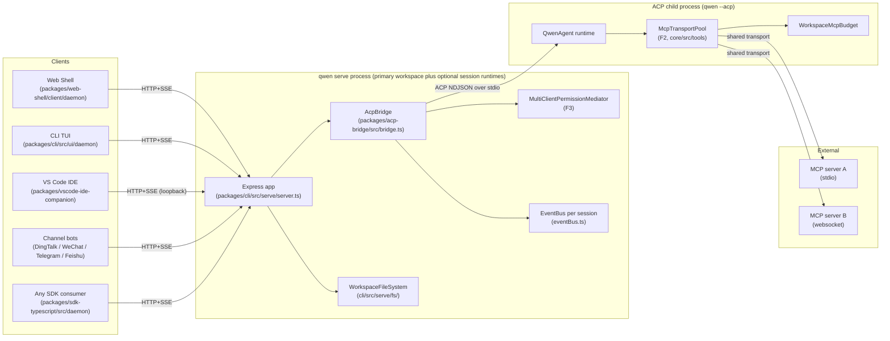
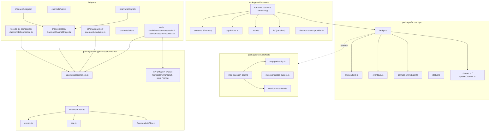
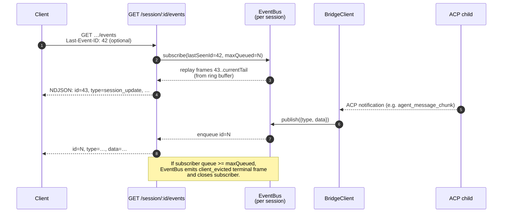
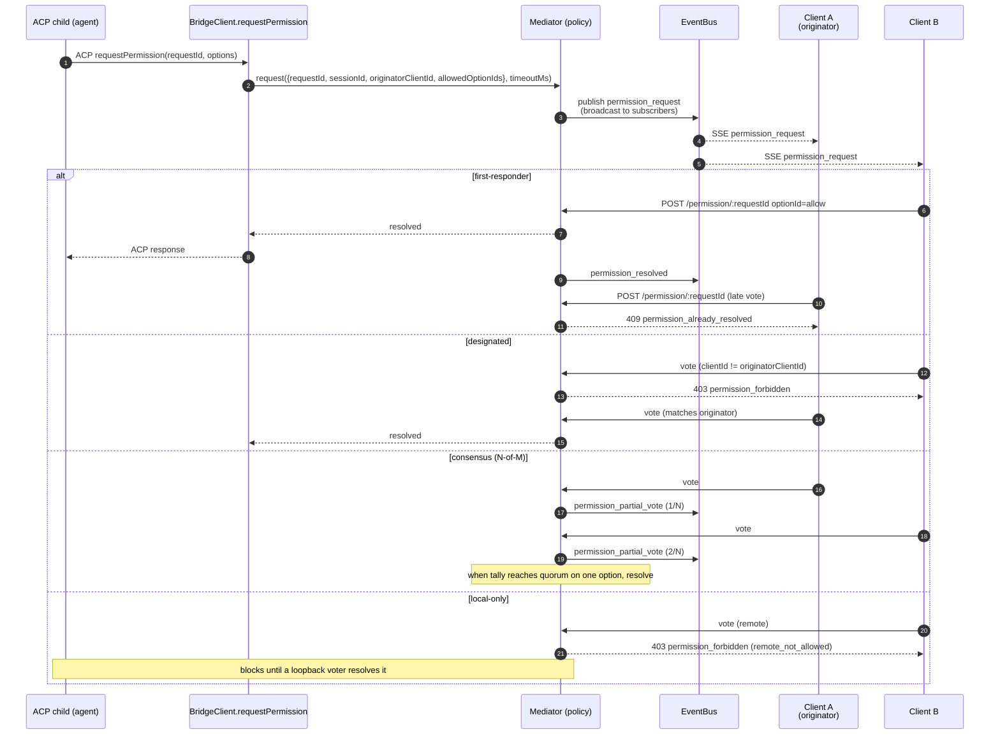
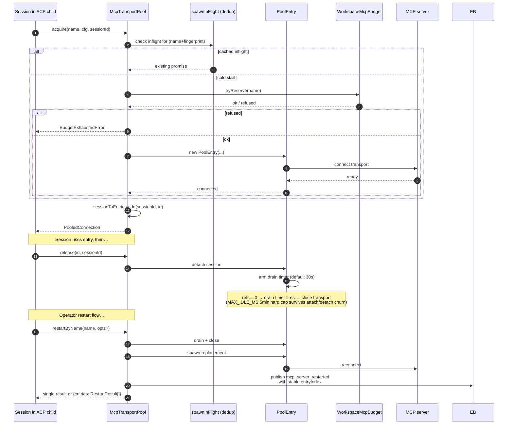
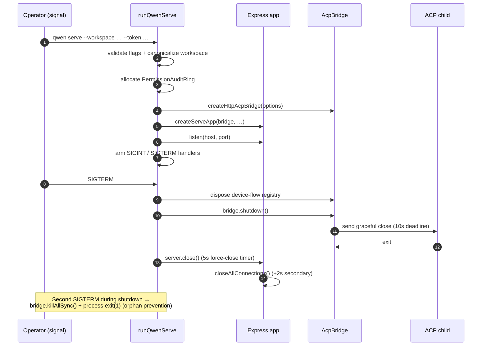

# Qwen Code 守护进程架构

解释工作区与子进程、HTTP 和 SSE 生命周期、多客户端权限、MCP 连接池及启动关闭流程。

- 来源：Qwen／Qwen Code
- 资料类型：存档文档
- 存档版本：`7e3de59d3aba`。
- 文档时间：源码提交（存档版）：[2026-09-09](<https://github.com/QwenLM/qwen-code/commit/9163bdcddb45fc23110d9cf1d9d145b2de5d8153>)；发表/更新：官方未公开；本地归档批次：2026-10-10
- 阅读状态：完整中文机器译文，由 Google 翻译；代码、命令与配置保留原样，未逐句人工校对。

[原文发布页](<https://github.com/QwenLM/qwen-code/blob/main/docs/developers/daemon/01-architecture.md>) · [原始文件](<../../../../原始抓取备份/原文/官方/Qwen/Qwen Code/docs/developers/daemon/01-architecture.md>) · [返回资料总览](<../../../资料总览.md>)

[查看原文对照](#原文对照)

## 中文全文

# 守护进程架构

## 概述

默认情况下，`qwen serve` 进程托管一台 Express HTTP 服务器和一个主工作区。启用 `multi_workspace_sessions` 后，它还可以为实时会话闭环托管额外的工作空间运行时；每个注册的工作区都拥有自己的 `@qwen-code/acp-bridge` / `qwen --acp` 子对。多个客户端（CLI TUI、IDE 同伴、IM 频道机器人、Web BFF、自定义脚本）通过 HTTP + SSE 连接，并且共享一个 ACP 会话（`sessionScope: 'single'`，默认）或按对话线程拆分会话（`sessionScope: 'thread'`）。

在 ACP 子级内部，MCP 服务器通过 `McpTransportPool` (F2) 在工作区范围内共享：单个（服务器名称 + 配置指纹）元组映射到一个 MCP 传输，无论有多少会话发现它。该桥的 `MultiClientPermissionMediator` (F3) 根据四种策略之一协调所有连接客户端的权限投票。

本文档提供了 ** 系统级图片 **，本文档集的其余部分均以此为基础。每个关键流程都以美人鱼序列图的形式展示；每个组件的实现细节位于其他 18 文档中。

## 流程拓扑



守护进程和 ACP 子进程通过 `AcpChannel` 连接（默认：一个真正的子进程 stdio 管道对；`inMemoryChannel` 用于测试）。守护进程所做的一切都是由这种分割决定的：HTTP 和 SSE 流量在守护进程中终止，agent 决策和工具调用发生在子进程中，并且桥将两者连接起来。

## 套餐图



三个信任边界很重要：HTTP 边缘（`serve/auth.ts` 中间件链）、桥到 ACP- 子边界（NDJSON 通过 stdio，无身份验证；子节点隐式信任桥）以及agent 到 MCP- 服务器边界（agent 可能会调用接触主机的工具）。

## 工作流程 1：HTTP 请求生命周期

```mermaid
sequenceDiagram
    autonumber
    participant C as Client (SDK)
    participant MW as Middleware<br/>(origin-strip→log→trace-id→host→same-origin→CORS→bearer→rate-limit→JSON→telemetry→mutationGate)
    participant R as Route handler
    participant BR as AcpBridge
    participant BC as BridgeClient
    participant CH as ACP child

    C->>MW: POST /session/:id/prompt<br/>Authorization: Bearer …<br/>X-Qwen-Client-Id: …
    MW->>MW: loopback same-origin Origin strip
    MW->>MW: access-log hook (skips GET /health and POST */heartbeat)
    MW->>MW: inbound trace-id capture
    MW->>MW: hostAllowlist (DNS rebinding guard)
    MW->>MW: remote same-origin Origin strip + bearer check (non-loopback with a token)
    MW->>MW: allowOriginCors (mutable allowlist; unmatched Origin -> 403)
    MW->>MW: bearerAuth (constant-time compare)
    MW->>MW: rateLimit (when enabled)
    MW->>MW: express.json body parser
    MW->>MW: daemonTelemetryMiddleware
    MW->>MW: mutationGate (strict on mutating routes)
    MW->>R: req validated
    R->>BR: bridge.sendPrompt(sessionId, body, clientId)
    BR->>BC: client.sendPrompt(sessionId, …)
    BC->>CH: ACP JSON-RPC over stdin
    CH-->>BC: ACP response / notifications
    BC-->>BR: result
    BR-->>R: result
    R-->>C: 200 JSON
```

非流式路由（提示、取消、模型切换、元数据、工作区 CRUD）作为单个 JSON 回复终止。流输出在 SSE 通道上带外传送，** 不是 ** 作为此连接上的分块 HTTP 主体。请参阅工作流程 2。

## 工作流程 2：SSE 事件传递和重播



环形缓冲区是有界的（`eventRingSize`，默认为8000）。 `Last-Event-ID` 早于环头的重新连接客户端会收到 `state_resync_required`，并且必须从 `loadSession` 的有界重播快照窗口重建，或者在已有本地历史记录时使用 `resumeSession`。慢速客户端在 75% 队列填充时触发 `slow_client_warning`，在上限时触发 `client_evicted`。

## 工作流程 3：多客户端权限调解



跨策略逃生舱口：任何客户端都可以投票 `CANCEL_VOTE_SENTINEL` 以将请求短路为 `cancelled / agent_cancelled`。网桥可防止电报呼叫者通过正常的 `optionId` 字段 (`InvalidPermissionOptionError`) 走私哨兵。

## 工作流程4：MCP传输池获取/释放/重新启动



`releaseSession(sessionId)` 使用反向 `sessionToEntries` 索引来释放会话在 O(refs) 中保存的每个条目。在守护进程关闭时，`drainAll()` 设置 `draining` 标志（拒绝新获取）并等待每个条目在可配置的超时下关闭。

## 工作流程 5：生命周期 — 启动和正常关闭



两阶段关闭很重要，因为正在运行的 HTTP 请求、正在运行的 SSE 订阅者以及 ACP 子进程的正在运行的工具调用都需要有界的拆卸窗口。如果有任何事情阻碍了这些截止日期，则强制关闭路径将接管，因此卡住的子进程无法使守护进程保持活动状态。

## 关键文件

|关注|文件|
| -------------------- | ----------------------------------------------------------- |
|引导程序| `packages/cli/src/serve/run-qwen-serve.ts`                  |
|快递应用程序| `packages/cli/src/serve/server.ts`                          |
|能力登记| `packages/cli/src/serve/capabilities.ts`                    |
|认证中间件| `packages/cli/src/serve/auth.ts`                            |
|桥| `packages/acp-bridge/src/bridge.ts`                         |
| BridgeClient         | `packages/acp-bridge/src/bridgeClient.ts`                   |
|权限中介者| `packages/acp-bridge/src/permissionMediator.ts`             |
| EventBus             | `packages/acp-bridge/src/eventBus.ts`                       |
|MCP 运输池| `packages/core/src/tools/mcp-transport-pool.ts`             |
|工作空间 MCP 预算| `packages/core/src/tools/mcp-workspace-budget.ts`           |
|工作空间 FS| `packages/cli/src/serve/fs/`                                |
| SDK DaemonClient     | `packages/sdk-typescript/src/daemon/DaemonClient.ts`        |
| SDK SessionClient    | `packages/sdk-typescript/src/daemon/DaemonSessionClient.ts` |
|事件架构| `packages/sdk-typescript/src/daemon/events.ts`              |

## 参考文献

- 设计问题：[#3803](<https://github.com/QwenLM/qwen-code/issues/3803>)（守护进程设计）、[#4175](<https://github.com/QwenLM/qwen-code/issues/4175>)（F-系列里程碑）。
- 用户指南：[`../../users/qwen-serve.md`](<Qwen Code 守护进程模式.md>)。
- 有线协议参考：[`../qwen-serve-protocol.md`](<Qwen Code 守护进程 HTTP 协议参考.md>)。
- F2设计文件：[`../../design/f2-mcp-transport-pool.md`](<https://github.com/QwenLM/qwen-code/blob/7e3de59d3aba5cab80767ac5b121c0b3b4e35267/docs/design/f2-mcp-transport-pool.md>)。
- F2 设计说明：问题 [#4175](<https://github.com/QwenLM/qwen-code/issues/4175>) 提交 4-6。


## 原文对照

<details>
<summary>展开完整原文</summary>

# Daemon Architecture

## Overview

A `qwen serve` process hosts one Express HTTP server and one primary workspace by default. With `multi_workspace_sessions` enabled it may also host additional workspace runtimes for the live session closed loop; each registered workspace owns its own `@qwen-code/acp-bridge` / `qwen --acp` child pair. Multiple clients (CLI TUI, IDE companion, IM channel bots, web BFFs, custom scripts) connect over HTTP + SSE and either share one ACP session (`sessionScope: 'single'`, default) or split sessions by conversation thread (`sessionScope: 'thread'`).

Inside the ACP child, MCP servers are shared workspace-wide through `McpTransportPool` (F2): a single (server-name + config-fingerprint) tuple maps to one MCP transport, regardless of how many sessions discover it. The bridge's `MultiClientPermissionMediator` (F3) coordinates permission votes across all connected clients under one of four policies.

This doc gives the **system-level picture** that the rest of this documentation set builds on. Each critical flow is shown as a Mermaid sequence diagram; per-component implementation details live in the other 18 docs.

## Process topology


The daemon process and the ACP child are connected by an `AcpChannel` (default: a real subprocess stdio pipe pair; `inMemoryChannel` for tests). Everything the daemon does is shaped by this split: HTTP and SSE traffic terminate in the daemon, agent decisions and tool invocations happen in the child, and the bridge connects the two.

## Package map


Three trust boundaries matter: the HTTP edge (`serve/auth.ts` middleware chain), the bridge-to-ACP-child boundary (NDJSON over stdio, no auth; the child trusts the bridge implicitly), and the agent-to-MCP-server boundary (the agent may invoke tools that touch the host).

## Workflow 1: HTTP request lifecycle

```mermaid
sequenceDiagram
    autonumber
    participant C as Client (SDK)
    participant MW as Middleware<br/>(origin-strip→log→trace-id→host→same-origin→CORS→bearer→rate-limit→JSON→telemetry→mutationGate)
    participant R as Route handler
    participant BR as AcpBridge
    participant BC as BridgeClient
    participant CH as ACP child

    C->>MW: POST /session/:id/prompt<br/>Authorization: Bearer …<br/>X-Qwen-Client-Id: …
    MW->>MW: loopback same-origin Origin strip
    MW->>MW: access-log hook (skips GET /health and POST */heartbeat)
    MW->>MW: inbound trace-id capture
    MW->>MW: hostAllowlist (DNS rebinding guard)
    MW->>MW: remote same-origin Origin strip + bearer check (non-loopback with a token)
    MW->>MW: allowOriginCors (mutable allowlist; unmatched Origin -> 403)
    MW->>MW: bearerAuth (constant-time compare)
    MW->>MW: rateLimit (when enabled)
    MW->>MW: express.json body parser
    MW->>MW: daemonTelemetryMiddleware
    MW->>MW: mutationGate (strict on mutating routes)
    MW->>R: req validated
    R->>BR: bridge.sendPrompt(sessionId, body, clientId)
    BR->>BC: client.sendPrompt(sessionId, …)
    BC->>CH: ACP JSON-RPC over stdin
    CH-->>BC: ACP response / notifications
    BC-->>BR: result
    BR-->>R: result
    R-->>C: 200 JSON
```

Non-streaming routes (prompt, cancel, model switch, metadata, workspace CRUD) terminate as a single JSON reply. Streaming output is delivered out-of-band on the SSE channel, **not** as a chunked HTTP body on this connection. See workflow 2.

## Workflow 2: SSE event delivery and replay


The ring buffer is bounded (`eventRingSize`, default 8000). A reconnecting client whose `Last-Event-ID` is older than the ring's head receives `state_resync_required` and must rebuild from `loadSession`'s bounded replay snapshot window or use `resumeSession` when it already has local history. Slow clients trigger `slow_client_warning` at 75% queue fill and `client_evicted` at the cap.

## Workflow 3: Multi-client permission mediation


Cross-policy escape hatch: any client may vote `CANCEL_VOTE_SENTINEL` to short-circuit the request as `cancelled / agent_cancelled`. The bridge guards against wire callers smuggling the sentinel via the normal `optionId` field (`InvalidPermissionOptionError`).

## Workflow 4: MCP transport pool acquire / release / restart


`releaseSession(sessionId)` uses the reverse `sessionToEntries` index to release every entry the session holds in O(refs). On daemon shutdown, `drainAll()` sets the `draining` flag (refusing new acquires) and waits for every entry to close under a configurable timeout.

## Workflow 5: Lifecycle — startup and graceful shutdown


The two-phase shutdown matters because in-flight HTTP requests, in-flight SSE subscribers, and the ACP child's in-flight tool calls all need bounded teardown windows. If anything blocks past those deadlines, the force-close path takes over so a stuck child cannot keep the daemon process alive.

## Critical files

| Concern              | File                                                        |
| -------------------- | ----------------------------------------------------------- |
| Bootstrap            | `packages/cli/src/serve/run-qwen-serve.ts`                  |
| Express app          | `packages/cli/src/serve/server.ts`                          |
| Capability registry  | `packages/cli/src/serve/capabilities.ts`                    |
| Auth middleware      | `packages/cli/src/serve/auth.ts`                            |
| Bridge               | `packages/acp-bridge/src/bridge.ts`                         |
| BridgeClient         | `packages/acp-bridge/src/bridgeClient.ts`                   |
| Permission mediator  | `packages/acp-bridge/src/permissionMediator.ts`             |
| EventBus             | `packages/acp-bridge/src/eventBus.ts`                       |
| MCP transport pool   | `packages/core/src/tools/mcp-transport-pool.ts`             |
| Workspace MCP budget | `packages/core/src/tools/mcp-workspace-budget.ts`           |
| Workspace FS         | `packages/cli/src/serve/fs/`                                |
| SDK DaemonClient     | `packages/sdk-typescript/src/daemon/DaemonClient.ts`        |
| SDK SessionClient    | `packages/sdk-typescript/src/daemon/DaemonSessionClient.ts` |
| Event schema         | `packages/sdk-typescript/src/daemon/events.ts`              |

## References

- Design issues: [#3803](<https://github.com/QwenLM/qwen-code/issues/3803>) (daemon design), [#4175](<https://github.com/QwenLM/qwen-code/issues/4175>) (F-series milestones).
- User guide: [`../../users/qwen-serve.md`](<Qwen Code 守护进程模式.md>).
- Wire protocol reference: [`../qwen-serve-protocol.md`](<Qwen Code 守护进程 HTTP 协议参考.md>).
- F2 design document: [`../../design/f2-mcp-transport-pool.md`](<https://github.com/QwenLM/qwen-code/blob/7e3de59d3aba5cab80767ac5b121c0b3b4e35267/docs/design/f2-mcp-transport-pool.md>).
- F2 design notes: issue [#4175](<https://github.com/QwenLM/qwen-code/issues/4175>) commits 4-6.


</details>
