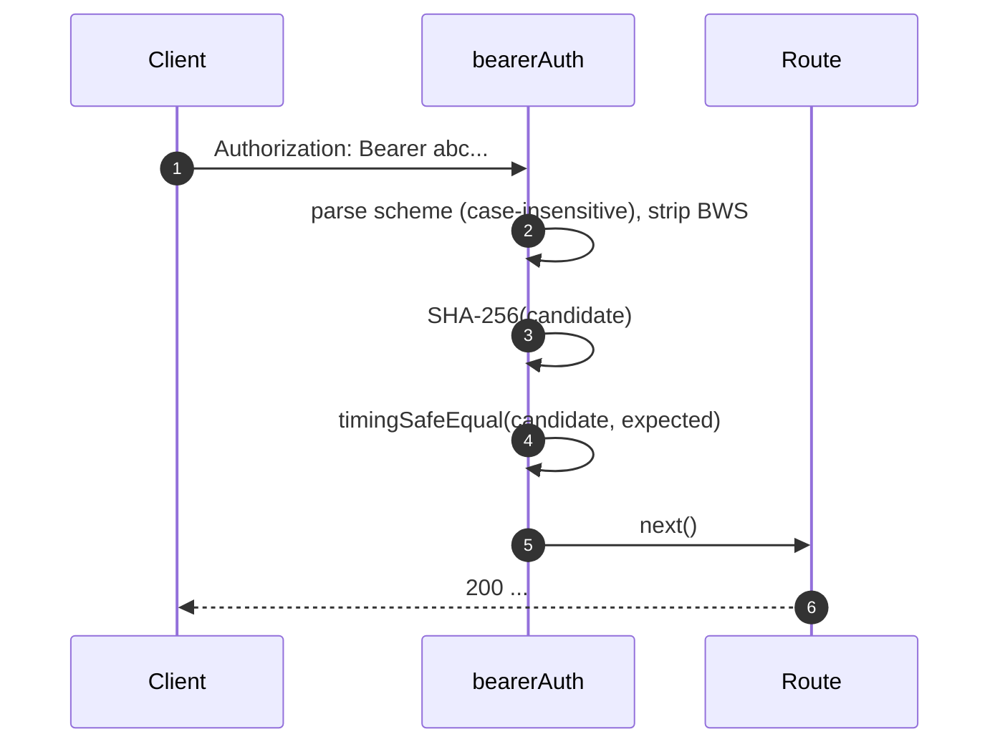
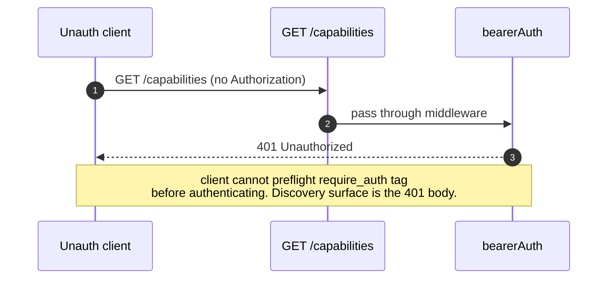
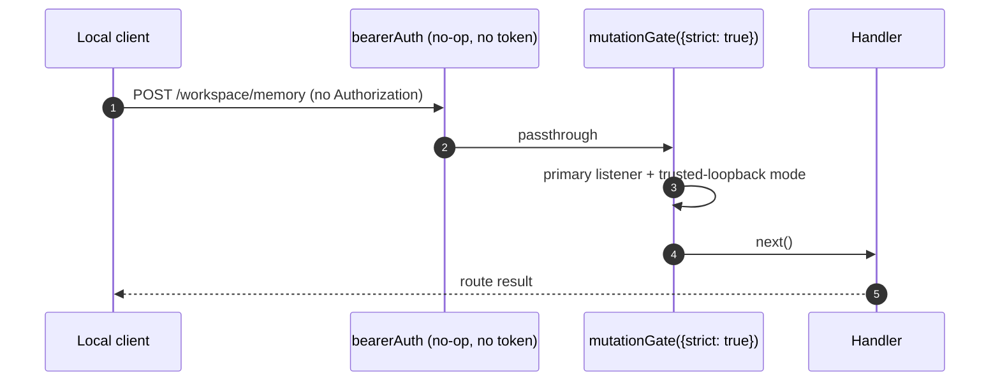

# Qwen Code 守护进程的认证与安全模型

说明监听地址、令牌、主机和来源检查、变更保护、设备认证及权限边界；属于服务部署与实现参考。

- 来源：Qwen／Qwen Code
- 资料类型：存档文档
- 存档版本：`7e3de59d3aba`。
- 文档时间：源码提交（存档版）：[2026-10-05](<https://github.com/QwenLM/qwen-code/commit/f2e069061ab4bbf4bb146881c946fa3bd2e32d5e>)；发表/更新：官方未公开；本地归档批次：2026-10-10
- 阅读状态：完整中文机器译文，由 Google 翻译；代码、命令与配置保留原样，未逐句人工校对。

[原文发布页](<https://github.com/QwenLM/qwen-code/blob/main/docs/developers/daemon/12-auth-security.md>) · [原始文件](<../../../../原始抓取备份/原文/官方/Qwen/Qwen Code/docs/developers/daemon/Qwen Code 守护进程的认证与安全模型.md>) · [返回资料总览](<../../../资料总览.md>)

[查看原文对照](#原文对照)

## 中文全文

# 身份验证和安全模型

## 概述

`qwen serve` 默认情况下是本地守护进程，并且是配置错误的暴露表面。它的安全模型是**分层**，因此错误配置无法关闭：

1. **Bind** — 非环回绑定总是携带一个承载：操作员的，或在启动时生成并打印一次的临时 128 位。仅当提供的令牌源显式为 empty/whitespace 时，或者当请求的 `localhost` 解析脱环且未解析令牌源（从不生成）时，引导才会拒绝。
2. **承载身份验证** — `bearerAuth` 具有恒定时间 SHA-256 比较的中间件可保护普通环回绑定上除 `/health` 之外的正常 API 路由（`require_auth` 将该端点移至承载后面）也）。通道 webhook 入口是由 `x-qwen-webhook-secret` 验证的单独预承载路由。 Web Shell 文档和资产路由在每种模式下均保持预身份验证。
3. **主机标头白名单** — 在环回时，仅接受 `localhost`、`127.0.0.1`、`[::1]`、`host.docker.internal` 或确切的绑定环回地址（加端口）；当监听 80 或 443 时，也接受相应的无端口形式。允许名单可防止 DNS 重新绑定。本地控制 LAN 侦听器是一个例外，它始终强制执行其广告权限主机检查，无论主绑定是什么。
4. **原点控制** — 运行时应用程序始终在可变白名单 (`MutableOriginAllowlist`) 上安装 `allowOriginCors`：`--allow-origin <pattern>` 条目为其播种，本地控制在启用时添加 LAN 原点。不匹配的源收到 403 拒绝信封。无条件拒绝墙 (`denyBrowserOriginCors`) 仅在运行时启动之前应答的引导应用程序中存在。
5. **每条路线突变门** - 严格的路线需要操作员权限。无令牌环回主侦听器是受信任的；经过承载验证和配对的本地控制请求也符合资格。在没有受信任权限的情况下到达此门的无令牌主要请求会收到明显的 `code: 'token_required'` 错误。丢失或无效的配置凭据和未配对的本地控制凭据会被其侦听器范围的承载中间件以简单的 `401 Unauthorized` 提前拒绝。
6. **设备流身份验证** — 提供商的单独 OAuth 界面（`POST /workspace/auth/device-flow` + `/:id` 上的 GET/DELETE）。

本文档详细介绍了每一层以及引导路径强制执行的显式不变量。

## 职责

- 拒绝在不安全的配置下启动。
- 配置时，门正常API通过承载请求，但受到环回`/health`豁免；将通道 Webhook 入口保留在其独立的共享秘密门后面，并在经过身份验证和豁免的路由之前保留环回主机和浏览器来源检查。
- 提供每条路线的突变门 Wave 4 路线选择加入。
- 托管设备流注册表，驱动通过 SSE 事件可见的提供者 OAuth 流。

## 建筑

### 启动时拒绝规则

在`run-qwen-serve.ts`中：

```ts
// A non-loopback bind with neither --token nor QWEN_SERVER_TOKEN first
// generates an ephemeral 128-bit base64url bearer (16 random bytes, 22
// URL-safe characters; printed once at startup, rotated per process). The
// first refusal below therefore fires only when a token source was supplied
// but is explicitly empty/whitespace, or when the requested hostname resolves
// off-loopback (localhost pinned to a non-loopback address never generates).
// Generation is loopback-suppressed, so the second refusal is a loopback-only
// fail-fast: on a non-loopback bind the generated token already satisfies
// --require-auth.
if (!isLoopbackBind(opts.hostname) && !token) {
  throw new Error('Refusing to bind <host>:<port> without a bearer token. ...');
}
if (opts.requireAuth && !token) {
  throw new Error(
    'Refusing to start with --require-auth set but no bearer token configured. ...',
  );
}
```

无令牌允许源配置仅限于环回 HTTP(S) 源；
非 HTTP(S) 条目保留其现有处理：

```ts
const parsed = parseAllowOriginPatterns(opts.allowOrigins);
if (parsed.allowAny && !token) {
  throw new Error(
    "Refusing to start with --allow-origin '*' but no bearer token configured. ...",
  );
}
if (findNonLoopbackHttpOrigin(parsed) && !token) {
  throw new Error(
    'Refusing to start with a non-loopback HTTP(S) --allow-origin but no bearer token configured. ...',
  );
}
```

这些拒绝是显式的启动失败（在 stderr 中可见/抛出到嵌入器），
从不沉默。 #3803 的威胁模型明确禁止静默地让 
 守护进程在开放环境中绑定到环回之外。

`runQwenServe()`解析`localhost`一次，将侦听器固定到该地址，并在发布可信环回权限之前验证实际侦听器地址；如果结果在 `127.0.0.0/8` 或 `::1` 之外，则无令牌启动失败并关闭侦听器。 `createServeApp()` 不拥有套接字，因此其调用者仍然负责确保声明的环回主机名仅绑定到环回。声明的非环回嵌入可保持严格的路由、会话 shell 和本地控制配对材料失败关闭。它还会拒绝在构造时没有非空令牌的 `requireAuth: true`，因此非严格路由不会在无效的强化配置下意外保持打开状态。

### 中间件链（HTTP请求订单）



`mutationGate` 是一个每路由中间件工厂（`createMutationGate` 回报
`mutate()`）；路线呼叫 `mutate()` 或 `mutate({strict: true})` 注册时
时间。这不是一个全球性的 `app.use()` 中间件。访问日志记录和入站
Trace-id 捕获在源墙和同源之前注册
凭据检查，所以那些 403/401 短路的记录与其他记录一样
拒绝并且日志行仍然加入调用者的跟踪 ID；两者也先于
`bearerAuth`，所以 401 拒绝仍被记录。环回主机允许列表在预身份验证运行状况之前注册
路线所以 DNS-重新绑定防御覆盖它。预授权 `/health` 坐在下面
源墙（匹配的跨源探针携带 CORS 标题）；访问
日志豁免 `GET /health` 和 `POST */heartbeat` 在附加其之前通过路径
完成记录器，所以精确路径 `GET /health` 和 `POST */heartbeat` 探针停留
在任何安装位置均未记录，并且这些豁免路径上的墙壁拒绝
同样未登录（`HEAD /health` 和 `GET /health/` 像任何记录一样
请求）。正常 API 速率限制
追赶 `bearerAuth` 和之前 `express.json()`，所以只有经过验证的
当限制达到时，请求计数和大型主体在解析之前会被拒绝
超过了。在承载身份验证之前通道 webhook 入口分支并应用其
自己的共享秘密检查、突变层率检查，以及 1 MiB 解析器。

同源表面是`server/self-origin.ts`中的两个中间件，分开安装
：仅环回`Origin`条安装在访问日志之前（它
仅删除匹配的`Origin`，从不拒绝），并且
`installRemoteSelfOriginMiddleware`运行紧接在具有配置令牌的非环回主侦听器上的 
`allowOriginCors` 之前。
远程监听器将规范 `Origin` 与直接套接字方案 
 以及规范化 `Host` 权限相匹配 — 永远不会咨询转发的标头 —
 和承载者在删除`Origin`之前验证匹配，因此内置Web
Shell的同源HTTP突变不需要`--allow-origin`。其预授权 
 谓词 (`web-shell-preauth.ts`) 免除 shell 入口点 (`/`、`//`、
`/assets*`、`/manifest.webmanifest`、`/sw.js`、 `/mcp-app-sandbox`、精确
`/session/:id`、`/plugins`、`/channels`、`/live`、`/scheduled-tasks`、`/goals` 和 `/settings` 文档导航）来自 
 的凭据检查，因为浏览器模块脚本提取携带 `Origin`
，而不带 `Authorization`。 WebSocket 升级和 TLS- 前端代理 `https` 来源 
 不包括在内：升级门保留其自己的 CSWSH 策略（环回来源、
`--allow-origin` 条目或本地控制侦听器自己的来源），并且
代理的`https`来源永远无法与普通套接字的方案匹配。

### `bearerAuth`

- **未配置令牌**→中间件是无操作的（环回开发人员默认）。例外：本地控制 **LAN 侦听器 ** 是侦听器范围的，并且始终需要其配对凭据（`CredentialStore.isOpen` 对于 `local-control` 永远不会为真），因此即使在无令牌守护程序上，它也永远不会打开。
- **配置的代币** → SHA-256构建时配置的代币；在每个请求哈希上，候选者和 `timingSafeEqual` 进行比较。无串等短路现象；没有时间泄漏。
- **方案解析**：不区分大小写`Bearer`按照RFC7235§2.1；根据 RFC 7230 §3.2.6 BWS 容忍方案和凭证之间的 `SP\tHTAB`；拒绝纯HTAB-作为分隔符。
- **CodeQL 强化 **：手工滚动 `indexOf` 解析而不是正则表达式与 `\s+` / `.+` 重叠（无多项式正则表达式风险）。

### `hostAllowlist`

仅环回。维护由端口键控的 `Set<string>`。允许的主机：

- `localhost:<port>`、`127.0.0.1:<port>`、`[::1]:<port>`、`host.docker.internal:<port>`以及具有相同端口的确切绑定环回地址。最后一种形式涵盖了完整支持的 IPv4 环回范围 (`127.0.0.0/8`)，而不允许不相关的主机。
- 当绑定到端口 80 或 443 时，加上相应的无端口形式 ** 仅 **（根据 RFC 7230 §5.4 默认端口省略）。

主机比较是 ** 不区分大小写 ** — Express 规范标头名称而不是值，因此大写主机 (`Localhost:4170`、`HOST.docker.internal`) 的 Docker 代理将 403 进行精确字符串比较。

非环回绑定绕过主门（操作员选择表面区域；承载令牌门改为主机欺骗）。本地控制 LAN 侦听器是例外：无论主绑定是什么，它始终强制执行其广告权限主机检查。

### `denyBrowserOriginCors`（仅限引导应用程序）

拒绝任何带有 `Origin` 标头的请求。 CLI/SDK 从未设置原点；只有浏览器可以。返回确定性的 `403 { error: 'Request denied by CORS policy' }`，而不是 `cors` 包的错误回调会产生的 500 HTML。运行时应用程序不再安装此墙 - 它在可变允许列表上运行 `allowOriginCors`（如下）；拒绝行为作为不匹配的起源分支保留在那里。墙保留在引导应用程序 (run-qwen-serve.ts) 中，该应用程序在运行时启动之前为请求提供服务。

例外：Web Shell 的同源 XHR **环回** 绑定由单独的中间件处理（在 `server/self-origin.ts`) 剥离 `Origin` 当它与规范环回自源之一匹配时（`127.0.0.1`, `localhost`, `[::1]`, `host.docker.internal`) 或确切的绑定环回地址。方案匹配的无端口源仅接受其默认端口 (`http` 上 80, `https` 上 443）。在非环回上绑定第二个中间件（`installRemoteSelfOriginMiddleware`，在同一个文件中）改为覆盖 shell 的 XHR：它对一个请求进行承载身份验证，该请求的规范 `Origin` 等于直接套接字方案加上标准化 `Host` 权威——转发的标头永远不受信任——并剥夺了这一点 `Origin` 在墙之前，所以这些请求不需要 `--allow-origin` 条目。跨域和 `null` 起源仍然被拒绝，并且 WebSocket 升级路线加一个 TLS-前端代理 `https` origin 仍然需要一个（参见 [中间件链](<#中间件链http请求订单>)).

### `allowOriginCors`（运行时应用程序，始终安装）

运行时应用程序无条件安装 `allowOriginCors(originAllowlist)`；
 允许列表是从 `--allow-origin
<pattern>` 条目（可能没有）播种的 `MutableOriginAllowlist`，并在启用 Local
Control 时在运行时扩展（LAN 源是added/removed与听众）：

- 匹配 `Origin` 值接收 `Access-Control-Allow-Origin`，
`Access-Control-Allow-Headers`和`Access-Control-Allow-Methods`； `OPTIONS`
 预检返回 `204`。
- 不匹配的 `Origin` 值接收相同的确定性
`403 { error: 'Request denied by CORS policy' }` 作为拒绝模式。
- `--allow-origin '*'` 需要不记名令牌；在环回绑定引导拒绝时，没有配置，而在非环回绑定生成的临时令牌满足保护（拒绝仅环回）。
- 如果没有令牌，HTTP(S) `--allow-origin` 值仅限于环回绑定上的环回主机；在非环回绑定生成的令牌满足相同的保护。非环回浏览器源在每个 API 路由上与承载者进行身份验证，因为否则它可以行使完整的操作员 API，包括作为守护程序用户执行代码；预身份验证例外是 Web Shell document/asset 路由和 MCP 应用程序沙箱（`/`、`/assets*`、`/manifest.webmanifest`、`/sw.js`、`/mcp-app-sandbox`、确切`/session/:id` 导航），加上通道 webhook 入口，它在 `bearerAuth` 之前分支并使用自己的 `x-qwen-webhook-secret` 而不是承载进行身份验证，并且 - 仅在环回绑定上 - `/health` （在其他地方进行承载门控）。
- 显式浏览器扩展源保留其无令牌本地自动化路径。启动日志表明任何无令牌允许的浏览器源都接收完全的操作员权限。
- `parseAllowOriginPatterns()` 在启动时验证模式语法。
- `allow_origin` 能力标签仅在该模式为
配置。

### `createMutationGate`

每条路线选择加入门。行为矩阵：

|daemon/request 权限|路线选择|结果|
| ------------------------------------------------------------- | --------------- | -------------------------------- |
|令牌已配置|任何|直通1|
|可信环回主要侦听器|任何|直通|
|配对的本地控制监听器| `strict: true`  |直通|
|没有可信环回权限的无令牌主请求| `strict: true`  | `401 { code: 'token_required' }` |
|任何无令牌部署| `strict: false` |直通|

1 任何令牌配置都会使全局 `bearerAuth` 在正常 API 路由的门之前强制执行承载身份验证，环回 `/health` 除外，除非设置了 `--require-auth`。通道 Webhook 入口在此中间件之前使用其自己的共享密钥进行身份验证。大门是多余的，但对其保护的路线无害。 `--require-auth` 本身不是身份验证，只有使用令牌才有效。

可信环回模式源自`loopback bind && no configured token && !requireAuth`。它仅授权通过主侦听器到达的请求。它不会标记内部承载验证标记，因此侦听器凭据和部署权限仍然是不同的事实。 `code: 'token_required'` 形状保留用于较旧的守护进程和无令牌的不可信嵌入，其请求到达严格的门，因此 SDK 客户端可以呈现配置提示而不是通用 401。配置令牌和本地控制凭据失败保留早期的普通 `401 Unauthorized` 响应。

本地控制状态和启用响应仅向具有操作员权限的呼叫者公开其配对 URL 和 QR：受信任的主侦听者呼叫者、经过承载身份验证的主呼叫者和已配对的 LAN 客户端。未配对的 LAN 调用者和不受信任的嵌入无法检索它。启用仍然需要主要侦听器； LAN客户端可以在配对后访问或在现有规则下请求禁用。

**波4+严格路线**：`/workspace/memory`，`/workspace/agents/*`，
`/workspace/agents/generate`，`/file/write`， `/file/edit`、
`/workspace/tools/:name/enable`、`/workspace/mcp/:server/restart`、
`/workspace/mcp/:server/{enable,disable,authenticate,clear-auth}`、
`/workspace/mcp/servers`（POST/DELETE）、`/workspace/auth/device-flow`、
`/workspace/init`、`/session/:id/approval-mode`、 `/session/:id/rewind`和
`/session/:id/shell`。

倒带残留物 REST-仅在 TypeScript SDK 即使当 ACP 运输是
配置。这保留了严格的突变门和 bearer/client 身份
标头；的 ACP 路由表故意没有倒带映射。所有者路由
还在倒回或 shell 到达辅助节点之前重新检查工作区信任
运行时桥。重复的实时会话 ID 无法关闭，如下所示
`ambiguous_session_owner` 而不是回退到主运行时。

### `/health` 豁免

在环回绑定上，`/health` 在 ** 承载中间件之前注册 **，因此 pod 内的活性探针不需要携带令牌。非环回将门 `/health` 与其他正常 API 路由绑定。 `--require-auth` 放弃了豁免：`/health` 也需要环回上的 `Authorization: Bearer <token>`。通道 webhook 入口在每种模式下都保留在承载身份验证之外，并且需要自己的 `x-qwen-webhook-secret`。

### v1 客户身份 (`X-Qwen-Client-Id`) 是自行报告的

该守护进程仅验证 `X-Qwen-Client-Id`
(`[A-Za-z0-9._:-]{1,128}`) 的格式并跟踪每个会话附加的客户端 ID。它
当前不执行所有权证明。在 SSE 上观察到 
`originatorClientId` 的客户端可以重新注册相同的 ID，并在以后的请求中模拟 
 发起者。

影响：

- `designated` — 远程调用者可以冒充发起者并投票
请求仅针对提示发起者。
- `consensus` — 如果欺骗 ID 已存在于 `votersAtIssue` 快照中，
它可以投票。
- `local-only` 不受影响，因为它选通 `fromLoopback`，
来自连接远程地址的守护进程标记。
- `first-responder` 不受影响，因为它与身份无关。

未来的配对令牌机制将发布每个会话的秘密
`POST /session`; `designated` / `consensus` 投票必须提出它。直到
然后，需要强化指定策略的部署应该绑定环回
或在经过身份验证的反向代理后面运行。参见
[`04-permission-mediation.md`](<Qwen Code 多客户端权限协调.md>) 对于政策层面
详细信息。

### 设备流身份验证

用于提供者身份验证的单独 OAuth 表面。 v1 提供商标识符为 
`qwen-oauth`，但 Qwen OAuth 免费套餐已在 2026-04-15 上停止；新的
设置应使用当前支持的身份验证提供程序（如果可用）。

- `POST /workspace/auth/device-flow` — 启动流程；返回 `{deviceFlowId, providerId, expiresAt, verificationUrl, userCode}`。
- `GET /workspace/auth/device-flow/:id` — 轮询状态。
- `DELETE /workspace/auth/device-flow/:id` — 取消。
- `GET /workspace/auth/status` — 当前帐户/提供商快照。

SSE 事件 `auth_device_flow_{started, throttled, authorized, failed, cancelled}` 向所有订阅者扇出流状态，以便多客户端 UI 保持同步。请参阅[`09-event-schema.md`](<https://github.com/QwenLM/qwen-code/blob/7e3de59d3aba5cab80767ac5b121c0b3b4e35267/docs/developers/daemon/09-event-schema.md>)。

实现：`packages/cli/src/serve/auth/device-flow.ts` + `qwen-device-flow-provider.ts`。

**日志注入/木马源码防御**：`sanitizeForStderr(value)`
(`device-flow.ts`)将ASCII控制字符和Unicode控制
字符替换为`?`。否则，恶意 IdP 可能会伪造日志行或隐藏 
 有效负载：

|范围|为何被剥离|
| -------------------------------- | ------------------------------------------------------------------------------------------------------------------------------------------------------------------------------------------------------------------------------------------------------------------- |
| `\x00–\x1f`, `\x7f`, `\x80–\x9f` |ASCII C0 / DEL / C1 控件、终端转义和日志行伪造。|
| U+200B-U+200F                    |零宽度字符加LRM / RLM；不可见，但可以更改终端渲染。|
| U+2028-U+2029                    |LINE / PARAGRAPH SEPARATOR;许多支持 Unicode 的终端将它们视为换行符。|
| U+202A-U+202E                    |双向 EMBEDDING / OVERRIDE 控制。|
| U+2066-U+2069                    |双向ISOLATE控件（LRI / RLI / FSI / PDI），主要[CVE-2021-42574“木马源”](<https://trojansource.codes/>)向量。使用 U+2066 (LRI) 代替 U+202D (LRO) 的 IdP 可以通过类似的视觉重新排序绕过 EMBEDDING/OVERRIDE-only 过滤器。|
| U+FEFF                           |BOM / 零宽度不间断空格。|

通过用 `?` 替换每个剥离的代码点而不是 
 删除它来保留长度，因此操作员仍然可以看到该 
 索引处存在某些内容。两个层都使用清理程序：`qwenDeviceFlowProvider` 清理 IdP
`oauthError`，注册表的后期轮询观察者清理插入到审核提示中的提供商控制的 
 值（`latePollResult.kind` / `lateErr.name`）。

`auth_device_flow`能力标签无条件公告****；如果守护进程无法满足特定提供者的要求，路由本身将返回 `400 unsupported_provider`。支持的提供者列表位于 `/workspace/auth/status` 而不是 `/capabilities` 以保持描述符形状统一。

## 工作流程

### 承载身份验证成功请求



### 承载身份验证失败模式

全部返回 `401 { error: 'Unauthorized' }`（在 `missing header` / `wrong scheme` / `wrong token` 之间统一，因此探测无法区分）。

### `--require-auth` 影子



身份验证后，`caps.features.includes('require_auth')` 确认部署已强化。

### 可信环回的严格变异



## 状态和生命周期

- 不记名令牌在启动时读取并修剪（`cat token.txt` 中的换行符将默默地中断比较）。
- 的 CLI-仅 `--open-with-auth` 模式在启动前运行：确定性后 loopback/Web Shell 检查，它应用相同的环境选项选择并填充 `ServeOptions.token` 与 32 仅当不存在非空选定令牌时，随机字节编码为 base64url。生成的凭证具有进程生命周期，不会被写入 `process.env` 或由守护进程持久化，并通过现有的到达浏览器 URL 片段。 Web Shell 在每个选项卡中保留其浏览器副本 `sessionStorage`。裸露 `--open` 并直接 `runQwenServe()` 调用者永远不会生成它。
- 允许的主机集按端口缓存；在端口更改时重建（临时 `0` → 真实端口后 `listen`）。
- 每个应用程序构建时，突变门都会构建一次 `passthrough` 和 `strictDenier`；每个路由调用返回缓存的闭包（没有每个请求分配）。
- 设备流注册表在 `shutdown()` 阶段 1 上进行处理，因此待处理的流在 HTTP 拆卸之前解析为 `cancelled`。

## 依赖关系

- `node:crypto` — `createHash`, `timingSafeEqual`.
- `packages/cli/src/serve/loopback-binds.ts` — `isLoopbackBind`.
- `packages/cli/src/serve/auth/device-flow.ts` — 设备流状态机。
- `@qwen-code/acp-bridge` — 在每个会话 SSE 总线上显示设备流事件。

## 配置

|来源|旋钮|效果|
| --------------- | --------------------------------------------------------------------------------------- | --------------------------------------------------------------------------------------------------------------------------------------------- |
|环境| `QWEN_SERVER_TOKEN`                                                                     |不记名令牌（已修剪）。|
|旗帜| `--token`                                                                               |不记名令牌（覆盖 env）。|
|CLI 标志| `--open-with-auth`                                                                      |在守护进程启动之前重用或生成环回 Web Shell 承载。|
|旗帜| `--require-auth`                                                                        |将承载扩展到环回 + `/health`。仅使用令牌启动。|
|旗帜| `--hostname`                                                                            |非环回绑定始终携带一个承载 — `--token`、`QWEN_SERVER_TOKEN` 或生成的临时承载；明确为空的源拒绝。|
|旗帜| `--allow-origin <pattern>`                                                              |切换到 CORS 白名单模式。通配符和非环回 HTTP(S) 来源需要令牌。|
|能力标签|`require_auth`（有条件）、`auth_device_flow`（始终）、`allow_origin`（有条件）|参见[`11-capabilities-versioning.md`](<https://github.com/QwenLM/qwen-code/blob/7e3de59d3aba5cab80767ac5b121c0b3b4e35267/docs/developers/daemon/11-capabilities-versioning.md>)。|

## 注意事项和已知限制

- **`--require-auth` 阴影具有预检功能。** 未经身份验证的客户端无法发现 `require_auth` 标签；他们的发现表面是401身体本身。
- **突变门主体解析器排序**：`mutationGate({strict: true})` 401在** `express.json()`解析主体后响应触发**。饱和监听器上的最坏情况：`--max-connections × express.json({limit: '10mb'})` ≈ 2.5 GB 瞬态。非环回生产入口点在正常的 API 解析器之前已经需要承载身份验证；通道 webhook 入口会在其单独的 1 MiB 解析器之前检查其共享密钥。直接的不受信任的嵌入拥有其听众的暴露权。
- **`server.ts` 中的同源原点剥离 ** 发生在 _ 之前 _ `allowOriginCors`。如果未来的更改将条带移到其他地方，Web Shell 就会崩溃。
- **令牌比较是在SHA-256摘要**上进行的，而不是在原始令牌上进行的。通过将可变长度令牌比较折叠为固定大小摘要比较来减少时序泄漏。
- 今天，守护进程确实 ** 不 ** 携带 mTLS、请求签名或配对令牌拥有证明。 `--rate-limit` 通过 client-id / IP key 提供 HTTP 速率限制；它不是客户端身份验证。

## 参考文献

- `packages/cli/src/serve/auth.ts`（整个文件）
- `packages/cli/src/serve/run-qwen-serve.ts`（拒绝规则）
- `packages/cli/src/serve/loopback-binds.ts`
- `packages/cli/src/serve/auth/device-flow.ts`
- `packages/cli/src/serve/auth/qwen-device-flow-provider.ts`
- 面向用户的威胁模型：[`../../users/qwen-serve.md`](<Qwen Code 守护进程模式.md>)。
- 电线参考号：[`../qwen-serve-protocol.md`](<Qwen Code 守护进程 HTTP 协议参考.md>)。


## 原文对照

<details>
<summary>展开完整原文</summary>

# Auth & Security Model

## Overview

`qwen serve` is a local daemon by default and an exposed surface in the wrong configuration. Its security model is **layered** so that misconfiguration fails closed:

1. **Bind** — a non-loopback bind always carries a bearer: the operator's, or an ephemeral 128-bit one generated and printed once at startup. Boot refuses only when a supplied token source is explicitly empty/whitespace, or when a requested `localhost` resolves off-loopback with no token source resolved (which never generates).
2. **Bearer auth** — `bearerAuth` middleware with constant-time SHA-256 compare protects normal API routes except `/health` on an ordinary loopback bind (`require_auth` moves that endpoint behind the bearer too). Channel webhook ingress is a separate pre-bearer route authenticated by `x-qwen-webhook-secret`. Web Shell document and asset routes remain pre-auth in every mode.
3. **Host header allowlist** — on loopback, only `localhost`, `127.0.0.1`, `[::1]`, `host.docker.internal`, or the exact bound loopback address (plus port) are accepted; the corresponding port-less forms are also accepted when listening on 80 or 443. The allowlist defends against DNS rebinding. The Local Control LAN listener is the exception that always enforces its advertised-authority Host check, whatever the primary bind is.
4. **Origin control** — the runtime app always installs `allowOriginCors` over a mutable allowlist (`MutableOriginAllowlist`): the `--allow-origin <pattern>` entries seed it, and Local Control adds the LAN origin while enabled. Non-matching origins receive the 403 deny envelope. The unconditional deny wall (`denyBrowserOriginCors`) survives only in the bootstrap app that answers before the runtime starts.
5. **Per-route mutation gate** — strict routes require operator authority. A token-less loopback primary listener is trusted; bearer-authenticated and paired Local Control requests also qualify. A token-less primary request that reaches this gate without trusted authority receives the distinct `code: 'token_required'` error. Missing or invalid configured credentials and unpaired Local Control credentials are rejected earlier by their listener-scoped bearer middleware with plain `401 Unauthorized`.
6. **Device-flow auth** — separate OAuth surface for providers (`POST /workspace/auth/device-flow` + GET/DELETE on `/:id`).

This doc walks through each layer and the explicit invariants the boot path enforces.

## Responsibilities

- Refuse to boot in unsafe configurations.
- Gate normal API requests through bearer when configured, subject to the loopback `/health` exemption; keep channel webhook ingress behind its independent shared-secret gate, and keep loopback Host and browser Origin checks in front of authenticated and exempt routes.
- Provide a per-route mutation gate Wave 4 routes opt into.
- Host the device-flow registry that drives provider OAuth flows visible via SSE events.

## Architecture

### Boot-time refuse rules

In `run-qwen-serve.ts`:

```ts
// A non-loopback bind with neither --token nor QWEN_SERVER_TOKEN first
// generates an ephemeral 128-bit base64url bearer (16 random bytes, 22
// URL-safe characters; printed once at startup, rotated per process). The
// first refusal below therefore fires only when a token source was supplied
// but is explicitly empty/whitespace, or when the requested hostname resolves
// off-loopback (localhost pinned to a non-loopback address never generates).
// Generation is loopback-suppressed, so the second refusal is a loopback-only
// fail-fast: on a non-loopback bind the generated token already satisfies
// --require-auth.
if (!isLoopbackBind(opts.hostname) && !token) {
  throw new Error('Refusing to bind <host>:<port> without a bearer token. ...');
}
if (opts.requireAuth && !token) {
  throw new Error(
    'Refusing to start with --require-auth set but no bearer token configured. ...',
  );
}
```

Tokenless allow-origin configuration is limited to loopback HTTP(S) origins;
non-HTTP(S) entries retain their existing handling:

```ts
const parsed = parseAllowOriginPatterns(opts.allowOrigins);
if (parsed.allowAny && !token) {
  throw new Error(
    "Refusing to start with --allow-origin '*' but no bearer token configured. ...",
  );
}
if (findNonLoopbackHttpOrigin(parsed) && !token) {
  throw new Error(
    'Refusing to start with a non-loopback HTTP(S) --allow-origin but no bearer token configured. ...',
  );
}
```

These refusals are explicit boot failures (visible in stderr / thrown to the embedder),
never silent. The threat model from #3803 explicitly forbids silently letting a
daemon bind beyond loopback in the open.

`runQwenServe()` resolves `localhost` once, pins the listener to that address, and verifies the actual listener address before publishing trusted-loopback authority; if the result is outside `127.0.0.0/8` or `::1`, token-less startup fails and closes the listener. `createServeApp()` does not own a socket, so its caller remains responsible for ensuring that a declared loopback hostname is bound only to loopback. A declared non-loopback embed keeps strict routes, session shell, and Local Control pairing material fail closed. It also rejects `requireAuth: true` without a non-empty token at construction so non-strict routes cannot accidentally remain open under an invalid hardened configuration.

### Middleware chain (HTTP request order)

```mermaid
flowchart LR
    REQ[Request] --> LS["loopback self-origin strip<br/>(server/self-origin.ts)"]
    LS --> LOG["access-log middleware<br/>(DaemonLogger)"]
    LOG --> TID["inbound trace-id capture"]
    TID --> HA["hostAllowlist<br/>(loopback DNS-rebinding defense;<br/>primary gate passes through on<br/>non-loopback binds, Local Control<br/>keeps its own Host gate)"]
    HA --> SO["remote same-origin check<br/>(credential check + Origin strip)"]
    SO --> AO["allowOriginCors<br/>(mutable allowlist: --allow-origin<br/>patterns + Local Control LAN origin)"]
    AO --> H["pre-auth /health<br/>(loopback, unless --require-auth)"]
    H --> WH{"Channel webhook?"}
    WH -->|yes| WS["x-qwen-webhook-secret<br/>+ webhook rate/body limits"]
    WH -->|no| BA["bearerAuth"]
    BA --> RL["rate-limit middleware<br/>(when enabled)"]
    RL --> JSON["express.json<br/>(body parser)"]
    JSON --> TEL["daemonTelemetryMiddleware<br/>(OTel span)"]
    TEL --> MG["per-route: mutationGate<br/>(opt-in strict)"]
    MG --> HANDLER["route handler"]
```


`mutationGate` is a per-route middleware factory (`createMutationGate` returns
`mutate()`); routes call `mutate()` or `mutate({strict: true})` at registration
time. It is not a global `app.use()` middleware. Access logging and inbound
trace-id capture are registered ahead of the origin wall and the same-origin
credential check, so those 403/401 short-circuits are logged like every other
reject and the log line still joins the caller's trace id; both also precede
`bearerAuth`, so 401 rejects are still logged. The loopback Host allowlist is registered ahead of the pre-auth health
route so the DNS-rebinding defense covers it. Pre-auth `/health` sits below
the origin wall (matched cross-origin probes carry CORS headers); the access
log exempts `GET /health` and `POST */heartbeat` by path before attaching its
finish logger, so exact-path `GET /health` and `POST */heartbeat` probes stay
unlogged at any mount position and wall rejects on those exempt paths are
likewise unlogged (`HEAD /health` and `GET /health/` are logged like any
request). Normal API rate limiting
runs after `bearerAuth` and before `express.json()`, so only authenticated
requests count and large bodies are rejected before parsing when a limit is
exceeded. Channel webhook ingress branches before bearer auth and applies its
own shared-secret check, mutation-tier rate check, and 1 MiB parser.

The same-origin surface is two middlewares in `server/self-origin.ts`, mounted
apart: the loopback-only `Origin` strip installs ahead of the access log (it
only deletes a matching `Origin`, never rejects), and
`installRemoteSelfOriginMiddleware` runs immediately before
`allowOriginCors` on a non-loopback primary listener with a configured token.
The remote one matches a canonical `Origin` against the direct socket scheme
plus the normalized `Host` authority — forwarded headers are never consulted —
and bearer-authenticates the match before deleting `Origin`, so the built-in Web
Shell's same-origin HTTP mutations need no `--allow-origin`. Its pre-auth
predicate (`web-shell-preauth.ts`) exempts the shell entry points (`/`, `//`,
`/assets*`, `/manifest.webmanifest`, `/sw.js`, `/mcp-app-sandbox`, exact
`/session/:id`, `/plugins`, `/channels`, `/live`, `/scheduled-tasks`, `/goals`, and `/settings` document navigations) from
the credential check because browser module-script fetches carry `Origin`
without `Authorization`. WebSocket upgrades and TLS-front-proxy `https` origins
are not covered: the upgrade gate keeps its own CSWSH policy (loopback origin,
`--allow-origin` entry, or the Local Control listener's own origin), and a
proxy's `https` origin can never match the plain socket's scheme.

### `bearerAuth`

- **No token configured** → middleware is a no-op (loopback developer default). Exception: the Local Control **LAN listener** is listener-scoped and always requires its pairing credential (`CredentialStore.isOpen` is never true for `local-control`), so it is never open even on a token-less daemon.
- **Token configured** → SHA-256 the configured token once at construction; on every request hash the candidate and `timingSafeEqual` compare. No string-equality short-circuit; no time-leak.
- **Scheme parsing**: case-insensitive `Bearer` per RFC 7235 §2.1; tolerant of `SP\tHTAB` between scheme and credentials per RFC 7230 §3.2.6 BWS; rejects pure-HTAB-as-separator.
- **CodeQL hardening**: hand-rolled `indexOf` parsing rather than regex with `\s+` / `.+` overlap (no polynomial-regex risk).

### `hostAllowlist`

Loopback-only. Maintains a `Set<string>` keyed by port. Allowed Hosts:

- `localhost:<port>`, `127.0.0.1:<port>`, `[::1]:<port>`, `host.docker.internal:<port>`, and the exact bound loopback address with the same port. The last form covers the complete supported IPv4 loopback range (`127.0.0.0/8`) without admitting unrelated Hosts.
- Plus the corresponding no-port forms **only** when bound to port 80 or 443 (per RFC 7230 §5.4 default-port omission).

Host comparison is **case-insensitive** — Express normalizes header names but not values, so Docker proxies that capitalize Hosts (`Localhost:4170`, `HOST.docker.internal`) would 403 with an exact-string compare.

Non-loopback binds bypass the primary gate (operator chose the surface area; bearer token gates Host spoofing instead). The Local Control LAN listener is the exception: it always enforces its advertised-authority Host check, whatever the primary bind is.

### `denyBrowserOriginCors` (bootstrap app only)

Reject any request with an `Origin` header. CLI/SDK never set Origin; only browsers do. Returns deterministic `403 { error: 'Request denied by CORS policy' }` rather than the 500 HTML the `cors` package's error-callback would produce. The runtime app no longer installs this wall — it runs `allowOriginCors` over the mutable allowlist (below); the deny behavior survives there as the unmatched-origin branch. The wall remains in the bootstrap app (run-qwen-serve.ts) that serves requests before the runtime starts.

Exception: the Web Shell's same-origin XHRs on a **loopback** bind are handled by a separate middleware (in `server/self-origin.ts`) that strips `Origin` when it matches one of the canonical loopback self-origins (`127.0.0.1`, `localhost`, `[::1]`, `host.docker.internal`) or the exact bound loopback address. Scheme-matched port-less origins are accepted only for their default port (`http` on 80, `https` on 443). On non-loopback binds a second middleware (`installRemoteSelfOriginMiddleware`, in the same file) covers the shell's XHRs instead: it bearer-authenticates a request whose canonical `Origin` equals the direct socket scheme plus the normalized `Host` authority — forwarded headers are never trusted — and strips that `Origin` before the wall, so those requests need no `--allow-origin` entry. Cross-origin and `null` origins remain rejected, and the WebSocket upgrade routes plus a TLS-front-proxy `https` origin still require one (see [Middleware chain](<#middleware-chain-http-request-order>)).

### `allowOriginCors` (runtime app, always installed)

The runtime app installs `allowOriginCors(originAllowlist)` unconditionally;
the allowlist is a `MutableOriginAllowlist` seeded from the `--allow-origin
<pattern>` entries (possibly none) and extended at runtime while Local
Control is enabled (the LAN origin is added/removed with the listener):

- Matching `Origin` values receive `Access-Control-Allow-Origin`,
  `Access-Control-Allow-Headers`, and `Access-Control-Allow-Methods`; `OPTIONS`
  preflight returns `204`.
- Non-matching `Origin` values receive the same deterministic
  `403 { error: 'Request denied by CORS policy' }` as deny mode.
- `--allow-origin '*'` requires a bearer token; on loopback binds boot refuses when none is configured, while on non-loopback binds the generated ephemeral token satisfies the guard (the refusal is loopback-only).
- Without a token, HTTP(S) `--allow-origin` values are limited to loopback hosts on loopback binds; on non-loopback binds the generated token satisfies the same guard. A non-loopback browser origin authenticates with the bearer on every API route because it could otherwise exercise the full operator API, including code execution as the daemon user; the pre-auth exceptions are the Web Shell document/asset routes and the MCP App sandbox (`/`, `/assets*`, `/manifest.webmanifest`, `/sw.js`, `/mcp-app-sandbox`, exact `/session/:id` navigations), plus the channel webhook ingress, which branches ahead of `bearerAuth` and authenticates with its own `x-qwen-webhook-secret` instead of the bearer, and — on loopback binds only — `/health` (bearer-gated elsewhere).
- Explicit browser-extension origins retain their tokenless local-automation path. Startup logs that any tokenless allowed browser origin receives full operator authority.
- `parseAllowOriginPatterns()` validates pattern syntax at boot.
- The `allow_origin` capability tag is advertised only when this mode is
  configured.

### `createMutationGate`

Per-route opt-in gate. Behavior matrix:

| daemon/request authority                                      | route opts      | result                           |
| ------------------------------------------------------------- | --------------- | -------------------------------- |
| token configured                                              | any             | passthrough¹                     |
| trusted-loopback primary listener                             | any             | passthrough                      |
| paired Local Control listener                                 | `strict: true`  | passthrough                      |
| token-less primary request without trusted-loopback authority | `strict: true`  | `401 { code: 'token_required' }` |
| any token-less deployment                                     | `strict: false` | passthrough                      |

¹ Any token configuration makes global `bearerAuth` enforce bearer auth before the gate on normal API routes, except loopback `/health` unless `--require-auth` is set. Channel webhook ingress authenticates with its own shared secret before this middleware. The gate is redundant but harmless on routes it protects. `--require-auth` is not itself authentication and is valid only with a token.

Trusted-loopback mode is derived once from `loopback bind && no configured token && !requireAuth`. It authorizes only requests arriving through the primary listener. It does not stamp the internal bearer-authenticated marker, so listener credentials and deployment authority remain distinct facts. The `code: 'token_required'` shape remains for older daemons and token-less non-trusted embeds whose requests reach the strict gate, so SDK clients can render a configuration hint instead of a generic 401. Configured-token and Local Control credential failures retain the earlier plain `401 Unauthorized` response.

Local Control status and enable responses expose their pairing URL and QR only to callers with operator authority: trusted primary-listener callers, bearer-authenticated primary callers, and already paired LAN clients. Unpaired LAN callers and non-trusted embeds cannot retrieve it. Enabling still requires the primary listener; LAN clients may access after pairing or request disable under the existing rules.

**Wave 4+ strict routes**: `/workspace/memory`, `/workspace/agents/*`,
`/workspace/agents/generate`, `/file/write`, `/file/edit`,
`/workspace/tools/:name/enable`, `/workspace/mcp/:server/restart`,
`/workspace/mcp/:server/{enable,disable,authenticate,clear-auth}`,
`/workspace/mcp/servers` (POST/DELETE), `/workspace/auth/device-flow`,
`/workspace/init`, `/session/:id/approval-mode`, `/session/:id/rewind`, and
`/session/:id/shell`.

Rewind remains REST-only in the TypeScript SDK even when an ACP transport is
configured. This preserves the strict mutation gate and bearer/client identity
headers; the ACP route table intentionally has no rewind mapping. Owner routing
also rechecks workspace trust before either rewind or shell reaches a secondary
runtime bridge. Duplicate live session ids fail closed as
`ambiguous_session_owner` instead of falling back to the primary runtime.

### `/health` exemption

On loopback binds, `/health` is registered **before** the bearer middleware so liveness probes inside the pod do not need to carry the token. Non-loopback binds gate `/health` with the other normal API routes. `--require-auth` drops the exemption: `/health` requires `Authorization: Bearer <token>` on loopback too. Channel webhook ingress remains outside bearer auth in every mode and requires its own `x-qwen-webhook-secret`.

### v1 client identity (`X-Qwen-Client-Id`) is self-reported

The daemon validates only the format of `X-Qwen-Client-Id`
(`[A-Za-z0-9._:-]{1,128}`) and tracks attached client ids per session. It does
not currently perform proof-of-possession. A client that observes
`originatorClientId` on SSE can re-register the same id and impersonate that
originator in later requests.

Impact:

- `designated` — a remote caller can impersonate the originator and vote on a
  request intended only for the prompt originator.
- `consensus` — if the spoofed id was already in the `votersAtIssue` snapshot,
  it can vote.
- `local-only` is not affected because it gates on `fromLoopback`, which the
  daemon stamps from the connection remote address.
- `first-responder` is not affected because it is identity-agnostic.

A future pair-token mechanism will issue a per-session secret from
`POST /session`; `designated` / `consensus` votes will have to present it. Until
then, deployments that need a hardened designated policy should bind loopback
or run behind an authenticated reverse proxy. See
[`04-permission-mediation.md`](<Qwen Code 多客户端权限协调.md>) for policy-level
details.

### Device-flow auth

Separate OAuth surface for provider authentication. The v1 provider identifier is
`qwen-oauth`, but Qwen OAuth free tier was discontinued on 2026-04-15; new
setups should use a currently supported auth provider when one is available.

- `POST /workspace/auth/device-flow` — start a flow; returns `{deviceFlowId, providerId, expiresAt, verificationUrl, userCode}`.
- `GET /workspace/auth/device-flow/:id` — poll state.
- `DELETE /workspace/auth/device-flow/:id` — cancel.
- `GET /workspace/auth/status` — current account / provider snapshot.

SSE events `auth_device_flow_{started, throttled, authorized, failed, cancelled}` fan-out flow state to all subscribers so multi-client UIs stay in sync. See [`09-event-schema.md`](<https://github.com/QwenLM/qwen-code/blob/7e3de59d3aba5cab80767ac5b121c0b3b4e35267/docs/developers/daemon/09-event-schema.md>).

Implementation: `packages/cli/src/serve/auth/device-flow.ts` + `qwen-device-flow-provider.ts`.

**Log injection / Trojan Source defense**: `sanitizeForStderr(value)`
(`device-flow.ts`) replaces ASCII control characters and Unicode control
characters with `?`. A malicious IdP could otherwise forge log lines or hide
payloads:

| Range                            | Why it is stripped                                                                                                                                                                                                                                                  |
| -------------------------------- | ------------------------------------------------------------------------------------------------------------------------------------------------------------------------------------------------------------------------------------------------------------------- |
| `\x00–\x1f`, `\x7f`, `\x80–\x9f` | ASCII C0 / DEL / C1 controls, terminal escapes, and log-line forging.                                                                                                                                                                                               |
| U+200B-U+200F                    | Zero-width characters plus LRM / RLM; invisible but can change terminal rendering.                                                                                                                                                                                  |
| U+2028-U+2029                    | LINE / PARAGRAPH SEPARATOR; many Unicode-aware terminals treat them as line breaks.                                                                                                                                                                                 |
| U+202A-U+202E                    | Bidirectional EMBEDDING / OVERRIDE controls.                                                                                                                                                                                                                        |
| U+2066-U+2069                    | Bidirectional ISOLATE controls (LRI / RLI / FSI / PDI), the main [CVE-2021-42574 "Trojan Source"](<https://trojansource.codes/>) vector. An IdP using U+2066 (LRI) instead of U+202D (LRO) can bypass EMBEDDING/OVERRIDE-only filters with similar visual reordering. |
| U+FEFF                           | BOM / zero-width no-break space.                                                                                                                                                                                                                                    |

Length is preserved by replacing each stripped code point with `?` rather than
deleting it, so operators can still see that something was present at that
index. Both layers use the sanitizer: `qwenDeviceFlowProvider` sanitizes IdP
`oauthError`, and the registry's late-poll observer sanitizes provider-controlled
values interpolated into audit hints (`latePollResult.kind` / `lateErr.name`).

The `auth_device_flow` capability tag is advertised **unconditionally**; the routes themselves return `400 unsupported_provider` if the daemon cannot satisfy a specific provider. The supported-providers list is on `/workspace/auth/status` rather than `/capabilities` to keep the descriptor shape uniform.

## Workflow

### Bearer auth successful request


### Bearer auth failure modes

All return `401 { error: 'Unauthorized' }` (uniform across `missing header` / `wrong scheme` / `wrong token` so probing cannot distinguish).

### `--require-auth` shadow


After authenticating, `caps.features.includes('require_auth')` confirms the deployment is hardened.

### Strict mutation on trusted loopback


## State & Lifecycle

- Bearer token is read at boot and trimmed (newlines from `cat token.txt` would otherwise silently break comparison).
- The CLI-only `--open-with-auth` mode runs before boot: after deterministic loopback/Web Shell checks, it applies the same option-over-environment selection and fills `ServeOptions.token` with 32 random bytes encoded as base64url only when no non-empty selected token exists. The generated credential has process lifetime, is not written to `process.env` or persisted by the daemon, and reaches the browser through the existing URL fragment. The Web Shell retains its browser copy in per-tab `sessionStorage`. Bare `--open` and direct `runQwenServe()` callers never generate it.
- Allowed-Host Set is cached per port; rebuilt on port change (ephemeral `0` → real port post-`listen`).
- Mutation gate constructs `passthrough` and `strictDenier` once per app build; per-route call returns the cached closure (no per-request allocation).
- Device-flow registry is disposed on `shutdown()` Phase 1 so pending flows resolve as `cancelled` before HTTP teardown.

## Dependencies

- `node:crypto` — `createHash`, `timingSafeEqual`.
- `packages/cli/src/serve/loopback-binds.ts` — `isLoopbackBind`.
- `packages/cli/src/serve/auth/device-flow.ts` — device-flow state machine.
- `@qwen-code/acp-bridge` — surfaces device-flow events on the per-session SSE bus.

## Configuration

| Source          | Knob                                                                                    | Effect                                                                                                                                        |
| --------------- | --------------------------------------------------------------------------------------- | --------------------------------------------------------------------------------------------------------------------------------------------- |
| Env             | `QWEN_SERVER_TOKEN`                                                                     | Bearer token (trimmed).                                                                                                                       |
| Flag            | `--token`                                                                               | Bearer token (overrides env).                                                                                                                 |
| CLI flags       | `--open-with-auth`                                                                      | Reuse or generate a loopback Web Shell bearer before daemon boot.                                                                             |
| Flag            | `--require-auth`                                                                        | Extends bearer to loopback + `/health`. Boots only with a token.                                                                              |
| Flag            | `--hostname`                                                                            | Non-loopback bind always carries a bearer — `--token`, `QWEN_SERVER_TOKEN`, or a generated ephemeral one; an explicitly empty source refuses. |
| Flag            | `--allow-origin <pattern>`                                                              | Switch to CORS allowlist mode. Wildcard and non-loopback HTTP(S) origins require a token.                                                     |
| Capability tags | `require_auth` (conditional), `auth_device_flow` (always), `allow_origin` (conditional) | See [`11-capabilities-versioning.md`](<https://github.com/QwenLM/qwen-code/blob/7e3de59d3aba5cab80767ac5b121c0b3b4e35267/docs/developers/daemon/11-capabilities-versioning.md>).                                                                       |

## Caveats & Known Limits

- **`--require-auth` shadows feature preflight.** Unauthenticated clients cannot discover the `require_auth` tag; their discovery surface is the 401 body itself.
- **Mutation gate body-parser ordering**: `mutationGate({strict: true})` 401 responses fire **after** `express.json()` parses the body. Worst case on a saturated listener: `--max-connections × express.json({limit: '10mb'})` ≈ 2.5 GB transient. Non-loopback production entrypoints already require bearer auth before the normal API parser; channel webhook ingress instead checks its shared secret before its separate 1 MiB parser. Direct non-trusted embeds own their listener exposure.
- **Same-origin Origin stripping** in `server.ts` happens _before_ `allowOriginCors`. If a future change moves the strip elsewhere, the Web Shell breaks.
- **Token comparison is over the SHA-256 digest**, not the raw token. Reduces timing leakage by collapsing variable-length token compares to a fixed-size digest compare.
- The daemon does **not** carry mTLS, request signing, or pair-token proof-of-possession today. `--rate-limit` provides HTTP rate limiting by client-id / IP key; it is not client identity authentication.

## References

- `packages/cli/src/serve/auth.ts` (entire file)
- `packages/cli/src/serve/run-qwen-serve.ts` (refuse rules)
- `packages/cli/src/serve/loopback-binds.ts`
- `packages/cli/src/serve/auth/device-flow.ts`
- `packages/cli/src/serve/auth/qwen-device-flow-provider.ts`
- User-facing threat model: [`../../users/qwen-serve.md`](<Qwen Code 守护进程模式.md>).
- Wire reference: [`../qwen-serve-protocol.md`](<Qwen Code 守护进程 HTTP 协议参考.md>).


</details>
