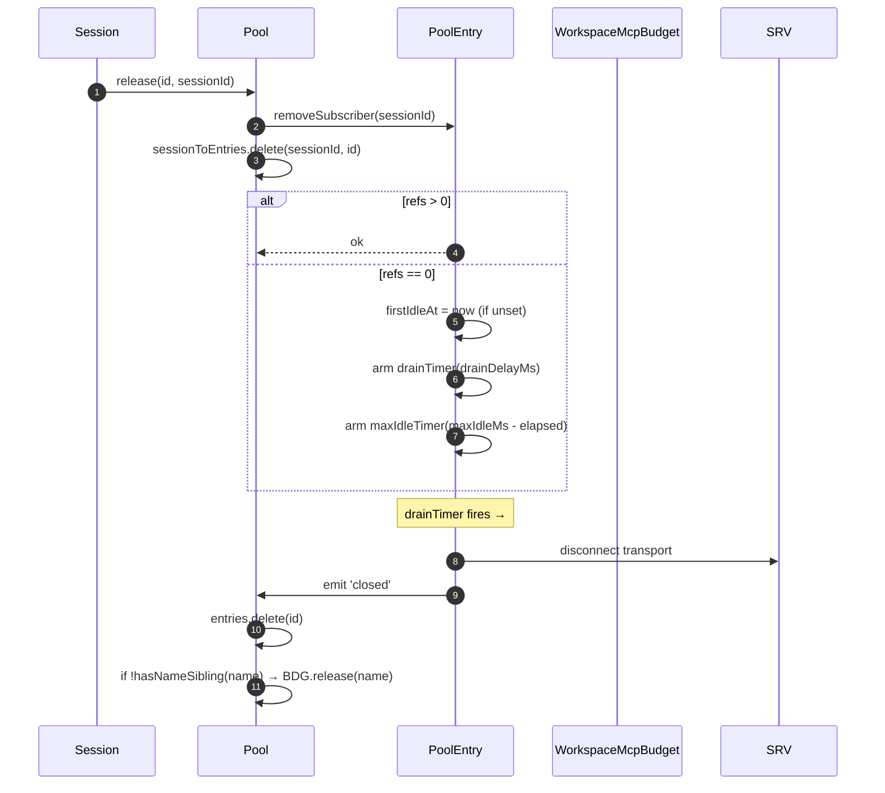
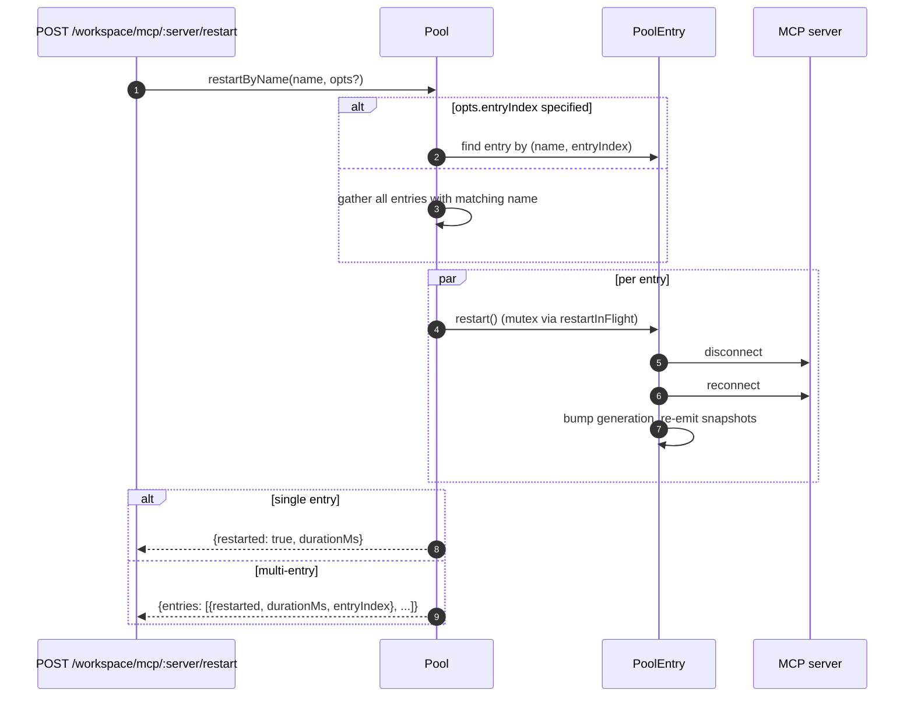
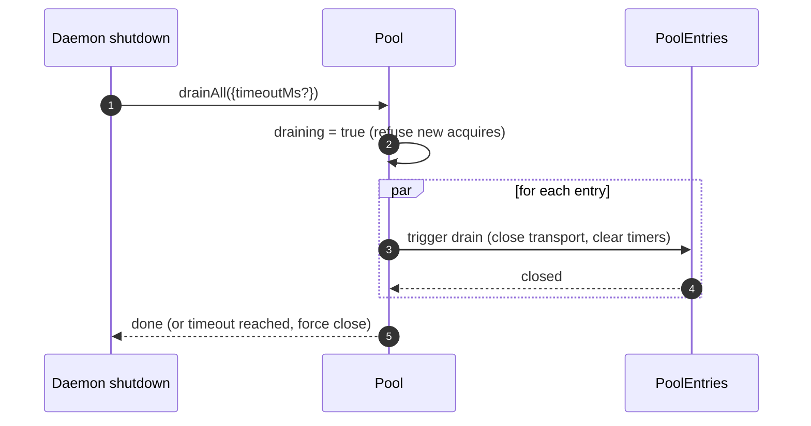

# Qwen Code 工作区 MCP 传输池

解释服务连接复用、配置指纹、获取释放、重启关闭及状态快照；属于内部资源管理架构参考。

- 来源：Qwen／Qwen Code
- 资料类型：存档文档
- 存档版本：`7e3de59d3aba`。
- 文档时间：源码提交（存档版）：[2026-09-27](<https://github.com/QwenLM/qwen-code/commit/81c260bb040c81a0a59b7e49ab8a4bbb3cae71c1>)；发表/更新：官方未公开；本地归档批次：2026-10-10
- 阅读状态：完整中文机器译文，由 Google 翻译；代码、命令与配置保留原样，未逐句人工校对。

[原文发布页](<https://github.com/QwenLM/qwen-code/blob/main/docs/developers/daemon/05-mcp-transport-pool.md>) · [原始文件](<../../../../原始抓取备份/原文/官方/Qwen/Qwen Code/docs/developers/daemon/Qwen Code 工作区 MCP 传输池.md>) · [返回资料总览](<../../../资料总览.md>)

[查看原文对照](#原文对照)

## 中文全文

# 工作区 MCP 传输池

## 概述

`McpTransportPool` (`packages/core/src/tools/mcp-transport-pool.ts`) 是 F2 (#4175 提交 5) 工作区范围池：一个运行时内的多个 ACP 会话为每个唯一的 `(serverName + configFingerprint)` 元组共享一个传输，而不是每个生成其拥有MCP子进程。启用池模式后，每个启动的 ACP 子项都拥有一个独立的池 (`QwenAgent.mcpPool`)。生产尝试预热受信任的主要子项以实现兼容性；受信任的辅助节点按需启动，不受信任的辅助节点既不启动子节点也不启动其池。旧主路由保留其现有的兼容性行为。该池在 agent 启动时使用运行时的引导程序 `Config` 构建一次，并在会话生命周期中生存。当引用计数达到零时，条目引用计数会话会在可配置的宽限期后附加并关闭。

它是防止多会话守护进程在每个会话中为每个 MCP 服务器分叉一份副本的主要机制。

## 职责

- 每个 `(name + fingerprint)` 获取或生成一个 MCP 传输，通过 `spawnInFlight` 消除重复的并发获取。
- 发布每场会议的参考资料；当最后一个引用分离时，启动条目的耗尽计时器。
- 通过硬性的 `MAX_IDLE_MS` 上限来避免引用计数流失，这样颠簸的客户端就无法永远保持空闲传输的状态。
- 反向索引 (`sessionToEntries`) 中的引用计数会话因此 `releaseSession(sessionId)` 是 O(refs) 而不是 O(entries)。
- 按需重新启动条目 (`restartByName`) — 单条目返回 `{restarted, durationMs}`，多条目返回 `{entries: RestartResult[]}`（F2 多条目合约）。
- 在守护进程关闭时用可配置的超时排空整个池；排水时拒绝新获得的物品。
- 请参阅 `acquire` 上的 `WorkspaceMcpBudget`（请参阅 [`06-mcp-budget-guardrails.md`](<Qwen Code MCP 工作区预算控制.md>)）以强制实施按名称保留上限；当没有同级条目拥有相同名称时，在条目关闭时释放插槽。
- 通过 `SessionMcpView` 生成每个会话过滤的 tool/prompt 快照，以便一个会话中的发现不会将工具注册到其他会话中。

## 建筑

### 公共面

```ts
class McpTransportPool {
  constructor(cliConfig: Config, options: McpTransportPoolOptions);
  acquire(
    serverName,
    cfg,
    sessionId,
    sessionToolRegistry,
    sessionPromptRegistry,
  ): Promise<PooledConnection>;
  release(id, sessionId): void;
  releaseSession(sessionId): void;
  restartByName(
    name,
    opts?,
  ): Promise<RestartResult | { entries: RestartResult[] }>;
  drainAll(opts?): Promise<void>;
  getBudget(): WorkspaceMcpBudget | undefined;
  getSnapshot(): McpPoolSnapshot;
}
```

`McpTransportPoolOptions`:

- `workspaceContext: WorkspaceContext`（必填）。
- `debugMode: boolean`.
- `sendSdkMcpMessage?` — 每个会话回调（池绕过 SDK MCP）。
- `pooledTransports?: ReadonlySet<McpTransportKind>` — 默认 `{stdio, websocket}`。 HTTP/SSE 传输默认情况下保持非池化状态，因为它们的标头可以携带特定于会话的 OAuth 状态，但操作员可以明确选择将它们与 `QWEN_SERVE_MCP_POOL_TRANSPORTS` 进行池化。
- `drainDelayMs?` — 默认 `30_000`。
- `entryOptions?: (transport) => PoolEntryOptions`.
- `budget?: WorkspaceMcpBudget`.

### 内部状态

|状态|类型|目的|
| ------------------ | --------------------------------------- | ---------------------------------------------------------------------------------------------------- |
| `entries`          | `Map<ConnectionId, PoolEntry>`          |实时池条目由 `connectionIdOf(name, fingerprint)` 键入。|
| `unpooledIds`      | `Set<ConnectionId>`                     |配置的 `pooledTransports` 白名单之外的传输条目。|
| `spawnInFlight`    | `Map<ConnectionId, Promise<PoolEntry>>` |对同一密钥的并发冷获取进行重复数据删除。|
| `sessionToEntries` | `Map<string, Set<ConnectionId>>`        |V21-2 O(refs) `releaseSession` 的反向索引。|
| `draining`         | `boolean`                               |排空互斥体 — 一旦设置，所有 `acquire` 调用都会被拒绝。|
| `nextIndexByName`  | `Map<string, number>`                   |V21-7 每个服务器名称单调 `entryIndex`（出现新条目时仪表板不会重新排列）。|

### `PoolEntry`（每个条目结构，`mcp-pool-entry.ts`）

状态机：`spawning → active ⇄ (active ↔ reconnect) → (active → draining on last detach, draining → active on attach OR draining → closed on timer)`。

|领域|目的|
| ------------------------------------------------------ | ------------------------------------------------------------------------------- |
| `localStatus: MCPServerStatus`                         |由 `MCPServerStatus` 生命周期驱动。|
| `state: PoolEntryState`                                | `spawning`/`active`/`draining`/`closed`/`failed`.                               |
| `generation: number`                                   |每次重启都会遇到问题；订阅者进行比较以检测重新连接周期。|
| `refs: Set<string>`                                    |当前附加的会话 ID。|
| `subscribers: Map<string, SessionMcpView>`             |每个会话过滤的视图。|
| `subscriberHandles: Map<string, PooledConnectionImpl>` |从 `acquire` 返回的句柄。|
| `toolsSnapshot[], promptsSnapshot[]`                   |规范池级快照；重新发布于 `toolsChanged` / `promptsChanged`。|
| `drainTimer?`                                          |`refs.size === 0`时布防；默认30秒。连接时重置。|
| `maxIdleTimer?`                                        |刚闲置时就武装起来；永远不会因 acquire/release 流失而重置。默认值 5 分钟|
| `firstIdleAt?`                                         |最大空闲硬上限的水印。|
| `restartInFlight?`                                     |`restart()` 的互斥锁。|

### `PoolEntryOptions`

```ts
interface PoolEntryOptions {
  drainDelayMs: number; // default 30_000
  maxIdleMs: number; // default 5 * 60_000
  maxReconnectAttempts: number; // default 3 (stdio/ws) or 5 (http/sse)
  reconnectStrategy:
    | { kind: 'fixed'; delayMs: number }
    | { kind: 'exponential'; baseMs: number; capMs: number };
}
```

`defaultPoolEntryOptions(transport)` (`mcp-pool-entry.ts`) 返回 stdio/ws 默认 `{fixed 5s, 3 attempts}` 和 http/sse 默认 `{exponential 1s → 16s, 5 attempts}`。远程传输获得更长的重试预算，因为它们的故障通常是暂时的。

## 工作流程

### `acquire`

```mermaid
sequenceDiagram
    autonumber
    participant S as Session
    participant P as Pool
    participant SIF as spawnInFlight
    participant E as PoolEntry
    participant BDG as WorkspaceMcpBudget
    participant SRV as MCP server

    S->>P: acquire(name, cfg, sessionId, sessionToolRegistry, sessionPromptRegistry)
    P->>P: refuse if draining
    P->>P: connectionId = connectionIdOf(name, fingerprint)
    P->>P: if !isPoolable(cfg) → mark unpooled
    alt entry in entries (warm)
        E-->>P: existing PoolEntry
    else inflight cold spawn
        SIF-->>P: existing Promise<PoolEntry>
    else cold start
        P->>BDG: tryReserve(name) (if budget set + poolable)
        BDG-->>P: 'reserved' | 'already_held' | 'refused'
        alt refused
            P->>BDG: recordRefusal(name, transport)
            P-->>S: BudgetExhaustedError
        else ok
            P->>E: spawnEntry(name, cfg)
            E->>SRV: connect transport
            SRV-->>E: ready
            P->>P: entries.set(id, E); nextIndexByName++
            E-->>P: connected
        end
    end
    P->>E: addSubscriber(sessionId, sessionToolRegistry, sessionPromptRegistry)
    P->>P: sessionToEntries.add(sessionId, id)
    P->>P: cancel drain timer (refs>0)
    P-->>S: PooledConnection { id, serverName, entryIndex, client, toolsSnapshot, promptsSnapshot, on, off, release }
```

### `release` + 排水



`hasNameSibling(name)` (`mcp-transport-pool.ts`) 迭代 `entries.values()` 和 `spawnInFlight.keys()`，并用 `parseConnectionId` 解析后者（服务器名称可以合法包含 `::`，因此 `startsWith` 会对以`${name}::`）。

`releaseSession(sessionId)`从`sessionToEntries`读取，释放O(refs)中所有引用的条目，然后清除索引条目。由网桥的会话关闭路径使用，因此它不会迭代完整的条目映射。

### `restartByName`



当目标的槽位尚未预留且重新启动会将实时计数推至超过 `enforce` 预算时，守护进程 HTTP 层的飞行前预算检查将返回 `{restarted:false, skipped:true, reason:'budget_would_exceed'}`（Wave 4 变异控制）。

### `drainAll`



## 状态和生命周期

- 池建设是同步的；首先 `acquire` 冷启动传输。
- `drainDelayMs`（默认 30 秒）在附加时重置为取消。
- `maxIdleMs`（默认为5分钟）是**从不**由attach/detach重置 - 它在FIRST空闲时开始滴答，并且仅在条目在截止日期之前实际关闭或附加时停止。防御殴打客户。
- `nextIndexByName` 是单调的。即使在新条目出现后，旧条目也会保留其分配的索引，因此显示为 `entryIndex` 的仪表板不会重新排列。
- 生成失败会释放预留的预算插槽（V21-4 - 如果没有这个，在连接中崩溃的冷生成将永远泄漏预留）。

## 依赖关系

- `packages/core/src/tools/mcp-client.ts` — `McpClient`，状态枚举，`SendSdkMcpMessage`。
- `packages/core/src/tools/mcp-pool-entry.ts` — `PoolEntry`, `PoolEntryOptions`, `defaultPoolEntryOptions`.
- `packages/core/src/tools/mcp-pool-key.ts` — `connectionIdOf`, `parseConnectionId`, `isPoolable`, `mcpTransportOf`, `POOLED_TRANSPORTS_DEFAULT`.
- `packages/core/src/tools/mcp-pool-events.ts` — `ConnectionId`, `PoolEntryState`, `PoolEvent`.
- `packages/core/src/tools/session-mcp-view.ts` — 过滤池快照的每个会话视图。
- `packages/core/src/tools/mcp-workspace-budget.ts` — `WorkspaceMcpBudget`（参见[`06-mcp-budget-guardrails.md`](<Qwen Code MCP 工作区预算控制.md>)）。
- `packages/core/src/tools/mcp-discovery-timeout.ts` — `discoveryTimeoutFor`, `runWithTimeout`.

## 配置

|来源|旋钮|效果|
| ----------------------------- | --------------------------------------------------------------- | --------------------------------------------------------------------------------------------------------- |
|环境| `QWEN_SERVE_NO_MCP_POOL=1`                                      |终止开关 - `QwenAgent.mcpPool` 保持未定义；每个会话 `McpClientManager` 强制执行（F2 之前的路径）。|
|旗帜| `--mcp-client-budget=N`, `--mcp-budget-mode={off,warn,enforce}` |通过`childEnvOverrides`转发给ACP孩子； child 构造 `WorkspaceMcpBudget` 并传递给池。|
|能力标签（有条件）| `mcp_workspace_pool`, `mcp_pool_restart`                        |泳池开放时一起做广告。 SDK 预飞行都在池感知响应形状上分支。|

### 非池化条目（HTTP / SSE / SDK-MCP）

配置的 `pooledTransports` 白名单（默认为 HTTP、SSE 和 SDK-MCP）之外的传输采用单独的路径：`createUnpooledConnection(name, cfg, sessionId, ...)` (`mcp-transport-pool.ts`) 创建一个 ID 为 `${name}::unpooled-${entryIndex}` 的每会话条目。与汇总条目的差异：

- 存储在 `entries` AND 中，并在 `unpooledIds: Set<ConnectionId>` 中跟踪，因此 `release` / `releaseSession` 可以快速路径关闭分离行为（引用始终在 1 处达到最大值）。
- 直接使用`McpClient.discover()`代替池重播； `applyTools` / `applyPrompts` 是无操作的，因为会话的注册表已经保存了注册的内容（`attach()` 中的 W77 / `skipReplay: true`）。
- 工作空间预算仍然限制着它们——F2预算后续行动弥补了之前的漏洞，其中非池化连接绕过了`tryReserve`；相同的 `WorkspaceMcpBudget` 槽被保留并在条目关闭时释放（无论是池化还是非池化）。

W77 竞赛 (`cb206da36`)：`createUnpooledConnection` 将条目存储在 `this.entries` BEFORE 中等待 `client.connect()` / `client.discover()`，但仅索引 `sessionToEntries[sessionId]` AFTER `attach()` 成功。 connect/discover 窗口期间的并发 `closeStoredSession()` / `releaseSession(sessionId)` 看到一个空索引，让非池化生成完成，然后 `attach()` 将 tools/prompts 注册到已经关闭的会话中。修复：

- `mcp-pool-entry.ts`：公共`isTerminated(): boolean`探针（`state === 'closed' || state === 'failed'`）。
- `mcp-pool-entry.ts`：`markActive()`如果`isTerminated()`短路，因此被拆除的条目无法复活到`'active'`。
- 调用者（池的非池化路径）在等待之间探测 `isTerminated()`，并在父会话消失时中止附加。

这场比赛当时是潜伏的（W61/W71每会话`releaseSession`钩子落在F4），但在钩子到达的那一刻就会开始直播。该修复已在 F2 系列早期应用。

## `GET /workspace/mcp` 池感知快照字段

当池处于活动状态时，每个 `ServeWorkspaceMcpStatus` 服务器单元 
(`packages/acp-bridge/src/status.ts`) 包含三个附加字段：

|领域|类型|目的|
| ---------------- | ------------------------------------------- | --------------------------------------------------------------------------------------------------------------------------------------------------------------------------------------------------------------------------------------------------------------------------------------------------------------------------------------------- |
| `disabledReason` | `'config' \| 'budget'`                      |将运营商禁用的服务器（`disabled: true` 与 `disabledMcpServers`）与预算拒绝（`status: 'error', errorKind: 'budget_exhausted'`）区分开来。仪表板可以呈现一个服务器行，而无需交叉读取 `errors[]` 或 `budgets[]`。|
| `entryCount`     | `number` (`>=1`)                            |在池模式下，当会话注入不同的指纹（例如每个会话的 OAuth 标头）时，工作区可以具有多个同名的 `PoolEntry` 实例。当 `QWEN_SERVE_NO_MCP_POOL=1` 禁用池时，此字段不存在。新客户端在 `entryCount > 1` 时呈现“N 个条目”徽章。|
| `entrySummary`   | `ReadonlyArray<{entryIndex, refs, status}>` |每个条目的细分。 `entryIndex`是创建条目时分配的稳定不透明整数；它不是原始指纹，因此快照差异不会泄漏 OAuth 或 env 轮换时间。 `refs` 是当前附加会话计数。 `status` 允许仪表板显示每个条目的运行状况，同时聚合 `mcpStatus` 已连接。|

`(entryCount, entrySummary)` 始终成对广播。 
`mcp_workspace_pool` 功能标签意味着这两个字段。较旧的 SDK 客户端 
 根据附加协议合约忽略它们。

池快照还公开 `subprocessCount`。它仅计算 `'stdio'`
 系列。 WebSocket、HTTP 和 SSE 传输连接到远程服务器，并且 
 不生成本地子进程。早期版本将 WebSocket 传输视为 
 本地子进程，这会夸大资源仪表板。

## 从两个关闭路径进行排水

池排出不限于 SIGTERM 处理程序。正常的IDE关闭路径
(`await connection.closed`)也会通过
`packages/cli/src/acp-integration/acpAgent.ts`的`drainPoolBeforeExit`调用`drainAll`。无论
守护进程收到进程信号还是IDE干净地关闭其连接，
池都会进入`draining`，拒绝新的获取，并等待条目
关闭。

## `/mcp refresh` 共享启动发现路径

`discoverAllMcpTools`（引导发现）和
`discoverAllMcpToolsIncremental`（`/mcp refresh`/热重载）都首先在池模式（`packages/core/src/tools/mcp-client-manager.ts`）下查询
池。 
共享门可防止热重载意外创建每个会话
客户端、重复计算预算或留下孤立传输。

## 重新连接期间运行中的工具调用 (`MCPCallInterruptedError`)

当底层 MCP 传输默默地断开连接（连接跳转
来自 `'active'` / `'draining'` 到 `localStatus === DISCONNECTED` 没有
显式关闭），池标记该条目 `'failed'`，将其逐出
`pool.entries`，并发出 `failed` 分离订阅者视图之前的事件。
分离之前发出的顺序很重要：订阅者收到 `failed` 事件
很快就可以路由待定 `callTool` 承诺
`MCPCallInterruptedError`，所以卡住了 `await client.callTool(...)` 拒绝
干净地代替悬挂。 `forceShutdown` 使用相同的发出然后分离
订购。

## 指纹和 `canonicalOAuth` 标准化

池密钥来自`mcp-pool-key.ts`中的`fingerprint(cfg)`。哈希涵盖
所有传输定义和共享工具快照字段：

> `transport, command, args, cwd, env, url, httpUrl, tcp, headers, timeout, versionNegotiation, oauth, appResourceMaxBytes, appResourceTimeoutMs`

每会话过滤和元数据字段（`includeTools`、`excludeTools`、
`trust`、`description`、`extensionName`、`discoveryTimeoutMs`）均被排除，因此具有不同过滤器的
会话可以共享一个条目。包含自动协商
选择加入，因为它改变了底层进程的连接方式。

对于 OAuth 单元，`canonicalOAuth(o)` 对每个 `MCPOAuthConfig` 字段进行哈希处理：
`clientId`、`clientSecret`、排序的 `scopes`、排序的 `audiences`、
`authorizationUrl`、`tokenUrl`、 `redirectUri`、`tokenParamName` 和 
`registrationUrl`。这是凭证隔离合约：两个会话 
 配置仅在 `clientSecret`、`audiences` 或 `redirectUri` 上有所不同，获得 
 不同的指纹，并且不能共享一个条目。机密客户端和
多受众令牌部署依赖于此。

对 `scopes` 和 `audiences` 进行排序使调用点顺序无关。显式
`null` 已标准化，因此未定义字段的哈希值与显式 null 相同。 
密钥不包含`discoveryTimeoutMs`；使用 
 相同密钥但不同超时的并发获取调用是“先胜”，与 F2
 之前的每个会话管理器行为相匹配。

应用程序资源限制是该排除的例外：它们在发现时被消耗
并存储在共享工具快照中，而不需要每个会话
重新投影，因此必须对它们进行键入 - 否则第二个会话将
默默地重用第一个会话的限制。具有相同 
 生命周期的任何未来字段（在发现时使用，从不在每个会话中重新投影）都属于 
 键，即使它不是传输定义的。两者都在其强制的 
（限制、限制、默认）值上进行散列 — 与 
`mcp-tool.ts` 中的读取站点应用的标准化相同，通过 `mcp-app-resource-limits.ts` 共享 — 因此配置 
 的有效策略是字节相同，共享一个条目。

`PoolEntry` 保持 `cfg: MCPServerConfig` 的私密性。当外部代码需要传输系列时，必须使用
`entry.transportKind` getter。这可以防止 
env、标头身份验证和 OAuth 字段意外泄露给消费者。

## 扩展卸载依赖于`MAX_IDLE_MS`

故意没有主动清理路径来在 
 运行时卸载 MCP 扩展。 `MCPServerConfig` 不再出现在合并的 
 工作空间设置中的孤立条目将在 
 最后一个订阅者分离后由 `MAX_IDLE_MS` 硬上限自然回收。同步卸载清理路径会增加
罕见运算符边缘情况的复杂性；默认情况下，硬上限将卸载点之后的孤立进程 
 生命周期限制为 5 分钟。

需要更快清理的操作员可以重新启动守护程序或调用 
`POST /workspace/mcp/:server/restart` 获取现在未配置的名称，该名称将通过 
 穿过禁用的服务器路径并删除该条目。

## 自愈可观察性

该池在自我修复路径上发出两个结构化诊断：

**`McpClient.lastTransportError: Error | undefined`** (`packages/core/src/tools/mcp-client.ts`) — `McpClient.onerror` 将最新的传输异常存储在私有字段中，并在 `connect()` 条目中将其清除。 `PoolEntry` 静默删除路径读取 `client.getLastTransportError()` 并将其包含在 `emit({kind:'failed', lastError})` 中，因此订阅者和仪表板不必 grep stderr 来查找根本原因。

**`SweepResult`**（内部接口，未导出；`packages/core/src/tools/mcp-pool-entry.ts`）—`sweepAndDisconnect(reason)`返回`Promise<SweepResult>`：

```ts
interface SweepResult {
  pidSweepError?: Error; // listDescendantPids itself threw
  descendantsFound?: number; // descendant pid count found
  descendantsSignaled?: number; // successfully SIGTERM'd count
}
```

唯一的消费者是 `statusChangeListener` 中的静默掉落块。它使用
`descendantsFound` / `descendantsSignaled`来检测部分信号情况
（发出信号的进程少于发现的进程，通常是因为进程退出或EPERM
发生在`listDescendantPids`和`sigtermPids`之间）和扫描错误，然后
记录一个结构化警告。 `forceShutdown` 和 `doRestart` 忽略此返回 
 值，因为它们的捕获路径已经携带了更丰富的故障信号。

## 子进程清理：`pid-descendants`快照路径

当 `McpTransportPool` 关闭 stdio 子进程，它必须枚举它们
后代进程； `npx` 包装器和外壳包装器可以创建多个分叉
水平。 `packages/core/src/tools/pid-descendants.ts` 暴露
`listDescendantPids(rootPid) → Promise<number[]>` 和 `sigtermPids(pids)` 为了
`sweepAndDisconnect`.

### Linux / macOS 主路径

单个`ps -A -o pid=,ppid=`快照读取进程表，将其解析为
`Map<ppid, pid[]>`，然后`walkDescendants(tree, root)`执行BFS以提取
子树。任何深度仅需要一根 `ps` 货叉。

`walkDescendants` 维护 `visited: Set<number>` 并将 `root` 包含在 
 集中，以防御 PID- 重用周期。在快速流程改动下，快照
理论上可以包含A→B / B→A循环。如果没有`visited`，步行者可以
用虚假数据填充`MAX_DESCENDANTS`配额并排挤真正的后代。

### Windows 主路径

单个 `Get-CimInstance Win32_Process | ConvertTo-Csv -Delimiter ","`
 快照发出所有 `(ProcessId, ParentProcessId)` 行，然后运行相同的 `Map` 和 
`walkDescendants` 路径。

需要显式的 `-Delimiter ","`。 PowerShell 5.1 随 
Windows 一起提供，默认 `ConvertTo-Csv` 为系统区域设置列表分隔符； DE、FR、
NL、IT 和类似的语言环境使用 `;`，因此前缀解析器 
`^"(\d+)","(\d+)"$` 从未匹配，并且每次守护进程关闭都会回退到每个 pid 的 
 CIM 过滤路径，为每个 
 子项添加大约 0.5-1 秒的 PowerShell 启动成本。

### 后备路径

BusyBox `<v1.28` 缺少 `ps -o`，distroless 容器可能不包含 `ps`、
，并且某些 Windows 环境通过 ACL 截断 CIM 输出。当主 
 路径解析零行或抛出异常时，代码会回退到每个 pid BFS：Linux /
macOS 使用 `pgrep -P <pid>`，Windows 使用 
`Get-CimInstance -Filter "ParentProcessId=$p"`，其中 `$p` 是 PowerShell
 变量绑定而不是字符串连接。当前的
`Number.isInteger`守卫足以满足入口点；绑定是
纵深防御。

### 共享约束

两条路径均以 `MAX_DESCENDANTS = 256` 和 `MAX_DEPTH = 8` 为界，以防止 
 恶意或退化进程树被拖垮。

快照路径使用`maxBuffer: 8MB`，对于具有
大约250k进程的病态主机来说足够了。 Node 的默认 1MB 缓冲区可以截断大约 30k 进程的子进程
输出。

性能增益故意适度（典型的 200-500 进程 dev
 机器在 10 毫秒内解析，大约 2x 比每个 pid `pgrep` 快）。主要的
好处是分叉卫生和快照一致性：BFS在
处看到完整的子树一次，而之前的每个pid查询路径可能会错过两个查询之间的孙分叉
。

## 嵌入器注释：`McpClientManager` 构造函数

`McpClientManager` 构造为
`(config, toolRegistry, options?: McpClientManagerOptions)`。 
直接导入类的嵌入器应该通过：

```ts
new McpClientManager(config, toolRegistry, {
  eventEmitter,
  sendSdkMcpMessage,
  healthConfig,
  budgetConfig,
  pool,
});
```

测试应该更喜欢 `mkManager(overrides?)` 工厂，以便关心 
 一个或两个字段的情况保持一行。

## 实施说明

这些助手是内部的，但源代码读者可能会看到它们：

- `McpTransportPool.acquire()` 使用 `attachPooledSession` 和 `rollbackReservationOnSpawnFailure` 共享快速路径附加、生成后附加和池化飞行中生成捕获行为。运行时行为不变；竞争窗口不变量仍然存在于调用站点。
- `SessionMcpView.applyTools` / `applyPrompts` 通过 `compileNameFilter(cfg)` 编译 `includeTools` / `excludeTools` 一次，并使用 `compiledFilterAccepts(compiled, name)` 检查每个工具。导出的 `passesSessionFilter` / `passesSessionPromptFilter` 使用相同的编译路径。 `excludeTools` 完全匹配； `includeTools` 删除第一个 `(...)` 后缀，因此 `toolName(args)` 匹配 `toolName`。

设计文档：[`../../design/f2-mcp-transport-pool.md`](<https://github.com/QwenLM/qwen-code/blob/7e3de59d3aba5cab80767ac5b121c0b3b4e35267/docs/design/f2-mcp-transport-pool.md>) §6 涵盖传输池状态机、重新连接、排出和后续扫描路径。

## 注意事项和已知限制

- **HTTP / SSE 传输默认情况下是非池化的 ** - 除非操作员明确将它们包含在 `QWEN_SERVE_MCP_POOL_TRANSPORTS` 中，否则每次获取都会创建一个新条目，该条目仅在其会话期间存在。它们的标头可能携带特定于会话的 OAuth 状态，因此默认情况下将它们合并可能会存在跨会话泄露凭证的风险。
- **`maxIdleMs` 是一个在 attach/detach 流失后仍然存在的硬上限。** 5 分钟的空闲硬上限意味着即使是积极的 attaching/detaching 客户端也无法将空闲传输保持在 5 分钟之后。想要固定长期传输的操作员应该增加 `maxIdleMs` 或在池外运行服务器。
- **每服务器名称预算插槽**表示共享名称但指纹不同的两个池条目一起消耗ONE插槽，而不是两个。子流程会计通过`pool.getSnapshot().subprocessCount`单独公开。
- 在 `hasNameSibling` 中避免了 **`startsWith` 回归 **，因为 MCP 服务器名称可以合法包含 `::` (`mcp-pool-key.test.ts`)。始终使用 `parseConnectionId` 的 `lastIndexOf('::')` 拆分，切勿进行字符串前缀匹配。
- **水池排水为单向** — `drainAll`永久设置`draining = true`；进一步的工作需要一个新的池。

## 参考文献

- `packages/core/src/tools/mcp-transport-pool.ts`（整个文件）
- `packages/core/src/tools/mcp-pool-entry.ts`（条目生命周期）
- `packages/core/src/tools/mcp-pool-key.ts` (`connectionIdOf`, `parseConnectionId`)
- `packages/core/src/tools/mcp-pool-events.ts`（事件类型）
- `packages/core/src/tools/session-mcp-view.ts`（每个会话过滤视图）
- F2 设计文档（v2.2，带有 32 项目审查折叠变更日志）：[`../../design/f2-mcp-transport-pool.md`](<https://github.com/QwenLM/qwen-code/blob/7e3de59d3aba5cab80767ac5b121c0b3b4e35267/docs/design/f2-mcp-transport-pool.md>)。设计合同具有权威性；此页面是开发人员深入研究的页面。
- F2设计说明：问题[#4175](<https://github.com/QwenLM/qwen-code/issues/4175>)（提交F2系列的4-6）。


## 原文对照

<details>
<summary>展开完整原文</summary>

# Workspace MCP Transport Pool

## Overview

`McpTransportPool` (`packages/core/src/tools/mcp-transport-pool.ts`) is the F2 (#4175 commit 5) workspace-scoped pool: multiple ACP sessions inside one runtime share one transport per unique `(serverName + configFingerprint)` tuple, instead of each spawning its own MCP child process. When pool mode is enabled, every started ACP child owns an independent pool (`QwenAgent.mcpPool`). Production attempts to preheat the trusted primary child for compatibility; trusted secondaries start on demand, and an untrusted secondary starts neither the child nor its pool. Legacy primary routes retain their existing compatibility behavior. The pool is constructed once at agent startup with the runtime's bootstrap `Config` and survives session lifecycles. Entries reference-count session attaches and close after a configurable grace period when the reference count reaches zero.

It is the main mechanism that prevents a multi-session daemon from forking one copy of every MCP server per session.

## Responsibilities

- Acquire or spawn one MCP transport per `(name + fingerprint)`, deduplicating concurrent acquires via `spawnInFlight`.
- Release per-session references; arm the entry's drain timer when the last reference detaches.
- Survive ref-count churn with a hard `MAX_IDLE_MS` cap so a thrashing client cannot keep an idle transport alive forever.
- Reference-count sessions in a reverse index (`sessionToEntries`) so `releaseSession(sessionId)` is O(refs) rather than O(entries).
- Restart entries on demand (`restartByName`) — single-entry returns `{restarted, durationMs}`, multi-entry returns `{entries: RestartResult[]}` (F2 multi-entry contract).
- Drain the entire pool on daemon shutdown with a configurable timeout; refuse new acquires while draining.
- Consult `WorkspaceMcpBudget` (see [`06-mcp-budget-guardrails.md`](<Qwen Code MCP 工作区预算控制.md>)) on `acquire` to enforce per-name reservation caps; release the slot on entry close when no sibling entry holds the same name.
- Produce per-session filtered tool/prompt snapshots via `SessionMcpView` so a discovery in one session does not register tools into other sessions.

## Architecture

### Public surface

```ts
class McpTransportPool {
  constructor(cliConfig: Config, options: McpTransportPoolOptions);
  acquire(
    serverName,
    cfg,
    sessionId,
    sessionToolRegistry,
    sessionPromptRegistry,
  ): Promise<PooledConnection>;
  release(id, sessionId): void;
  releaseSession(sessionId): void;
  restartByName(
    name,
    opts?,
  ): Promise<RestartResult | { entries: RestartResult[] }>;
  drainAll(opts?): Promise<void>;
  getBudget(): WorkspaceMcpBudget | undefined;
  getSnapshot(): McpPoolSnapshot;
}
```

`McpTransportPoolOptions`:

- `workspaceContext: WorkspaceContext` (required).
- `debugMode: boolean`.
- `sendSdkMcpMessage?` — per-session callback (pool bypasses SDK MCP).
- `pooledTransports?: ReadonlySet<McpTransportKind>` — default `{stdio, websocket}`. HTTP/SSE transports stay unpooled by default because their headers can carry session-specific OAuth state, but operators can explicitly opt them into pooling with `QWEN_SERVE_MCP_POOL_TRANSPORTS`.
- `drainDelayMs?` — default `30_000`.
- `entryOptions?: (transport) => PoolEntryOptions`.
- `budget?: WorkspaceMcpBudget`.

### Internal state

| State              | Type                                    | Purpose                                                                                              |
| ------------------ | --------------------------------------- | ---------------------------------------------------------------------------------------------------- |
| `entries`          | `Map<ConnectionId, PoolEntry>`          | Live pool entries keyed by `connectionIdOf(name, fingerprint)`.                                      |
| `unpooledIds`      | `Set<ConnectionId>`                     | Entries for transports outside the configured `pooledTransports` allowlist.                          |
| `spawnInFlight`    | `Map<ConnectionId, Promise<PoolEntry>>` | Deduplicates concurrent cold acquires for the same key.                                              |
| `sessionToEntries` | `Map<string, Set<ConnectionId>>`        | V21-2 reverse index for O(refs) `releaseSession`.                                                    |
| `draining`         | `boolean`                               | Drain mutex — once set, all `acquire` calls reject.                                                  |
| `nextIndexByName`  | `Map<string, number>`                   | V21-7 monotonic `entryIndex` per server name (dashboards do not reshuffle when a new entry appears). |

### `PoolEntry` (per-entry structure, `mcp-pool-entry.ts`)

State machine: `spawning → active ⇄ (active ↔ reconnect) → (active → draining on last detach, draining → active on attach OR draining → closed on timer)`.

| Field                                                  | Purpose                                                                         |
| ------------------------------------------------------ | ------------------------------------------------------------------------------- |
| `localStatus: MCPServerStatus`                         | Driven by `MCPServerStatus` lifecycle.                                          |
| `state: PoolEntryState`                                | `spawning`/`active`/`draining`/`closed`/`failed`.                               |
| `generation: number`                                   | Bumped on each restart; subscribers compare to detect reconnect cycles.         |
| `refs: Set<string>`                                    | Session ids currently attached.                                                 |
| `subscribers: Map<string, SessionMcpView>`             | Per-session filtered views.                                                     |
| `subscriberHandles: Map<string, PooledConnectionImpl>` | Handles returned from `acquire`.                                                |
| `toolsSnapshot[], promptsSnapshot[]`                   | Canonical pool-level snapshots; re-issued on `toolsChanged` / `promptsChanged`. |
| `drainTimer?`                                          | Armed when `refs.size === 0`; default 30s. Reset on attach.                     |
| `maxIdleTimer?`                                        | Armed at first idle; never reset by acquire/release churn. Default 5 min.       |
| `firstIdleAt?`                                         | Watermark for the max-idle hard cap.                                            |
| `restartInFlight?`                                     | Mutex for `restart()`.                                                          |

### `PoolEntryOptions`

```ts
interface PoolEntryOptions {
  drainDelayMs: number; // default 30_000
  maxIdleMs: number; // default 5 * 60_000
  maxReconnectAttempts: number; // default 3 (stdio/ws) or 5 (http/sse)
  reconnectStrategy:
    | { kind: 'fixed'; delayMs: number }
    | { kind: 'exponential'; baseMs: number; capMs: number };
}
```

`defaultPoolEntryOptions(transport)` (`mcp-pool-entry.ts`) returns stdio/ws defaults `{fixed 5s, 3 attempts}` and http/sse defaults `{exponential 1s → 16s, 5 attempts}`. Remote transports get longer retry budgets because their failures are more often transient.

## Workflow

### `acquire`

```mermaid
sequenceDiagram
    autonumber
    participant S as Session
    participant P as Pool
    participant SIF as spawnInFlight
    participant E as PoolEntry
    participant BDG as WorkspaceMcpBudget
    participant SRV as MCP server

    S->>P: acquire(name, cfg, sessionId, sessionToolRegistry, sessionPromptRegistry)
    P->>P: refuse if draining
    P->>P: connectionId = connectionIdOf(name, fingerprint)
    P->>P: if !isPoolable(cfg) → mark unpooled
    alt entry in entries (warm)
        E-->>P: existing PoolEntry
    else inflight cold spawn
        SIF-->>P: existing Promise<PoolEntry>
    else cold start
        P->>BDG: tryReserve(name) (if budget set + poolable)
        BDG-->>P: 'reserved' | 'already_held' | 'refused'
        alt refused
            P->>BDG: recordRefusal(name, transport)
            P-->>S: BudgetExhaustedError
        else ok
            P->>E: spawnEntry(name, cfg)
            E->>SRV: connect transport
            SRV-->>E: ready
            P->>P: entries.set(id, E); nextIndexByName++
            E-->>P: connected
        end
    end
    P->>E: addSubscriber(sessionId, sessionToolRegistry, sessionPromptRegistry)
    P->>P: sessionToEntries.add(sessionId, id)
    P->>P: cancel drain timer (refs>0)
    P-->>S: PooledConnection { id, serverName, entryIndex, client, toolsSnapshot, promptsSnapshot, on, off, release }
```

### `release` + drain


`hasNameSibling(name)` (`mcp-transport-pool.ts`) iterates both `entries.values()` and `spawnInFlight.keys()` parsing the latter with `parseConnectionId` (server names can legitimately contain `::`, so `startsWith` would false-positive on a sibling name beginning with `${name}::`).

`releaseSession(sessionId)` reads from `sessionToEntries`, releases all referenced entries in O(refs), then clears the index entry. Used by the bridge's session-close path so it does not iterate the full entry map.

### `restartByName`


The preflight budget check at the daemon HTTP layer returns `{restarted:false, skipped:true, reason:'budget_would_exceed'}` (Wave 4 mutation control) when the target's slot is not already reserved and a restart would push live count over `enforce` budget.

### `drainAll`


## State & Lifecycle

- Pool construction is synchronous; first `acquire` cold-starts a transport.
- `drainDelayMs` (default 30s) is reset to cancellation on attach.
- `maxIdleMs` (default 5 min) is **never** reset by attach/detach — it starts ticking at the FIRST idle and only stops when the entry actually closes or attaches before the deadline. Defense against thrashing clients.
- `nextIndexByName` is monotonic. Old entries keep their assigned index even after newer ones appear, so dashboards reading `entryIndex` do not reshuffle.
- Spawn failure releases the reserved budget slot (V21-4 — without this, a cold spawn that crashed mid-connect would leak the reservation forever).

## Dependencies

- `packages/core/src/tools/mcp-client.ts` — `McpClient`, status enum, `SendSdkMcpMessage`.
- `packages/core/src/tools/mcp-pool-entry.ts` — `PoolEntry`, `PoolEntryOptions`, `defaultPoolEntryOptions`.
- `packages/core/src/tools/mcp-pool-key.ts` — `connectionIdOf`, `parseConnectionId`, `isPoolable`, `mcpTransportOf`, `POOLED_TRANSPORTS_DEFAULT`.
- `packages/core/src/tools/mcp-pool-events.ts` — `ConnectionId`, `PoolEntryState`, `PoolEvent`.
- `packages/core/src/tools/session-mcp-view.ts` — per-session view that filters pool snapshots.
- `packages/core/src/tools/mcp-workspace-budget.ts` — `WorkspaceMcpBudget` (see [`06-mcp-budget-guardrails.md`](<Qwen Code MCP 工作区预算控制.md>)).
- `packages/core/src/tools/mcp-discovery-timeout.ts` — `discoveryTimeoutFor`, `runWithTimeout`.

## Configuration

| Source                        | Knob                                                            | Effect                                                                                                    |
| ----------------------------- | --------------------------------------------------------------- | --------------------------------------------------------------------------------------------------------- |
| Env                           | `QWEN_SERVE_NO_MCP_POOL=1`                                      | Kill switch — `QwenAgent.mcpPool` stays undefined; per-session `McpClientManager` enforces (pre-F2 path). |
| Flag                          | `--mcp-client-budget=N`, `--mcp-budget-mode={off,warn,enforce}` | Forwarded to ACP child via `childEnvOverrides`; child constructs `WorkspaceMcpBudget` and passes to pool. |
| Capability tags (conditional) | `mcp_workspace_pool`, `mcp_pool_restart`                        | Advertised together when pool is on. SDK pre-flights both to branch on pool-aware response shapes.        |

### Unpooled entries (HTTP / SSE / SDK-MCP)

Transports outside the configured `pooledTransports` allowlist (HTTP, SSE, and SDK-MCP by default) take a separate path: `createUnpooledConnection(name, cfg, sessionId, ...)` (`mcp-transport-pool.ts`) creates a per-session entry with id `${name}::unpooled-${entryIndex}`. Differences from pooled entries:

- Stored in `entries` AND tracked in `unpooledIds: Set<ConnectionId>` so `release` / `releaseSession` can fast-path the close-on-detach behavior (refs always max out at 1).
- `McpClient.discover()` is used directly instead of pool replay; `applyTools` / `applyPrompts` are no-ops because the session's registries already hold what was registered (W77 / `skipReplay: true` in `attach()`).
- Workspace budget still gates them — the F2 budget follow-up closed the prior loophole where unpooled connections bypassed `tryReserve`; the same `WorkspaceMcpBudget` slot is reserved and released on entry close (whether pooled or unpooled).

The W77 race (`cb206da36`): `createUnpooledConnection` stores the entry in `this.entries` BEFORE awaiting `client.connect()` / `client.discover()`, but only indexes `sessionToEntries[sessionId]` AFTER `attach()` succeeds. A concurrent `closeStoredSession()` / `releaseSession(sessionId)` during the connect/discover window saw an empty index, let the unpooled spawn finish, and `attach()` then registered tools/prompts into an already-closed session. The fix:

- `mcp-pool-entry.ts`: public `isTerminated(): boolean` probe (`state === 'closed' || state === 'failed'`).
- `mcp-pool-entry.ts`: `markActive()` short-circuits if `isTerminated()` so a torn-down entry cannot be resurrected to `'active'`.
- Callers (the pool's unpooled path) probe `isTerminated()` between the awaits and abort the attach if the parent session went away.

This race was latent at the time (the W61/W71 per-session `releaseSession` hooks land in F4), but would become live the moment that hook arrived. The fix was applied early in the F2 series.

## `GET /workspace/mcp` pool-aware snapshot fields

When the pool is active, each `ServeWorkspaceMcpStatus` server cell
(`packages/acp-bridge/src/status.ts`) includes three additional fields:

| Field            | Type                                        | Purpose                                                                                                                                                                                                                                                                                                                                       |
| ---------------- | ------------------------------------------- | --------------------------------------------------------------------------------------------------------------------------------------------------------------------------------------------------------------------------------------------------------------------------------------------------------------------------------------------- |
| `disabledReason` | `'config' \| 'budget'`                      | Distinguishes operator-disabled servers (`disabled: true` from `disabledMcpServers`) from budget refusal (`status: 'error', errorKind: 'budget_exhausted'`). Dashboards can render one server row without cross-reading `errors[]` or `budgets[]`.                                                                                            |
| `entryCount`     | `number` (`>=1`)                            | In pool mode a workspace can have multiple `PoolEntry` instances with the same name when sessions inject different fingerprints such as per-session OAuth headers. This field is absent when `QWEN_SERVE_NO_MCP_POOL=1` disables the pool. New clients render an "N entries" badge when `entryCount > 1`.                                     |
| `entrySummary`   | `ReadonlyArray<{entryIndex, refs, status}>` | Per-entry breakdown. `entryIndex` is the stable opaque integer assigned when the entry was created; it is not the raw fingerprint, so snapshot diffs do not leak OAuth or env rotation timing. `refs` is the current attached-session count. `status` lets dashboards show per-entry health while aggregate `mcpStatus` is already connected. |

`(entryCount, entrySummary)` are always broadcast as a pair. The
`mcp_workspace_pool` capability tag implies both fields. Older SDK clients
ignore them under the additive protocol contract.

Pool snapshots also expose `subprocessCount`. It counts only the `'stdio'`
family. WebSocket, HTTP, and SSE transports connect to remote servers and do
not spawn local child processes. Early versions counted WebSocket transports as
local subprocesses, which inflated resource dashboards.

## Drain runs from both shutdown paths

Pool drain is not limited to the SIGTERM handler. The normal IDE shutdown path
(`await connection.closed`) also calls `drainAll` via
`packages/cli/src/acp-integration/acpAgent.ts`'s `drainPoolBeforeExit`. Whether
the daemon receives a process signal or the IDE closes its connection cleanly,
the pool enters `draining`, refuses new acquires, and waits for entries to
close.

## `/mcp refresh` shares the boot discovery path

`discoverAllMcpTools` (boot discovery) and
`discoverAllMcpToolsIncremental` (`/mcp refresh` / hot reload) both consult the
pool first in pool mode (`packages/core/src/tools/mcp-client-manager.ts`). The
shared gate prevents hot reload from accidentally creating a per-session
client, double-counting budget, or leaving an orphan transport behind.

## In-flight tool calls during reconnect (`MCPCallInterruptedError`)

When the underlying MCP transport silently disconnects (the connection jumps
from `'active'` / `'draining'` to `localStatus === DISCONNECTED` without an
explicit close), the pool marks the entry `'failed'`, evicts it from
`pool.entries`, and emits the `failed` event before detaching subscriber views.
That emit-before-detach order matters: subscribers receive the `failed` event
soon enough to route pending `callTool` promises to
`MCPCallInterruptedError`, so a stuck `await client.callTool(...)` rejects
cleanly instead of hanging. `forceShutdown` uses the same emit-then-detach
ordering.

## Fingerprint and `canonicalOAuth` normalization

The pool key comes from `fingerprint(cfg)` in `mcp-pool-key.ts`. The hash covers
all transport-defining and shared tool-snapshot fields:

> `transport, command, args, cwd, env, url, httpUrl, tcp, headers, timeout, versionNegotiation, oauth, appResourceMaxBytes, appResourceTimeoutMs`

Per-session filtering and metadata fields (`includeTools`, `excludeTools`,
`trust`, `description`, `extensionName`, `discoveryTimeoutMs`) are excluded, so
sessions with different filters can share one entry. The automatic negotiation
opt-in is included because it changes how the underlying process connects.

For the OAuth cell, `canonicalOAuth(o)` hashes every `MCPOAuthConfig` field:
`clientId`, `clientSecret`, sorted `scopes`, sorted `audiences`,
`authorizationUrl`, `tokenUrl`, `redirectUri`, `tokenParamName`, and
`registrationUrl`. This is the credential-isolation contract: two session
configs that differ only by `clientSecret`, `audiences`, or `redirectUri` get
different fingerprints and cannot share one entry. Confidential clients and
multi-audience token deployments depend on this.

Sorting `scopes` and `audiences` makes callsite order irrelevant. Explicit
`null` is normalized so undefined fields hash the same as explicit null. The
key does not include `discoveryTimeoutMs`; concurrent acquire calls with the
same key but different timeouts are "first wins", matching the pre-F2
per-session manager behavior.

The App resource limits are the exception to that exclusion: they are consumed
at discovery and stored in the shared tool snapshot without per-session
re-projection, so they must be keyed — otherwise a second session would
silently reuse the first session's limits. Any future field with the same
lifecycle (consumed at discovery, never re-projected per session) belongs in
the key even though it is not transport-defining. Both hash at their enforced
(clamped, floored, defaulted) values — the same normalization the read site in
`mcp-tool.ts` applies, shared via `mcp-app-resource-limits.ts` — so configs
whose effective policy is byte-identical share one entry.

`PoolEntry` keeps `cfg: MCPServerConfig` private. External code must use the
`entry.transportKind` getter when it needs the transport family. That prevents
env, header auth, and OAuth fields from leaking to consumers by accident.

## Extension unloads rely on `MAX_IDLE_MS`

There is intentionally no active cleanup path for unloading an MCP extension at
runtime. Orphan entries whose `MCPServerConfig` no longer appears in the merged
workspace settings are reclaimed naturally by the `MAX_IDLE_MS` hard cap after
the last subscriber detaches. A synchronous unload-cleanup path would add
complexity for a rare operator edge case; the hard cap limits orphan process
lifetime past the unload point to 5 minutes by default.

Operators who need faster cleanup can restart the daemon or call
`POST /workspace/mcp/:server/restart` for the now-unconfigured name, which goes
through the disabled-server path and tears the entry down.

## Self-heal observability

The pool emits two structured diagnostics on the self-heal path:

**`McpClient.lastTransportError: Error | undefined`** (`packages/core/src/tools/mcp-client.ts`) — `McpClient.onerror` stores the most recent transport exception in a private field and clears it at `connect()` entry. The `PoolEntry` silent-drop path reads `client.getLastTransportError()` and includes it in `emit({kind:'failed', lastError})`, so subscribers and dashboards do not have to grep stderr for root cause.

**`SweepResult`** (internal interface, not exported; `packages/core/src/tools/mcp-pool-entry.ts`) — `sweepAndDisconnect(reason)` returns `Promise<SweepResult>`:

```ts
interface SweepResult {
  pidSweepError?: Error; // listDescendantPids itself threw
  descendantsFound?: number; // descendant pid count found
  descendantsSignaled?: number; // successfully SIGTERM'd count
}
```

The only consumer is the silent-drop block in `statusChangeListener`. It uses
`descendantsFound` / `descendantsSignaled` to detect partial-signal cases
(fewer processes signaled than found, usually because a process exited or EPERM
occurred between `listDescendantPids` and `sigtermPids`) and sweep errors, then
logs a structured warning. `forceShutdown` and `doRestart` ignore this return
value because their catch paths already carry richer failure signals.

## Subprocess cleanup: the `pid-descendants` snapshot path

When `McpTransportPool` shuts down stdio subprocesses, it has to enumerate their
descendant processes; `npx` wrappers and shell wrappers can create multiple fork
levels. `packages/core/src/tools/pid-descendants.ts` exposes
`listDescendantPids(rootPid) → Promise<number[]>` and `sigtermPids(pids)` for
`sweepAndDisconnect`.

### Linux / macOS primary path

A single `ps -A -o pid=,ppid=` snapshot reads the process table, parses it into
`Map<ppid, pid[]>`, then `walkDescendants(tree, root)` performs BFS to extract
the subtree. Any depth requires only one `ps` fork.

`walkDescendants` maintains `visited: Set<number>` and includes `root` in the
set to defend against PID-reuse cycles. Under fast process churn, the snapshot
can theoretically contain A→B / B→A loops. Without `visited`, the walker could
fill the `MAX_DESCENDANTS` quota with bogus data and crowd out real descendants.

### Windows primary path

A single `Get-CimInstance Win32_Process | ConvertTo-Csv -Delimiter ","`
snapshot emits all `(ProcessId, ParentProcessId)` rows, then the same `Map` and
`walkDescendants` path runs.

The explicit `-Delimiter ","` is required. PowerShell 5.1, which ships with
Windows, defaults `ConvertTo-Csv` to the system locale list separator; DE, FR,
NL, IT, and similar locales use `;`, so the pre-fix parser
`^"(\d+)","(\d+)"$` never matched and every daemon shutdown fell back to the
per-pid CIM filter path, adding roughly 0.5-1s of PowerShell startup cost per
child.

### Fallback path

BusyBox `<v1.28` lacks `ps -o`, distroless containers might not include `ps`,
and some Windows environments truncate CIM output via ACLs. When the primary
path parses zero rows or throws, the code falls back to per-pid BFS: Linux /
macOS use `pgrep -P <pid>`, and Windows uses
`Get-CimInstance -Filter "ParentProcessId=$p"` where `$p` is a PowerShell
variable binding rather than string concatenation. The current
`Number.isInteger` guard is sufficient for the entry point; the binding is
defense-in-depth.

### Shared constraints

Both paths are bounded by `MAX_DESCENDANTS = 256` and `MAX_DEPTH = 8` to keep a
malicious or degenerate process tree from dragging down sweep.

The snapshot path uses `maxBuffer: 8MB`, enough for pathological hosts with
about 250k processes. Node's default 1MB buffer can truncate child-process
output around 30k processes.

The performance gain is intentionally modest (typical 200-500 process dev
machines parse in under 10ms, around 2x faster than per-pid `pgrep`). The main
benefit is fork hygiene and snapshot consistency: BFS sees the full subtree at
once, while the previous per-pid query path could miss a grandchild forked
between two queries.

## Embedder note: `McpClientManager` constructor

`McpClientManager` is constructed as
`(config, toolRegistry, options?: McpClientManagerOptions)`. Embedders that
import the class directly should pass:

```ts
new McpClientManager(config, toolRegistry, {
  eventEmitter,
  sendSdkMcpMessage,
  healthConfig,
  budgetConfig,
  pool,
});
```

Tests should prefer an `mkManager(overrides?)` factory so cases that care about
one or two fields stay one line.

## Implementation notes

These helpers are internal, but source readers may see them:

- `McpTransportPool.acquire()` uses `attachPooledSession` and `rollbackReservationOnSpawnFailure` to share fast-path attach, post-spawn attach, and pooled spawn-in-flight catch behavior. Runtime behavior is unchanged; race-window invariants still live at the call sites.
- `SessionMcpView.applyTools` / `applyPrompts` compile `includeTools` / `excludeTools` once via `compileNameFilter(cfg)` and check each tool with `compiledFilterAccepts(compiled, name)`. Exported `passesSessionFilter` / `passesSessionPromptFilter` use the same compiled path. `excludeTools` is exact-match; `includeTools` strips the first `(...)` suffix so `toolName(args)` matches `toolName`.

Design document: [`../../design/f2-mcp-transport-pool.md`](<https://github.com/QwenLM/qwen-code/blob/7e3de59d3aba5cab80767ac5b121c0b3b4e35267/docs/design/f2-mcp-transport-pool.md>) §6 covers the transport pool state machine, reconnect, drain, and descendant sweep paths.

## Caveats & Known Limits

- **HTTP / SSE transports are unpooled by default** — unless operators explicitly include them in `QWEN_SERVE_MCP_POOL_TRANSPORTS`, each acquire mints a fresh entry that lives only as long as its session. Their headers may carry session-specific OAuth state, so pooling them by default would risk leaking credentials across sessions.
- **`maxIdleMs` is a hard cap that survives attach/detach churn.** A 5-minute idle hard cap means even an aggressively attaching/detaching client cannot keep an idle transport pinned past 5 minutes. Operators who want pinned long-lived transports should increase `maxIdleMs` or run the server outside the pool.
- **Per-server-name budget slots** mean two pool entries that share a name but differ by fingerprint consume ONE slot together, not two. Subprocess accounting is exposed separately via `pool.getSnapshot().subprocessCount`.
- **`startsWith` regression** was avoided in `hasNameSibling` because MCP server names can legitimately contain `::` (`mcp-pool-key.test.ts`). Always use `parseConnectionId`'s `lastIndexOf('::')` split, never string-prefix matching.
- **Pool draining is one-way** — `drainAll` sets `draining = true` permanently; a fresh pool is required for further work.

## References

- `packages/core/src/tools/mcp-transport-pool.ts` (entire file)
- `packages/core/src/tools/mcp-pool-entry.ts` (entry lifecycle)
- `packages/core/src/tools/mcp-pool-key.ts` (`connectionIdOf`, `parseConnectionId`)
- `packages/core/src/tools/mcp-pool-events.ts` (event types)
- `packages/core/src/tools/session-mcp-view.ts` (per-session filtered view)
- F2 design document (v2.2, with the 32-item review fold-in changelog): [`../../design/f2-mcp-transport-pool.md`](<https://github.com/QwenLM/qwen-code/blob/7e3de59d3aba5cab80767ac5b121c0b3b4e35267/docs/design/f2-mcp-transport-pool.md>). Treat the design contract as authoritative; this page is the developer deep dive.
- F2 design notes: issue [#4175](<https://github.com/QwenLM/qwen-code/issues/4175>) (commits 4-6 of the F2 series).


</details>
