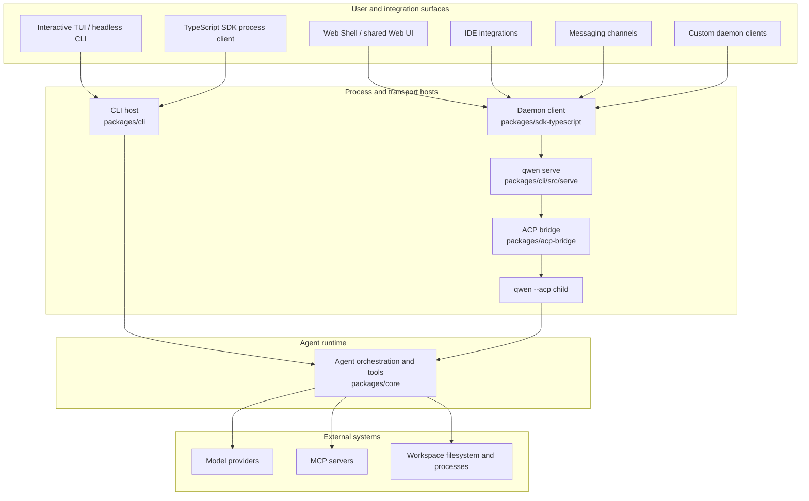

# Qwen Code 系统架构总览

按包与运行流程解释终端、核心、ACP、守护进程、SDK、IDE 和消息客户端，标明扩展点与状态配置。

- 来源：Qwen／Qwen Code
- 资料类型：存档文档
- 存档版本：`7e3de59d3aba`。
- 文档时间：源码提交（存档版）：[2026-09-25](<https://github.com/QwenLM/qwen-code/commit/73aa65a4b41e674e8729011a648e8f0a577902f2>)；发表/更新：官方未公开；本地归档批次：2026-10-10
- 阅读状态：完整中文机器译文，由 Google 翻译；代码、命令与配置保留原样，未逐句人工校对。

[原文发布页](<https://github.com/QwenLM/qwen-code/blob/main/docs/developers/architecture.md>) · [原始文件](<../../../../原始抓取备份/原文/官方/Qwen/Qwen Code/docs/developers/Qwen Code 系统架构总览.md>) · [返回资料总览](<../../../资料总览.md>)

[查看原文对照](#原文对照)

## 中文全文

# Qwen Code架构概述

Qwen Code 是一个单一存储库，支持交互式终端、无头和 
 编程执行、Agent 客户端协议 (ACP)、长期运行的 HTTP
 守护进程、Web 和 IDE 客户端以及消息通道适配器。本文档将
这些表面映射到实现它们的包，并解释了主要的
运行时边界。

有关详细的守护进程内部结构，请从
[守护进程文档](<https://github.com/QwenLM/qwen-code/blob/7e3de59d3aba5cab80767ac5b121c0b3b4e35267/docs/developers/daemon/00-index.md>)开始。对于 HTTP 请求和事件 
 形状，请参阅 [`qwen serve` 协议参考 ](<Qwen Code 守护进程 HTTP 协议参考.md>)。

## 系统一览

Qwen Code有两个agent执行模型：

- **直接执行：**交互式TUI和无头CLI构造并运行
直接运行agent运行时。
- **ACP 执行：** `qwen --acp` 在 ACP 传输后面托管 agent。它
可以由 ACP 客户端直接驱动，也可以由 `qwen serve` 通过共享 
 ACP 桥驱动。

`qwen serve` 在 ACP
 执行周围添加了 HTTP + 服务器发送事件 (SSE) 控制平面，以便多个客户端可以使用长期存在的工作区范围的运行时。

该图显示了主要生产路径。某些适配器还具有独立的 
 模式：例如，`qwen channel start` 使用 ACP 桥接器，而不需要 
 HTTP 守护程序。有关这些变体，请参阅
[频道插件指南](<Qwen Code 消息渠道插件开发指南.md#运行时模式>)。

## 存储库布局

|路径|责任|
| ---------------------------------------------------------------------------------------------------------- | ------------------------------------------------------------------------------------------------------------------------------------------------------------------------------------------------ |
| `packages/cli`                                                                                             |`qwen` 可执行文件、参数解析、配置汇编、Ink TUI、无头输出、ACP 入口点、`qwen serve` 和特定于命令的适配器。|
| `packages/core`                                                                                            |UI-独立的agent编排、模型提供者集成、提示和上下文构建、工具注册和执行、权限、会话、内存、遥测和共享服务。|
| `packages/acp-bridge`                                                                                      |ACP 通道生命周期、会话复用、事件传递、权限调解、进程生成以及守护程序和适配器主机共享的文件系统接缝。|
| `packages/sdk-typescript`                                                                                  |通过 `query()` 加上 HTTP/SSE 客户端和 `qwen serve` 的转录投影执行编程流程。|
| `packages/web-shell`                                                                                       |浏览器 UI 和守护程序 React 适配器构建在 TypeScript SDK 上。|
| `packages/web-templates`                                                                                   |Web 模板打包为可嵌入的 JavaScript 和 CSS 字符串。|
| `packages/audio-capture`                                                                                   |用于语音输入的本机麦克风捕获。|
| `packages/channels`                                                                                        |用于消息传递服务的共享通道运行时和平台适配器。|
| `packages/desktop`, `packages/vscode-ide-companion`, `packages/chrome-extension`, `packages/zed-extension` |使 Qwen Code 适应其主机环境的产品和编辑器界面。|
| `packages/sdk-java`, `packages/sdk-python`                                                                 |特定语言的程序化客户端。|
| `packages/cua-driver`, `packages/mobile-mcp`                                                               |通过 MCP- 兼容边界公开计算机使用和移动设备集成。|
| `integration-tests`                                                                                        |端到端覆盖 CLI、交互式、SDK、沙箱、挂钩和终端行为。|
|`docs` 和 `docs-site`|用户、开发人员、协议和设计文档以及文档站点。|
| `scripts`                                                                                                  |构建、打包、发布、验证和存储库维护自动化。|

大多数代码位于 `packages/` 下的 npm 工作区中。包应该通过其声明的公共导出来依赖
另一个包，而不是通过
到该包源树的相对路径。

## 包边界

### CLI 和演示界面

`packages/cli` 拥有可执行文件并从命令行 
 参数选择运行时模式。它加载用户和工作区设置，构建核心
配置，在必要时进入请求的沙箱，然后启动一个
交互式、无头、ACP、守护进程、通道或维护流程。

表示保留在核心运行时之外：

- Ink TUI 呈现本地交互式会话；
- `packages/web-shell` 使守护进程状态适应 React 提供者和挂钩
提供浏览器体验；
- IDE 和通道包将特定于主机的事件转换为共享客户端或
桥梁合同。

### 核心运行时

`packages/core` 拥有 agent 循环。它构建模型请求，维护
对话上下文，调度工具调用，应用权限策略，并且
将结构化事件和结果返回到活动主机。内置工具涵盖
文件操作、shell执行、搜索、规划、Web访问、内存、技能、
和子代理。 MCP 扩展了工具和资源表面，而无需将 
 运行时耦合到特定集成。

核心包不决定结果如何显示或远程
客户端如何传输它们。这些决策属于 CLI、桥接、SDK 和 UI
 层。

### ACP 桥

`packages/acp-bridge` 将主机进程连接到 ACP agent 运行时。其主要
职责是：

- 生成或附加到 ACP 通道；
- 多路复用会话和客户端；
- 转发提示、取消和ACP通知；
- 调解许可请求；
- 发布有界会话事件流；
- 向主机提供工作区文件系统接口。

该桥可以在生产中使用真实的 `qwen --acp` 子进程，或在测试中使用 
 内存通道。请参阅 
[`@qwen-code/acp-bridge` README](<https://github.com/QwenLM/qwen-code/blob/7e3de59d3aba5cab80767ac5b121c0b3b4e35267/packages/acp-bridge/README.md>) 了解其 
 公共入口点。

### SDK 和 UI 适配器

TypeScript SDK 公开两种客户端样式：

- `query()`启动并控制Qwen Code进程以供编程本地使用；
- 守护进程客户端通过 HTTP 和 SSE 与 `qwen serve` 进行通信。

`packages/web-shell` 在守护进程 
 客户端上构建 React 状态层和浏览器 UI。其他客户端，
，包括 IDE 集成和守护进程管理的通道，重用相同的 SDK 和 
 事件契约，而不是导入服务器实现代码。

## 运行时流程

### 直接【CLI】流

1. CLI 解析参数并解析用户、工作空间、环境和
命令行配置。
2. 它准备沙箱并构建核心运行时配置。
3. 核心运行时构建模型请求并进入 agent/tool 循环。
4. 工具调用根据权限策略进行检查并在活动中执行
工作区环境。
5. CLI 在 TUI 中渲染增量事件或将它们序列化
无头输出。

### 守护进程流

1. 客户端使用 TypeScript SDK 或记录的 HTTP API 连接到
   `qwen serve`.
2. 守护进程验证请求并解析拥有的工作区
所请求的操作。
3. 工作区运行时通过其 ACP 桥将 agent 操作转发到
`qwen --acp` 孩子。
4. 子进程运行直接执行所使用的相同核心 agent 和工具逻辑。
5. 响应和通知通过桥返回；会话事件是
通过 SSE 交付给客户。

启用多工作区会话后，每个实时工作区运行时都拥有自己的 
 桥和 ACP 子节点。文件系统访问、环境覆盖、MCP 传输、
 会话和故障处理仍然仅限于已解析的运行时。 
[守护进程架构](<Qwen Code 守护进程架构.md>)详细记录了流程
拓扑、信任边界、事件重播和生命周期。

## 扩展点

Qwen Code可以在几层上扩展：

- **MCP 服务器** 将工具、提示和资源添加到核心运行时。
- **扩展和技巧**封装可重用的命令、配置和agent
行为。
- **通道插件**使消息传递平台适应共享通道运行时。
- **SDK 客户端** 构建自定义本地或守护程序支持的应用程序。
- **UI 适配器** 将共享守护进程事件投射到特定于主机的状态并
演示。

将特定于平台的关注点保留在适配器中。共享 agent 行为属于 
 核心运行时，而传输和连线行为属于 ACP 桥、
SDK 或守护程序主机。

## 配置和状态

的 CLI 从命令行参数组装有效的配置，
环境变量、用户设置、工作区设置和之前的默认值
构建运行时。核心接收解析的配置而不是
而不是阅读特定于演示文稿的输入。参见
[设置](<https://github.com/QwenLM/qwen-code/blob/7e3de59d3aba5cab80767ac5b121c0b3b4e35267/docs/users/configuration/settings.md>) 对于支持的设置和
他们的范围。

直接会话通过共享核心
服务保留其历史记录和元数据。在守护进程模式下，守护进程解析所属工作空间并向客户端公开
工作空间和会话范围的操作； ACP 子级仍然是实时 agent 执行的 
 所有者。

## 下一步去哪里

- [守护进程开发者文档](<https://github.com/QwenLM/qwen-code/blob/7e3de59d3aba5cab80767ac5b121c0b3b4e35267/docs/developers/daemon/00-index.md>)
- [`qwen serve` HTTP 协议](<Qwen Code 守护进程 HTTP 协议参考.md>)
- [TypeScript SDK](<https://github.com/QwenLM/qwen-code/blob/7e3de59d3aba5cab80767ac5b121c0b3b4e35267/packages/sdk-typescript/README.md>)
- [ACP 桥](<https://github.com/QwenLM/qwen-code/blob/7e3de59d3aba5cab80767ac5b121c0b3b4e35267/packages/acp-bridge/README.md>)
- [频道插件开发指南](<Qwen Code 消息渠道插件开发指南.md>)
- [工具开发](<https://github.com/QwenLM/qwen-code/blob/7e3de59d3aba5cab80767ac5b121c0b3b4e35267/docs/developers/tools/introduction.md>)
- [集成测试](<https://github.com/QwenLM/qwen-code/blob/7e3de59d3aba5cab80767ac5b121c0b3b4e35267/docs/developers/development/integration-tests.md>)

## 原文对照

展开完整原文

# Qwen Code Architecture Overview

Qwen Code is a monorepo that supports an interactive terminal, headless and
programmatic execution, the Agent Client Protocol (ACP), a long-running HTTP
daemon, web and IDE clients, and messaging-channel adapters. This document maps
those surfaces to the packages that implement them and explains the main
runtime boundaries.

For detailed daemon internals, start with the
[daemon documentation](<https://github.com/QwenLM/qwen-code/blob/7e3de59d3aba5cab80767ac5b121c0b3b4e35267/docs/developers/daemon/00-index.md>). For HTTP request and event
shapes, see the [`qwen serve` protocol reference](<Qwen Code 守护进程 HTTP 协议参考.md>).

## System at a glance

Qwen Code has two agent execution models:

- **Direct execution:** the interactive TUI and headless CLI construct and run
  the agent runtime directly.
- **ACP execution:** `qwen --acp` hosts the agent behind an ACP transport. It
  can be driven by an ACP client directly or by `qwen serve` through the shared
  ACP bridge.

`qwen serve` adds an HTTP + Server-Sent Events (SSE) control plane around ACP
execution so multiple clients can use long-lived, workspace-scoped runtimes.

The diagram shows the main production paths. Some adapters also have standalone
modes: for example, `qwen channel start` uses the ACP bridge without requiring
an HTTP daemon. See the
[channel plugin guide](<Qwen Code 消息渠道插件开发指南.md#runtime-modes>) for those variants.

## Repository layout

| Path                                                                                                       | Responsibility                                                                                                                                                                                   |
| ---------------------------------------------------------------------------------------------------------- | ------------------------------------------------------------------------------------------------------------------------------------------------------------------------------------------------ |
| `packages/cli`                                                                                             | The `qwen` executable, argument parsing, configuration assembly, Ink TUI, headless output, ACP entry point, `qwen serve`, and command-specific adapters.                                         |
| `packages/core`                                                                                            | UI-independent agent orchestration, model-provider integration, prompt and context construction, tool registration and execution, permissions, sessions, memory, telemetry, and shared services. |
| `packages/acp-bridge`                                                                                      | ACP channel lifecycle, session multiplexing, event delivery, permission mediation, process spawning, and the filesystem seam shared by daemon and adapter hosts.                                 |
| `packages/sdk-typescript`                                                                                  | Programmatic process execution through `query()` plus HTTP/SSE clients and transcript projection for `qwen serve`.                                                                               |
| `packages/web-shell`                                                                                       | The browser UI and daemon React adapter built on the TypeScript SDK.                                                                                                                             |
| `packages/web-templates`                                                                                   | Web templates packaged as embeddable JavaScript and CSS strings.                                                                                                                                 |
| `packages/audio-capture`                                                                                   | Native microphone capture for voice input.                                                                                                                                                       |
| `packages/channels`                                                                                        | The shared channel runtime and platform adapters for messaging services.                                                                                                                         |
| `packages/desktop`, `packages/vscode-ide-companion`, `packages/chrome-extension`, `packages/zed-extension` | Product and editor surfaces that adapt Qwen Code to their host environments.                                                                                                                     |
| `packages/sdk-java`, `packages/sdk-python`                                                                 | Language-specific programmatic clients.                                                                                                                                                          |
| `packages/cua-driver`, `packages/mobile-mcp`                                                               | Computer-use and mobile-device integrations exposed through MCP-compatible boundaries.                                                                                                           |
| `integration-tests`                                                                                        | End-to-end coverage for CLI, interactive, SDK, sandbox, hook, and terminal behavior.                                                                                                             |
| `docs` and `docs-site`                                                                                     | User, developer, protocol, and design documentation plus the documentation site.                                                                                                                 |
| `scripts`                                                                                                  | Build, packaging, release, validation, and repository-maintenance automation.                                                                                                                    |

Most code lives in npm workspaces under `packages/`. A package should depend on
another package through its declared public exports rather than through a
relative path into that package's source tree.

## Package boundaries

### CLI and presentation surfaces

`packages/cli` owns the executable and chooses the runtime mode from command-line
arguments. It loads user and workspace settings, constructs the core
configuration, enters the requested sandbox when necessary, and then starts one
of the interactive, headless, ACP, daemon, channel, or maintenance flows.

Presentation remains outside the core runtime:

- the Ink TUI renders local interactive sessions;
- `packages/web-shell` adapts daemon state to React providers and hooks and
  provides the browser experience;
- IDE and channel packages translate host-specific events into shared client or
  bridge contracts.

### Core runtime

`packages/core` owns the agent loop. It constructs model requests, maintains
conversation context, dispatches tool calls, applies permission policy, and
returns structured events and results to the active host. Built-in tools cover
file operations, shell execution, search, planning, web access, memory, skills,
and subagents. MCP extends the tool and resource surface without coupling the
runtime to a specific integration.

The core package does not decide how results are displayed or how a remote
client transports them. Those decisions belong to the CLI, bridge, SDK, and UI
layers.

### ACP bridge

`packages/acp-bridge` connects a host process to an ACP agent runtime. Its main
responsibilities are:

- spawning or attaching to an ACP channel;
- multiplexing sessions and clients;
- forwarding prompts, cancellations, and ACP notifications;
- mediating permission requests;
- publishing bounded session event streams;
- providing a workspace filesystem interface to the host.

The bridge can use a real `qwen --acp` child process in production or an
in-memory channel in tests. See the
[`@qwen-code/acp-bridge` README](<https://github.com/QwenLM/qwen-code/blob/7e3de59d3aba5cab80767ac5b121c0b3b4e35267/packages/acp-bridge/README.md>) for its
public entry points.

### SDK and UI adapters

The TypeScript SDK exposes two client styles:

- `query()` starts and controls a Qwen Code process for programmatic local use;
- daemon clients communicate with `qwen serve` over HTTP and SSE.

`packages/web-shell` builds a React state layer and browser UI on the daemon
client. Other clients,
including IDE integrations and daemon-managed channels, reuse the same SDK and
event contracts instead of importing server implementation code.

## Runtime flows

### Direct CLI flow

1. The CLI parses arguments and resolves user, workspace, environment, and
   command-line configuration.
2. It prepares sandboxing and constructs the core runtime configuration.
3. The core runtime builds the model request and enters the agent/tool loop.
4. Tool calls are checked against permission policy and executed in the active
   workspace environment.
5. The CLI renders incremental events in the TUI or serializes them for
   headless output.

### Daemon flow

1. A client uses the TypeScript SDK or the documented HTTP API to connect to
   `qwen serve`.
2. The daemon authenticates the request and resolves the workspace that owns
   the requested operation.
3. The workspace runtime forwards agent operations through its ACP bridge to a
   `qwen --acp` child.
4. The child runs the same core agent and tool logic used by direct execution.
5. Responses and notifications return through the bridge; session events are
   delivered to clients over SSE.

With multi-workspace sessions enabled, each live workspace runtime owns its own
bridge and ACP child. Filesystem access, environment overlays, MCP transports,
sessions, and failure handling remain scoped to that resolved runtime. The
[daemon architecture](<Qwen Code 守护进程架构.md>) documents the process
topology, trust boundaries, event replay, and lifecycle in detail.

## Extension points

Qwen Code can be extended at several layers:

- **MCP servers** add tools, prompts, and resources to the core runtime.
- **Extensions and skills** package reusable commands, configuration, and agent
  behavior.
- **Channel plugins** adapt messaging platforms to the shared channel runtime.
- **SDK clients** build custom local or daemon-backed applications.
- **UI adapters** project shared daemon events into host-specific state and
  presentation.

Keep platform-specific concerns in adapters. Shared agent behavior belongs in
the core runtime, while transport and wire behavior belongs in the ACP bridge,
SDK, or daemon host.

## Configuration and state

The CLI assembles effective configuration from command-line arguments,
environment variables, user settings, workspace settings, and defaults before
constructing the runtime. The core receives the resolved configuration rather
than reading presentation-specific input. See
[Settings](<https://github.com/QwenLM/qwen-code/blob/7e3de59d3aba5cab80767ac5b121c0b3b4e35267/docs/users/configuration/settings.md>) for the supported settings and
their scopes.

Direct sessions persist their history and metadata through shared core
services. In daemon mode, the daemon resolves the owning workspace and exposes
workspace- and session-scoped operations to clients; the ACP child remains the
owner of live agent execution.

## Where to go next

- [Daemon developer documentation](<https://github.com/QwenLM/qwen-code/blob/7e3de59d3aba5cab80767ac5b121c0b3b4e35267/docs/developers/daemon/00-index.md>)
- [`qwen serve` HTTP protocol](<Qwen Code 守护进程 HTTP 协议参考.md>)
- [TypeScript SDK](<https://github.com/QwenLM/qwen-code/blob/7e3de59d3aba5cab80767ac5b121c0b3b4e35267/packages/sdk-typescript/README.md>)
- [ACP bridge](<https://github.com/QwenLM/qwen-code/blob/7e3de59d3aba5cab80767ac5b121c0b3b4e35267/packages/acp-bridge/README.md>)
- [Channel plugin developer guide](<Qwen Code 消息渠道插件开发指南.md>)
- [Tool development](<https://github.com/QwenLM/qwen-code/blob/7e3de59d3aba5cab80767ac5b121c0b3b4e35267/docs/developers/tools/introduction.md>)
- [Integration testing](<https://github.com/QwenLM/qwen-code/blob/7e3de59d3aba5cab80767ac5b121c0b3b4e35267/docs/developers/development/integration-tests.md>)

