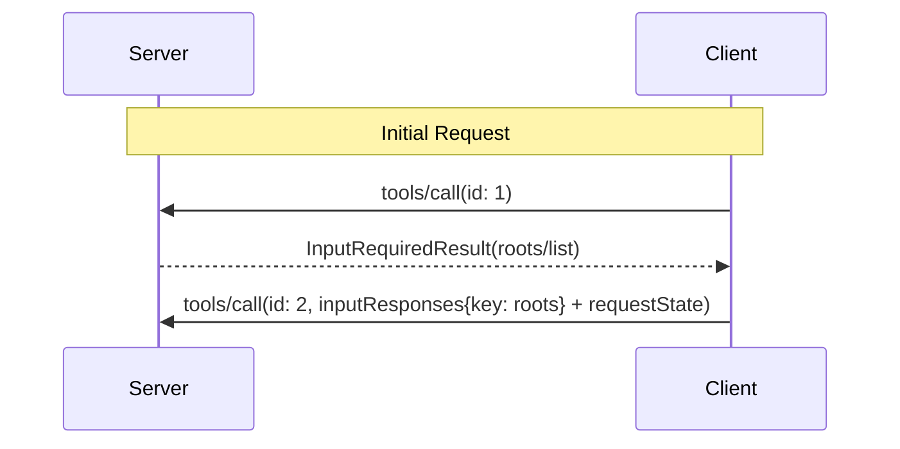

# MCP Roots 规范及弃用说明

介绍工作目录列表、消息和安全考虑；所保存版本明确将该能力标为弃用，不能直接套用于其他协议版本。

- 来源：通用规范／MCP
- 资料类型：存档文档
- 文档时间：官网现页更新：[2026-10-11](<https://modelcontextprotocol.io/specification/2026-07-28/client/roots>)；规范版本：[2026-07-28](<https://modelcontextprotocol.io/specification/2026-07-28/client/roots>)；本地抓取：2026-10-11
- 阅读状态：完整中文机器译文，由 Google 翻译；代码、命令与配置保留原样，未逐句人工校对。

[原文发布页](<https://modelcontextprotocol.io/specification/2026-07-28/client/roots>) · [原始文件](<../../../../原始抓取备份/原文/官方/通用规范/MCP/MCP Roots 规范及弃用说明.md>) · [返回资料总览](<../../../资料总览.md>)

[查看原文对照](#原文对照)

## 中文全文

> ## 文档索引
> 在以下位置获取完整的文档索引： https://modelcontextprotocol.io/llms.txt
> 在进一步探索之前使用此文件来发现所有可用页面。

# 根源

<div id="enable-section-numbers" />


**注意：**

**已弃用**：自协议版本
 `2026-07-28`
 ([SEP-2577](<https://github.com/modelcontextprotocol/modelcontextprotocol/pull/2577>)) 起，根功能已弃用。
 在 [ 功能生命周期下政策](<https://modelcontextprotocol.io/community/feature-lifecycle>)，在本修订版本
发布后，它在规范中保留
至少十二个月，然后才有资格删除。新的实现**SHOULDNOT**
采用它；现有实现 **SHOULD** 通过工具参数、资源 URI 或服务器配置迁移到传递目录 
 或文件。请参阅
 [已弃用的功能注册表](<https://modelcontextprotocol.io/specification/2026-07-28/deprecated>)。


Model Context Protocol (MCP) 为客户端提供了一种标准化方法来向服务器公开 
 文件系统“根”。根通知服务器有关
客户端认为相关的目录和文件，以便服务器可以相应地集中其操作。它们
是信息指导而不是访问控制机制。该协议
不强制服务器保留在根中。服务器可以从
支持的客户端请求根列表。

## 用户交互模型

MCP 中的根通常通过工作区或项目配置接口公开。

例如，实现可以提供一个 workspace/project 选择器，允许用户 
 选择服务器应有权访问的目录和文件。这可以与版本控制系统或项目文件的
自动工作区检测相结合。

然而，实现可以通过任何满足其需求的接口模式
自由地公开根——协议本身不强制要求任何特定的用户
交互模型。

## 能力

支持根 **MUST** 的客户端在每个请求的 
`_meta.io.modelcontextprotocol/clientCapabilities` 中声明 `roots` 功能：

```json theme={null}
{
  "_meta": {
    "io.modelcontextprotocol/clientCapabilities": {
      "roots": {}
    }
  }
}
```

## 协议消息

### 列出根

为了在处理客户端请求期间检索根，服务器发送包含 `roots/list` 请求的 `InputRequiredResult`
：

**输入请求（在[`InputRequiredResult.inputRequests`](<https://modelcontextprotocol.io/specification/2026-07-28/basic/patterns/mrtr#inputrequests>)内传递）：**

```json theme={null}
{
  "method": "roots/list"
}
```

**客户端结果（在重试请求时在`inputResponses`内返回）：**

```json theme={null}
{
  "roots": [
    {
      "uri": "file:///home/user/projects/myproject",
      "name": "My Project"
    }
  ]
}
```

## 消息流



## 数据类型

### 根

根定义包括：

* `uri`：根的唯一标识符。此 **MUST** 是当前中的 `file://` URI
规格。
* `name`：用于显示目的的可选人类可读名称。

不同用例的根示例：

#### 项目目录

```json theme={null}
{
  "uri": "file:///home/user/projects/myproject",
  "name": "My Project"
}
```

#### 多个存储库

```json theme={null}
[
  {
    "uri": "file:///home/user/repos/frontend",
    "name": "Frontend Repository"
  },
  {
    "uri": "file:///home/user/repos/backend",
    "name": "Backend Repository"
  }
]
```

## 错误处理

如果发生错误，客户端不需要重播带有错误消息 
 的初始调用，因为服务器不会等待具有 `InputRequiredResult` 模式的响应。

## 安全考虑

1. 客户**MUST**：
   * 仅公开具有适当权限的根
   * 验证所有根 URI 以防止路径遍历
   * 实施适当的访问控制
   * 监控 root 可访问性

2. 服务器**SHOULD**：
   * 处理 root 不可用的情况
   * 在操作期间尊重根边界
   * 根据提供的根验证所有路径

## 实施指南

1. 客户**SHOULD**：
   * 在将根暴露给服务器之前提示用户同意
   * 为根管理提供清晰的用户界面
   * 在公开之前验证 root 可访问性
   * 监视根更改

2. 服务器**SHOULD**：
   * 使用前检查根能力
   * 尊重操作中的根边界
   * 适当缓存根信息


## 原文对照

<details>
<summary>展开完整原文</summary>

> ## Documentation Index
> Fetch the complete documentation index at: https://modelcontextprotocol.io/llms.txt
> Use this file to discover all available pages before exploring further.

# Roots

<div id="enable-section-numbers" />


**注意：**

  **Deprecated**: The Roots feature is deprecated as of protocol version
  `2026-07-28`
  ([SEP-2577](<https://github.com/modelcontextprotocol/modelcontextprotocol/pull/2577>)).
  Under the [feature lifecycle policy](<https://modelcontextprotocol.io/community/feature-lifecycle>), it remains
  in the specification for at least twelve months after this revision's release
  before it becomes eligible for removal. New implementations **SHOULD NOT**
  adopt it; existing implementations **SHOULD** migrate to passing directories
  or files via tool parameters, resource URIs, or server configuration. See the
  [deprecated features registry](<https://modelcontextprotocol.io/specification/2026-07-28/deprecated>).


The Model Context Protocol (MCP) provides a standardized way for clients to expose
filesystem "roots" to servers. Roots inform servers about the directories and files the
client considers relevant, so that servers can focus their operations accordingly. They
are informational guidance rather than an access-control mechanism. The protocol does
not enforce that servers stay within roots. Servers can request the list of roots from
supporting clients.

## User Interaction Model

Roots in MCP are typically exposed through workspace or project configuration interfaces.

For example, implementations could offer a workspace/project picker that allows users to
select directories and files the server should have access to. This can be combined with
automatic workspace detection from version control systems or project files.

However, implementations are free to expose roots through any interface pattern that
suits their needs—the protocol itself does not mandate any specific user
interaction model.

## Capabilities

Clients that support roots **MUST** declare the `roots` capability in
`_meta.io.modelcontextprotocol/clientCapabilities` on each request:

```json theme={null}
{
  "_meta": {
    "io.modelcontextprotocol/clientCapabilities": {
      "roots": {}
    }
  }
}
```

## Protocol Messages

### Listing Roots

To retrieve roots during the processing of a client request, servers send an `InputRequiredResult`
containing a `roots/list` request:

**Input request (delivered inside [`InputRequiredResult.inputRequests`](<https://modelcontextprotocol.io/specification/2026-07-28/basic/patterns/mrtr#inputrequests>)):**

```json theme={null}
{
  "method": "roots/list"
}
```

**Client result (returned inside `inputResponses` on the retried request):**

```json theme={null}
{
  "roots": [
    {
      "uri": "file:///home/user/projects/myproject",
      "name": "My Project"
    }
  ]
}
```

## Message Flow


## Data Types

### Root

A root definition includes:

* `uri`: Unique identifier for the root. This **MUST** be a `file://` URI in the current
  specification.
* `name`: Optional human-readable name for display purposes.

Example roots for different use cases:

#### Project Directory

```json theme={null}
{
  "uri": "file:///home/user/projects/myproject",
  "name": "My Project"
}
```

#### Multiple Repositories

```json theme={null}
[
  {
    "uri": "file:///home/user/repos/frontend",
    "name": "Frontend Repository"
  },
  {
    "uri": "file:///home/user/repos/backend",
    "name": "Backend Repository"
  }
]
```

## Error Handling

If an error occurs, the client does not need to replay the initial call with an error message
as the server is not waiting for a response with the `InputRequiredResult` pattern.

## Security Considerations

1. Clients **MUST**:
   * Only expose roots with appropriate permissions
   * Validate all root URIs to prevent path traversal
   * Implement proper access controls
   * Monitor root accessibility

2. Servers **SHOULD**:
   * Handle cases where roots become unavailable
   * Respect root boundaries during operations
   * Validate all paths against provided roots

## Implementation Guidelines

1. Clients **SHOULD**:
   * Prompt users for consent before exposing roots to servers
   * Provide clear user interfaces for root management
   * Validate root accessibility before exposing
   * Monitor for root changes

2. Servers **SHOULD**:
   * Check for roots capability before usage
   * Respect root boundaries in operations
   * Cache root information appropriately


</details>
