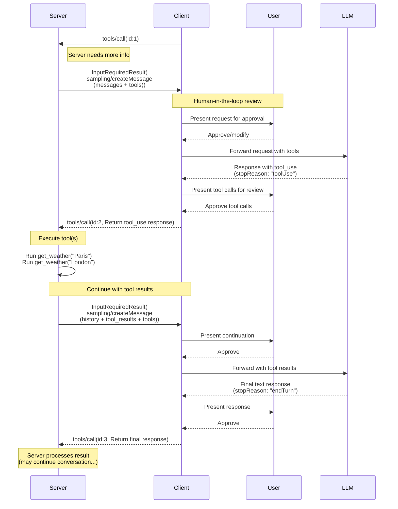
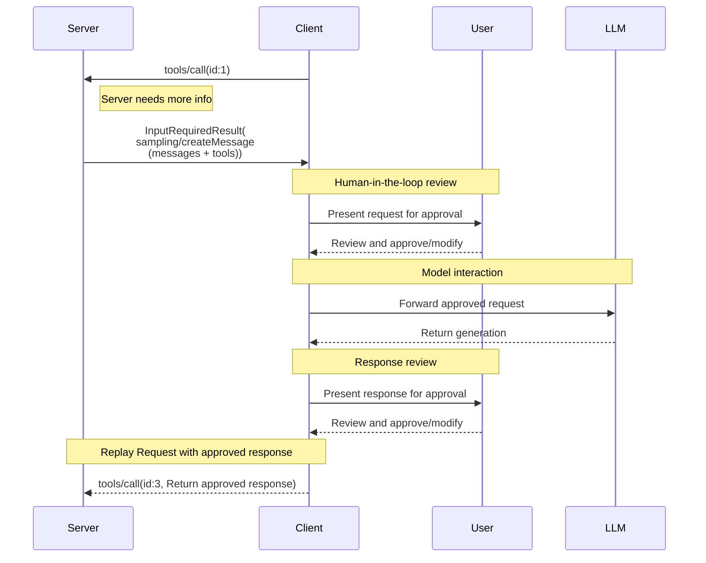

# MCP Sampling 规范及弃用说明

介绍由客户端执行采样、工具循环、消息与交互；所保存版本明确标为弃用，阅读时需核对协议版本。

- 来源：通用规范／MCP
- 资料类型：存档文档
- 文档时间：官网现页更新：[2026-10-11](<https://modelcontextprotocol.io/specification/2026-07-28/client/sampling>)；规范版本：[2026-07-28](<https://modelcontextprotocol.io/specification/2026-07-28/client/sampling>)；本地抓取：2026-10-11
- 阅读状态：完整中文机器译文，由 Google 翻译；代码、命令与配置保留原样，未逐句人工校对。

[原文发布页](<https://modelcontextprotocol.io/specification/2026-07-28/client/sampling>) · [原始文件](<../../../../原始抓取备份/原文/官方/通用规范/MCP/MCP Sampling 规范及弃用说明.md>) · [返回资料总览](<../../../资料总览.md>)

[查看原文对照](#原文对照)

## 中文全文

> ## 文档索引
> 在以下位置获取完整的文档索引： https://modelcontextprotocol.io/llms.txt
> 在进一步探索之前使用此文件来发现所有可用页面。

# 取样

<div id="enable-section-numbers" />


**注意：**

**已弃用**：从协议版本
 `2026-07-28`
 ([SEP-2577](<https://github.com/modelcontextprotocol/modelcontextprotocol/pull/2577>)) 起，采样功能已弃用。
 在 [ 功能生命周期下政策](<https://modelcontextprotocol.io/community/feature-lifecycle>)，在本修订版本
发布后，它在规范中保留
至少十二个月，然后才有资格删除。新的实现**SHOULDNOT**
采用它；现有实现 **SHOULD** 迁移到直接集成 
 与 LLM 提供商 API。请参阅[已弃用的功能
注册表](<https://modelcontextprotocol.io/specification/2026-07-28/deprecated>)。


Model Context Protocol (MCP) 为服务器提供了一种通过客户端从语言模型请求 LLM
 采样（“完成”或“生成”）的标准化方法。此流程
允许客户端保持对模型访问、选择和权限的控制，同时
使服务器能够利用AI功能，无需服务器API密钥。
服务器可以请求基于文本、音频或图像的交互，并且可以选择在提示中包含来自 MCP 服务器的 
 上下文。

## 用户交互模型

MCP中的采样允许服务器实现代理行为，通过启用LLM调用
发生*嵌套*在其他MCP服务器功能内。

实现可以通过任何适合
其需求的接口模式自由地公开采样——协议本身不强制要求任何特定的用户交互
模型。


**注意：**

为了信任和安全，**SHOULD** 始终
 是一个能够拒绝采样请求的人。

应用**SHOULD**：

  * 提供UI，使审核采样请求变得简单直观
  * 允许用户在发送前查看和编辑提示
  * 在交付前呈现生成的响应以供审核


## 采样工具

服务器可以通过在采样请求中提供 `tools` 数组和可选的 `toolChoice` 配置来请求客户端 LLM 在采样期间使用工具。 `tools` 数组中的工具定义仅限于采样请求 - 它们不需要与注册的工具相对应。这使得服务器能够实现代理行为，其中 LLM 可以调用专门指定的工具、接收结果并继续对话 - 所有这些都在单个采样请求流中进行。

客户端 **MUST** 通过 `sampling.tools` 功能声明支持工具使用，以接收启用工具的采样请求。服务器 **MUST NOT** 向尚未通过 `sampling.tools` 功能声明支持工具使用的客户端发送支持工具的采样请求。

## 能力

支持采样 **MUST** 的客户端在每个请求的 
`_meta.io.modelcontextprotocol/clientCapabilities` 中声明 `sampling` 功能：

**基本采样：**

```json theme={null}
{
  "_meta": {
    "io.modelcontextprotocol/clientCapabilities": {
      "sampling": {}
    }
  }
}
```

**带工具使用支持：**

```json theme={null}
{
  "_meta": {
    "io.modelcontextprotocol/clientCapabilities": {
      "sampling": {
        "tools": {}
      }
    }
  }
}
```

**具有上下文包含支持（已弃用）：**

```json theme={null}
{
  "_meta": {
    "io.modelcontextprotocol/clientCapabilities": {
      "sampling": {
        "context": {}
      }
    }
  }
}
```


**注释：**

  的 `includeContext` 参数值 `"thisServer"` 和 `"allServers"` 是
  已弃用 [功能生命周期
  政策](<https://modelcontextprotocol.io/community/feature-lifecycle#deprecating-a-feature>)
  ([SEP-2596](<https://github.com/modelcontextprotocol/modelcontextprotocol/pull/2596>));
  它们将在采样功能本身之前被删除。服务器
  **SHOULD** 避免使用这些值（例如可以省略 `includeContext` 自从
  它默认为 `"none"`），以及 **SHOULD NOT** 使用它们，除非客户
  宣称 `sampling.context` 能力。请参阅 [已弃用的功能
  注册表](<https://modelcontextprotocol.io/specification/2026-07-28/deprecated>).


## 协议消息

### 创建消息

要在处理客户端请求期间请求生成语言模型，服务器会发送包含 `sampling/createMessage` 请求的 `InputRequiredResult`：

**输入请求（在[`InputRequiredResult.inputRequests`](<https://modelcontextprotocol.io/specification/2026-07-28/basic/patterns/mrtr#inputrequests>)内传递）：**

```json theme={null}
{
  "method": "sampling/createMessage",
  "params": {
    "messages": [
      {
        "role": "user",
        "content": {
          "type": "text",
          "text": "What is the capital of France?"
        }
      }
    ],
    "modelPreferences": {
      "hints": [
        {
          "name": "claude-3-sonnet"
        }
      ],
      "costPriority": 0.3,
      "intelligencePriority": 0.8,
      "speedPriority": 0.5
    },
    "temperature": 0.1,
    "systemPrompt": "You are a helpful assistant.",
    "includeContext": "thisServer",
    "maxTokens": 100
  }
}
```

**客户端结果（在重试请求时在`inputResponses`内返回）：**

```json theme={null}
{
  "role": "assistant",
  "content": {
    "type": "text",
    "text": "The capital of France is Paris."
  },
  "model": "claude-3-sonnet-20240307",
  "stopReason": "endTurn"
}
```

### 使用工具采样

下图说明了使用工具进行采样的完整流程，包括多转工具循环：



要请求具有工具使用功能的 LLM 生成，服务器在请求中包含 `tools` 和可选的 `toolChoice`：

**输入请求（服务器->客户端，在`InputRequiredResult.inputRequests`内传递）：**

```json theme={null}
{
  "method": "sampling/createMessage",
  "params": {
    "messages": [
      {
        "role": "user",
        "content": {
          "type": "text",
          "text": "What's the weather like in Paris and London?"
        }
      }
    ],
    "tools": [
      {
        "name": "get_weather",
        "description": "Get current weather for a city",
        "inputSchema": {
          "type": "object",
          "properties": {
            "city": {
              "type": "string",
              "description": "City name"
            }
          },
          "required": ["city"]
        }
      }
    ],
    "toolChoice": {
      "mode": "auto"
    },
    "maxTokens": 1000
  }
}
```

**客户端结果（客户端 -> 服务器，在重试请求时在 `inputResponses` 内返回）：**

```json theme={null}
{
  "role": "assistant",
  "content": [
    {
      "type": "tool_use",
      "id": "call_abc123",
      "name": "get_weather",
      "input": {
        "city": "Paris"
      }
    },
    {
      "type": "tool_use",
      "id": "call_def456",
      "name": "get_weather",
      "input": {
        "city": "London"
      }
    }
  ],
  "model": "claude-3-sonnet-20240307",
  "stopReason": "toolUse"
}
```

### 多回转刀具循环

服务器收到来自LLM的工具使用请求后，通常：

1. 执行请求的工具使用。
2. 发送新的采样请求并附加工具结果
3. 接收LLM的响应（其中可能包含新的工具用途）
4. 根据需要重复多次（服务器可能会限制最大迭代次数，例如在最后一次迭代中传递 `toolChoice: {mode: "none"}` 以强制得出最终结果）

**后续输入请求（服务器->客户端，在`InputRequiredResult.inputRequests`内部传递），工具结果：**

```json theme={null}
{
  "method": "sampling/createMessage",
  "params": {
    "messages": [
      {
        "role": "user",
        "content": {
          "type": "text",
          "text": "What's the weather like in Paris and London?"
        }
      },
      {
        "role": "assistant",
        "content": [
          {
            "type": "tool_use",
            "id": "call_abc123",
            "name": "get_weather",
            "input": { "city": "Paris" }
          },
          {
            "type": "tool_use",
            "id": "call_def456",
            "name": "get_weather",
            "input": { "city": "London" }
          }
        ]
      },
      {
        "role": "user",
        "content": [
          {
            "type": "tool_result",
            "toolUseId": "call_abc123",
            "content": [
              {
                "type": "text",
                "text": "Weather in Paris: 18°C, partly cloudy"
              }
            ]
          },
          {
            "type": "tool_result",
            "toolUseId": "call_def456",
            "content": [
              {
                "type": "text",
                "text": "Weather in London: 15°C, rainy"
              }
            ]
          }
        ]
      }
    ],
    "tools": [
      {
        "name": "get_weather",
        "description": "Get current weather for a city",
        "inputSchema": {
          "type": "object",
          "properties": {
            "city": { "type": "string" }
          },
          "required": ["city"]
        }
      }
    ],
    "maxTokens": 1000
  }
}
```

**最终客户端结果（客户端 -> 服务器，在重试请求时在 `inputResponses` 内返回）：**

```json theme={null}
{
  "role": "assistant",
  "content": {
    "type": "text",
    "text": "Based on the current weather data:\n\n- **Paris**: 18°C and partly cloudy - quite pleasant!\n- **London**: 15°C and rainy - you'll want an umbrella.\n\nParis has slightly warmer and drier conditions today."
  },
  "model": "claude-3-sonnet-20240307",
  "stopReason": "endTurn"
}
```

## 消息内容限制

### 工具结果消息

当用户消息包含工具结果（类型：“工具\_结果”）时，它**MUST**包含ONLY工具结果。不允许将工具结果与同一消息中的其他内容类型（文本、图像、音频）混合。

此约束确保与使用工具结果专用角色的提供者 API 的兼容性（例如，OpenAI 的“工具”角色、Gemini 的“功能”角色）。

**有效 - 单个工具结果：**

```json theme={null}
{
  "role": "user",
  "content": {
    "type": "tool_result",
    "toolUseId": "call_123",
    "content": [{ "type": "text", "text": "Result data" }]
  }
}
```

**有效 - 多个工具结果：**

```json theme={null}
{
  "role": "user",
  "content": [
    {
      "type": "tool_result",
      "toolUseId": "call_123",
      "content": [{ "type": "text", "text": "Result 1" }]
    },
    {
      "type": "tool_result",
      "toolUseId": "call_456",
      "content": [{ "type": "text", "text": "Result 2" }]
    }
  ]
}
```

**无效 - 混合内容：**

```json theme={null}
{
  "role": "user",
  "content": [
    {
      "type": "text",
      "text": "Here are the results:"
    },
    {
      "type": "tool_result",
      "toolUseId": "call_123",
      "content": [{ "type": "text", "text": "Result data" }]
    }
  ]
}
```

### 工具使用和结果平衡

当在采样中使用工具使用时，每个包含 `ToolUseContent` 块 **MUST** 的辅助消息后跟一个完全由 `ToolResultContent` 块组成的用户消息，在任何其他消息之前，每个工具使用（例如使用 `id: $id`）与相应的工具结果（使用 `toolUseId: $id`）相匹配。

这一要求确保：

* 工具的使用总是在对话继续之前解决
* 提供程序 API 可以同时处理多个工具的使用并并行获取其结果
* 对话保持一致的请求-响应模式

**有效序列示例：**

1. 用户留言：“巴黎和伦敦的天气怎么样？”
2. 助理消息：`ToolUseContent`（`id: "call_abc123", name: "get_weather", input: {city: "Paris"}`）+`ToolUseContent`（`id: "call_def456", name: "get_weather", input: {city: "London"}`）
3. 用户留言：`ToolResultContent` (`toolUseId: "call_abc123", content: "18°C, partly cloudy"`) + `ToolResultContent` (`toolUseId: "call_def456", content: "15°C, rainy"`)
4. 助理消息：短信回复比较两个城市的天气

**序列无效 - 缺少工具结果：**

1. 用户留言：“巴黎和伦敦的天气怎么样？”
2. 助理消息：`ToolUseContent`（`id: "call_abc123", name: "get_weather", input: {city: "Paris"}`）+`ToolUseContent`（`id: "call_def456", name: "get_weather", input: {city: "London"}`）
3. 用户消息：`ToolResultContent` (`toolUseId: "call_abc123", content: "18°C, partly cloudy"`) ← 缺少呼叫结果\_def456
4. 助理消息：文本响应（无效 - 并非所有工具使用均已解决）

## 跨API兼容性

采样规范旨在跨多个 LLM 提供商 API（Claude、OpenAI、Gemini 等）工作。兼容性的关键设计决策：

### 消息角色

MCP使用两个角色：“用户”和“助理”。

工具使用请求以“助理”角色在 CreateMessageResult 中发送。
工具结果以“用户”角色在消息中发回。
包含工具结果的消息不能包含其他类型的内容。

### 工具选择模式

`CreateMessageRequest.params.toolChoice`控制模型的工具使用能力：

* `{mode: "auto"}`：模型决定是否使用工具（默认）
* `{mode: "required"}`：模型MUST在完成之前至少使用一种工具
* `{mode: "none"}`：型号MUSTNOT使用任何工具

### 并行工具的使用

MCP 允许模型并行发出多个工具使用请求（返回 `ToolUseContent` 数组）。所有主要提供商 API 均支持此功能：

* **Claude**：原生支持并行工具使用
* **OpenAI**：支持并行工具调用（可以使用`parallel_tool_calls: false`禁用）
* **Gemini**：原生支持并行函数调用

支持禁用并行工具的实现包装提供程序使用 MAY 将其公开为扩展，但它不是核心 MCP 规范的一部分。

## 消息流



## 数据类型

### 留言

采样消息**MUST**包含`"user"`或`"assistant"`的`role`字段； 
表示消息数据的`content`字段。

采样请求 **SHOULD NOT** 中的消息列表将在 
 单独的请求之间保留。

`content` 字段可以包含：

#### 文字内容

```json theme={null}
{
  "type": "text",
  "text": "The message content"
}
```

#### 图片内容

```json theme={null}
{
  "type": "image",
  "data": "base64-encoded-image-data",
  "mimeType": "image/jpeg"
}
```

#### 音频内容

```json theme={null}
{
  "type": "audio",
  "data": "base64-encoded-audio-data",
  "mimeType": "audio/wav"
}
```

### 模型偏好

MCP 中的模型选择需要仔细抽象，因为服务器和客户端可能使用 
 具有不同模型产品的不同 AI 提供程序。服务器不能简单地按名称请求
特定模型，因为客户端可能无法访问该确切模型，或者可能
更喜欢使用不同提供商的等效模型。

为了解决这个问题，MCP实现了一个偏好系统，它将抽象能力
优先级与可选模型提示相结合：

#### 能力优先事项

服务器通过三个标准化优先级值（0-1）表达其需求：

* `costPriority`：最小化成本有多重要？更高的价值更喜欢更便宜的型号。
* `speedPriority`：低延迟有多重要？值越高，模型越快。
* `intelligencePriority`：高级能力有多重要？值越高越好
更强大的模型。

#### 型号提示

虽然优先级有助于根据特征选择模型，但 `hints` 允许服务器 
 建议特定模型或模型系列：

* 提示被视为子字符串，可以灵活匹配模型名称
* 按优先顺序评估多个提示
* 客户端 **MAY** 将提示映射到来自不同提供商的等效模型
* 提示为建议性的——客户做出最终的型号选择

例如：

```json theme={null}
{
  "hints": [
    { "name": "claude-3-sonnet" }, // Prefer Sonnet-class models
    { "name": "claude" } // Fall back to any Claude model
  ],
  "costPriority": 0.3, // Cost is less important
  "speedPriority": 0.8, // Speed is very important
  "intelligencePriority": 0.5 // Moderate capability needs
}
```

客户端处理这些首选项，从其可用的
选项中选择合适的模型。例如，如果客户端无权访问 Claude 模型，但具有 Gemini、
，它可能会基于类似的功能将十四行诗提示映射到 `gemini-1.5-pro`。

### 系统提示

可选的`systemPrompt`字段允许服务器请求特定的系统提示。
客户端**MAY**修改或忽略此字段，而不将此字段传达给服务器。

### 上下文包含

`includeContext` 参数指定客户端期望 
 在其响应中包含哪些上下文信息：

* `"none"`：没有额外的上下文。
* `"thisServer"`：包括来自请求服务器的上下文。
* `"allServers"`：包括来自所有连接的 MCP 服务器的上下文。

`"thisServer"` 和 `"allServers"` 值已弃用；请参阅
[功能](<#能力>)。

客户端 **MAY** 修改或忽略此字段，而不将此字段传达给服务器。
例如，客户端可以确定在特定请求中尊重此字段 
 将需要与服务器共享敏感信息，并相应地限制其响应 
。

### 采样参数

LLM采样可以通过以下参数进行微调：

* `temperature`：控制模型响应的随机性。较高的值会产生较高的随机性，较低的值会产生更稳定的输出。有效范围取决于模型提供商。
* `maxTokens`：生成的最大代币数量；必需的。
* `stopSequences`：停止生成的序列数组。
* `metadata`：其他特定于提供商的参数。

客户端**MUST**尊重`maxTokens`参数。

客户端**MAY**修改或忽略`temperature`、`stopSequences`和`metadata`。对于 
 示例，客户端可能使用不支持其中一个或多个参数的模型，
，因此无法利用它们。

### 结果字段

采样结果将包含以下字段：

* `role`：消息角色；请参阅[消息](<#留言>)。

* `content`：消息内容。这可以是：

  * 单个内容块，当响应仅包含一个内容块时，例如单个文本响应。
  * 当响应包含一个或多个内容块（例如多种工具使用或混合内容）时，一组内容块。

有关内容块类型，请参阅[消息](<#留言>)。

* `model`：生成消息的模型的名称。

* `stopReason`：采样停止的原因（如果已知）。尽管实现 **MAY** 提供了自己的任意值，但该规范定义了以下（非详尽的）停止原因：
  * `"endTurn"`：参与者正在将对话让给对方。
  * `"stopSequence"`：消息生成遇到请求的 `stopSequences` 之一。
  * `"maxTokens"`：已达到代币限制。
  * `"toolUse"`：模型想要使用一种或多种工具。

## 错误处理

如果发生错误或用户拒绝采样请求，则客户端不需要使用 
 错误消息重播初始调用，因为服务器不会等待具有 `InputRequiredResult` 模式的响应。

## 安全考虑

1. 客户端 **SHOULD** 实施用户审批控制
2. 双方**SHOULD**验证消息内容
3. 客户 **SHOULD** 尊重模型偏好提示
4. 客户端**SHOULD**实施速率限制
5. 双方 **MUST** 适当处理敏感数据

当使用工具进行采样时，需要考虑其他安全注意事项：

6. 服务器 **MUST** 确保在回复 `stopReason: "toolUse"` 时，每个 `ToolUseContent` 项目都会使用具有匹配 `toolUseId` 的 `ToolResultContent` 项目进行响应，并且用户消息仅包含工具结果（无其他内容类型）
7. 双方**SHOULD**实施工具循环的迭代限制


## 原文对照

<details>
<summary>展开完整原文</summary>

> ## Documentation Index
> Fetch the complete documentation index at: https://modelcontextprotocol.io/llms.txt
> Use this file to discover all available pages before exploring further.

# Sampling

<div id="enable-section-numbers" />


**注意：**

  **Deprecated**: The Sampling feature is deprecated as of protocol version
  `2026-07-28`
  ([SEP-2577](<https://github.com/modelcontextprotocol/modelcontextprotocol/pull/2577>)).
  Under the [feature lifecycle policy](<https://modelcontextprotocol.io/community/feature-lifecycle>), it remains
  in the specification for at least twelve months after this revision's release
  before it becomes eligible for removal. New implementations **SHOULD NOT**
  adopt it; existing implementations **SHOULD** migrate to integrating directly
  with LLM provider APIs. See the [deprecated features
  registry](<https://modelcontextprotocol.io/specification/2026-07-28/deprecated>).


The Model Context Protocol (MCP) provides a standardized way for servers to request LLM
sampling ("completions" or "generations") from language models via clients. This flow
allows clients to maintain control over model access, selection, and permissions while
enabling servers to leverage AI capabilities—with no server API keys necessary.
Servers can request text, audio, or image-based interactions and optionally include
context from MCP servers in their prompts.

## User Interaction Model

Sampling in MCP allows servers to implement agentic behaviors, by enabling LLM calls to
occur *nested* inside other MCP server features.

Implementations are free to expose sampling through any interface pattern that suits
their needs—the protocol itself does not mandate any specific user interaction
model.


**注意：**

  For trust & safety and security, there **SHOULD** always
  be a human in the loop with the ability to deny sampling requests.

  Applications **SHOULD**:

  * Provide UI that makes it easy and intuitive to review sampling requests
  * Allow users to view and edit prompts before sending
  * Present generated responses for review before delivery


## Tools in Sampling

Servers can request that the client's LLM use tools during sampling by providing a `tools` array and optional `toolChoice` configuration in their sampling requests. The tool definitions in the `tools` array are scoped to the sampling request — they don't need to correspond to registered tools. This enables servers to implement agentic behaviors where the LLM can call specially designated tools, receive results, and continue the conversation - all within a single sampling request flow.

Clients **MUST** declare support for tool use via the `sampling.tools` capability to receive tool-enabled sampling requests. Servers **MUST NOT** send tool-enabled sampling requests to Clients that have not declared support for tool use via the `sampling.tools` capability.

## Capabilities

Clients that support sampling **MUST** declare the `sampling` capability in
`_meta.io.modelcontextprotocol/clientCapabilities` on each request:

**Basic sampling:**

```json theme={null}
{
  "_meta": {
    "io.modelcontextprotocol/clientCapabilities": {
      "sampling": {}
    }
  }
}
```

**With tool use support:**

```json theme={null}
{
  "_meta": {
    "io.modelcontextprotocol/clientCapabilities": {
      "sampling": {
        "tools": {}
      }
    }
  }
}
```

**With context inclusion support (deprecated):**

```json theme={null}
{
  "_meta": {
    "io.modelcontextprotocol/clientCapabilities": {
      "sampling": {
        "context": {}
      }
    }
  }
}
```


**注释：**

  The `includeContext` parameter values `"thisServer"` and `"allServers"` are
  deprecated under the [feature lifecycle
  policy](<https://modelcontextprotocol.io/community/feature-lifecycle#deprecating-a-feature>)
  ([SEP-2596](<https://github.com/modelcontextprotocol/modelcontextprotocol/pull/2596>));
  they will be removed no later than the Sampling feature itself. Servers
  **SHOULD** avoid using these values (e.g. can just omit `includeContext` since
  it defaults to `"none"`), and **SHOULD NOT** use them unless the client
  declares `sampling.context` capability. See the [deprecated features
  registry](<https://modelcontextprotocol.io/specification/2026-07-28/deprecated>).


## Protocol Messages

### Creating Messages

To request a language model generation during the processing of a client request, servers send an `InputRequiredResult` containing a `sampling/createMessage` request:

**Input request (delivered inside [`InputRequiredResult.inputRequests`](<https://modelcontextprotocol.io/specification/2026-07-28/basic/patterns/mrtr#inputrequests>)):**

```json theme={null}
{
  "method": "sampling/createMessage",
  "params": {
    "messages": [
      {
        "role": "user",
        "content": {
          "type": "text",
          "text": "What is the capital of France?"
        }
      }
    ],
    "modelPreferences": {
      "hints": [
        {
          "name": "claude-3-sonnet"
        }
      ],
      "costPriority": 0.3,
      "intelligencePriority": 0.8,
      "speedPriority": 0.5
    },
    "temperature": 0.1,
    "systemPrompt": "You are a helpful assistant.",
    "includeContext": "thisServer",
    "maxTokens": 100
  }
}
```

**Client result (returned inside `inputResponses` on the retried request):**

```json theme={null}
{
  "role": "assistant",
  "content": {
    "type": "text",
    "text": "The capital of France is Paris."
  },
  "model": "claude-3-sonnet-20240307",
  "stopReason": "endTurn"
}
```

### Sampling with Tools

The following diagram illustrates the complete flow of sampling with tools, including the multi-turn tool loop:


To request LLM generation with tool use capabilities, servers include `tools` and optionally `toolChoice` in the request:

**Input request (Server -> Client, delivered inside `InputRequiredResult.inputRequests`):**

```json theme={null}
{
  "method": "sampling/createMessage",
  "params": {
    "messages": [
      {
        "role": "user",
        "content": {
          "type": "text",
          "text": "What's the weather like in Paris and London?"
        }
      }
    ],
    "tools": [
      {
        "name": "get_weather",
        "description": "Get current weather for a city",
        "inputSchema": {
          "type": "object",
          "properties": {
            "city": {
              "type": "string",
              "description": "City name"
            }
          },
          "required": ["city"]
        }
      }
    ],
    "toolChoice": {
      "mode": "auto"
    },
    "maxTokens": 1000
  }
}
```

**Client result (Client -> Server, returned inside `inputResponses` on the retried request):**

```json theme={null}
{
  "role": "assistant",
  "content": [
    {
      "type": "tool_use",
      "id": "call_abc123",
      "name": "get_weather",
      "input": {
        "city": "Paris"
      }
    },
    {
      "type": "tool_use",
      "id": "call_def456",
      "name": "get_weather",
      "input": {
        "city": "London"
      }
    }
  ],
  "model": "claude-3-sonnet-20240307",
  "stopReason": "toolUse"
}
```

### Multi-turn Tool Loop

After receiving tool use requests from the LLM, the server typically:

1. Executes the requested tool uses.
2. Sends a new sampling request with the tool results appended
3. Receives the LLM's response (which might contain new tool uses)
4. Repeats as many times as needed (server might cap the maximum number of iterations, and e.g. pass `toolChoice: {mode: "none"}` on the last iteration to force a final result)

**Follow-up input request (Server -> Client, delivered inside `InputRequiredResult.inputRequests`) with tool results:**

```json theme={null}
{
  "method": "sampling/createMessage",
  "params": {
    "messages": [
      {
        "role": "user",
        "content": {
          "type": "text",
          "text": "What's the weather like in Paris and London?"
        }
      },
      {
        "role": "assistant",
        "content": [
          {
            "type": "tool_use",
            "id": "call_abc123",
            "name": "get_weather",
            "input": { "city": "Paris" }
          },
          {
            "type": "tool_use",
            "id": "call_def456",
            "name": "get_weather",
            "input": { "city": "London" }
          }
        ]
      },
      {
        "role": "user",
        "content": [
          {
            "type": "tool_result",
            "toolUseId": "call_abc123",
            "content": [
              {
                "type": "text",
                "text": "Weather in Paris: 18°C, partly cloudy"
              }
            ]
          },
          {
            "type": "tool_result",
            "toolUseId": "call_def456",
            "content": [
              {
                "type": "text",
                "text": "Weather in London: 15°C, rainy"
              }
            ]
          }
        ]
      }
    ],
    "tools": [
      {
        "name": "get_weather",
        "description": "Get current weather for a city",
        "inputSchema": {
          "type": "object",
          "properties": {
            "city": { "type": "string" }
          },
          "required": ["city"]
        }
      }
    ],
    "maxTokens": 1000
  }
}
```

**Final client result (Client -> Server, returned inside `inputResponses` on the retried request):**

```json theme={null}
{
  "role": "assistant",
  "content": {
    "type": "text",
    "text": "Based on the current weather data:\n\n- **Paris**: 18°C and partly cloudy - quite pleasant!\n- **London**: 15°C and rainy - you'll want an umbrella.\n\nParis has slightly warmer and drier conditions today."
  },
  "model": "claude-3-sonnet-20240307",
  "stopReason": "endTurn"
}
```

## Message Content Constraints

### Tool Result Messages

When a user message contains tool results (type: "tool\_result"), it **MUST** contain ONLY tool results. Mixing tool results with other content types (text, image, audio) in the same message is not allowed.

This constraint ensures compatibility with provider APIs that use dedicated roles for tool results (e.g., OpenAI's "tool" role, Gemini's "function" role).

**Valid - single tool result:**

```json theme={null}
{
  "role": "user",
  "content": {
    "type": "tool_result",
    "toolUseId": "call_123",
    "content": [{ "type": "text", "text": "Result data" }]
  }
}
```

**Valid - multiple tool results:**

```json theme={null}
{
  "role": "user",
  "content": [
    {
      "type": "tool_result",
      "toolUseId": "call_123",
      "content": [{ "type": "text", "text": "Result 1" }]
    },
    {
      "type": "tool_result",
      "toolUseId": "call_456",
      "content": [{ "type": "text", "text": "Result 2" }]
    }
  ]
}
```

**Invalid - mixed content:**

```json theme={null}
{
  "role": "user",
  "content": [
    {
      "type": "text",
      "text": "Here are the results:"
    },
    {
      "type": "tool_result",
      "toolUseId": "call_123",
      "content": [{ "type": "text", "text": "Result data" }]
    }
  ]
}
```

### Tool Use and Result Balance

When using tool use in sampling, every assistant message containing `ToolUseContent` blocks **MUST** be followed by a user message that consists entirely of `ToolResultContent` blocks, with each tool use (e.g. with `id: $id`) matched by a corresponding tool result (with `toolUseId: $id`), before any other message.

This requirement ensures:

* Tool uses are always resolved before the conversation continues
* Provider APIs can concurrently process multiple tool uses and fetch their results in parallel
* The conversation maintains a consistent request-response pattern

**Example valid sequence:**

1. User message: "What's the weather like in Paris and London?"
2. Assistant message: `ToolUseContent` (`id: "call_abc123", name: "get_weather", input: {city: "Paris"}`) + `ToolUseContent` (`id: "call_def456", name: "get_weather", input: {city: "London"}`)
3. User message: `ToolResultContent` (`toolUseId: "call_abc123", content: "18°C, partly cloudy"`) + `ToolResultContent` (`toolUseId: "call_def456", content: "15°C, rainy"`)
4. Assistant message: Text response comparing the weather in both cities

**Invalid sequence - missing tool result:**

1. User message: "What's the weather like in Paris and London?"
2. Assistant message: `ToolUseContent` (`id: "call_abc123", name: "get_weather", input: {city: "Paris"}`) + `ToolUseContent` (`id: "call_def456", name: "get_weather", input: {city: "London"}`)
3. User message: `ToolResultContent` (`toolUseId: "call_abc123", content: "18°C, partly cloudy"`) ← Missing result for call\_def456
4. Assistant message: Text response (invalid - not all tool uses were resolved)

## Cross-API Compatibility

The sampling specification is designed to work across multiple LLM provider APIs (Claude, OpenAI, Gemini, etc.). Key design decisions for compatibility:

### Message Roles

MCP uses two roles: "user" and "assistant".

Tool use requests are sent in CreateMessageResult with the "assistant" role.
Tool results are sent back in messages with the "user" role.
Messages with tool results cannot contain other kinds of content.

### Tool Choice Modes

`CreateMessageRequest.params.toolChoice` controls the tool use ability of the model:

* `{mode: "auto"}`: Model decides whether to use tools (default)
* `{mode: "required"}`: Model MUST use at least one tool before completing
* `{mode: "none"}`: Model MUST NOT use any tools

### Parallel Tool Use

MCP allows models to make multiple tool use requests in parallel (returning an array of `ToolUseContent`). All major provider APIs support this:

* **Claude**: Supports parallel tool use natively
* **OpenAI**: Supports parallel tool calls (can be disabled with `parallel_tool_calls: false`)
* **Gemini**: Supports parallel function calls natively

Implementations wrapping providers that support disabling parallel tool use MAY expose this as an extension, but it is not part of the core MCP specification.

## Message Flow


## Data Types

### Messages

Sampling messages **MUST** contain a `role` field of `"user"` or `"assistant"`; and
a `content` field representing the message data.

The list of messages in a sampling request **SHOULD NOT** be retained between
separate requests.

The `content` field can contain:

#### Text Content

```json theme={null}
{
  "type": "text",
  "text": "The message content"
}
```

#### Image Content

```json theme={null}
{
  "type": "image",
  "data": "base64-encoded-image-data",
  "mimeType": "image/jpeg"
}
```

#### Audio Content

```json theme={null}
{
  "type": "audio",
  "data": "base64-encoded-audio-data",
  "mimeType": "audio/wav"
}
```

### Model Preferences

Model selection in MCP requires careful abstraction since servers and clients may use
different AI providers with distinct model offerings. A server cannot simply request a
specific model by name since the client may not have access to that exact model or may
prefer to use a different provider's equivalent model.

To solve this, MCP implements a preference system that combines abstract capability
priorities with optional model hints:

#### Capability Priorities

Servers express their needs through three normalized priority values (0-1):

* `costPriority`: How important is minimizing costs? Higher values prefer cheaper models.
* `speedPriority`: How important is low latency? Higher values prefer faster models.
* `intelligencePriority`: How important are advanced capabilities? Higher values prefer
  more capable models.

#### Model Hints

While priorities help select models based on characteristics, `hints` allow servers to
suggest specific models or model families:

* Hints are treated as substrings that can match model names flexibly
* Multiple hints are evaluated in order of preference
* Clients **MAY** map hints to equivalent models from different providers
* Hints are advisory—clients make final model selection

For example:

```json theme={null}
{
  "hints": [
    { "name": "claude-3-sonnet" }, // Prefer Sonnet-class models
    { "name": "claude" } // Fall back to any Claude model
  ],
  "costPriority": 0.3, // Cost is less important
  "speedPriority": 0.8, // Speed is very important
  "intelligencePriority": 0.5 // Moderate capability needs
}
```

The client processes these preferences to select an appropriate model from its available
options. For instance, if the client doesn't have access to Claude models but has Gemini,
it might map the sonnet hint to `gemini-1.5-pro` based on similar capabilities.

### System Prompt

The optional `systemPrompt` field allows servers to request a specific system prompt.
The client **MAY** modify or ignore this field without communicating this to the server.

### Context Inclusion

The `includeContext` parameter specifies what context information the client is expected
to include in its response:

* `"none"`: No additional context.
* `"thisServer"`: Include context from the requesting server.
* `"allServers"`: Include context from all connected MCP servers.

The `"thisServer"` and `"allServers"` values are deprecated; see
[Capabilities](<#capabilities>).

The client **MAY** modify or ignore this field without communicating this to the server.
For example, a client could determine that respecting this field in a particular request
would require sharing sensitive information with a server, and constrain its response
accordingly.

### Sampling Parameters

LLM sampling can be fine-tuned with the following parameters:

* `temperature`: Controls randomness in model responses. Higher values produce higher randomness, and lower values produce more stable output. Valid range depends upon the model provider.
* `maxTokens`: Maximum tokens to generate; required.
* `stopSequences`: Array of sequences that stop generation.
* `metadata`: Additional provider-specific parameters.

The client **MUST** respect the `maxTokens` parameter.

The client **MAY** modify or ignore `temperature`, `stopSequences` and `metadata`. For
example, a client could use a model that does not support one or more of these parameters,
and would therefore be unable to leverage them.

### Result Fields

Sampling results will contain the following fields:

* `role`: The message role; see [Messages](<#messages>).

* `content`: The message content. This can be either:

  * A single content block when the response contains only one content block, such as a single text response.
  * An array of content blocks when the response contains one or more content blocks, such as multiple tool uses or mixed content.

  See [Messages](<#messages>) for content block types.

* `model`: The name of the model that generated the message.

* `stopReason`: The reason why sampling stopped, if known. The specification defines the following (non-exhaustive) stop reasons, although implementations **MAY** provide their own arbitrary values:
  * `"endTurn"`: The participant is yielding the conversation to the other party.
  * `"stopSequence"`: Message generation encountered one of the requested `stopSequences`.
  * `"maxTokens"`: The token limit was reached.
  * `"toolUse"`: The model wants to use one or more tools.

## Error Handling

If an error occurs or the user declines the sampling request, the client does not need to replay the initial call with an
error message, as the server is not waiting for a response with the `InputRequiredResult` pattern.

## Security Considerations

1. Clients **SHOULD** implement user approval controls
2. Both parties **SHOULD** validate message content
3. Clients **SHOULD** respect model preference hints
4. Clients **SHOULD** implement rate limiting
5. Both parties **MUST** handle sensitive data appropriately

When tools are used in sampling, additional security considerations apply:

6. Servers **MUST** ensure that when replying to a `stopReason: "toolUse"`, each `ToolUseContent` item is responded to with a `ToolResultContent` item with a matching `toolUseId`, and that the user message contains only tool results (no other content types)
7. Both parties **SHOULD** implement iteration limits for tool loops


</details>
