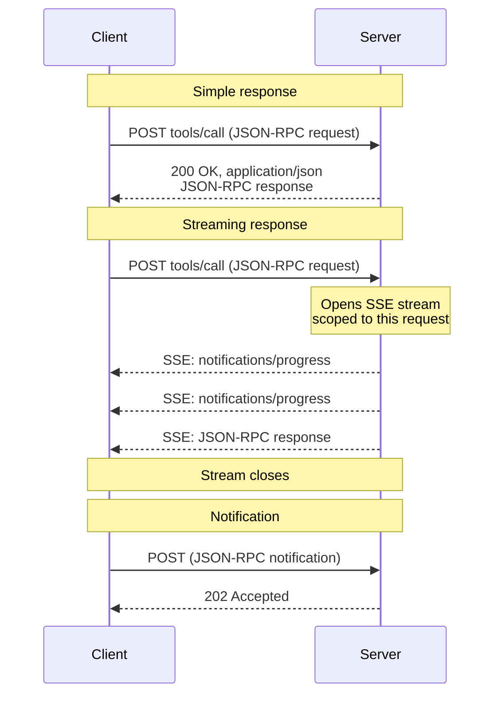
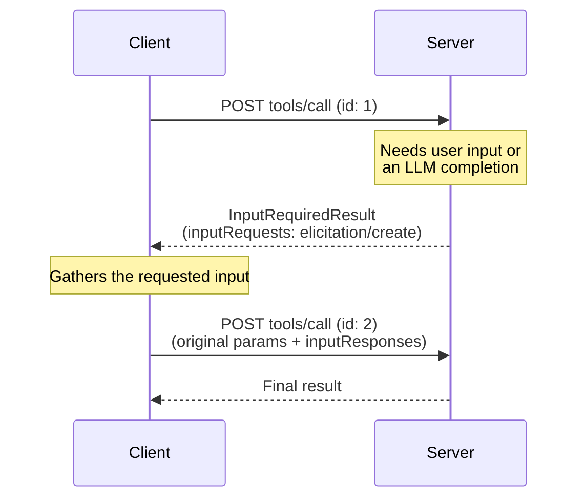
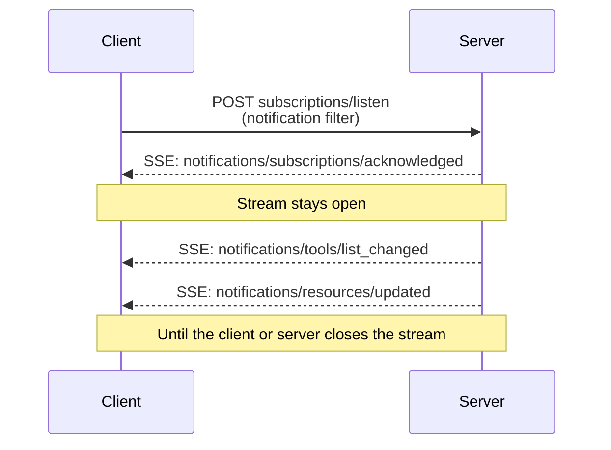

# MCP Streamable HTTP 传输规范

规定端点、消息、取消、版本和请求头，并解释与旧版 HTTP/SSE 的兼容差异；适用归档协议版本。

- 来源：通用规范／MCP
- 资料类型：存档文档
- 文档时间：官网现页更新：[2026-10-11](<https://modelcontextprotocol.io/specification/2026-07-28/basic/transports/streamable-http>)；规范版本：[2026-07-28](<https://modelcontextprotocol.io/specification/2026-07-28/basic/transports/streamable-http>)；本地抓取：2026-10-11
- 阅读状态：完整中文机器译文，由 Google 翻译；代码、命令与配置保留原样，未逐句人工校对。

[原文发布页](<https://modelcontextprotocol.io/specification/2026-07-28/basic/transports/streamable-http>) · [原始文件](<../../../../原始抓取备份/原文/官方/通用规范/MCP/MCP Streamable HTTP 传输规范.md>) · [返回资料总览](<../../../资料总览.md>)

[查看原文对照](#原文对照)

## 中文全文

> ## 文档索引
> 在以下位置获取完整的文档索引： https://modelcontextprotocol.io/llms.txt
> 在进一步探索之前使用此文件来发现所有可用页面。

# 可串流 HTTP

<div id="enable-section-numbers" />


**说明：**

  可串流 HTTP 在协议版本中引入 2025-03-26 作为替代品
  为 [HTTP+SSE 运输][http-sse] 从协议版本 2024-11-05.


**说明：**

修订版 2026-07-28 更改了 Streamable HTTP 的行为。客户端必须
确保他们正确处理向后兼容性。变化包括：

  * 删除 GET 流端点。
  * 删除协议级会话。

请参阅下面的 [ 变更日志 ](<https://modelcontextprotocol.io/specification/2026-07-28/changelog>) 和 
 [ 向后兼容性 ](<#向后兼容性>)。


在 ** 流式 HTTP** 传输中，服务器作为独立的 
 进程运行，可以处理多个客户端连接。一目了然：

* 服务器公开单个 HTTP 端点（**MCP 端点 **）
接受 POST。
* 客户端将每个 JSON-RPC 请求或通知作为自己的 HTTP 发送
  POST.
* 服务器使用单个 JSON 对象或一个
[服务器发送的事件][sse] (SSE) 流的范围为该请求，携带
 请求相关通知，后跟最终响应。
* 嵌入服务器到客户端交互（采样、启发、根）
结果为每个
 [多往返请求(MRTR)][mrtr] ([SEP-2322][sep-2322])的输入请求。
* 长期更改通知（例如列表更改和资源更新）
在 
 [`subscriptions/listen`][subscriptions-listen] 请求的响应流上传递。

参见 [消息流](<#消息流>) 对于这些序列图
互动。

服务器 **MUST** 提供支持 POST 的单个 HTTP 端点路径（以下称为 
 作为 **MCP 端点 **）。例如，这可能是 URL
，如 `https://example.com/mcp`。

[http-sse]: <https://modelcontextprotocol.io/specification/2024-11-05/basic/transports#http-with-sse>

[sse]: <https://en.wikipedia.org/wiki/Server-sent_events>

## 安全与端点

实现 Streamable HTTP 传输时：

1. 服务器 **MUST** 验证所有传入连接上的 `Origin` 标头
以防止DNS重新绑定攻击。
   * 如果 `Origin` 标头存在且无效，则服务器 **MUST** 响应
与 HTTP 403 禁止。 HTTP响应正文**MAY**包含
JSON-RPC*错误响应*，但没有`id`。
2. 在本地运行时，服务器 **SHOULD** 仅绑定到本地主机
(127.0.0.1) 而不是所有网络接口 (0.0.0.0)。
3. 服务器 **SHOULD** 对所有连接实施正确的身份验证。

如果没有这些保护，攻击者可以使用 DNS 重新绑定从远程网站与 
 本地 MCP 服务器进行交互。

## 发送消息

从客户端 **MUST** 发送的每条 JSON-RPC 消息都是对 MCP 端点的新 HTTP POST
 请求。

1. 客户端**MUST**使用HTTPPOST发送JSON-RPC消息。
2. 客户端 **MUST** 包含一个 `Accept` 标头，其中列出了
`application/json` 和 `text/event-stream` 作为受支持的内容类型。
3. 客户端 **MUST** 包含 [ 请求元数据标头 ](<#请求元数据>)
针对每个 POST 请求。
4. HTTP POST **MUST** 的主体是单个 JSON-RPC * 请求 * 或
*通知*。客户端 **MUST NOT** 发送 JSON-RPC * 响应 *。
5. 如果正文是 JSON-RPC * 通知 *：
   * 如果服务器接受，服务器**MUST**返回HTTP状态码
`202 Accepted` 没有身体。
   * 如果服务器无法接受它，它**MUST**返回HTTP错误状态
代码（例如，`400 Bad Request`）。 HTTP响应主体**MAY**包括
和没有`id`的JSON-RPC*错误响应*。
6. 如果主体是 JSON-RPC * 请求 *，则服务器 **MUST** 返回
`Content-Type: application/json`（单个 JSON 对象）或 
 `Content-Type: text/event-stream`（一个 SSE 响应流）。客户端
 **MUST**都支持。


**注释：**

此版本的核心协议没有定义通过 Streamable HTTP 的客户端到服务器 
 \* 通知 *。 
 核心协议 `notifications/cancelled` 中唯一客户端发送的通知仅用于 
 [stdio](<https://modelcontextprotocol.io/specification/2026-07-28/basic/transports/stdio>) 传输；在
流式传输HTTP上，关闭SSE响应流本身就是取消
信号，并且预计不会有`notifications/cancelled`消息（请参阅
 [取消][取消]）。上述通知规则描述了通知 POST 的 
 传输机制；此版本未定义 
 通知 POST 的标头要求。


## 接收消息

当服务器返回SSE响应流
(`Content-Type: text/event-stream`)时：

* 服务器 **MAY** 发送 JSON-RPC * 通知 * — 例如，
最终响应之前的 [`notifications/progress`][ 通知进度 ]
 或 [`notifications/message`][ 通知消息 ] —
。这些通知 **MUST** 与 
 发起客户端请求相关。
* 服务器**MUST NOT**在此流上发送独立的JSON-RPC *请求*。
  服务器到客户端的交互（采样、启发、列表根）是
  作为输入请求嵌入
  [`InputRequiredResult`][输入所需结果] 每
  [MRTR][先生] ([SEP-2322][九月-2322]），不作为单独的请求交付
  这个或任何其他流。这是对 Streamable 的更改 HTTP 在协议中
  版本 `2025-03-26` 通过 `2025-11-25`，服务器可以发送这样的
  请求于 SSE 溪流。
* 最终的JSON-RPC *响应* **SHOULD**终止流。

通过发送
[`subscriptions/listen`][订阅监听]
请求来获取长期通知流。服务器的响应本身是一个保持打开状态的 SSE 流，并且 
 传递客户端选择的更改通知（例如 
`notifications/tools/list_changed` 或 `notifications/resources/updated`）。
 请求范围的通知，例如 `notifications/progress`和
`notifications/message`是**而不是**在监听流上传递 - 它们
仅在与其相关的请求的响应流上流动。

当启动 SSE 流时，服务器 **SHOULD** 在 HTTP 响应中包含 
`X-Accel-Buffering: no` 标头。这指示反向
代理（例如nginx）禁用响应缓冲，确保SSE
事件立即传递到客户端而不是保存在
缓冲区中。如果没有此标头，代理可能会在将消息发送
到客户端之前累积消息，从而引入不必要的延迟，并可能破坏SSE通信的
实时性质。


**注释：**

对于长期存在的流 - 特别是 
 [`subscriptions/listen`][ 订阅监听 ] 响应流 - 
 鼓励服务器定期发出 SSE 注释行（以 
 冒号开头的行，例如`:\r\n`）作为保持活动状态。这可以防止连接在没有 
 通知流动的安静期间被中介机构或客户端空闲超时关闭 
。根据 [SSE 规范 ][sse]，任何以冒号开头 
 的行都是不携带事件数据的注释；客户端必须忽略此类 
 行，并且不得将其视为格式错误的输入。


不支持通过 `Last-Event-ID` 恢复的 SSE 流。

[notifications-progress]: <https://modelcontextprotocol.io/specification/2026-07-28/basic/patterns/progress>

[notifications-message]: <https://modelcontextprotocol.io/specification/2026-07-28/server/utilities/logging>

[input-required-result]: <https://modelcontextprotocol.io/specification/2026-07-28/schema#inputrequiredresult>

[mrtr]: <https://modelcontextprotocol.io/specification/2026-07-28/basic/patterns/mrtr>

[sep-2322]: <https://modelcontextprotocol.io/seps/2322-MRTR>

[subscriptions-listen]: <https://modelcontextprotocol.io/specification/2026-07-28/basic/patterns/subscriptions>

## 消息流

下图说明了单个 MCP 端点上的消息流。

**请求和响应。**每个请求都是它自己的POST；服务器为每个请求选择
是否使用单个JSON对象或SSE流进行响应：



**服务器到客户端的交互（MRTR).** 当服务器需要输入时
客户端——采样、启发或根——它不会发送自己的
JSON-RPC 请求。它返回一个
[`InputRequiredResult`][输入所需结果] 含有 `inputRequests`,
并且客户端使用匹配的内容重试原始请求
`inputResponses` （见 [多次往返请求][先生]):



**更改通知。**想要服务器启动更改
通知的客户端使用
[`subscriptions/listen`][订阅监听]打开一个长期存在的流；响应流保持
打开状态，并且仅携带客户端选择的通知类型：



## 取消

关闭 SSE 响应流 **MUST** 会被服务器视为 
 取消该请求。因为每个请求都有自己的响应
流，所以传输层断开是明确的。服务器**SHOULD**
尽快停止处理已取消的请求，并**MUSTNOT**发送
任何进一步的消息。完整规则请参见
[取消][取消]。

[cancellation]: <https://modelcontextprotocol.io/specification/2026-07-28/basic/patterns/cancellation>

## 请求元数据

Streamable HTTP 传输将选定的 JSON-RPC 正文字段镜像到 HTTP
 标头中，以便中介（负载均衡器、网关、可观察性 
 工具）可以路由和检查请求，而无需解析正文。

### 协议版本头

对 MCP 端点 **MUST** 的每个 POST 请求都包含 
`MCP-Protocol-Version` 标头。

例如：`MCP-Protocol-Version: 2026-07-28`

标头值 **MUST** 匹配
`io.modelcontextprotocol/protocolVersion` 请求体中携带的字段
`_meta`。如果值不匹配，服务器 **MUST** 拒绝请求
与 `400 Bad Request` 和一个 `HeaderMismatch` JSON-RPC 错误
（见 [服务器验证](<#服务器验证>)).

如果服务器没有实现请求的协议版本（无论
版本对服务器来说是未知的，还是服务器选择
不支持的已知版本），它**MUST**响应`400 Bad Request`并且
[`UnsupportedProtocolVersionError`][不支持的版本]
列出了其支持的版本。请参阅
[版本控制：协议版本协商][生命周期版本]
了解协商流程。

如果服务器没有实现请求 RPC 方法，它 **MUST** 回应
与 `404 Not Found` 和一个 JSON-RPC 代码错误 `-32601`
(`Method not found`）。的 JSON-RPC 错误主体将这种情况与
`404` 由遗产归还 [HTTP+SSE][http-sse] 不托管的服务器
现代的 MCP 终点（参见 [向后兼容性](<#向后兼容性>)).

支持客户端实现早于 
`2025-06-18` 的协议版本（未定义 `MCP-Protocol-Version` 标头）的服务器 **MAY**
 将省略标头的请求视为协议版本 `2025-03-26`。不支持此类客户端 **MUST** 的 
 服务器会拒绝没有 
 按照 [ 服务器验证 ](<#服务器验证>) 标头的请求。

[unsupported-version]: <https://modelcontextprotocol.io/specification/2026-07-28/schema#unsupportedprotocolversionerror>

[lifecycle-version]: <https://modelcontextprotocol.io/specification/2026-07-28/basic/versioning#protocol-version-negotiation>

### 标准请求标头

|标头名称|源字段|需要用于|
| - | - | - |
| `Mcp-Method` | `method` |所有请求|
| `Mcp-Name` |`params.name` 或 `params.uri`|`tools/call`、`resources/read`、`prompts/get` 请求|

为了合规性，这些标头为 **REQUIRED**。

如果 `Mcp-Name` 源值不能安全地表示为普通值 ASCII
标头值、客户端 **MUST** 使用 Base64 哨兵格式对其进行编码
描述于 [值编码](<#值编码>).

**`tools/call` 请求：**

```http theme={null}
POST /mcp HTTP/1.1
Content-Type: application/json
MCP-Protocol-Version: 2026-07-28
Mcp-Method: tools/call
Mcp-Name: get_weather

{
  "jsonrpc": "2.0",
  "id": 1,
  "method": "tools/call",
  "params": {
    "name": "get_weather",
    "arguments": {
      "location": "Seattle, WA"
    },
    "_meta": {
      "io.modelcontextprotocol/protocolVersion": "2026-07-28",
      "io.modelcontextprotocol/clientInfo": {
        "name": "ExampleClient",
        "version": "1.0.0"
      },
      "io.modelcontextprotocol/clientCapabilities": {}
    }
  }
}
```

**`resources/read` 请求：**

```http theme={null}
POST /mcp HTTP/1.1
Content-Type: application/json
MCP-Protocol-Version: 2026-07-28
Mcp-Method: resources/read
Mcp-Name: file:///projects/myapp/config.json

{
  "jsonrpc": "2.0",
  "id": 2,
  "method": "resources/read",
  "params": {
    "uri": "file:///projects/myapp/config.json",
    "_meta": {
      "io.modelcontextprotocol/protocolVersion": "2026-07-28",
      "io.modelcontextprotocol/clientInfo": {
        "name": "ExampleClient",
        "version": "1.0.0"
      },
      "io.modelcontextprotocol/clientCapabilities": {}
    }
  }
}
```

### 来自工具参数的自定义标头

MCP 服务器 **MAY** 指定要镜像到的特定工具参数
HTTP 标头使用 `x-mcp-header` 参数的扩展属性
工具内的架构 `inputSchema`。参见
[工具定义][工具定义] 为了
有关如何注释工具参数的详细信息。

虽然服务器可以选择使用 `x-mcp-header`，但客户端 **MUST**
 支持此功能。当服务器的工具定义包含
`x-mcp-header`注释时，符合要求的客户端**MUST**会将
指定的参数值镜像到HTTP标头中。

[tool-definitions]: <https://modelcontextprotocol.io/specification/2026-07-28/server/tools#x-mcp-header>

#### 模式扩展

`x-mcp-header` 属性指定用于构造 
 标头名称 `Mcp-Param-{name}` 的名称部分。

**对`x-mcp-header`值的约束**：

* **MUST NOT** 为空
* **MUST** 匹配 HTTP 字段名称标记语法（`1*tchar`、[RFC 9110 节 5.1](<https://datatracker.ietf.org/doc/html/rfc9110#section-5.1>)）
* **MUST NOT** 包含控制字符，包括回车符（CR、`\r`）
或换行（LF、`\n`）
* **MUST** 在所有 `x-mcp-header` 值中不区分大小写是唯一的
`inputSchema`
* **MUST** 仅适用于原始类型的参数（整数、
字符串、布尔值）。不允许使用类型为 `number` 的参数。
 整数值 **MUST** 在 JavaScript
 的安全范围内（−2<sup>53</sup>+1 2<sup>53</sup>−1)
* **MUST** 仅适用于 * 静态可达的属性 *
从模式根：可通过仅由 
 `properties` 键组成的链访问。链**MUST NOT**通过`items`（或任何
其他数组关键字），组合关键字（`oneOf`，`anyOf`，`allOf`，
 `not`）、条件关键字（`if`/`then`/`else`）或`$ref`。只要链中的每个步骤都是 
 `properties` 键，就允许嵌套 
 对象属性。其他任何地方的 `x-mcp-header` 注释都会使 
 注释（以及工具定义）无效。

标头提取定义为读取带注释的属性的确切 
 属性路径处的实例值（通向它的 `properties` 键 
 链）。如果调用参数中的该路径不存在任何值，则 
 标头将被省略。

使用 Streamable HTTP 传输 **MUST** 的客户端会拒绝任何 `x-mcp-header` 值违反这些约束的工具定义 
。拒绝意味着
客户端**MUST**从`tools/list`的结果中排除无效工具。
客户端**SHOULD**在拒绝工具定义时记录警告，包括
工具名称和拒绝原因。这确保单个
格式错误的工具定义不会阻止其他有效工具的使用。
使用其他传输（例如stdio）的客户端**MAY**完全忽略`x-mcp-header`
注释。

**刀具定义示例：**

```json theme={null}
{
  "name": "execute_sql",
  "description": "Execute SQL on Google Cloud Spanner",
  "inputSchema": {
    "type": "object",
    "properties": {
      "region": {
        "type": "string",
        "description": "The region to execute the query in",
        "x-mcp-header": "Region"
      },
      "query": {
        "type": "string",
        "description": "The SQL query to execute"
      }
    },
    "required": ["region", "query"]
  }
}
```

**生成的 HTTP 请求：**

```http theme={null}
POST /mcp HTTP/1.1
Content-Type: application/json
MCP-Protocol-Version: 2026-07-28
Mcp-Method: tools/call
Mcp-Name: execute_sql
Mcp-Param-Region: us-west1

{
  "jsonrpc": "2.0",
  "id": 1,
  "method": "tools/call",
  "params": {
    "_meta": {
      "io.modelcontextprotocol/protocolVersion": "2026-07-28",
      "io.modelcontextprotocol/clientInfo": {
        "name": "ExampleClient",
        "version": "1.0.0"
      },
      "io.modelcontextprotocol/clientCapabilities": {}
    },
    "name": "execute_sql",
    "arguments": {
      "region": "us-west1",
      "query": "SELECT * FROM users"
    }
  }
}
```

#### 值编码

客户端 **MUST** 在将参数值包含在 HTTP
 标头中之前对其进行编码，以确保安全传输并防止注入攻击。

**类型转换**：将参数值转换为其字符串表示形式：

* `string`：按原样使用该值
* `integer`：转换为十进制字符串表示形式（例如，`42`、`-7`）
* `boolean`：转换为小写`"true"`或`"false"`

每个 [RFC 9110][rfc9110-values]、
HTTP 标头字段值必须包含可见的 ASCII 字符
(0x21-0x7E)、空格 (0x20) 和水平制表符（0x09）。当一个值无法
安全地表示为普通的ASCII标头值（例如，它包含
非ASCII字符、控制字符或具有leading/trailing
空格）时，客户端**MUST**使用该值的Base64编码UTF-8
表示形式如下：

```text theme={null}
Mcp-Param-{Name}: =?base64?{Base64EncodedValue}?=
```

相同的编码规则适用于 `Mcp-Name` 标头值。工具和 
 提示名称仅 **SHOULD** 限制为标头安全字符，因此安全集之外的 
 名称（或资源 URI）被携带为：

```text theme={null}
Mcp-Name: =?base64?{Base64EncodedValue}?=
```

前缀 `=?base64?` 和后缀 `?=` 表明该值为
Base64 编码。这些标记区分大小写并且 **MUST** 准确地出现
如图所示（小写）。需要检查这些的服务器和中介
价值观 **MUST** 相应地解码它们。特别是服务器 **MUST**
解码编码的 `Mcp-Name` 或 `Mcp-Param-{Name}` 比较之前的值
期间对应的请求体值
[服务器验证](<#服务器验证>).

为了避免歧义，客户端 **MUST** 还对与哨兵模式匹配的任何纯 ASCII
 值进行 Base64 编码（即以 `=?base64?`
 开头并以 `?=` 结尾）。

**编码示例：**

|原值|原因|编码标头值|
| - | - | - |
| `"us-west1"` |素色【ASCII】| `Mcp-Param-Region: us-west1` |
| `"Hello, 世界"` |包含非ASCII| `Mcp-Param-Greeting: =?base64?SGVsbG8sIOS4lueVjA==?=` |
| `" padded "` |Leading/trailing 空格| `Mcp-Param-Text: =?base64?IHBhZGRlZCA=?=` |
| `"line1\nline2"` |包含换行符| `Mcp-Param-Text: =?base64?bGluZTEKbGluZTI=?=` |
| `"=?base64?literal?="` |匹配哨兵模式| `Mcp-Param-Val: =?base64?PT9iYXNlNjQ/bGl0ZXJhbD89?=` |

[rfc9110-values]: <https://datatracker.ietf.org/doc/html/rfc9110#name-field-values>

#### 客户行为

当通过HTTP传输构建`tools/call`请求时，客户端
**MUST**：

1. 从请求正文中提取任何标准标头的值（例如，
   `method`, `params.name`, `params.uri`).
2. 将 `Mcp-Method` 标头和 `Mcp-Name` 标头（如果适用）附加到
的请求。
3. 检查工具的 `inputSchema` 是否有标有的属性
`x-mcp-header` 并提取每个带注释属性的精确 
 属性路径处的值，当不存在值时省略标头（请参阅
 [架构扩展](<#模式扩展>)）。
4. 根据[值编码](<#值编码>)对值进行编码
规则。
5. 将 `Mcp-Param-{Name}: {Value}` 标头附加到请求中。

如果服务器拒绝带有以下内容的请求
[`HeaderMismatch`](<#服务器验证>) 错误，因为需要
`Mcp-Param-*` 标头丢失或与正文不匹配，客户端
**SHOULD** 打电话 `tools/list` 检查工具的更改
`inputSchema`，然后使用适当的方法重试原始请求
标头。

#### 自定义标头的服务器行为

无法识别 `Mcp-Param-{Name}` 标头 
**MUST** 的中间服务器会根据 
[HTTP 语义 RFC][http 语义 ] 的要求转发它，否则忽略它。

服务器 **MUST** 拒绝带有已识别的 `Mcp-Param-{Name}` 标头 
 且包含无效字符的请求（请参阅 [ 值编码 ](<#值编码>)）。

处理消息正文 **MUST** 的任何服务器都会验证编码的 
 标头值，如果采用 Base64 编码，则在解码后与请求正文中相应的 
 值匹配。如果任何验证失败，服务器 **MUST** 将拒绝状态为 
`400 Bad Request` HTTP 和 JSON-RPC 错误代码 `-32020`
(`HeaderMismatch`) 的请求。

|场景|客户行为|服务器行为|
| - | - | - |
|提供的参数值|客户端 MUST 包含标头|服务器 MUST 验证标头与正文匹配|
|参数值为`null`|客户端MUST省略标头|服务器 MUST NOT 期望标头|
|参数不在参数中|客户端MUST省略标头|服务器 MUST NOT 期望标头|
|客户端省略标头，但值在正文中|不合格客户|服务器MUST拒绝请求|

[http-semantics]: <https://www.rfc-editor.org/rfc/rfc9110.html#name-field-names>

### 区分大小写

标头名称（在 
[RFC 9110][rfc9110-names] 中称为“字段名称”）
 不区分大小写。客户端和服务器 **MUST** 对标头名称使用不区分大小写的 
 比较。标头*值*（例如方法名称）是
区分大小写。

[rfc9110-names]: <https://datatracker.ietf.org/doc/html/rfc9110#name-field-names>

### 服务器验证

处理请求正文 **MUST** 的服务器会拒绝标头中指定的 
 值与 
 请求正文中的相应值不匹配的请求。当
网络中的不同组件依赖于不同的事实来源
时，这可以防止潜在的安全漏洞（例如，负载均衡器在标头值上路由，而MCP服务器
根据主体值执行）。


**注释：**

验证整数参数值时，服务器 **SHOULD** 以数字方式而不是字符串形式比较 
 标头值和主体值（例如，
 `42.0` 和 `42` 被视为相等）。


当由于标头验证失败而拒绝请求时，服务器**MUST**
返回HTTP状态`400 Bad Request`和**MUST**包括使用以下错误代码的JSON-RPC错误
响应：

|代码|名称|描述|
| - | - | - |
| `-32020` | [`HeaderMismatch`](<https://modelcontextprotocol.io/specification/2026-07-28/schema#headermismatcherror>) |HTTP 标头与请求正文中的相应值不匹配，或者所需标头为 missing/malformed.|

该错误代码是从 MCP 规范 
 为协议定义的错误保留的子范围中分配的。请参阅
[错误代码](<https://modelcontextprotocol.io/specification/2026-07-28/basic/index#error-codes>)。

**错误响应示例：**

```json theme={null}
{
  "jsonrpc": "2.0",
  "id": 1,
  "error": {
    "code": -32020,
    "message": "Header mismatch: Mcp-Name header value 'foo' does not match body value 'bar'"
  }
}
```

验证失败的情况包括：

* 所需的标准标头（`MCP-Protocol-Version`、`Mcp-Method`、
`Mcp-Name`) 缺失。
* 标头值与相应的请求正文值不匹配。
对于允许 Base64 标记编码的标头（`Mcp-Name` 和 
 `Mcp-Param-{Name}`），服务器 **MUST** 在将编码值与正文进行比较之前解码编码值（请参阅
 [值编码](<#值编码>)）值。
* 标头值包含无效字符。


**注释：**

对于验证失败，中介体 **MUST** 返回适当的 HTTP 错误状态（例如，
 `400 Bad Request`），但不需要返回 
 JSON-RPC 错误响应。


**注释：**

基于镜像标头执行策略的中介（例如，路由
或租户的速率限制）**SHOULD**验证`MCP-Protocol-Version`
标头是否指示需要标头主体验证的版本。如果 
 版本较旧或标头不存在，则中介 **SHOULD** 会拒绝 
 请求，而不是信任未经验证的标头值。


## 向后兼容性

支持现代（每个请求元数据）MCP版本和
旧版的客户端，需要`initialize`握手**MAY**通过首先尝试现代请求来检测服务器实现的
时代。在 
`400 Bad Request` 上，客户端 **SHOULD** 在 
 回退之前检查响应正文：现代服务器还使用 `400` 来处理 
[`UnsupportedProtocolVersionError`][ 不支持的版本 ]、
`MissingRequiredClientCapabilityError` 和标头验证失败。

* 如果正文包含可识别的现代 JSON-RPC 错误，则服务器会说话
现代版本的 MCP — 使用广告中的 `supported` 版本 
 重试或纠正请求，而不是回退。
* 如果主体为空或者不是公认的现代JSON-RPC错误，则掉落
返回到 `initialize` 并继续使用旧版本来处理后续的 
 请求。

请参阅[版本控制：向后兼容性][生命周期兼容性]，了解时代模型
和实现者的兼容性矩阵。

### 早期流媒体 HTTP 修订

协议版本 `2025-03-26` 到 [`2025-11-25`](<https://modelcontextprotocol.io/specification/2025-11-25/basic/transports>)
 也使用 Streamable HTTP 传输，但形式不同：服务器可以通过 
 `Mcp-Session-Id` 标头（以 HTTP DELETE 终止）分配会话，客户端可以打开
带有HTTP GET的独立SSE流来接收服务器发起的消息，
服务器可以发送JSON-RPC *请求* SSE 流，并且流可以通过 `Last-Event-ID` 恢复 
。这些机制都不是本次
修订的一部分。

仅支持此版本并从 
 旧客户端 **SHOULD** 接收此类流量的服务器响应如下：

* HTTP GET 或 DELETE 到 MCP 端点：响应
  `405 Method Not Allowed`.
* 请求中的 `Mcp-Session-Id` 标头：忽略它，并且不铸造或回显
会话 ID。
* `Last-Event-ID` 标头：忽略它；流不可恢复。

需要与使用 
 的协议版本进行互操作的服务器和客户端实现相应 
 修订版中描述的行为（例如，
[2025-11-25： HTTP](<https://modelcontextprotocol.io/specification/2025-11-25/basic/transports#streamable-http>)),
除了上述版本协商后备之外。

### HTTP+SSE 运输（2024-11-05）


**注意：**

  **已弃用**: 的 [HTTP+SSE 运输][http-sse] 从协议版本
  2024-11-05 自协议版本以来已被弃用 `2025-03-26` 并且是
  根据以下分类为已弃用 [功能生命周期
  政策](<https://modelcontextprotocol.io/community/feature-lifecycle#deprecating-a-feature>)
  ([SEP-2596](<https://github.com/modelcontextprotocol/modelcontextprotocol/pull/2596>)).
  新的实施 **SHOULD NOT** 采用它；现有的实施
  **SHOULD** 迁移到 [可串流
  HTTP](<https://modelcontextprotocol.io/specification/2026-07-28/basic/transports/streamable-http>)。它是
  有资格在未来的修订中删除；看到 [已弃用的功能
  注册表](<https://modelcontextprotocol.io/specification/2026-07-28/deprecated>).


客户端和服务器可以保持与
已弃用的[HTTP+SSE传输][http-sse]（来自
协议版本）的向后兼容性2024-11-05）如下：

**服务器**想要支持旧客户端应该：

* Continue 托管旧传输的 SSE 和 POST 端点，
以及为 Streamable HTTP 传输定义的新“MCP 端点”。
  * 还可以组合旧的 POST 端点和新的 MCP
端点，但这可能会带来不必要的复杂性。

**想要支持旧服务器的客户端**应该：

1. 接受用户的 MCP 服务器 URL，该服务器可能指向任一服务器
使用旧交通工具或新交通工具。
2. 尝试 POST 向服务器 URL 发出请求，其中 `Accept` 标头为
上面定义：
   * 如果成功，客户端可以假设这是一个支持
新的可流传输 HTTP 传输。
   * 如果失败并显示 HTTP 状态代码 `400 Bad Request`、`404 Not Found`，
或 `405 Method Not Allowed` ** 和 ** 响应正文不是 
 识别的现代 JSON-RPC 错误（现代服务器因 
 不支持的版本、未知方法或标头验证失败而返回一个错误）：
     * 向服务器 URL 发出 GET 请求，期望这将打开
SSE 流并返回 `endpoint` 事件作为第一个事件。
     * 当 `endpoint` 事件到达时，客户端可以假设这是一个
服务器运行旧的 HTTP+SSE 传输，并且应该使用该 
 传输进行所有后续通信。

[lifecycle-compat]: <https://modelcontextprotocol.io/specification/2026-07-28/basic/versioning#backward-compatibility-with-initialization-based-versions>


## 原文对照

<details>
<summary>展开完整原文</summary>

> ## Documentation Index
> Fetch the complete documentation index at: https://modelcontextprotocol.io/llms.txt
> Use this file to discover all available pages before exploring further.

# Streamable HTTP

<div id="enable-section-numbers" />


**说明：**

  Streamable HTTP was introduced in protocol version 2025-03-26 as a replacement
  for the [HTTP+SSE transport][http-sse] from protocol version 2024-11-05.


**说明：**

  Revision 2026-07-28 changed the behavior of Streamable HTTP. Clients must
  ensure they handle backwards compatibility correctly. Changes included:

  * Removal of the GET stream endpoint.
  * Removal of protocol-level sessions.

  See the [changelog](<https://modelcontextprotocol.io/specification/2026-07-28/changelog>) and
  [Backward Compatibility](<#backward-compatibility>) below.


In the **Streamable HTTP** transport, the server operates as an independent
process that can handle multiple client connections. At a glance:

* The server exposes a single HTTP endpoint (the **MCP endpoint**) that
  accepts POST.
* The client sends every JSON-RPC request or notification as its own HTTP
  POST.
* The server answers each request with either a single JSON object or a
  [Server-Sent Events][sse] (SSE) stream scoped to that request, carrying
  request-related notifications followed by the final response.
* Server-to-client interactions (sampling, elicitation, roots) are embedded
  in results as input requests per
  [Multi Round-Trip Requests (MRTR)][mrtr] ([SEP-2322][sep-2322]).
* Long-lived change notifications (such as list changes and resource updates)
  are delivered on the response stream of a
  [`subscriptions/listen`][subscriptions-listen] request.

See [Message Flow](<#message-flow>) for sequence diagrams of these
interactions.

The server **MUST** provide a single HTTP endpoint path (hereafter referred to
as the **MCP endpoint**) that supports POST. For example, this could be a URL
like `https://example.com/mcp`.

[http-sse]: <https://modelcontextprotocol.io/specification/2024-11-05/basic/transports#http-with-sse>

[sse]: <https://en.wikipedia.org/wiki/Server-sent_events>

## Security & Endpoint

When implementing Streamable HTTP transport:

1. Servers **MUST** validate the `Origin` header on all incoming connections
   to prevent DNS rebinding attacks.
   * If the `Origin` header is present and invalid, servers **MUST** respond
     with HTTP 403 Forbidden. The HTTP response body **MAY** comprise a
     JSON-RPC *error response* that has no `id`.
2. When running locally, servers **SHOULD** bind only to localhost
   (127.0.0.1) rather than all network interfaces (0.0.0.0).
3. Servers **SHOULD** implement proper authentication for all connections.

Without these protections, attackers could use DNS rebinding to interact with
local MCP servers from remote websites.

## Sending Messages

Every JSON-RPC message sent from the client **MUST** be a new HTTP POST
request to the MCP endpoint.

1. The client **MUST** use HTTP POST to send JSON-RPC messages.
2. The client **MUST** include an `Accept` header listing both
   `application/json` and `text/event-stream` as supported content types.
3. The client **MUST** include the [request metadata headers](<#request-metadata>)
   on each POST request.
4. The body of the HTTP POST **MUST** be a single JSON-RPC *request* or
   *notification*. The client **MUST NOT** send JSON-RPC *responses*.
5. If the body is a JSON-RPC *notification*:
   * If the server accepts it, the server **MUST** return HTTP status code
     `202 Accepted` with no body.
   * If the server cannot accept it, it **MUST** return an HTTP error status
     code (e.g., `400 Bad Request`). The HTTP response body **MAY** comprise
     a JSON-RPC *error response* that has no `id`.
6. If the body is a JSON-RPC *request*, the server **MUST** return either
   `Content-Type: application/json` (a single JSON object) or
   `Content-Type: text/event-stream` (an SSE response stream). The client
   **MUST** support both.


**注释：**

  This revision of the core protocol defines no client-to-server
  *notifications* over Streamable HTTP. The only client-sent notification in
  the core protocol, `notifications/cancelled`, is used only on the
  [stdio](<https://modelcontextprotocol.io/specification/2026-07-28/basic/transports/stdio>) transport; on
  Streamable HTTP, closing the SSE response stream is itself the cancellation
  signal and no `notifications/cancelled` message is expected (see
  [Cancellation][cancellation]). The notification rules above describe the
  transport mechanics for a notification POST; header requirements for
  notification POSTs are not defined by this revision.


## Receiving Messages

When the server returns an SSE response stream
(`Content-Type: text/event-stream`):

* The server **MAY** send JSON-RPC *notifications* — for example,
  [`notifications/progress`][notifications-progress]
  or [`notifications/message`][notifications-message] —
  before the final response. These notifications **MUST** relate to the
  originating client request.
* The server **MUST NOT** send independent JSON-RPC *requests* on this stream.
  Server-to-client interactions (sampling, elicitation, list-roots) are
  embedded as input requests inside an
  [`InputRequiredResult`][input-required-result] per
  [MRTR][mrtr] ([SEP-2322][sep-2322]), not delivered as separate requests on
  this or any other stream. This is a change from Streamable HTTP in protocol
  versions `2025-03-26` through `2025-11-25`, where servers could send such
  requests on SSE streams.
* The final JSON-RPC *response* **SHOULD** terminate the stream.

Long-lived notification streams are obtained by sending a
[`subscriptions/listen`][subscriptions-listen]
request. The server's response is itself an SSE stream that stays open and
delivers the change notifications the client opted in to (such as
`notifications/tools/list_changed` or `notifications/resources/updated`).
Request-scoped notifications like `notifications/progress` and
`notifications/message` are **not** delivered on the listen stream — they
flow only on the response stream of the request they relate to.

When initiating an SSE stream, servers **SHOULD** include the
`X-Accel-Buffering: no` header in the HTTP response. This instructs reverse
proxies (such as nginx) to disable response buffering, ensuring that SSE
events are delivered to clients immediately rather than being held in a
buffer. Without this header, proxies may accumulate messages before sending
them to the client, introducing unwanted latency and potentially breaking the
real-time nature of SSE communication.


**注释：**

  For long-lived streams — in particular the
  [`subscriptions/listen`][subscriptions-listen] response stream — servers are
  encouraged to periodically emit an SSE comment line (a line beginning with a
  colon, e.g. `:\r\n`) as a keep-alive. This keeps the connection from being
  closed by intermediaries or client idle timeouts during quiet periods when no
  notifications are flowing. Per the [SSE specification][sse], any line beginning
  with a colon is a comment that carries no event data; clients must ignore such
  lines and must not treat them as malformed input.


Resumable SSE streams via `Last-Event-ID` are not supported.

[notifications-progress]: <https://modelcontextprotocol.io/specification/2026-07-28/basic/patterns/progress>

[notifications-message]: <https://modelcontextprotocol.io/specification/2026-07-28/server/utilities/logging>

[input-required-result]: <https://modelcontextprotocol.io/specification/2026-07-28/schema#inputrequiredresult>

[mrtr]: <https://modelcontextprotocol.io/specification/2026-07-28/basic/patterns/mrtr>

[sep-2322]: <https://modelcontextprotocol.io/seps/2322-MRTR>

[subscriptions-listen]: <https://modelcontextprotocol.io/specification/2026-07-28/basic/patterns/subscriptions>

## Message Flow

The following diagrams illustrate the message flows on a single MCP endpoint.

**Requests and responses.** Each request is its own POST; the server chooses
per request whether to respond with a single JSON object or an SSE stream:


**Server-to-client interactions (MRTR).** When the server needs input from
the client — sampling, elicitation, or roots — it does not send its own
JSON-RPC request. It returns an
[`InputRequiredResult`][input-required-result] containing `inputRequests`,
and the client retries the original request with the matching
`inputResponses` (see [Multi Round-Trip Requests][mrtr]):


**Change notifications.** Clients that want server-initiated change
notifications open a long-lived stream with
[`subscriptions/listen`][subscriptions-listen]; the response stream stays
open and carries only the notification types the client opted in to:


## Cancellation

Closing the SSE response stream **MUST** be treated by the server as
cancellation of that request. Because each request has its own response
stream, the transport-level disconnect is unambiguous. The server **SHOULD**
stop work on the cancelled request as soon as practical and **MUST NOT** send
any further messages for it. See
[Cancellation][cancellation] for the full rules.

[cancellation]: <https://modelcontextprotocol.io/specification/2026-07-28/basic/patterns/cancellation>

## Request Metadata

The Streamable HTTP transport mirrors selected JSON-RPC body fields into HTTP
headers so that intermediaries (load balancers, gateways, observability
tooling) can route and inspect requests without parsing the body.

### Protocol Version Header

Every POST request to the MCP endpoint **MUST** include an
`MCP-Protocol-Version` header.

For example: `MCP-Protocol-Version: 2026-07-28`

The header value **MUST** match the
`io.modelcontextprotocol/protocolVersion` field carried in the request body's
`_meta`. If the values do not match, the server **MUST** reject the request
with `400 Bad Request` and a `HeaderMismatch` JSON-RPC error
(see [Server Validation](<#server-validation>)).

If the server does not implement the requested protocol version (whether the
version is unknown to the server, or is a known version the server has chosen
not to support), it **MUST** respond with `400 Bad Request` and an
[`UnsupportedProtocolVersionError`][unsupported-version]
listing its supported versions. See
[Versioning: Protocol Version Negotiation][lifecycle-version]
for the negotiation flow.

If the server does not implement the requested RPC method, it **MUST** respond
with `404 Not Found` and a JSON-RPC error with code `-32601`
(`Method not found`). The JSON-RPC error body distinguishes this case from a
`404` returned by a legacy [HTTP+SSE][http-sse] server that does not host the
modern MCP endpoint (see [Backward Compatibility](<#backward-compatibility>)).

A server that supports clients implementing protocol versions earlier than
`2025-06-18` (which did not define the `MCP-Protocol-Version` header) **MAY**
treat a request that omits the header as protocol version `2025-03-26`. A
server that does not support such clients **MUST** reject a request without
the header per [Server Validation](<#server-validation>).

[unsupported-version]: <https://modelcontextprotocol.io/specification/2026-07-28/schema#unsupportedprotocolversionerror>

[lifecycle-version]: <https://modelcontextprotocol.io/specification/2026-07-28/basic/versioning#protocol-version-negotiation>

### Standard Request Headers

| Header Name | Source Field | Required For |
| - | - | - |
| `Mcp-Method` | `method` | All requests |
| `Mcp-Name` | `params.name` or `params.uri` | `tools/call`, `resources/read`, `prompts/get` requests |

These headers are **REQUIRED** for compliance.

If the `Mcp-Name` source value cannot be safely represented as a plain ASCII
header value, clients **MUST** encode it using the Base64 sentinel format
described in [Value Encoding](<#value-encoding>).

**`tools/call` request:**

```http theme={null}
POST /mcp HTTP/1.1
Content-Type: application/json
MCP-Protocol-Version: 2026-07-28
Mcp-Method: tools/call
Mcp-Name: get_weather

{
  "jsonrpc": "2.0",
  "id": 1,
  "method": "tools/call",
  "params": {
    "name": "get_weather",
    "arguments": {
      "location": "Seattle, WA"
    },
    "_meta": {
      "io.modelcontextprotocol/protocolVersion": "2026-07-28",
      "io.modelcontextprotocol/clientInfo": {
        "name": "ExampleClient",
        "version": "1.0.0"
      },
      "io.modelcontextprotocol/clientCapabilities": {}
    }
  }
}
```

**`resources/read` request:**

```http theme={null}
POST /mcp HTTP/1.1
Content-Type: application/json
MCP-Protocol-Version: 2026-07-28
Mcp-Method: resources/read
Mcp-Name: file:///projects/myapp/config.json

{
  "jsonrpc": "2.0",
  "id": 2,
  "method": "resources/read",
  "params": {
    "uri": "file:///projects/myapp/config.json",
    "_meta": {
      "io.modelcontextprotocol/protocolVersion": "2026-07-28",
      "io.modelcontextprotocol/clientInfo": {
        "name": "ExampleClient",
        "version": "1.0.0"
      },
      "io.modelcontextprotocol/clientCapabilities": {}
    }
  }
}
```

### Custom Headers from Tool Parameters

MCP servers **MAY** designate specific tool parameters to be mirrored into
HTTP headers using an `x-mcp-header` extension property in the parameter's
schema within the tool's `inputSchema`. See
[Tool Definitions][tool-definitions] for
details on how to annotate tool parameters.

While the use of `x-mcp-header` is optional for servers, clients **MUST**
support this feature. When a server's tool definition includes
`x-mcp-header` annotations, conforming clients **MUST** mirror the
designated parameter values into HTTP headers.

[tool-definitions]: <https://modelcontextprotocol.io/specification/2026-07-28/server/tools#x-mcp-header>

#### Schema Extension

The `x-mcp-header` property specifies the name portion used to construct
the header name `Mcp-Param-{name}`.

**Constraints on `x-mcp-header` values**:

* **MUST NOT** be empty
* **MUST** match HTTP field-name token syntax (`1*tchar`, [RFC 9110 Section 5.1](<https://datatracker.ietf.org/doc/html/rfc9110#section-5.1>))
* **MUST NOT** contain control characters, including carriage return (CR, `\r`)
  or line feed (LF, `\n`)
* **MUST** be case-insensitively unique among all `x-mcp-header` values in
  the `inputSchema`
* **MUST** only be applied to parameters with primitive types (integer,
  string, boolean). Parameters with type `number` are not permitted.
  Integer values **MUST** be within the safe range for JavaScript
  (−2<sup>53</sup>+1 to 2<sup>53</sup>−1)
* **MUST** only be applied to properties that are *statically reachable*
  from the schema root: reachable via a chain consisting solely of
  `properties` keys. The chain **MUST NOT** pass through `items` (or any
  other array keyword), composition keywords (`oneOf`, `anyOf`, `allOf`,
  `not`), conditional keywords (`if`/`then`/`else`), or `$ref`. Nested
  object properties are permitted as long as every step in the chain is a
  `properties` key. An `x-mcp-header` annotation anywhere else makes the
  annotation — and thus the tool definition — invalid.

Header extraction is defined as reading the instance value at the exact
property path of the annotated property (the chain of `properties` keys
leading to it). If no value is present at that path in the call arguments,
the header is omitted.

Clients using the Streamable HTTP transport **MUST** reject tool definitions
where any `x-mcp-header` value violates these constraints. Rejection means
the client **MUST** exclude the invalid tool from the result of `tools/list`.
Clients **SHOULD** log a warning when rejecting a tool definition, including
the tool name and the reason for rejection. This ensures that a single
malformed tool definition does not prevent other valid tools from being used.
Clients using other transports (e.g., stdio) **MAY** ignore `x-mcp-header`
annotations entirely.

**Example tool definition:**

```json theme={null}
{
  "name": "execute_sql",
  "description": "Execute SQL on Google Cloud Spanner",
  "inputSchema": {
    "type": "object",
    "properties": {
      "region": {
        "type": "string",
        "description": "The region to execute the query in",
        "x-mcp-header": "Region"
      },
      "query": {
        "type": "string",
        "description": "The SQL query to execute"
      }
    },
    "required": ["region", "query"]
  }
}
```

**Resulting HTTP request:**

```http theme={null}
POST /mcp HTTP/1.1
Content-Type: application/json
MCP-Protocol-Version: 2026-07-28
Mcp-Method: tools/call
Mcp-Name: execute_sql
Mcp-Param-Region: us-west1

{
  "jsonrpc": "2.0",
  "id": 1,
  "method": "tools/call",
  "params": {
    "_meta": {
      "io.modelcontextprotocol/protocolVersion": "2026-07-28",
      "io.modelcontextprotocol/clientInfo": {
        "name": "ExampleClient",
        "version": "1.0.0"
      },
      "io.modelcontextprotocol/clientCapabilities": {}
    },
    "name": "execute_sql",
    "arguments": {
      "region": "us-west1",
      "query": "SELECT * FROM users"
    }
  }
}
```

#### Value Encoding

Clients **MUST** encode parameter values before including them in HTTP
headers to ensure safe transmission and prevent injection attacks.

**Type conversion**: Convert the parameter value to its string representation:

* `string`: Use the value as-is
* `integer`: Convert to decimal string representation (e.g., `42`, `-7`)
* `boolean`: Convert to lowercase `"true"` or `"false"`

Per [RFC 9110][rfc9110-values],
HTTP header field values must consist of visible ASCII characters
(0x21-0x7E), space (0x20), and horizontal tab (0x09). When a value cannot
be safely represented as a plain ASCII header value (e.g., it contains
non-ASCII characters, control characters, or has leading/trailing
whitespace), clients **MUST** use Base64 encoding of the UTF-8
representation with the following format:

```text theme={null}
Mcp-Param-{Name}: =?base64?{Base64EncodedValue}?=
```

The same encoding rule applies to the `Mcp-Name` header value. Tool and
prompt names are only **SHOULD**-constrained to header-safe characters, so a
name (or resource URI) outside the safe set is carried as:

```text theme={null}
Mcp-Name: =?base64?{Base64EncodedValue}?=
```

The prefix `=?base64?` and suffix `?=` indicate that the value is
Base64-encoded. These markers are case-sensitive and **MUST** appear exactly
as shown (lowercase). Servers and intermediaries that need to inspect these
values **MUST** decode them accordingly. In particular, servers **MUST**
decode an encoded `Mcp-Name` or `Mcp-Param-{Name}` value before comparing it
to the corresponding request body value during
[Server Validation](<#server-validation>).

To avoid ambiguity, clients **MUST** also Base64-encode any plain-ASCII
value that matches the sentinel pattern (i.e., starts with `=?base64?`
and ends with `?=`).

**Encoding examples:**

| Original Value | Reason | Encoded Header Value |
| - | - | - |
| `"us-west1"` | Plain ASCII | `Mcp-Param-Region: us-west1` |
| `"Hello, 世界"` | Contains non-ASCII | `Mcp-Param-Greeting: =?base64?SGVsbG8sIOS4lueVjA==?=` |
| `" padded "` | Leading/trailing spaces | `Mcp-Param-Text: =?base64?IHBhZGRlZCA=?=` |
| `"line1\nline2"` | Contains newline | `Mcp-Param-Text: =?base64?bGluZTEKbGluZTI=?=` |
| `"=?base64?literal?="` | Matches sentinel pattern | `Mcp-Param-Val: =?base64?PT9iYXNlNjQ/bGl0ZXJhbD89?=` |

[rfc9110-values]: <https://datatracker.ietf.org/doc/html/rfc9110#name-field-values>

#### Client Behavior

When constructing a `tools/call` request via HTTP transport, the client
**MUST**:

1. Extract the values for any standard headers from the request body (e.g.,
   `method`, `params.name`, `params.uri`).
2. Append the `Mcp-Method` header and, if applicable, `Mcp-Name` header to
   the request.
3. Inspect the tool's `inputSchema` for properties marked with
   `x-mcp-header` and extract the value at each annotated property's exact
   property path, omitting the header when no value is present (see
   [Schema Extension](<#schema-extension>)).
4. Encode the values according to the [Value Encoding](<#value-encoding>)
   rules.
5. Append a `Mcp-Param-{Name}: {Value}` header to the request.

If the server rejects a request with a
[`HeaderMismatch`](<#server-validation>) error because required
`Mcp-Param-*` headers are missing or do not match the body, the client
**SHOULD** call `tools/list` to check for changes to the tool's
`inputSchema`, then retry the original request with the appropriate
headers.

#### Server Behavior for Custom Headers

Intermediate servers that do not recognize an `Mcp-Param-{Name}` header
**MUST** forward it and otherwise ignore it, as required by the
[HTTP Semantics RFC][http-semantics].

Servers **MUST** reject requests with a recognized `Mcp-Param-{Name}` header
that contains invalid characters (see [Value Encoding](<#value-encoding>)).

Any server that processes the message body **MUST** validate that encoded
header values, after decoding if Base64-encoded, match the corresponding
values in the request body. Servers **MUST** reject requests with a
`400 Bad Request` HTTP status and JSON-RPC error code `-32020`
(`HeaderMismatch`) if any validation fails.

| Scenario | Client Behavior | Server Behavior |
| - | - | - |
| Parameter value provided | Client MUST include the header | Server MUST validate header matches body |
| Parameter value is `null` | Client MUST omit the header | Server MUST NOT expect the header |
| Parameter not in arguments | Client MUST omit the header | Server MUST NOT expect the header |
| Client omits header but value is in body | Non-conforming client | Server MUST reject the request |

[http-semantics]: <https://www.rfc-editor.org/rfc/rfc9110.html#name-field-names>

### Case Sensitivity

Header names (called "field names" in
[RFC 9110][rfc9110-names])
are case-insensitive. Clients and servers **MUST** use case-insensitive
comparisons for header names. Header *values* (such as method names) are
case-sensitive.

[rfc9110-names]: <https://datatracker.ietf.org/doc/html/rfc9110#name-field-names>

### Server Validation

Servers that process the request body **MUST** reject requests where the
values specified in the headers do not match the corresponding values in the
request body. This prevents potential security vulnerabilities when
different components in the network rely on different sources of truth
(e.g., a load balancer routing on the header value while the MCP server
executes based on the body value).


**注释：**

  When validating integer parameter values, servers **SHOULD** compare the
  header value and the body value numerically rather than as strings (e.g.,
  `42.0` and `42` are considered equal).


When rejecting a request due to header validation failure, servers **MUST**
return HTTP status `400 Bad Request` and **MUST** include a JSON-RPC error
response using the following error code:

| Code | Name | Description |
| - | - | - |
| `-32020` | [`HeaderMismatch`](<https://modelcontextprotocol.io/specification/2026-07-28/schema#headermismatcherror>) | The HTTP headers do not match the corresponding values in the request body, or required headers are missing/malformed. |

This error code is allocated from the sub-range the MCP specification
reserves for protocol-defined errors. See
[Error Codes](<https://modelcontextprotocol.io/specification/2026-07-28/basic/index#error-codes>).

**Example error response:**

```json theme={null}
{
  "jsonrpc": "2.0",
  "id": 1,
  "error": {
    "code": -32020,
    "message": "Header mismatch: Mcp-Name header value 'foo' does not match body value 'bar'"
  }
}
```

Validation failure conditions include:

* A required standard header (`MCP-Protocol-Version`, `Mcp-Method`,
  `Mcp-Name`) is missing.
* A header value does not match the corresponding request body value.
  For headers that permit the Base64 sentinel encoding (`Mcp-Name` and
  `Mcp-Param-{Name}`), servers **MUST** decode encoded values (see
  [Value Encoding](<#value-encoding>)) before comparing them to the body value.
* A header value contains invalid characters.


**注释：**

  Intermediaries **MUST** return an appropriate HTTP error status (e.g.,
  `400 Bad Request`) for validation failures but are not required to return
  a JSON-RPC error response.


**注释：**

  Intermediaries that enforce policy based on mirrored headers (e.g., routing
  or rate-limiting by tenant) **SHOULD** verify that the `MCP-Protocol-Version`
  header indicates a version that requires header–body validation. If the
  version is older or the header is absent, the intermediary **SHOULD** reject
  the request rather than trusting unvalidated header values.


## Backward Compatibility

A client that supports both modern (per-request-metadata) MCP versions and a
legacy version that requires an `initialize` handshake **MAY** detect which
era the server implements by attempting a modern request first. On
`400 Bad Request`, the client **SHOULD** inspect the response body before
falling back: modern servers also use `400` for
[`UnsupportedProtocolVersionError`][unsupported-version],
`MissingRequiredClientCapabilityError`, and header-validation failures.

* If the body contains a recognized modern JSON-RPC error, the server speaks
  a modern version of MCP — retry using the advertised `supported` versions
  or correct the request, rather than falling back.
* If the body is empty or is not a recognized modern JSON-RPC error, fall
  back to `initialize` and continue with the legacy version for subsequent
  requests.

See [Versioning: Backward Compatibility][lifecycle-compat] for the era model
and a compatibility matrix for implementors.

### Earlier Streamable HTTP Revisions

Protocol versions `2025-03-26` through [`2025-11-25`](<https://modelcontextprotocol.io/specification/2025-11-25/basic/transports>)
also used the Streamable HTTP transport, but in a different shape: servers could assign a session via
the `Mcp-Session-Id` header (terminated with HTTP DELETE), clients could open
a standalone SSE stream with HTTP GET to receive server-initiated messages,
servers could send JSON-RPC *requests* on SSE streams, and streams were
resumable via `Last-Event-ID`. None of these mechanisms are part of this
revision.

A server that supports only this revision and receives such traffic from an
older client **SHOULD** respond as follows:

* HTTP GET or DELETE to the MCP endpoint: respond with
  `405 Method Not Allowed`.
* An `Mcp-Session-Id` header on a request: ignore it, and do not mint or echo
  session IDs.
* A `Last-Event-ID` header: ignore it; streams are not resumable.

Servers and clients that need to interoperate with counterparts speaking
those protocol versions implement the behavior described in the corresponding
revision (for example,
[2025-11-25: Streamable HTTP](<https://modelcontextprotocol.io/specification/2025-11-25/basic/transports#streamable-http>)),
in addition to the version-negotiation fallback described above.

### HTTP+SSE Transport (2024-11-05)


**注意：**

  **Deprecated**: The [HTTP+SSE transport][http-sse] from protocol version
  2024-11-05 has been deprecated since protocol version `2025-03-26` and is
  classified as Deprecated under the [feature lifecycle
  policy](<https://modelcontextprotocol.io/community/feature-lifecycle#deprecating-a-feature>)
  ([SEP-2596](<https://github.com/modelcontextprotocol/modelcontextprotocol/pull/2596>)).
  New implementations **SHOULD NOT** adopt it; existing implementations
  **SHOULD** migrate to [Streamable
  HTTP](<https://modelcontextprotocol.io/specification/2026-07-28/basic/transports/streamable-http>). It is
  eligible for removal in a future revision; see the [deprecated features
  registry](<https://modelcontextprotocol.io/specification/2026-07-28/deprecated>).


Clients and servers can maintain backward compatibility with the
deprecated [HTTP+SSE transport][http-sse] (from
protocol version 2024-11-05) as follows:

**Servers** wanting to support older clients should:

* Continue to host both the SSE and POST endpoints of the old transport,
  alongside the new "MCP endpoint" defined for the Streamable HTTP transport.
  * It is also possible to combine the old POST endpoint and the new MCP
    endpoint, but this may introduce unneeded complexity.

**Clients** wanting to support older servers should:

1. Accept an MCP server URL from the user, which may point to either a server
   using the old transport or the new transport.
2. Attempt to POST a request to the server URL, with an `Accept` header as
   defined above:
   * If it succeeds, the client can assume this is a server supporting the
     new Streamable HTTP transport.
   * If it fails with HTTP status code `400 Bad Request`, `404 Not Found`,
     or `405 Method Not Allowed` **and** the response body is not a
     recognized modern JSON-RPC error (a modern server returns one for
     unsupported version, unknown method, or header-validation failure):
     * Issue a GET request to the server URL, expecting that this will open
       an SSE stream and return an `endpoint` event as the first event.
     * When the `endpoint` event arrives, the client can assume this is a
       server running the old HTTP+SSE transport, and should use that
       transport for all subsequent communication.

[lifecycle-compat]: <https://modelcontextprotocol.io/specification/2026-07-28/basic/versioning#backward-compatibility-with-initialization-based-versions>


</details>
