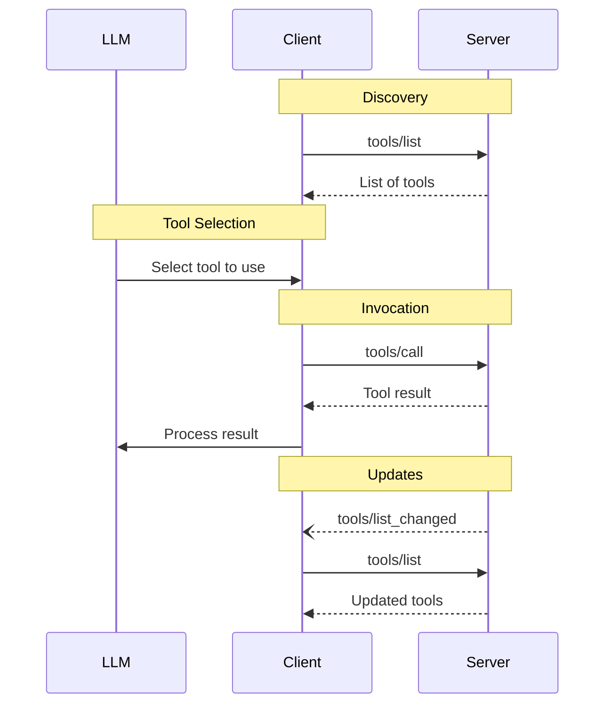

# MCP 工具规范（2025-06-18 版）

规定工具列表与调用、输入输出、内容、错误和安全要求，供旧协议版本实现参考。

- 来源：通用规范／MCP
- 资料类型：存档文档
- 文档时间：官网现页更新：[2026-10-11](<https://modelcontextprotocol.io/specification/2025-06-18/server/tools>)；规范版本：[2025-06-18](<https://modelcontextprotocol.io/specification/2025-06-18/server/tools>)；本地抓取：2026-10-11
- 阅读状态：完整中文机器译文，由 Google 翻译；代码、命令与配置保留原样，未逐句人工校对。

[原文发布页](<https://modelcontextprotocol.io/specification/2025-06-18/server/tools>) · [原始文件](<../../../../原始抓取备份/原文/官方/通用规范/MCP/MCP 工具规范（2025-06-18 版）.md>) · [返回资料总览](<../../../资料总览.md>)

[查看原文对照](#原文对照)

## 中文全文

> ## 文档索引
> 在以下位置获取完整的文档索引： https://modelcontextprotocol.io/llms.txt
> 在进一步探索之前使用此文件来发现所有可用页面。

# 工具

<div id="enable-section-numbers" />

Model Context Protocol (MCP) 允许服务器公开可由
语言模型调用的工具。工具使模型能够与外部系统交互，例如查询
数据库、调用API或执行计算。每个工具都由 
 名称唯一标识，并包含描述其架构的元数据。

## 用户交互模型

MCP中的工具被设计为**模型控制的**，这意味着语言模型可以
根据其上下文理解和
用户的提示自动发现和调用工具。

然而，实现可以通过任何适合其需求的接口模式
自由地公开工具——协议本身不强制要求任何特定的用户
交互模型。


**注意：**

为了信任和安全，**SHOULD** 总是
 是一个能够拒绝工具调用的循环中的人。

应用**SHOULD**：

  * 提供 UI，明确哪些工具暴露给 AI 模型
  * 调用工具时插入清晰的视觉指示器
  * 向用户提供操作确认提示，以确保有人在操作中
循环


## 能力

支持工具**MUST**的服务器声明`tools`功能：

```json theme={null}
{
  "capabilities": {
    "tools": {
      "listChanged": true
    }
  }
}
```

`listChanged`表示当
可用工具列表发生变化时，服务器是否发出通知。

## 协议消息

### 上市工具

要发现可用的工具，客户端会发送 `tools/list` 请求。该操作支持
[分页](<https://modelcontextprotocol.io/specification/2025-06-18/server/utilities/pagination>)。

**请求：**

```json theme={null}
{
  "jsonrpc": "2.0",
  "id": 1,
  "method": "tools/list",
  "params": {
    "cursor": "optional-cursor-value"
  }
}
```

**回复：**

```json theme={null}
{
  "jsonrpc": "2.0",
  "id": 1,
  "result": {
    "tools": [
      {
        "name": "get_weather",
        "title": "Weather Information Provider",
        "description": "Get current weather information for a location",
        "inputSchema": {
          "type": "object",
          "properties": {
            "location": {
              "type": "string",
              "description": "City name or zip code"
            }
          },
          "required": ["location"]
        }
      }
    ],
    "nextCursor": "next-page-cursor"
  }
}
```

### 调用工具

要调用工具，客户端发送 `tools/call` 请求：

**请求：**

```json theme={null}
{
  "jsonrpc": "2.0",
  "id": 2,
  "method": "tools/call",
  "params": {
    "name": "get_weather",
    "arguments": {
      "location": "New York"
    }
  }
}
```

**回复：**

```json theme={null}
{
  "jsonrpc": "2.0",
  "id": 2,
  "result": {
    "content": [
      {
        "type": "text",
        "text": "Current weather in New York:\nTemperature: 72°F\nConditions: Partly cloudy"
      }
    ],
    "isError": false
  }
}
```

### 列表更改通知

当可用工具列表发生更改时，声明 `listChanged`
 功能 **SHOULD** 的服务器会发送通知：

```json theme={null}
{
  "jsonrpc": "2.0",
  "method": "notifications/tools/list_changed"
}
```

## 消息流



## 数据类型

### 工具

工具定义包括：

* `name`：工具的唯一标识符
* `title`：用于显示目的的可选人类可读工具名称。
* `description`：人类可读的功能描述
* `inputSchema`: JSON 定义预期参数的架构
* `outputSchema`：可选 JSON 定义预期输出结构的架构
* `annotations`：描述工具行为的可选属性


**注意：**

为了信任和安全，客户端 **MUST** 认为 
 工具注释是不可信的，除非它们来自可信服务器。


### 工具结果

工具结果可能包含[**结构化**](<#结构化内容>)或**非结构化**内容。

**非结构化**内容在结果的`content`字段中返回，并且可以包含多个不同类型的内容项：


**注释：**

所有内容类型（文本、图像、音频、资源链接和嵌入式资源）
都支持可选的
 [注释](<https://modelcontextprotocol.io/specification/2025-06-18/server/resources#annotations>)，
提供有关受众、优先级和修改时间的元数据。这是资源和提示使用的
相同的注释格式。


#### 文字内容

```json theme={null}
{
  "type": "text",
  "text": "Tool result text"
}
```

#### 图片内容

```json theme={null}
{
  "type": "image",
  "data": "base64-encoded-data",
  "mimeType": "image/png",
  "annotations": {
    "audience": ["user"],
    "priority": 0.9
  }
}
```

此示例演示了可选注释的使用。

#### 音频内容

```json theme={null}
{
  "type": "audio",
  "data": "base64-encoded-audio-data",
  "mimeType": "audio/wav"
}
```

#### 资源链接

工具 **MAY** 返回到 [ 资源 ](<https://modelcontextprotocol.io/specification/2025-06-18/server/resources>) 的链接，以提供额外的上下文 
 或数据。在这种情况下，该工具将返回一个可由客户端订阅或获取的 URI：

```json theme={null}
{
  "type": "resource_link",
  "uri": "file:///project/src/main.rs",
  "name": "main.rs",
  "description": "Primary application entry point",
  "mimeType": "text/x-rust",
  "annotations": {
    "audience": ["assistant"],
    "priority": 0.9
  }
}
```

资源链接支持与常规资源相同的[资源注释](<https://modelcontextprotocol.io/specification/2025-06-18/server/resources#annotations>)，以帮助客户了解如何使用它们。


**说明：**

工具返回的资源链接不保证出现在 `resources/list` 请求的结果 
 中。


#### 嵌入式资源

[资源](<https://modelcontextprotocol.io/specification/2025-06-18/server/resources>) **MAY** 嵌入以提供额外的上下文
或使用合适的数据 [URI 方案](<https://modelcontextprotocol.io/specification/2025-06-18/server/resources#common-uri-schemes>)。使用嵌入式资源的服务器 **SHOULD** 实施 `resources` 能力：

```json theme={null}
{
  "type": "resource",
  "resource": {
    "uri": "file:///project/src/main.rs",
    "mimeType": "text/x-rust",
    "text": "fn main() {\n    println!(\"Hello world!\");\n}",
    "annotations": {
      "audience": ["user", "assistant"],
      "priority": 0.7,
      "lastModified": "2025-05-03T14:30:00Z"
    }
  }
}
```

嵌入式资源支持与常规资源相同的[资源注释](<https://modelcontextprotocol.io/specification/2025-06-18/server/resources#annotations>)，以帮助客户了解如何使用它们。

#### 结构化内容

**结构化**内容作为结果的`structuredContent`字段中的JSON对象返回。

为了向后兼容，返回结构化内容 SHOULD 的工具还会返回 TextContent 块中的序列化 JSON。


**注释：**

`structuredContent` 是服务器生成的结果数据，与 LLM
“结构化输出”（架构约束模型生成）无关。


#### 输出模式

工具还可以提供用于验证结构化结果的输出模式。
如果提供了输出模式：

* 服务器 **MUST** 提供符合此模式的结构化结果。
* 客户端 **SHOULD** 根据此模式验证结构化结果。

具有输出架构的示例工具：

```json theme={null}
{
  "name": "get_weather_data",
  "title": "Weather Data Retriever",
  "description": "Get current weather data for a location",
  "inputSchema": {
    "type": "object",
    "properties": {
      "location": {
        "type": "string",
        "description": "City name or zip code"
      }
    },
    "required": ["location"]
  },
  "outputSchema": {
    "type": "object",
    "properties": {
      "temperature": {
        "type": "number",
        "description": "Temperature in celsius"
      },
      "conditions": {
        "type": "string",
        "description": "Weather conditions description"
      },
      "humidity": {
        "type": "number",
        "description": "Humidity percentage"
      }
    },
    "required": ["temperature", "conditions", "humidity"]
  }
}
```

此工具的有效响应示例：

```json theme={null}
{
  "jsonrpc": "2.0",
  "id": 5,
  "result": {
    "content": [
      {
        "type": "text",
        "text": "{\"temperature\": 22.5, \"conditions\": \"Partly cloudy\", \"humidity\": 65}"
      }
    ],
    "structuredContent": {
      "temperature": 22.5,
      "conditions": "Partly cloudy",
      "humidity": 65
    }
  }
}
```

提供输出模式可帮助客户和法学硕士通过以下方式理解并正确处理结构化工具输出：

* 启用响应的严格模式验证
* 提供类型信息以更好地与编程语言集成
* 指导客户和法学硕士正确解析和利用返回的数据
* 支持更好的文档和开发人员体验

## 错误处理

工具使用两种错误报告机制：

1. **协议错误**：标准JSON-RPC错误，例如：
   * 未知工具
   * 无效参数
   * 服务器错误

2. **工具执行错误**：在工具结果中报告为`isError: true`：
   * API 故障
   * 输入数据无效
   * 业务逻辑错误

协议错误示例：

```json theme={null}
{
  "jsonrpc": "2.0",
  "id": 3,
  "error": {
    "code": -32602,
    "message": "Unknown tool: invalid_tool_name"
  }
}
```

工具执行错误示例：

```json theme={null}
{
  "jsonrpc": "2.0",
  "id": 4,
  "result": {
    "content": [
      {
        "type": "text",
        "text": "Failed to fetch weather data: API rate limit exceeded"
      }
    ],
    "isError": true
  }
}
```

## 安全考虑

1. 服务器**MUST**：
   * 验证所有工具输入
   * 实施适当的访问控制
   * 速率限制工具调用
   * 清理工具输出

2. 客户**SHOULD**：
   * 敏感操作提示用户确认
   * 在调用服务器之前向用户显示工具输入，以避免恶意或
意外数据泄露
   * 在传递到 LLM 之前验证工具结果
   * 为工具调用实施超时
   * 出于审计目的记录工具的使用情况


## 原文对照

<details>
<summary>展开完整原文</summary>

> ## Documentation Index
> Fetch the complete documentation index at: https://modelcontextprotocol.io/llms.txt
> Use this file to discover all available pages before exploring further.

# Tools

<div id="enable-section-numbers" />

The Model Context Protocol (MCP) allows servers to expose tools that can be invoked by
language models. Tools enable models to interact with external systems, such as querying
databases, calling APIs, or performing computations. Each tool is uniquely identified by
a name and includes metadata describing its schema.

## User Interaction Model

Tools in MCP are designed to be **model-controlled**, meaning that the language model can
discover and invoke tools automatically based on its contextual understanding and the
user's prompts.

However, implementations are free to expose tools through any interface pattern that
suits their needs—the protocol itself does not mandate any specific user
interaction model.


**注意：**

  For trust & safety and security, there **SHOULD** always
  be a human in the loop with the ability to deny tool invocations.

  Applications **SHOULD**:

  * Provide UI that makes clear which tools are being exposed to the AI model
  * Insert clear visual indicators when tools are invoked
  * Present confirmation prompts to the user for operations, to ensure a human is in the
    loop


## Capabilities

Servers that support tools **MUST** declare the `tools` capability:

```json theme={null}
{
  "capabilities": {
    "tools": {
      "listChanged": true
    }
  }
}
```

`listChanged` indicates whether the server will emit notifications when the list of
available tools changes.

## Protocol Messages

### Listing Tools

To discover available tools, clients send a `tools/list` request. This operation supports
[pagination](<https://modelcontextprotocol.io/specification/2025-06-18/server/utilities/pagination>).

**Request:**

```json theme={null}
{
  "jsonrpc": "2.0",
  "id": 1,
  "method": "tools/list",
  "params": {
    "cursor": "optional-cursor-value"
  }
}
```

**Response:**

```json theme={null}
{
  "jsonrpc": "2.0",
  "id": 1,
  "result": {
    "tools": [
      {
        "name": "get_weather",
        "title": "Weather Information Provider",
        "description": "Get current weather information for a location",
        "inputSchema": {
          "type": "object",
          "properties": {
            "location": {
              "type": "string",
              "description": "City name or zip code"
            }
          },
          "required": ["location"]
        }
      }
    ],
    "nextCursor": "next-page-cursor"
  }
}
```

### Calling Tools

To invoke a tool, clients send a `tools/call` request:

**Request:**

```json theme={null}
{
  "jsonrpc": "2.0",
  "id": 2,
  "method": "tools/call",
  "params": {
    "name": "get_weather",
    "arguments": {
      "location": "New York"
    }
  }
}
```

**Response:**

```json theme={null}
{
  "jsonrpc": "2.0",
  "id": 2,
  "result": {
    "content": [
      {
        "type": "text",
        "text": "Current weather in New York:\nTemperature: 72°F\nConditions: Partly cloudy"
      }
    ],
    "isError": false
  }
}
```

### List Changed Notification

When the list of available tools changes, servers that declared the `listChanged`
capability **SHOULD** send a notification:

```json theme={null}
{
  "jsonrpc": "2.0",
  "method": "notifications/tools/list_changed"
}
```

## Message Flow


## Data Types

### Tool

A tool definition includes:

* `name`: Unique identifier for the tool
* `title`: Optional human-readable name of the tool for display purposes.
* `description`: Human-readable description of functionality
* `inputSchema`: JSON Schema defining expected parameters
* `outputSchema`: Optional JSON Schema defining expected output structure
* `annotations`: optional properties describing tool behavior


**注意：**

  For trust & safety and security, clients **MUST** consider
  tool annotations to be untrusted unless they come from trusted servers.


### Tool Result

Tool results may contain [**structured**](<#structured-content>) or **unstructured** content.

**Unstructured** content is returned in the `content` field of a result, and can contain multiple content items of different types:


**注释：**

  All content types (text, image, audio, resource links, and embedded resources)
  support optional
  [annotations](<https://modelcontextprotocol.io/specification/2025-06-18/server/resources#annotations>) that
  provide metadata about audience, priority, and modification times. This is the
  same annotation format used by resources and prompts.


#### Text Content

```json theme={null}
{
  "type": "text",
  "text": "Tool result text"
}
```

#### Image Content

```json theme={null}
{
  "type": "image",
  "data": "base64-encoded-data",
  "mimeType": "image/png",
  "annotations": {
    "audience": ["user"],
    "priority": 0.9
  }
}
```

This example demonstrates the use of an optional Annotation.

#### Audio Content

```json theme={null}
{
  "type": "audio",
  "data": "base64-encoded-audio-data",
  "mimeType": "audio/wav"
}
```

#### Resource Links

A tool **MAY** return links to [Resources](<https://modelcontextprotocol.io/specification/2025-06-18/server/resources>), to provide additional context
or data. In this case, the tool will return a URI that can be subscribed to or fetched by the client:

```json theme={null}
{
  "type": "resource_link",
  "uri": "file:///project/src/main.rs",
  "name": "main.rs",
  "description": "Primary application entry point",
  "mimeType": "text/x-rust",
  "annotations": {
    "audience": ["assistant"],
    "priority": 0.9
  }
}
```

Resource links support the same [Resource annotations](<https://modelcontextprotocol.io/specification/2025-06-18/server/resources#annotations>) as regular resources to help clients understand how to use them.


**说明：**

  Resource links returned by tools are not guaranteed to appear in the results
  of a `resources/list` request.


#### Embedded Resources

[Resources](<https://modelcontextprotocol.io/specification/2025-06-18/server/resources>) **MAY** be embedded to provide additional context
or data using a suitable [URI scheme](<https://modelcontextprotocol.io/specification/2025-06-18/server/resources#common-uri-schemes>). Servers that use embedded resources **SHOULD** implement the `resources` capability:

```json theme={null}
{
  "type": "resource",
  "resource": {
    "uri": "file:///project/src/main.rs",
    "mimeType": "text/x-rust",
    "text": "fn main() {\n    println!(\"Hello world!\");\n}",
    "annotations": {
      "audience": ["user", "assistant"],
      "priority": 0.7,
      "lastModified": "2025-05-03T14:30:00Z"
    }
  }
}
```

Embedded resources support the same [Resource annotations](<https://modelcontextprotocol.io/specification/2025-06-18/server/resources#annotations>) as regular resources to help clients understand how to use them.

#### Structured Content

**Structured** content is returned as a JSON object in the `structuredContent` field of a result.

For backwards compatibility, a tool that returns structured content SHOULD also return the serialized JSON in a TextContent block.


**注释：**

  `structuredContent` is server-produced result data and is unrelated to LLM
  "structured outputs" (schema-constrained model generation).


#### Output Schema

Tools may also provide an output schema for validation of structured results.
If an output schema is provided:

* Servers **MUST** provide structured results that conform to this schema.
* Clients **SHOULD** validate structured results against this schema.

Example tool with output schema:

```json theme={null}
{
  "name": "get_weather_data",
  "title": "Weather Data Retriever",
  "description": "Get current weather data for a location",
  "inputSchema": {
    "type": "object",
    "properties": {
      "location": {
        "type": "string",
        "description": "City name or zip code"
      }
    },
    "required": ["location"]
  },
  "outputSchema": {
    "type": "object",
    "properties": {
      "temperature": {
        "type": "number",
        "description": "Temperature in celsius"
      },
      "conditions": {
        "type": "string",
        "description": "Weather conditions description"
      },
      "humidity": {
        "type": "number",
        "description": "Humidity percentage"
      }
    },
    "required": ["temperature", "conditions", "humidity"]
  }
}
```

Example valid response for this tool:

```json theme={null}
{
  "jsonrpc": "2.0",
  "id": 5,
  "result": {
    "content": [
      {
        "type": "text",
        "text": "{\"temperature\": 22.5, \"conditions\": \"Partly cloudy\", \"humidity\": 65}"
      }
    ],
    "structuredContent": {
      "temperature": 22.5,
      "conditions": "Partly cloudy",
      "humidity": 65
    }
  }
}
```

Providing an output schema helps clients and LLMs understand and properly handle structured tool outputs by:

* Enabling strict schema validation of responses
* Providing type information for better integration with programming languages
* Guiding clients and LLMs to properly parse and utilize the returned data
* Supporting better documentation and developer experience

## Error Handling

Tools use two error reporting mechanisms:

1. **Protocol Errors**: Standard JSON-RPC errors for issues like:
   * Unknown tools
   * Invalid arguments
   * Server errors

2. **Tool Execution Errors**: Reported in tool results with `isError: true`:
   * API failures
   * Invalid input data
   * Business logic errors

Example protocol error:

```json theme={null}
{
  "jsonrpc": "2.0",
  "id": 3,
  "error": {
    "code": -32602,
    "message": "Unknown tool: invalid_tool_name"
  }
}
```

Example tool execution error:

```json theme={null}
{
  "jsonrpc": "2.0",
  "id": 4,
  "result": {
    "content": [
      {
        "type": "text",
        "text": "Failed to fetch weather data: API rate limit exceeded"
      }
    ],
    "isError": true
  }
}
```

## Security Considerations

1. Servers **MUST**:
   * Validate all tool inputs
   * Implement proper access controls
   * Rate limit tool invocations
   * Sanitize tool outputs

2. Clients **SHOULD**:
   * Prompt for user confirmation on sensitive operations
   * Show tool inputs to the user before calling the server, to avoid malicious or
     accidental data exfiltration
   * Validate tool results before passing to LLM
   * Implement timeouts for tool calls
   * Log tool usage for audit purposes


</details>
