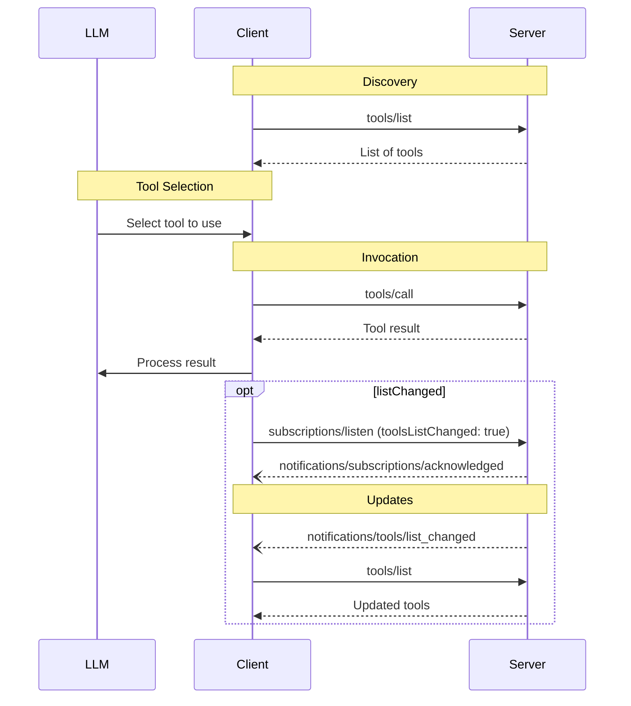

# MCP 工具规范（2026-07-28 版）

定义工具发现调用、请求元数据、需要补充输入的结果及字段要求，说明与旧版不同的接口内容。

- 来源：通用规范／MCP
- 资料类型：存档文档
- 文档时间：官网现页更新：[2026-10-11](<https://modelcontextprotocol.io/specification/2026-07-28/server/tools>)；规范版本：[2026-07-28](<https://modelcontextprotocol.io/specification/2026-07-28/server/tools>)；本地抓取：2026-10-11
- 阅读状态：完整中文机器译文，由 Google 翻译；代码、命令与配置保留原样，未逐句人工校对。

[原文发布页](<https://modelcontextprotocol.io/specification/2026-07-28/server/tools>) · [原始文件](<../../../../原始抓取备份/原文/官方/通用规范/MCP/MCP 工具规范（2026-07-28 版）.md>) · [返回资料总览](<../../../资料总览.md>)

[查看原文对照](#原文对照)

## 中文全文

> ## 文档索引
> 在以下位置获取完整的文档索引： https://modelcontextprotocol.io/llms.txt
> 在进一步探索之前使用此文件来发现所有可用页面。

# 工具

<div id="enable-section-numbers" />

Model Context Protocol (MCP) 允许服务器公开可由
语言模型调用的工具。工具使模型能够与外部系统交互，例如查询
数据库、调用API或执行计算。每个工具都由 
 名称唯一标识，并包含描述其架构的元数据。


**注释：**

为简洁起见，本页面上的请求示例省略了 `_meta` 请求 
 元数据（`io.modelcontextprotocol/protocolVersion`、
 `io.modelcontextprotocol/clientInfo` 和 
 `io.modelcontextprotocol/clientCapabilities`）。每个请求**MUST**都包含
所需的`_meta`字段；参见
 [`_meta`](<https://modelcontextprotocol.io/specification/2026-07-28/basic/index#meta>)。


## 用户交互模型

MCP中的工具被设计为**模型控制的**，这意味着语言模型可以
根据其上下文理解和
用户的提示自动发现和调用工具。

然而，实现可以通过任何适合其需求的接口模式
自由地公开工具——协议本身不强制要求任何特定的用户
交互模型。


**注意：**

为了信任和安全，**SHOULD** 总是
 是一个能够拒绝工具调用的循环中的人。

应用**SHOULD**：

  * 提供 UI，明确哪些工具暴露给 AI 模型
  * 调用工具时插入清晰的视觉指示器
  * 向用户提供操作确认提示，以确保有人在操作中
循环


## 能力

支持工具**MUST**的服务器声明`tools`功能：

```json theme={null}
{
  "capabilities": {
    "tools": {
      "listChanged": true
    }
  }
}
```

`listChanged`表示当
可用工具列表发生变化时，服务器是否发出通知。

声明 `tools` 功能 **MUST** 的服务器使用请求客户端当前可用的工具集响应 `tools/list` 请求 
。该集合 **MAY** 为 
 为空，并且 **MAY** 随时间变化（参见
[列表更改通知](<#列表更改通知>)），但 **MUST NOT**每个连接都有不同的
或作为连接上其他请求的副作用。集合 
**MAY** 根据请求上提供的授权而变化 - 例如，仅返回 
 调用者授予范围允许的工具 - 因为凭据是 
 每个请求输入，而不是连接状态。

服务器 **SHOULD** 以确定的顺序返回工具（即，当底层工具集未更改时，
 请求之间的顺序相同）。确定性排序使 
 客户端能够可靠地缓存工具列表，并在工具 
 包含在模型上下文中时提高 LLM 提示缓存命中率。

## 协议消息

### 上市工具

要发现可用的工具，客户端会发送 `tools/list` 请求。此操作支持
[分页](<https://modelcontextprotocol.io/specification/2026-07-28/server/utilities/pagination>)和[缓存](<https://modelcontextprotocol.io/specification/2026-07-28/server/utilities/caching>)。

**请求：**

```json theme={null}
{
  "jsonrpc": "2.0",
  "id": 1,
  "method": "tools/list",
  "params": {
    "cursor": "optional-cursor-value"
  }
}
```

**回复：**

```json theme={null}
{
  "jsonrpc": "2.0",
  "id": 1,
  "result": {
    "resultType": "complete",
    "tools": [
      {
        "name": "get_weather",
        "title": "Weather Information Provider",
        "description": "Get current weather information for a location",
        "inputSchema": {
          "type": "object",
          "properties": {
            "location": {
              "type": "string",
              "description": "City name or zip code"
            }
          },
          "required": ["location"]
        },
        "icons": [
          {
            "src": "https://example.com/weather-icon.png",
            "mimeType": "image/png",
            "sizes": ["48x48"]
          }
        ]
      }
    ],
    "nextCursor": "next-page-cursor",
    "ttlMs": 300000,
    "cacheScope": "public"
  }
}
```

### 调用工具

要调用工具，客户端发送 `tools/call` 请求：

**请求：**

```json theme={null}
{
  "jsonrpc": "2.0",
  "id": 2,
  "method": "tools/call",
  "params": {
    "name": "get_weather",
    "arguments": {
      "location": "New York"
    }
  }
}
```

**回复：**

```json theme={null}
{
  "jsonrpc": "2.0",
  "id": 2,
  "result": {
    "resultType": "complete",
    "content": [
      {
        "type": "text",
        "text": "Current weather in New York:\nTemperature: 72°F\nConditions: Partly cloudy"
      }
    ],
    "isError": false
  }
}
```

### 输入所需的工具结果

服务器 **MAY** 使用 [`InputRequiredResult`](<https://modelcontextprotocol.io/specification/2026-07-28/basic/patterns/mrtr#inputrequiredresult>) 响应 `tools/call`，以指示在完成工具调用之前需要附加输入。这遵循[多往返请求](<https://modelcontextprotocol.io/specification/2026-07-28/basic/patterns/mrtr#multi-round-trip-requests>)机制。

当使用输入响应重试请求时，客户端在请求参数中包含 `inputResponses` 和 `requestState`（如果服务器提供）：

**输入所需响应：**

```json theme={null}
{
  "jsonrpc": "2.0",
  "id": 2,
  "result": {
    "resultType": "input_required",
    "inputRequests": {
      "github_login": {
        "method": "elicitation/create",
        "params": {
          "mode": "form",
          "message": "Please provide your GitHub username",
          "requestedSchema": {
            "type": "object",
            "properties": {
              "name": { "type": "string" }
            },
            "required": ["name"]
          }
        }
      }
    },
    "requestState": "eyJsb2NhdGlvbiI6Ik5ldyBZb3JrIn0..."
  }
}
```

**使用输入响应重试：**

```json theme={null}
{
  "jsonrpc": "2.0",
  "id": 3,
  "method": "tools/call",
  "params": {
    "name": "get_weather",
    "arguments": {
      "location": "New York"
    },
    "inputResponses": {
      "github_login": {
        "action": "accept",
        "content": {
          "name": "octocat"
        }
      }
    },
    "requestState": "eyJsb2NhdGlvbiI6Ik5ldyBZb3JrIn0..."
  }
}
```

请注意，初始请求和重试之间的 JSON-RPC `id` **MUST** 是不同的。

### 列表更改通知

当可用工具列表发生变化时，声明了该工具的服务器 `listChanged`
能力 **SHOULD** 向已打开的客户发送通知
[`subscriptions/listen`](<https://modelcontextprotocol.io/specification/2026-07-28/basic/patterns/subscriptions>) 流式传输
`toolsListChanged: true`:

```json theme={null}
{
  "jsonrpc": "2.0",
  "method": "notifications/tools/list_changed"
}
```

## 消息流



## 数据类型

### 工具

工具定义包括：

* `name`：工具的唯一标识符
* `title`：用于显示目的的可选人类可读工具名称。
* `description`：人类可读的功能描述
* `icons`：用于在用户界面中显示的可选图标数组
* `inputSchema`: JSON 定义预期参数的架构
  * 遵循 [JSON 架构使用指南 ](<https://modelcontextprotocol.io/specification/2026-07-28/basic#json-schema-usage>)
  * 如果不存在 `$schema` 字段，则默认为 2020-12
  * **MUST** 是有效的 JSON 架构对象（不是 `null`）
  * 对于没有参数的工具，请使用以下有效方法之一：
    * `{ "type": "object", "additionalProperties": false }` - **推荐**：明确仅接受空对象
    * `{ "type": "object" }` - 接受任何对象（包括带有属性）
  * 属性 **MAY** 包含用于公开的 [`x-mcp-header`](<#x-mcp-标头>) 注释
参数值作为 HTTP 标头
* `outputSchema`：可选 JSON 定义预期输出结构的架构
  * 遵循 [JSON 架构使用指南 ](<https://modelcontextprotocol.io/specification/2026-07-28/basic#json-schema-usage>)
  * 如果不存在 `$schema` 字段，则默认为 2020-12
* `annotations`：描述工具行为的可选属性


**注意：**

为了信任和安全，客户端 **MUST** 认为 
 的工具注释是不可信的，除非它们来自可信服务器。


#### 工具名称

* 工具名称 **SHOULD** 的长度在 1 和 128 个字符之间（含）。
* 工具名称 **SHOULD** 被视为区分大小写。
* 以下 **SHOULD** 是唯一允许的字符：大写和小写 ASCII 字母（A-Z，a-z）、数字
(0-9)、下划线 (\_)、连字符 (-) 和点 (.)
* 工具名称 **SHOULD NOT** 包含空格、逗号或其他特殊字符。
* 工具名称 **SHOULD** 在服务器内是唯一的。
* 有效工具名称示例：
  * `getUser`
  * `DATA_EXPORT_v2`
  * `admin.tools.list`


**注释：**

工具名称唯一性仅限于单个服务器。 
 聚合来自多个服务器 **MAY** 的工具的客户端或代理遇到命名冲突（对于 
 示例，两台服务器各公开一个 `search` 工具）和 **SHOULD** 实现 
 消歧策略，例如在工具名称前添加服务器前缀标识符。

服务器 `name`（来自 `serverInfo`）不保证在 
 服务器之间是唯一的，并且可以依赖 **SHOULD NOT** 来消除歧义。


#### x-mcp 标头

的 `x-mcp-header` 扩展属性允许服务器指定特定的工具
要镜像的参数 HTTP 使用时的标头
[可串流 HTTP 运输](<https://modelcontextprotocol.io/specification/2026-07-28/basic/transports/streamable-http#custom-headers-from-tool-parameters>).
这使得网络中介（负载均衡器、代理、WAF）能够路由和处理
基于参数值的请求，而不解析请求体。

`x-mcp-header` 属性直接放置在要镜像 
 的属性的 JSON 架构内。它的值指定生成的 `Mcp-Param-{name}`
HTTP 标头的名称部分。

**对`x-mcp-header`值的约束：**

* **MUST NOT** 为空
* **MUST** 匹配 HTTP 字段名称标记语法（`1*tchar`、[RFC 9110 节 5.1](<https://datatracker.ietf.org/doc/html/rfc9110#section-5.1>)）
* **MUST NOT** 包含控制字符，包括回车符（CR、`\r`）或
换行（LF、`\n`）
* **MUST** 在所有 `x-mcp-header` 值中不区分大小写是唯一的
  `inputSchema`
* **MUST** 仅适用于基本类型（整数、字符串、布尔值）的参数。
不允许使用类型为 `number` 的参数。整数值 **MUST** 在使用 IEEE754 双精度浮点数表示的整数的 
 安全范围内（−2<sup>53</sup>+1 到 2<sup>53</sup>−1）
* **MUST** 仅适用于架构中 * 可静态访问 * 的属性
root，如
 [来自工具参数的自定义标头](<https://modelcontextprotocol.io/specification/2026-07-28/basic/transports/streamable-http#custom-headers-from-tool-parameters>)、
中定义，它还定义了如何从调用参数中提取标头值

使用 Streamable HTTP 传输 **MUST** 的客户端会拒绝任何 
`x-mcp-header` 值违反这些约束的工具定义。拒绝意味着客户端**MUST**
从`tools/list`的结果中排除无效工具。客户端 **SHOULD** 在拒绝工具定义时记录 
 警告，包括工具名称和 
 拒绝的原因。这可确保单个格式错误的工具定义不会阻止其他
有效工具的使用。使用其他传输（例如 stdio）的客户端 **MAY** 完全忽略 
`x-mcp-header` 注释。

**使用 `x-mcp-header` 的刀具定义示例：**

```json theme={null}
{
  "name": "execute_sql",
  "description": "Execute SQL on Google Cloud Spanner",
  "inputSchema": {
    "type": "object",
    "properties": {
      "region": {
        "type": "string",
        "description": "The region to execute the query in",
        "x-mcp-header": "Region"
      },
      "query": {
        "type": "string",
        "description": "The SQL query to execute"
      }
    },
    "required": ["region", "query"]
  }
}
```

在此示例中，当使用 `"region": "us-west1"` 调用该工具时，客户端会将 
 标头 `Mcp-Param-Region: us-west1` 添加到 HTTP 请求中。


**注意：**

服务器开发人员 **SHOULD NOT** 使用 `x-mcp-header` 标记敏感参数（密码、API 密钥、令牌、
 PII），因为标头值对网络中介可见。


### 工具结果

工具结果可能包含[**结构化**](<#结构化内容>)或**非结构化**内容。

**非结构化**内容在结果的`content`字段中返回，并且可以包含多个不同类型的内容项：


**注释：**

所有内容类型（文本、图像、音频、资源链接和嵌入式资源）
都支持可选的
 [注释](<https://modelcontextprotocol.io/specification/2026-07-28/server/resources#annotations>)，
提供有关受众、优先级和修改时间的元数据。这是资源和提示使用的
相同的注释格式。


#### 文字内容

```json theme={null}
{
  "type": "text",
  "text": "Tool result text"
}
```

#### 图片内容

```json theme={null}
{
  "type": "image",
  "data": "base64-encoded-data",
  "mimeType": "image/png",
  "annotations": {
    "audience": ["user"],
    "priority": 0.9
  }
}
```

#### 音频内容

```json theme={null}
{
  "type": "audio",
  "data": "base64-encoded-audio-data",
  "mimeType": "audio/wav"
}
```

#### 资源链接

工具 **MAY** 返回到 [ 资源 ](<https://modelcontextprotocol.io/specification/2026-07-28/server/resources>) 的链接，以提供额外的上下文 
 或数据。在这种情况下，该工具将返回一个可由客户端订阅或获取的 URI：

```json theme={null}
{
  "type": "resource_link",
  "uri": "file:///project/src/main.rs",
  "name": "main.rs",
  "description": "Primary application entry point",
  "mimeType": "text/x-rust"
}
```

资源链接支持与常规资源相同的[资源注释](<https://modelcontextprotocol.io/specification/2026-07-28/server/resources#annotations>)，以帮助客户了解如何使用它们。


**说明：**

工具返回的资源链接不保证出现在 `resources/list` 请求的结果 
 中。


#### 嵌入式资源

[资源](<https://modelcontextprotocol.io/specification/2026-07-28/server/resources>) **MAY** 嵌入以提供额外的上下文
或使用合适的数据 [URI 方案](<https://modelcontextprotocol.io/specification/2026-07-28/server/resources#common-uri-schemes>)。使用嵌入式资源的服务器 **SHOULD** 实施 `resources` 能力：

```json theme={null}
{
  "type": "resource",
  "resource": {
    "uri": "file:///project/src/main.rs",
    "mimeType": "text/x-rust",
    "text": "fn main() {\n    println!(\"Hello world!\");\n}",
    "annotations": {
      "audience": ["user", "assistant"],
      "priority": 0.7,
      "lastModified": "2025-05-03T14:30:00Z"
    }
  }
}
```

嵌入式资源支持与常规资源相同的[资源注释](<https://modelcontextprotocol.io/specification/2026-07-28/server/resources#annotations>)，以帮助客户了解如何使用它们。

#### 结构化内容

**结构化**内容作为结果的`structuredContent`字段中的JSON值返回。这可以是符合工具的 `outputSchema` 的任何 JSON 值（对象、数组、字符串、数字、布尔值或 null）（如果已定义）。

为了向后兼容，返回结构化内容 SHOULD 的工具还会返回 TextContent 块中的序列化 JSON。


**注释：**

`structuredContent` 是服务器生成的结果数据，与 LLM
“结构化输出”（架构约束模型生成）无关。


#### 输出模式

工具还可以提供用于验证结构化结果的输出模式。
如果提供了输出模式：

* 服务器 **MUST** 提供符合此模式的结构化结果。
* 客户端 **SHOULD** 根据此模式验证结构化结果。

具有输出架构的示例工具：

```json theme={null}
{
  "name": "get_weather_data",
  "title": "Weather Data Retriever",
  "description": "Get current weather data for a location",
  "inputSchema": {
    "type": "object",
    "properties": {
      "location": {
        "type": "string",
        "description": "City name or zip code"
      }
    },
    "required": ["location"]
  },
  "outputSchema": {
    "type": "object",
    "properties": {
      "temperature": {
        "type": "number",
        "description": "Temperature in celsius"
      },
      "conditions": {
        "type": "string",
        "description": "Weather conditions description"
      },
      "humidity": {
        "type": "number",
        "description": "Humidity percentage"
      }
    },
    "required": ["temperature", "conditions", "humidity"]
  }
}
```

此工具的有效响应示例：

```json theme={null}
{
  "jsonrpc": "2.0",
  "id": 5,
  "result": {
    "resultType": "complete",
    "content": [
      {
        "type": "text",
        "text": "{\"temperature\": 22.5, \"conditions\": \"Partly cloudy\", \"humidity\": 65}"
      }
    ],
    "structuredContent": {
      "temperature": 22.5,
      "conditions": "Partly cloudy",
      "humidity": 65
    }
  }
}
```

具有数组输出模式的示例工具：

```json theme={null}
{
  "name": "list_users",
  "title": "User List",
  "description": "Returns a list of all users",
  "inputSchema": {
    "type": "object",
    "properties": {}
  },
  "outputSchema": {
    "type": "array",
    "items": {
      "type": "object",
      "properties": {
        "id": { "type": "string" },
        "name": { "type": "string" },
        "email": { "type": "string" }
      },
      "required": ["id", "name", "email"]
    }
  }
}
```

具有数组输出的工具的有效响应示例：

```json theme={null}
{
  "jsonrpc": "2.0",
  "id": 6,
  "result": {
    "resultType": "complete",
    "content": [
      {
        "type": "text",
        "text": "Found 2 users: Alice (alice@example.com) and Bob (bob@example.com)."
      }
    ],
    "structuredContent": [
      { "id": "1", "name": "Alice", "email": "alice@example.com" },
      { "id": "2", "name": "Bob", "email": "bob@example.com" }
    ]
  }
}
```

提供输出模式可帮助客户和法学硕士通过以下方式理解并正确处理结构化工具输出：

* 启用响应的严格模式验证
* 提供类型信息以更好地与编程语言集成
* 指导客户和法学硕士正确解析和利用返回的数据
* 支持更好的文档和开发人员体验

### 模式示例

#### 具有默认 2020-12 架构的工具：

```json theme={null}
{
  "name": "calculate_sum",
  "description": "Add two numbers",
  "inputSchema": {
    "type": "object",
    "properties": {
      "a": { "type": "number" },
      "b": { "type": "number" }
    },
    "required": ["a", "b"]
  }
}
```

#### 具有显式草稿-07架构的工具：

```json theme={null}
{
  "name": "calculate_sum",
  "description": "Add two numbers",
  "inputSchema": {
    "$schema": "http://json-schema.org/draft-07/schema#",
    "type": "object",
    "properties": {
      "a": { "type": "number" },
      "b": { "type": "number" }
    },
    "required": ["a", "b"]
  }
}
```

#### 没有参数的工具：

```json theme={null}
{
  "name": "get_current_time",
  "description": "Returns the current server time",
  "inputSchema": {
    "type": "object",
    "additionalProperties": false
  }
}
```

## 有状态工具


**注释：**

本节是工具设计的非规范指南。该协议没有
状态句柄的概念；从线路的角度来看，句柄是工具结果中的普通 
 字符串，也是后续工具调用的普通参数。


MCP 没有协议级会话，因此服务器不能依赖隐式 
 每个连接状态将一个工具调用与下一个工具调用相关联。需要
跨调用维护状态的服务器——购物车、打开的浏览器上下文、
数据库事务——应该通过从
创建工具返回显式句柄并接受该句柄作为后续调用的参数来实现。

例如，管理购物车的服务器可能会公开：

```jsonc theme={null}
// → tools/call
{ "name": "create_basket", "arguments": {} }

// ← result
{
  "content": [{ "type": "text", "text": "Created basket bsk_a1b2c3" }],
  "structuredContent": { "basket_id": "bsk_a1b2c3" }
}

// → tools/call
{
  "name": "add_item",
  "arguments": { "basket_id": "bsk_a1b2c3", "sku": "..." }
}
```

该模型负责承载`basket_id`前进；服务器将
购物车内容存储在该键下，并在每次调用时查找它们。

在设计句柄时，服务器应考虑：

* **授权。** 对于经过身份验证的服务器，句柄是名称，而不是
能力。服务器应在每次调用时根据 
 句柄验证调用者的授权。对于未经身份验证的服务器，其中句柄是
必然是不记名令牌，它应该使用足够的熵
（例如，UUIDv4）生成并给出有限的生命周期。
* **不透明度。**对内部结构进行编码的句柄邀请解析或
猜测；不透明标识符则不然。
* **Lifetime。**因为句柄比任何单个连接都存活，所以服务器的
保留策略应在创建工具的描述中说明（例如，
“篮子在24不活动小时后过期”），以便模型在
决定创建状态时可以看到它。
* **过期错误。**针对过期或未知句柄的调用应返回
工具执行错误如此说明，因此模型可以通过创建一个新的 
 来恢复。

## 错误处理

工具使用两种错误报告机制：

1. **协议错误**表示请求结构本身存在模型不太可能修复的问题：

   * 未知工具
   * 格式错误的请求（无法满足 [CallToolRequest 架构 ](<https://modelcontextprotocol.io/specification/2026-07-28/schema#calltoolrequest>) 的请求）
   * 服务器错误

它们作为标准 JSON-RPC 错误返回：

   ```json theme={null}
   {
     "jsonrpc": "2.0",
     "id": 3,
     "error": {
       "code": -32602,
       "message": "Unknown tool: invalid_tool_name"
     }
   }
   ```

2. **工具执行错误**包含可操作的反馈，语言模型可以使用这些反馈进行自我纠正并通过调整的参数重试：

   * API 故障
   * 输入验证错误（例如，日期格式错误、值超出范围）
   * 业务逻辑错误

它们在工具结果中报告为 `isError: true`：

   ```json theme={null}
   {
     "jsonrpc": "2.0",
     "id": 4,
     "result": {
       "resultType": "complete",
       "content": [
         {
           "type": "text",
           "text": "Invalid departure date: must be in the future. Current date is 08/08/2025."
         }
       ],
       "isError": true
     }
   }
   ```

客户端 **MAY** 向语言模型提供协议错误，尽管这些错误不太可能导致成功恢复。
 客户端 **SHOULD** 向语言模型提供工具执行错误以实现自我纠正。

## 安全考虑

1. 服务器**MUST**：
   * 验证所有工具输入
   * 实施适当的访问控制
   * 速率限制工具调用
   * 清理工具输出

2. 客户**SHOULD**：
   * 敏感操作提示用户确认
   * 在调用服务器之前向用户显示工具输入，以避免恶意或
意外数据泄露
   * 在传递到 LLM 之前验证工具结果
   * 遵循[`$ref`分辨率要求](<https://modelcontextprotocol.io/specification/2026-07-28/basic/index#ref-resolution>)
根据 `inputSchema` 和 `outputSchema` 验证工具输入和输出时
   * 为工具调用实施超时
   * 出于审计目的记录工具的使用情况


## 原文对照

<details>
<summary>展开完整原文</summary>

> ## Documentation Index
> Fetch the complete documentation index at: https://modelcontextprotocol.io/llms.txt
> Use this file to discover all available pages before exploring further.

# Tools

<div id="enable-section-numbers" />

The Model Context Protocol (MCP) allows servers to expose tools that can be invoked by
language models. Tools enable models to interact with external systems, such as querying
databases, calling APIs, or performing computations. Each tool is uniquely identified by
a name and includes metadata describing its schema.


**注释：**

  For brevity, the request examples on this page omit the `_meta` request
  metadata (`io.modelcontextprotocol/protocolVersion`,
  `io.modelcontextprotocol/clientInfo`, and
  `io.modelcontextprotocol/clientCapabilities`). Every request **MUST** include
  the required `_meta` fields; see
  [`_meta`](<https://modelcontextprotocol.io/specification/2026-07-28/basic/index#meta>).


## User Interaction Model

Tools in MCP are designed to be **model-controlled**, meaning that the language model can
discover and invoke tools automatically based on its contextual understanding and the
user's prompts.

However, implementations are free to expose tools through any interface pattern that
suits their needs—the protocol itself does not mandate any specific user
interaction model.


**注意：**

  For trust & safety and security, there **SHOULD** always
  be a human in the loop with the ability to deny tool invocations.

  Applications **SHOULD**:

  * Provide UI that makes clear which tools are being exposed to the AI model
  * Insert clear visual indicators when tools are invoked
  * Present confirmation prompts to the user for operations, to ensure a human is in the
    loop


## Capabilities

Servers that support tools **MUST** declare the `tools` capability:

```json theme={null}
{
  "capabilities": {
    "tools": {
      "listChanged": true
    }
  }
}
```

`listChanged` indicates whether the server will emit notifications when the list of
available tools changes.

Servers that declare the `tools` capability **MUST** respond to `tools/list` requests
with the set of tools currently available to the requesting client. This set **MAY** be
empty and **MAY** change over time (see
[List Changed Notification](<#list-changed-notification>)), but **MUST NOT** vary
per-connection or as a side effect of other requests on the connection. The set
**MAY** vary by the authorization presented on the request — for example, returning
only the tools the caller's granted scopes permit — since credentials are
per-request input, not connection state.

Servers **SHOULD** return tools in a deterministic order (i.e., the same ordering across
requests when the underlying set of tools has not changed). Deterministic ordering enables
clients to reliably cache the tool list and improves LLM prompt cache hit rates when tools
are included in model context.

## Protocol Messages

### Listing Tools

To discover available tools, clients send a `tools/list` request. This operation supports
[pagination](<https://modelcontextprotocol.io/specification/2026-07-28/server/utilities/pagination>) and [caching](<https://modelcontextprotocol.io/specification/2026-07-28/server/utilities/caching>).

**Request:**

```json theme={null}
{
  "jsonrpc": "2.0",
  "id": 1,
  "method": "tools/list",
  "params": {
    "cursor": "optional-cursor-value"
  }
}
```

**Response:**

```json theme={null}
{
  "jsonrpc": "2.0",
  "id": 1,
  "result": {
    "resultType": "complete",
    "tools": [
      {
        "name": "get_weather",
        "title": "Weather Information Provider",
        "description": "Get current weather information for a location",
        "inputSchema": {
          "type": "object",
          "properties": {
            "location": {
              "type": "string",
              "description": "City name or zip code"
            }
          },
          "required": ["location"]
        },
        "icons": [
          {
            "src": "https://example.com/weather-icon.png",
            "mimeType": "image/png",
            "sizes": ["48x48"]
          }
        ]
      }
    ],
    "nextCursor": "next-page-cursor",
    "ttlMs": 300000,
    "cacheScope": "public"
  }
}
```

### Calling Tools

To invoke a tool, clients send a `tools/call` request:

**Request:**

```json theme={null}
{
  "jsonrpc": "2.0",
  "id": 2,
  "method": "tools/call",
  "params": {
    "name": "get_weather",
    "arguments": {
      "location": "New York"
    }
  }
}
```

**Response:**

```json theme={null}
{
  "jsonrpc": "2.0",
  "id": 2,
  "result": {
    "resultType": "complete",
    "content": [
      {
        "type": "text",
        "text": "Current weather in New York:\nTemperature: 72°F\nConditions: Partly cloudy"
      }
    ],
    "isError": false
  }
}
```

### Input Required Tool Results

Servers **MAY** respond to `tools/call` with an [`InputRequiredResult`](<https://modelcontextprotocol.io/specification/2026-07-28/basic/patterns/mrtr#inputrequiredresult>) to indicate that additional input is needed before the tool call can be completed. This follows the [multi round-trip requests](<https://modelcontextprotocol.io/specification/2026-07-28/basic/patterns/mrtr#multi-round-trip-requests>) mechanism.

When retrying the request with input responses, clients include `inputResponses` and, if provided by the server, `requestState` in the request parameters:

**Input Required Response:**

```json theme={null}
{
  "jsonrpc": "2.0",
  "id": 2,
  "result": {
    "resultType": "input_required",
    "inputRequests": {
      "github_login": {
        "method": "elicitation/create",
        "params": {
          "mode": "form",
          "message": "Please provide your GitHub username",
          "requestedSchema": {
            "type": "object",
            "properties": {
              "name": { "type": "string" }
            },
            "required": ["name"]
          }
        }
      }
    },
    "requestState": "eyJsb2NhdGlvbiI6Ik5ldyBZb3JrIn0..."
  }
}
```

**Retry with Input Responses:**

```json theme={null}
{
  "jsonrpc": "2.0",
  "id": 3,
  "method": "tools/call",
  "params": {
    "name": "get_weather",
    "arguments": {
      "location": "New York"
    },
    "inputResponses": {
      "github_login": {
        "action": "accept",
        "content": {
          "name": "octocat"
        }
      }
    },
    "requestState": "eyJsb2NhdGlvbiI6Ik5ldyBZb3JrIn0..."
  }
}
```

Note that the JSON-RPC `id` **MUST** be different between the initial request and the retry.

### List Changed Notification

When the list of available tools changes, servers that declared the `listChanged`
capability **SHOULD** send a notification to clients that have opened a
[`subscriptions/listen`](<https://modelcontextprotocol.io/specification/2026-07-28/basic/patterns/subscriptions>) stream with
`toolsListChanged: true`:

```json theme={null}
{
  "jsonrpc": "2.0",
  "method": "notifications/tools/list_changed"
}
```

## Message Flow


## Data Types

### Tool

A tool definition includes:

* `name`: Unique identifier for the tool
* `title`: Optional human-readable name of the tool for display purposes.
* `description`: Human-readable description of functionality
* `icons`: Optional array of icons for display in user interfaces
* `inputSchema`: JSON Schema defining expected parameters
  * Follows the [JSON Schema usage guidelines](<https://modelcontextprotocol.io/specification/2026-07-28/basic#json-schema-usage>)
  * Defaults to 2020-12 if no `$schema` field is present
  * **MUST** be a valid JSON Schema object (not `null`)
  * For tools with no parameters, use one of these valid approaches:
    * `{ "type": "object", "additionalProperties": false }` - **Recommended**: explicitly accepts only empty objects
    * `{ "type": "object" }` - accepts any object (including with properties)
  * Properties **MAY** include an [`x-mcp-header`](<#x-mcp-header>) annotation to expose
    parameter values as HTTP headers
* `outputSchema`: Optional JSON Schema defining expected output structure
  * Follows the [JSON Schema usage guidelines](<https://modelcontextprotocol.io/specification/2026-07-28/basic#json-schema-usage>)
  * Defaults to 2020-12 if no `$schema` field is present
* `annotations`: Optional properties describing tool behavior


**注意：**

  For trust & safety and security, clients **MUST** consider tool annotations to
  be untrusted unless they come from trusted servers.


#### Tool Names

* Tool names **SHOULD** be between 1 and 128 characters in length (inclusive).
* Tool names **SHOULD** be considered case-sensitive.
* The following **SHOULD** be the only allowed characters: uppercase and lowercase ASCII letters (A-Z, a-z), digits
  (0-9), underscore (\_), hyphen (-), and dot (.)
* Tool names **SHOULD NOT** contain spaces, commas, or other special characters.
* Tool names **SHOULD** be unique within a server.
* Example valid tool names:
  * `getUser`
  * `DATA_EXPORT_v2`
  * `admin.tools.list`


**注释：**

  Tool name uniqueness is scoped to a single server. Clients or proxies that
  aggregate tools from multiple servers **MAY** encounter naming collisions (for
  example, two servers each exposing a `search` tool) and **SHOULD** implement a
  disambiguation strategy such as prefixing tool names with a server identifier.

  The server `name` (from `serverInfo`) is not guaranteed to be unique across
  servers and **SHOULD NOT** be relied upon for disambiguation.


#### x-mcp-header

The `x-mcp-header` extension property allows servers to designate specific tool
parameters to be mirrored into HTTP headers when using the
[Streamable HTTP transport](<https://modelcontextprotocol.io/specification/2026-07-28/basic/transports/streamable-http#custom-headers-from-tool-parameters>).
This enables network intermediaries (load balancers, proxies, WAFs) to route and process
requests based on parameter values without parsing the request body.

The `x-mcp-header` property is placed directly within the JSON Schema of the property to
be mirrored. Its value specifies the name portion of the resulting `Mcp-Param-{name}`
HTTP header.

**Constraints on `x-mcp-header` values:**

* **MUST NOT** be empty
* **MUST** match HTTP field-name token syntax (`1*tchar`, [RFC 9110 Section 5.1](<https://datatracker.ietf.org/doc/html/rfc9110#section-5.1>))
* **MUST NOT** contain control characters, including carriage return (CR, `\r`) or
  line feed (LF, `\n`)
* **MUST** be case-insensitively unique among all `x-mcp-header` values in the
  `inputSchema`
* **MUST** only be applied to parameters with primitive types (integer, string, boolean).
  Parameters with type `number` are not permitted. Integer values **MUST** be within the
  safe range for integers represented using IEEE754 double-precision floating point numbers (−2<sup>53</sup>+1 to 2<sup>53</sup>−1)
* **MUST** only be applied to properties that are *statically reachable* from the schema
  root, as defined in
  [Custom Headers from Tool Parameters](<https://modelcontextprotocol.io/specification/2026-07-28/basic/transports/streamable-http#custom-headers-from-tool-parameters>),
  which also defines how header values are extracted from call arguments

Clients using the Streamable HTTP transport **MUST** reject tool definitions where any
`x-mcp-header` value violates these constraints. Rejection means the client **MUST**
exclude the invalid tool from the result of `tools/list`. Clients **SHOULD** log a
warning when rejecting a tool definition, including the tool name and the reason for
rejection. This ensures that a single malformed tool definition does not prevent other
valid tools from being used. Clients using other transports (e.g., stdio) **MAY** ignore
`x-mcp-header` annotations entirely.

**Example tool definition with `x-mcp-header`:**

```json theme={null}
{
  "name": "execute_sql",
  "description": "Execute SQL on Google Cloud Spanner",
  "inputSchema": {
    "type": "object",
    "properties": {
      "region": {
        "type": "string",
        "description": "The region to execute the query in",
        "x-mcp-header": "Region"
      },
      "query": {
        "type": "string",
        "description": "The SQL query to execute"
      }
    },
    "required": ["region", "query"]
  }
}
```

In this example, when the tool is called with `"region": "us-west1"`, the client adds
the header `Mcp-Param-Region: us-west1` to the HTTP request.


**注意：**

  Server developers **SHOULD NOT** mark sensitive parameters (passwords, API keys, tokens,
  PII) with `x-mcp-header`, as header values are visible to network intermediaries.


### Tool Result

Tool results may contain [**structured**](<#structured-content>) or **unstructured** content.

**Unstructured** content is returned in the `content` field of a result, and can contain multiple content items of different types:


**注释：**

  All content types (text, image, audio, resource links, and embedded resources)
  support optional
  [annotations](<https://modelcontextprotocol.io/specification/2026-07-28/server/resources#annotations>) that
  provide metadata about audience, priority, and modification times. This is the
  same annotation format used by resources and prompts.


#### Text Content

```json theme={null}
{
  "type": "text",
  "text": "Tool result text"
}
```

#### Image Content

```json theme={null}
{
  "type": "image",
  "data": "base64-encoded-data",
  "mimeType": "image/png",
  "annotations": {
    "audience": ["user"],
    "priority": 0.9
  }
}
```

#### Audio Content

```json theme={null}
{
  "type": "audio",
  "data": "base64-encoded-audio-data",
  "mimeType": "audio/wav"
}
```

#### Resource Links

A tool **MAY** return links to [Resources](<https://modelcontextprotocol.io/specification/2026-07-28/server/resources>), to provide additional context
or data. In this case, the tool will return a URI that can be subscribed to or fetched by the client:

```json theme={null}
{
  "type": "resource_link",
  "uri": "file:///project/src/main.rs",
  "name": "main.rs",
  "description": "Primary application entry point",
  "mimeType": "text/x-rust"
}
```

Resource links support the same [Resource annotations](<https://modelcontextprotocol.io/specification/2026-07-28/server/resources#annotations>) as regular resources to help clients understand how to use them.


**说明：**

  Resource links returned by tools are not guaranteed to appear in the results
  of a `resources/list` request.


#### Embedded Resources

[Resources](<https://modelcontextprotocol.io/specification/2026-07-28/server/resources>) **MAY** be embedded to provide additional context
or data using a suitable [URI scheme](<https://modelcontextprotocol.io/specification/2026-07-28/server/resources#common-uri-schemes>). Servers that use embedded resources **SHOULD** implement the `resources` capability:

```json theme={null}
{
  "type": "resource",
  "resource": {
    "uri": "file:///project/src/main.rs",
    "mimeType": "text/x-rust",
    "text": "fn main() {\n    println!(\"Hello world!\");\n}",
    "annotations": {
      "audience": ["user", "assistant"],
      "priority": 0.7,
      "lastModified": "2025-05-03T14:30:00Z"
    }
  }
}
```

Embedded resources support the same [Resource annotations](<https://modelcontextprotocol.io/specification/2026-07-28/server/resources#annotations>) as regular resources to help clients understand how to use them.

#### Structured Content

**Structured** content is returned as a JSON value in the `structuredContent` field of a result. This can be any JSON value (object, array, string, number, boolean, or null) that conforms to the tool's `outputSchema` if one is defined.

For backwards compatibility, a tool that returns structured content SHOULD also return the serialized JSON in a TextContent block.


**注释：**

  `structuredContent` is server-produced result data and is unrelated to LLM
  "structured outputs" (schema-constrained model generation).


#### Output Schema

Tools may also provide an output schema for validation of structured results.
If an output schema is provided:

* Servers **MUST** provide structured results that conform to this schema.
* Clients **SHOULD** validate structured results against this schema.

Example tool with output schema:

```json theme={null}
{
  "name": "get_weather_data",
  "title": "Weather Data Retriever",
  "description": "Get current weather data for a location",
  "inputSchema": {
    "type": "object",
    "properties": {
      "location": {
        "type": "string",
        "description": "City name or zip code"
      }
    },
    "required": ["location"]
  },
  "outputSchema": {
    "type": "object",
    "properties": {
      "temperature": {
        "type": "number",
        "description": "Temperature in celsius"
      },
      "conditions": {
        "type": "string",
        "description": "Weather conditions description"
      },
      "humidity": {
        "type": "number",
        "description": "Humidity percentage"
      }
    },
    "required": ["temperature", "conditions", "humidity"]
  }
}
```

Example valid response for this tool:

```json theme={null}
{
  "jsonrpc": "2.0",
  "id": 5,
  "result": {
    "resultType": "complete",
    "content": [
      {
        "type": "text",
        "text": "{\"temperature\": 22.5, \"conditions\": \"Partly cloudy\", \"humidity\": 65}"
      }
    ],
    "structuredContent": {
      "temperature": 22.5,
      "conditions": "Partly cloudy",
      "humidity": 65
    }
  }
}
```

Example tool with array output schema:

```json theme={null}
{
  "name": "list_users",
  "title": "User List",
  "description": "Returns a list of all users",
  "inputSchema": {
    "type": "object",
    "properties": {}
  },
  "outputSchema": {
    "type": "array",
    "items": {
      "type": "object",
      "properties": {
        "id": { "type": "string" },
        "name": { "type": "string" },
        "email": { "type": "string" }
      },
      "required": ["id", "name", "email"]
    }
  }
}
```

Example valid response for a tool with array output:

```json theme={null}
{
  "jsonrpc": "2.0",
  "id": 6,
  "result": {
    "resultType": "complete",
    "content": [
      {
        "type": "text",
        "text": "Found 2 users: Alice (alice@example.com) and Bob (bob@example.com)."
      }
    ],
    "structuredContent": [
      { "id": "1", "name": "Alice", "email": "alice@example.com" },
      { "id": "2", "name": "Bob", "email": "bob@example.com" }
    ]
  }
}
```

Providing an output schema helps clients and LLMs understand and properly handle structured tool outputs by:

* Enabling strict schema validation of responses
* Providing type information for better integration with programming languages
* Guiding clients and LLMs to properly parse and utilize the returned data
* Supporting better documentation and developer experience

### Schema Examples

#### Tool with default 2020-12 schema:

```json theme={null}
{
  "name": "calculate_sum",
  "description": "Add two numbers",
  "inputSchema": {
    "type": "object",
    "properties": {
      "a": { "type": "number" },
      "b": { "type": "number" }
    },
    "required": ["a", "b"]
  }
}
```

#### Tool with explicit draft-07 schema:

```json theme={null}
{
  "name": "calculate_sum",
  "description": "Add two numbers",
  "inputSchema": {
    "$schema": "http://json-schema.org/draft-07/schema#",
    "type": "object",
    "properties": {
      "a": { "type": "number" },
      "b": { "type": "number" }
    },
    "required": ["a", "b"]
  }
}
```

#### Tool with no parameters:

```json theme={null}
{
  "name": "get_current_time",
  "description": "Returns the current server time",
  "inputSchema": {
    "type": "object",
    "additionalProperties": false
  }
}
```

## Stateful Tools


**注释：**

  This section is non-normative guidance for tool design. The protocol has no
  concept of a state handle; from the wire's perspective a handle is an ordinary
  string in a tool result and an ordinary argument to subsequent tool calls.


MCP has no protocol-level session, so a server cannot rely on implicit
per-connection state to relate one tool call to the next. Servers that need to
maintain state across calls — a shopping cart, an open browser context, a
database transaction — should do so by returning an explicit handle from a
creation tool and accepting that handle as an argument on subsequent calls.

For example, a server that manages a shopping cart might expose:

```jsonc theme={null}
// → tools/call
{ "name": "create_basket", "arguments": {} }

// ← result
{
  "content": [{ "type": "text", "text": "Created basket bsk_a1b2c3" }],
  "structuredContent": { "basket_id": "bsk_a1b2c3" }
}

// → tools/call
{
  "name": "add_item",
  "arguments": { "basket_id": "bsk_a1b2c3", "sku": "..." }
}
```

The model is responsible for carrying `basket_id` forward; the server stores
the cart contents under that key and looks them up on each call.

When designing handles, servers should consider:

* **Authorization.** For authenticated servers, a handle is a name, not a
  capability. The server should validate the caller's authorization against the
  handle on every call. For unauthenticated servers, where the handle is
  necessarily a bearer token, it should be generated with sufficient entropy
  (e.g., a UUIDv4) and given a bounded lifetime.
* **Opacity.** Handles that encode internal structure invite parsing or
  guessing; opaque identifiers do not.
* **Lifetime.** Because handles outlive any single connection, the server's
  retention policy should be stated in the creation tool's description (e.g.,
  "baskets expire after 24 hours of inactivity") so the model can see it when
  deciding to create state.
* **Expiry errors.** A call against an expired or unknown handle should return
  a tool execution error that says so, so the model can recover by creating a
  new one.

## Error Handling

Tools use two error reporting mechanisms:

1. **Protocol Errors** indicate issues with the request structure itself that models are less likely to be able to fix:

   * Unknown tool
   * Malformed requests (requests that fail to satisfy [CallToolRequest schema](<https://modelcontextprotocol.io/specification/2026-07-28/schema#calltoolrequest>))
   * Server errors

   They are returned as standard JSON-RPC errors:

   ```json theme={null}
   {
     "jsonrpc": "2.0",
     "id": 3,
     "error": {
       "code": -32602,
       "message": "Unknown tool: invalid_tool_name"
     }
   }
   ```

2. **Tool Execution Errors** contain actionable feedback that language models can use to self-correct and retry with adjusted parameters:

   * API failures
   * Input validation errors (e.g., date in wrong format, value out of range)
   * Business logic errors

   They are reported in tool results with `isError: true`:

   ```json theme={null}
   {
     "jsonrpc": "2.0",
     "id": 4,
     "result": {
       "resultType": "complete",
       "content": [
         {
           "type": "text",
           "text": "Invalid departure date: must be in the future. Current date is 08/08/2025."
         }
       ],
       "isError": true
     }
   }
   ```

Clients **MAY** provide protocol errors to language models, though these are less likely to result in successful recovery.
Clients **SHOULD** provide tool execution errors to language models to enable self-correction.

## Security Considerations

1. Servers **MUST**:
   * Validate all tool inputs
   * Implement proper access controls
   * Rate limit tool invocations
   * Sanitize tool outputs

2. Clients **SHOULD**:
   * Prompt for user confirmation on sensitive operations
   * Show tool inputs to the user before calling the server, to avoid malicious or
     accidental data exfiltration
   * Validate tool results before passing to LLM
   * Follow the [`$ref` resolution requirements](<https://modelcontextprotocol.io/specification/2026-07-28/basic/index#ref-resolution>)
     when validating tool inputs and outputs against `inputSchema` and `outputSchema`
   * Implement timeouts for tool calls
   * Log tool usage for audit purposes


</details>
