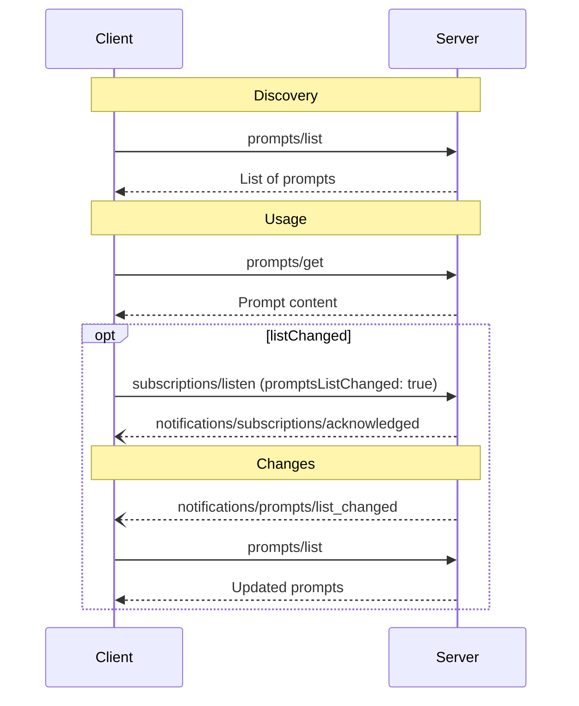

# MCP 提示模板规范

规定提示发现、读取、参数、消息内容及变更通知，并说明错误处理和用户交互边界。

- 来源：通用规范／MCP
- 资料类型：存档文档
- 文档时间：官网现页更新：[2026-10-11](<https://modelcontextprotocol.io/specification/2026-07-28/server/prompts>)；规范版本：[2026-07-28](<https://modelcontextprotocol.io/specification/2026-07-28/server/prompts>)；本地抓取：2026-10-11
- 阅读状态：完整中文机器译文，由 Google 翻译；代码、命令与配置保留原样，未逐句人工校对。

[原文发布页](<https://modelcontextprotocol.io/specification/2026-07-28/server/prompts>) · [原始文件](<../../../../原始抓取备份/原文/官方/通用规范/MCP/MCP 提示模板规范.md>) · [返回资料总览](<../../../资料总览.md>)

[查看原文对照](#原文对照)

## 中文全文

> ## 文档索引
> 在以下位置获取完整的文档索引： https://modelcontextprotocol.io/llms.txt
> 在进一步探索之前使用此文件来发现所有可用页面。

# 提示

<div id="enable-section-numbers" />

Model Context Protocol (MCP) 为服务器提供了一种向客户端公开提示 
 模板的标准化方法。提示允许服务器提供结构化消息和
与语言模型交互的指令。客户端可以发现可用的
提示、检索其内容并提供参数来自定义它们。


**注释：**

为简洁起见，本页面上的请求示例省略了 `_meta` 请求 
 元数据（`io.modelcontextprotocol/protocolVersion`、
 `io.modelcontextprotocol/clientInfo` 和 
 `io.modelcontextprotocol/clientCapabilities`）。每个请求**MUST**都包含
所需的`_meta`字段；参见
 [`_meta`](<https://modelcontextprotocol.io/specification/2026-07-28/basic/index#meta>)。


## 用户交互模型

提示被设计为**用户控制的**，这意味着它们从服务器公开给
客户端，目的是让用户能够明确选择它们来使用。
这指的是由谁决定何时使用提示，而不是由谁创作其内容。提示
内容由服务器定义。

通常，提示将通过用户
界面中的用户启动命令来触发，这允许用户自然地发现并调用可用的提示。

例如，作为斜杠命令：


然而，实现者可以自由地通过任何适合
其需求的界面模式公开提示——协议本身并不强制要求任何特定的用户交互
模型。

## 能力

支持提示符 **MUST** 的服务器在其 
[`DiscoverResult`](<https://modelcontextprotocol.io/specification/2026-07-28/schema#discoverresult>) 中声明 `prompts` 功能：

```json theme={null}
{
  "capabilities": {
    "prompts": {
      "listChanged": true
    }
  }
}
```

`listChanged`表示当
可用提示列表发生变化时，服务器是否发出通知。

声明 `prompts` 功能 **MUST** 的服务器使用请求客户端当前可用的一组提示来响应 `prompts/list` 请求 
。该集合 **MAY** 为 
 为空，并且 **MAY** 随时间变化（参见
[列表更改通知](<#列表更改通知>)），但 **MUST NOT**每个连接都有不同的
或作为连接上其他请求的副作用。设置 
**MAY** 因请求上提供的授权而异 - 例如，仅返回调用者授予的范围允许的提示 
 \- 因为凭据是 
 每个请求输入，而不是连接状态。

## 协议消息

### 列表提示

要检索可用的提示，客户端会发送 `prompts/list` 请求。此操作
支持[分页](<https://modelcontextprotocol.io/specification/2026-07-28/server/utilities/pagination>)和[缓存](<https://modelcontextprotocol.io/specification/2026-07-28/server/utilities/caching>)。

**请求：**

```json theme={null}
{
  "jsonrpc": "2.0",
  "id": 1,
  "method": "prompts/list",
  "params": {
    "cursor": "optional-cursor-value"
  }
}
```

**回复：**

```json theme={null}
{
  "jsonrpc": "2.0",
  "id": 1,
  "result": {
    "resultType": "complete",
    "prompts": [
      {
        "name": "code_review",
        "title": "Request Code Review",
        "description": "Asks the LLM to analyze code quality and suggest improvements",
        "arguments": [
          {
            "name": "code",
            "description": "The code to review",
            "required": true
          }
        ],
        "icons": [
          {
            "src": "https://example.com/review-icon.svg",
            "mimeType": "image/svg+xml",
            "sizes": ["any"]
          }
        ]
      }
    ],
    "nextCursor": "next-page-cursor",
    "ttlMs": 600000,
    "cacheScope": "public"
  }
}
```

### 收到提示

要检索特定提示，客户端发送 `prompts/get` 请求。参数可能是
自动完成通过 [完成 API](<https://modelcontextprotocol.io/specification/2026-07-28/server/utilities/completion>).

**请求：**

```json theme={null}
{
  "jsonrpc": "2.0",
  "id": 2,
  "method": "prompts/get",
  "params": {
    "name": "code_review",
    "arguments": {
      "code": "def hello():\n    print('world')"
    }
  }
}
```

**回复：**

```json theme={null}
{
  "jsonrpc": "2.0",
  "id": 2,
  "result": {
    "resultType": "complete",
    "description": "Code review prompt",
    "messages": [
      {
        "role": "user",
        "content": {
          "type": "text",
          "text": "Please review this Python code:\ndef hello():\n    print('world')"
        }
      }
    ]
  }
}
```

服务器 **MAY** 还使用 [`InputRequiredResult`](<https://modelcontextprotocol.io/specification/2026-07-28/basic/patterns/mrtr#inputrequiredresult>) 响应 `prompts/get`，以指示在解决提示之前需要额外的输入。这遵循[多往返请求](<https://modelcontextprotocol.io/specification/2026-07-28/basic/patterns/mrtr#multi-round-trip-requests>)机制。重试请求时，客户端在请求参数中包含 `inputResponses`，如果服务器提供了 `requestState`。

### 列表更改通知

当可用提示列表发生变化时，声明了该提示的服务器 `listChanged`
能力 **SHOULD** 向已打开的客户发送通知
[`subscriptions/listen`](<https://modelcontextprotocol.io/specification/2026-07-28/basic/patterns/subscriptions>) 流式传输
`promptsListChanged: true`:

```json theme={null}
{
  "jsonrpc": "2.0",
  "method": "notifications/prompts/list_changed"
}
```

## 消息流



## 数据类型

### 提示

提示定义包括：

* `name`：提示的唯一标识符
* `title`：用于显示目的的可选人类可读提示名称。
* `description`：可选的人类可读描述
* `icons`：用于在用户界面中显示的可选图标数组
* `arguments`：用于自定义的可选参数列表

### PromptMessage

提示中的消息可以包含：

* `role`：“用户”或“助理”，指示发言者
* `content`：以下内容类型之一：


**注释：**

  提示信息中所有内容类型均支持可选
  [注释](<https://modelcontextprotocol.io/specification/2026-07-28/server/resources#annotations>) 为了
  有关受众、优先级和修改时间的元数据。


#### 文字内容

文本内容代表纯文本消息：

```json theme={null}
{
  "type": "text",
  "text": "The text content of the message"
}
```

这是自然语言交互中最常见的内容类型。

#### 图片内容

图像内容允许在消息中包含视觉信息：

```json theme={null}
{
  "type": "image",
  "data": "base64-encoded-image-data",
  "mimeType": "image/png"
}
```

图像数据 **MUST** 采用 Base64 编码并包含有效的 MIME 类型。这使得
视觉上下文很重要的多模式交互成为可能。

#### 音频内容

音频内容允许在消息中包含音频信息：

```json theme={null}
{
  "type": "audio",
  "data": "base64-encoded-audio-data",
  "mimeType": "audio/wav"
}
```

音频数据 MUST 采用 Base64 编码并包含有效的 MIME 类型。这使得
音频上下文很重要的多模式交互成为可能。

#### 资源链接

提示消息 **MAY** 包含指向 
[ 资源 ](<https://modelcontextprotocol.io/specification/2026-07-28/server/resources>) 的链接，以提供附加上下文或 
 数据，而无需直接嵌入资源内容。在这种情况下，提示消息
返回一个可以被客户端获取的URI：

```json theme={null}
{
  "type": "resource_link",
  "uri": "file:///project/src/main.rs",
  "name": "main.rs",
  "description": "Primary application entry point",
  "mimeType": "text/x-rust"
}
```

资源链接支持与常规资源相同的[资源注释](<https://modelcontextprotocol.io/specification/2026-07-28/server/resources#annotations>)
，以帮助客户了解如何使用它们。

#### 嵌入式资源

嵌入资源允许在消息中直接引用服务器端资源：

```json theme={null}
{
  "type": "resource",
  "resource": {
    "uri": "resource://example",
    "mimeType": "text/plain",
    "text": "Resource content"
  }
}
```

资源可以包含文本或二进制（blob）数据，**MUST** 包括：

* 有效资源 URI
* 相应的 MIME 类型
* 文本内容或 Base64 编码的 Blob 数据

嵌入式资源支持提示将服务器管理的内容（例如
文档、代码示例或其他参考材料）直接无缝合并到对话
流中。

## 错误处理

服务器 **SHOULD** 针对常见故障情况返回标准 JSON-RPC 错误：

* 无效提示名称：`-32602`（无效参数）
* 缺少必需的参数：`-32602`（无效参数）
* 内部错误：`-32603`（内部错误）

## 实施注意事项

1. 服务器 **SHOULD** 在处理之前验证提示参数
2. 客户端 **SHOULD** 处理大型提示列表的分页
3. 双方**SHOULD**尊重能力协商

## 安全性

实现**MUST**仔细验证所有提示输入和输出，以防止
注入攻击或未经授权的资源访问。


## 原文对照

<details>
<summary>展开完整原文</summary>

> ## Documentation Index
> Fetch the complete documentation index at: https://modelcontextprotocol.io/llms.txt
> Use this file to discover all available pages before exploring further.

# Prompts

<div id="enable-section-numbers" />

The Model Context Protocol (MCP) provides a standardized way for servers to expose prompt
templates to clients. Prompts allow servers to provide structured messages and
instructions for interacting with language models. Clients can discover available
prompts, retrieve their contents, and provide arguments to customize them.


**注释：**

  For brevity, the request examples on this page omit the `_meta` request
  metadata (`io.modelcontextprotocol/protocolVersion`,
  `io.modelcontextprotocol/clientInfo`, and
  `io.modelcontextprotocol/clientCapabilities`). Every request **MUST** include
  the required `_meta` fields; see
  [`_meta`](<https://modelcontextprotocol.io/specification/2026-07-28/basic/index#meta>).


## User Interaction Model

Prompts are designed to be **user-controlled**, meaning they are exposed from servers to
clients with the intention of the user being able to explicitly select them for use.
This refers to who decides when the prompt is used, not who authors its content. Prompt
content is defined by the server.

Typically, prompts would be triggered through user-initiated commands in the user
interface, which allows users to naturally discover and invoke available prompts.

For example, as slash commands:


However, implementors are free to expose prompts through any interface pattern that suits
their needs—the protocol itself does not mandate any specific user interaction
model.

## Capabilities

Servers that support prompts **MUST** declare the `prompts` capability in their
[`DiscoverResult`](<https://modelcontextprotocol.io/specification/2026-07-28/schema#discoverresult>):

```json theme={null}
{
  "capabilities": {
    "prompts": {
      "listChanged": true
    }
  }
}
```

`listChanged` indicates whether the server will emit notifications when the list of
available prompts changes.

Servers that declare the `prompts` capability **MUST** respond to `prompts/list` requests
with the set of prompts currently available to the requesting client. This set **MAY** be
empty and **MAY** change over time (see
[List Changed Notification](<#list-changed-notification>)), but **MUST NOT** vary
per-connection or as a side effect of other requests on the connection. The set
**MAY** vary by the authorization presented on the request — for example, returning
only the prompts the caller's granted scopes permit — since credentials are
per-request input, not connection state.

## Protocol Messages

### Listing Prompts

To retrieve available prompts, clients send a `prompts/list` request. This operation
supports [pagination](<https://modelcontextprotocol.io/specification/2026-07-28/server/utilities/pagination>) and [caching](<https://modelcontextprotocol.io/specification/2026-07-28/server/utilities/caching>).

**Request:**

```json theme={null}
{
  "jsonrpc": "2.0",
  "id": 1,
  "method": "prompts/list",
  "params": {
    "cursor": "optional-cursor-value"
  }
}
```

**Response:**

```json theme={null}
{
  "jsonrpc": "2.0",
  "id": 1,
  "result": {
    "resultType": "complete",
    "prompts": [
      {
        "name": "code_review",
        "title": "Request Code Review",
        "description": "Asks the LLM to analyze code quality and suggest improvements",
        "arguments": [
          {
            "name": "code",
            "description": "The code to review",
            "required": true
          }
        ],
        "icons": [
          {
            "src": "https://example.com/review-icon.svg",
            "mimeType": "image/svg+xml",
            "sizes": ["any"]
          }
        ]
      }
    ],
    "nextCursor": "next-page-cursor",
    "ttlMs": 600000,
    "cacheScope": "public"
  }
}
```

### Getting a Prompt

To retrieve a specific prompt, clients send a `prompts/get` request. Arguments may be
auto-completed through [the completion API](<https://modelcontextprotocol.io/specification/2026-07-28/server/utilities/completion>).

**Request:**

```json theme={null}
{
  "jsonrpc": "2.0",
  "id": 2,
  "method": "prompts/get",
  "params": {
    "name": "code_review",
    "arguments": {
      "code": "def hello():\n    print('world')"
    }
  }
}
```

**Response:**

```json theme={null}
{
  "jsonrpc": "2.0",
  "id": 2,
  "result": {
    "resultType": "complete",
    "description": "Code review prompt",
    "messages": [
      {
        "role": "user",
        "content": {
          "type": "text",
          "text": "Please review this Python code:\ndef hello():\n    print('world')"
        }
      }
    ]
  }
}
```

Servers **MAY** also respond to `prompts/get` with an [`InputRequiredResult`](<https://modelcontextprotocol.io/specification/2026-07-28/basic/patterns/mrtr#inputrequiredresult>) to indicate that additional input is needed before the prompt can be resolved. This follows the [multi round-trip requests](<https://modelcontextprotocol.io/specification/2026-07-28/basic/patterns/mrtr#multi-round-trip-requests>) mechanism. When retrying the request, clients include `inputResponses` and, if provided by the server, `requestState` in the request parameters.

### List Changed Notification

When the list of available prompts changes, servers that declared the `listChanged`
capability **SHOULD** send a notification to clients that have opened a
[`subscriptions/listen`](<https://modelcontextprotocol.io/specification/2026-07-28/basic/patterns/subscriptions>) stream with
`promptsListChanged: true`:

```json theme={null}
{
  "jsonrpc": "2.0",
  "method": "notifications/prompts/list_changed"
}
```

## Message Flow


## Data Types

### Prompt

A prompt definition includes:

* `name`: Unique identifier for the prompt
* `title`: Optional human-readable name of the prompt for display purposes.
* `description`: Optional human-readable description
* `icons`: Optional array of icons for display in user interfaces
* `arguments`: Optional list of arguments for customization

### PromptMessage

Messages in a prompt can contain:

* `role`: Either "user" or "assistant" to indicate the speaker
* `content`: One of the following content types:


**注释：**

  All content types in prompt messages support optional
  [annotations](<https://modelcontextprotocol.io/specification/2026-07-28/server/resources#annotations>) for
  metadata about audience, priority, and modification times.


#### Text Content

Text content represents plain text messages:

```json theme={null}
{
  "type": "text",
  "text": "The text content of the message"
}
```

This is the most common content type used for natural language interactions.

#### Image Content

Image content allows including visual information in messages:

```json theme={null}
{
  "type": "image",
  "data": "base64-encoded-image-data",
  "mimeType": "image/png"
}
```

The image data **MUST** be base64-encoded and include a valid MIME type. This enables
multi-modal interactions where visual context is important.

#### Audio Content

Audio content allows including audio information in messages:

```json theme={null}
{
  "type": "audio",
  "data": "base64-encoded-audio-data",
  "mimeType": "audio/wav"
}
```

The audio data MUST be base64-encoded and include a valid MIME type. This enables
multi-modal interactions where audio context is important.

#### Resource Links

Prompt messages **MAY** include links to
[Resources](<https://modelcontextprotocol.io/specification/2026-07-28/server/resources>), to provide additional context or
data without embedding the resource contents directly. In this case, the prompt message
returns a URI that can be fetched by the client:

```json theme={null}
{
  "type": "resource_link",
  "uri": "file:///project/src/main.rs",
  "name": "main.rs",
  "description": "Primary application entry point",
  "mimeType": "text/x-rust"
}
```

Resource links support the same [Resource annotations](<https://modelcontextprotocol.io/specification/2026-07-28/server/resources#annotations>)
as regular resources to help clients understand how to use them.

#### Embedded Resources

Embedded resources allow referencing server-side resources directly in messages:

```json theme={null}
{
  "type": "resource",
  "resource": {
    "uri": "resource://example",
    "mimeType": "text/plain",
    "text": "Resource content"
  }
}
```

Resources can contain either text or binary (blob) data and **MUST** include:

* A valid resource URI
* The appropriate MIME type
* Either text content or base64-encoded blob data

Embedded resources enable prompts to seamlessly incorporate server-managed content like
documentation, code samples, or other reference materials directly into the conversation
flow.

## Error Handling

Servers **SHOULD** return standard JSON-RPC errors for common failure cases:

* Invalid prompt name: `-32602` (Invalid params)
* Missing required arguments: `-32602` (Invalid params)
* Internal errors: `-32603` (Internal error)

## Implementation Considerations

1. Servers **SHOULD** validate prompt arguments before processing
2. Clients **SHOULD** handle pagination for large prompt lists
3. Both parties **SHOULD** respect capability negotiation

## Security

Implementations **MUST** carefully validate all prompt inputs and outputs to prevent
injection attacks or unauthorized access to resources.


</details>
