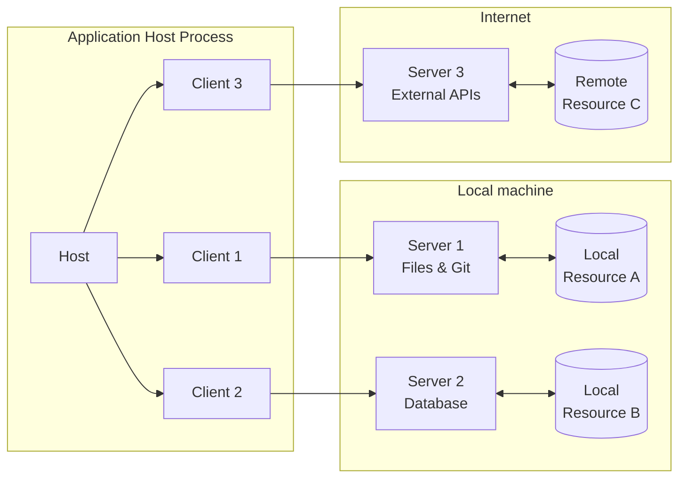
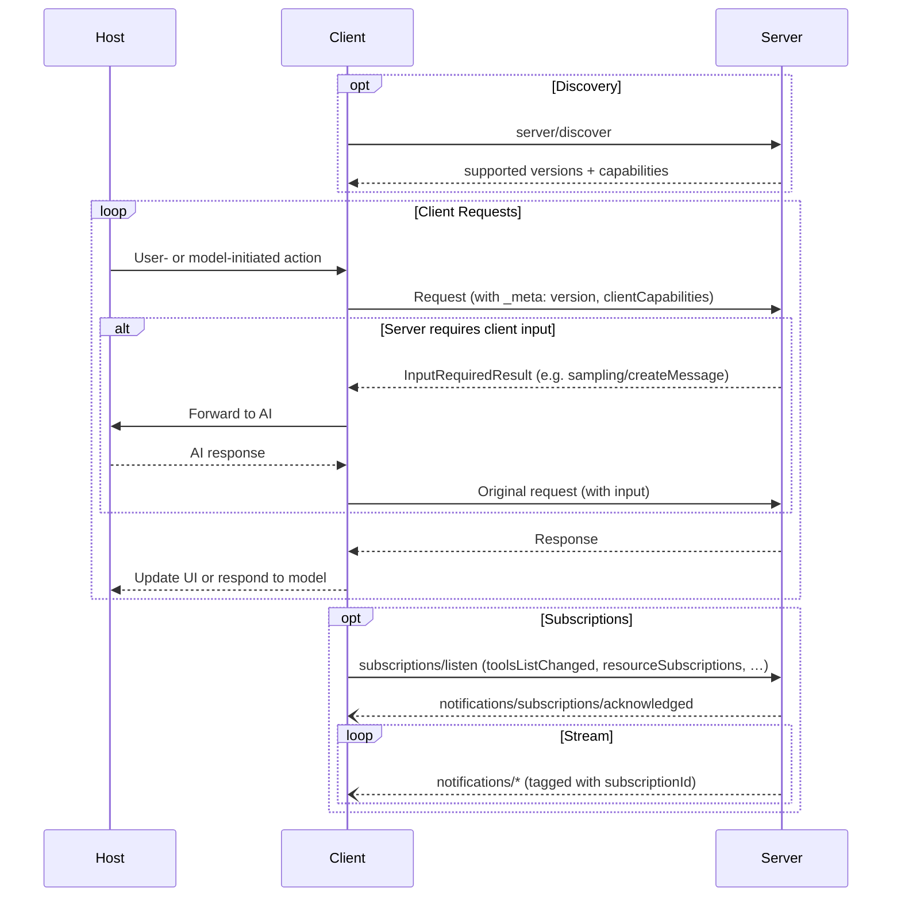

# MCP 架构规范

定义主机、客户端和服务端职责、设计原则与能力协商；具体行为适用于归档的协议版本。

- 来源：通用规范／MCP
- 资料类型：存档文档
- 文档时间：官网现页更新：[2026-10-11](<https://modelcontextprotocol.io/specification/2026-07-28/architecture>)；规范版本：[2026-07-28](<https://modelcontextprotocol.io/specification/2026-07-28/architecture>)；本地抓取：2026-10-11
- 阅读状态：完整中文机器译文，由 Google 翻译；代码、命令与配置保留原样，未逐句人工校对。

[原文发布页](<https://modelcontextprotocol.io/specification/2026-07-28/architecture>) · [原始文件](<../../../../原始抓取备份/原文/官方/通用规范/MCP/MCP 架构规范.md>) · [返回资料总览](<../../../资料总览.md>)

[查看原文对照](#原文对照)

## 中文全文

> ## 文档索引
> 在以下位置获取完整的文档索引： https://modelcontextprotocol.io/llms.txt
> 在进一步探索之前使用此文件来发现所有可用页面。

# 建筑

Model Context Protocol (MCP) 遵循客户端-主机-服务器架构，其中每个 
 主机可以运行多个客户端实例。 MCP 是一种无状态协议：每个请求都是 
 独立的，并带有自己的协议版本和功能。
此架构使用户能够跨应用程序集成 AI 功能，同时 
 保持清晰的安全边界并隔离问题。 MCP
 基于 JSON-RPC 构建，提供了一个专注于 
 客户端和服务器之间的上下文交换和采样协调的协​​议。

## 核心组件

### 主持人

宿主进程充当容器和协调器：

* 创建和管理多个客户端实例
* 控制客户端连接权限和生命周期
* 执行安全策略和同意要求
* 处理用户授权决策
* 坐标AI/LLM积分和采样
* 管理跨客户端的上下文聚合

### 客户

每个客户端均由主机创建并与一台服务器通信：

* 与一台服务器通信
* 为每个请求附加协议版本和功能
* 双向路由协议消息
* 管理订阅和通知
* 维护服务器之间的安全边界

主机应用程序创建并管理多个客户端，每个客户端与特定服务器具有 1:1
 关系。

### 服务器

服务器提供专门的上下文和功能：

* 通过 MCP 原语公开资源、工具和提示
* 独立运作，职责明确
* 通过回复中的 `InputRequiredResult` 请求客户输入（采样、启发、根）
* 必须尊重安全限制
* 可以是本地进程或远程服务

## 设计原则

MCP 建立在几个关键设计原则之上，这些原则为其架构和 
 实现提供了信息：

1. **服务器应该非常容易构建**
   * 主机应用程序处理复杂的编排职责
   * 服务器专注于特定的、明确定义的功能
   * 简单的接口最大限度地减少实现开销
   * 清晰的分离使代码可维护

2. **服务器应该是高度可组合的**
   * 每个服务器独立提供集中的功能
   * 多台服务器可以无缝组合
   * 共享协议实现互操作性
   * 模块化设计支持可扩展性

3. **服务器不应该能够读取整个对话，也不应该“看到”其他对话
服务器**
   * 服务器仅接收必要的上下文信息
   * 完整的对话历史记录由主机保留
   * 每个服务器都保持隔离
   * 跨服务器交互由主机控制
   * 主机进程强制执行安全边界

4. **可以逐步向服务器和客户端添加功能**
   * 核心协议提供最少的所需功能
   * 可以根据需要协商附加功能
   * 服务器和客户端独立发展
   * 为未来可扩展性而设计的协议
   * 保持向后兼容性

## 能力谈判

Model Context Protocol 使用基于功能的协商系统，客户端和 
 服务器在每个请求上声明其支持的功能。客户端在每次请求时将其
功能包含在`_meta.io.modelcontextprotocol/clientCapabilities`中。
服务器通告其功能以响应
[`server/discover`](<https://modelcontextprotocol.io/specification/2026-07-28/server/discover>)，客户端可以在
任何其他预先功能发现请求之前调用这些功能。

* 服务器声明工具支持、资源订阅和提示等功能
模板
* 客户声明采样支持和启发处理等功能
* 双方必须在整个互动过程中尊重所声明的能力
* 可以通过协议扩展协商附加功能

每个功能都会根据每个请求解锁特定的协议功能。例如：

* 已实现的 [ 服务器功能 ](<https://modelcontextprotocol.io/specification/2026-07-28/server>) 必须在
服务器的能力
* 接收资源更新通知需要打开
[`subscriptions/listen`](<https://modelcontextprotocol.io/specification/2026-07-28/basic/patterns/subscriptions>) 具有所需资源 URI 的流 
* [工具](<https://modelcontextprotocol.io/specification/2026-07-28/server/tools>)调用需要服务器声明工具功能

此功能协商可确保客户端和服务器清楚地了解 
 支持的功能，同时保持协议可扩展性。

## 原文对照

展开完整原文

> ## Documentation Index
> Fetch the complete documentation index at: https://modelcontextprotocol.io/llms.txt
> Use this file to discover all available pages before exploring further.

# Architecture

The Model Context Protocol (MCP) follows a client-host-server architecture where each
host can run multiple client instances. MCP is a stateless protocol: every request is
self-contained and carries its own protocol version and capabilities.
This architecture enables users to integrate AI capabilities across applications while
maintaining clear security boundaries and isolating concerns. Built on JSON-RPC, MCP
provides a protocol focused on context exchange and sampling coordination between
clients and servers.

## Core Components

### Host

The host process acts as the container and coordinator:

* Creates and manages multiple client instances
* Controls client connection permissions and lifecycle
* Enforces security policies and consent requirements
* Handles user authorization decisions
* Coordinates AI/LLM integration and sampling
* Manages context aggregation across clients

### Clients

Each client is created by the host and communicates with exactly one server:

* Communicates with exactly one server
* Attaches protocol version and capabilities to every request
* Routes protocol messages bidirectionally
* Manages subscriptions and notifications
* Maintains security boundaries between servers

A host application creates and manages multiple clients, with each client having a 1:1
relationship with a particular server.

### Servers

Servers provide specialized context and capabilities:

* Expose resources, tools and prompts via MCP primitives
* Operate independently with focused responsibilities
* Request client input (sampling, elicitation, roots) via `InputRequiredResult` within a reply
* Must respect security constraints
* Can be local processes or remote services

## Design Principles

MCP is built on several key design principles that inform its architecture and
implementation:

1. **Servers should be extremely easy to build**
   * Host applications handle complex orchestration responsibilities
   * Servers focus on specific, well-defined capabilities
   * Simple interfaces minimize implementation overhead
   * Clear separation enables maintainable code

2. **Servers should be highly composable**
   * Each server provides focused functionality in isolation
   * Multiple servers can be combined seamlessly
   * Shared protocol enables interoperability
   * Modular design supports extensibility

3. **Servers should not be able to read the whole conversation, nor "see into" other
   servers**
   * Servers receive only necessary contextual information
   * Full conversation history stays with the host
   * Each server maintains isolation
   * Cross-server interactions are controlled by the host
   * Host process enforces security boundaries

4. **Features can be added to servers and clients progressively**
   * Core protocol provides minimal required functionality
   * Additional capabilities can be negotiated as needed
   * Servers and clients evolve independently
   * Protocol designed for future extensibility
   * Backwards compatibility is maintained

## Capability Negotiation

The Model Context Protocol uses a capability-based negotiation system where clients and
servers declare their supported features on each request. Clients include their
capabilities in `_meta.io.modelcontextprotocol/clientCapabilities` on every request.
Servers advertise their capabilities in response to
[`server/discover`](<https://modelcontextprotocol.io/specification/2026-07-28/server/discover>), which clients may call before
any other request for up-front capability discovery.

* Servers declare capabilities like tool support, resource subscriptions, and prompt
  templates
* Clients declare capabilities like sampling support and elicitation handling
* Both parties must respect declared capabilities throughout the interaction
* Additional capabilities can be negotiated through extensions to the protocol

Each capability unlocks specific protocol features on a per-request basis. For example:

* Implemented [server features](<https://modelcontextprotocol.io/specification/2026-07-28/server>) must be advertised in the
  server's capabilities
* Receiving resource update notifications requires opening a
  [`subscriptions/listen`](<https://modelcontextprotocol.io/specification/2026-07-28/basic/patterns/subscriptions>) stream
  with the desired resource URIs
* [Tool](<https://modelcontextprotocol.io/specification/2026-07-28/server/tools>) invocation requires the server to declare tool capabilities

This capability negotiation ensures clients and servers have a clear understanding of
supported functionality while maintaining protocol extensibility.

