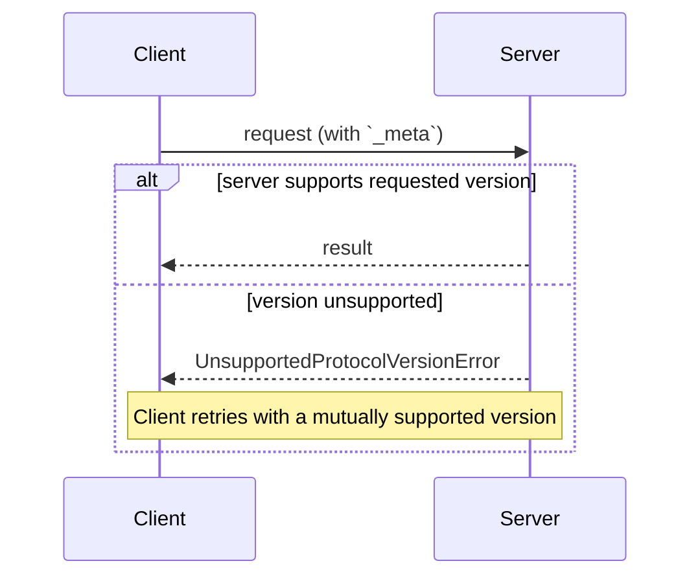

# MCP 版本与兼容性规范

说明请求的协议版本、扩展能力协商及与旧初始化机制的互通，包含兼容矩阵。

- 来源：通用规范／MCP
- 资料类型：存档文档
- 文档时间：官网现页更新：[2026-10-11](<https://modelcontextprotocol.io/specification/2026-07-28/basic/versioning>)；规范版本：[2026-07-28](<https://modelcontextprotocol.io/specification/2026-07-28/basic/versioning>)；本地抓取：2026-10-11
- 阅读状态：完整中文机器译文，由 Google 翻译；代码、命令与配置保留原样，未逐句人工校对。

[原文发布页](<https://modelcontextprotocol.io/specification/2026-07-28/basic/versioning>) · [原始文件](<../../../../原始抓取备份/原文/官方/通用规范/MCP/MCP 版本与兼容性规范.md>) · [返回资料总览](<../../../资料总览.md>)

[查看原文对照](#原文对照)

## 中文全文

> ## 文档索引
> 在以下位置获取完整的文档索引： https://modelcontextprotocol.io/llms.txt
> 在进一步探索之前使用此文件来发现所有可用页面。

# 版本控制和兼容性

<div id="enable-section-numbers" />

此页面定义客户端和服务器如何就他们所说的内容达成一致：
协议版本，在每个请求上声明；可选扩展，
通过功能协商；以及与早期基于
握手的协议修订版的互操作性。

没有谈判握手。每个请求都携带其协议
版本，服务器独立接受或拒绝每个请求：



## 术语

本页面使用以下术语来实现跨协议 
 修订版的互操作性：

* **现代**：传达版本、身份和信息的协议版本
作为每个请求元数据的功能（修订版 `2026-07-28` 及更高版本）。
* **旧版**：与
`initialize` 握手（`2025-11-25` 及更早版本）。
* **双时代**：同时支持现代和传统的实现
版本。

## 协议版本协商

每个请求都在其 
[`_meta`](<https://modelcontextprotocol.io/specification/2026-07-28/basic/index#meta>) 字段中声明它正在使用的协议版本。在 HTTP 上，这是 
，也包含在 
[`MCP-Protocol-Version` 标头 ](<https://modelcontextprotocol.io/specification/2026-07-28/basic/transports/streamable-http#protocol-version-header>) 中。

如果服务器未实现请求的版本（无论版本
对服务器来说是未知的，还是服务器选择不支持
支持的已知版本），它**MUST**会以
[`UnsupportedProtocolVersionError`](<https://modelcontextprotocol.io/specification/2026-07-28/schema#unsupportedprotocolversionerror>)
响应，列出它所支持的版本：

```json theme={null}
{
  "jsonrpc": "2.0",
  "id": 1,
  "error": {
    "code": -32022,
    "message": "Unsupported protocol version",
    "data": {
      "supported": ["2026-07-28", "2025-11-25"],
      "requested": "1900-01-01"
    }
  }
}
```

客户端**SHOULD**从`supported`
列表中选择一个相互支持的版本并重试请求，或者如果不存在兼容的
版本，则向用户显示错误。

服务器**MUST**实现
[`server/discover`](<https://modelcontextprotocol.io/specification/2026-07-28/server/discover>)。客户端
**MAY**在发送任何其他请求之前调用它，以预先了解服务器
支持的版本，但不需要：客户端可以自由
调用任何RPC内联并处理`UnsupportedProtocolVersionError`（如果其
首选）版本不受支持。

## 延期协商

客户端和服务器可以协商支持核心协议之外的可选
[扩展](<https://modelcontextprotocol.io/docs/extensions/overview>)。扩展 
 在功能的 `extensions` 字段中公布，该字段是 
 扩展标识符到每个扩展设置对象的映射。扩展标识符
**MUST**遵循[`_meta`键命名规则](<https://modelcontextprotocol.io/specification/2026-07-28/basic/index#meta>)，
带有强制前缀。

以下是通告标识为 `io.modelcontextprotocol/ui` 的 
[MCP 应用扩展 ](<https://modelcontextprotocol.io/extensions/apps/overview>) 的客户端示例：

```json theme={null}
{
  "capabilities": {
    "roots": {},
    "extensions": {
      "io.modelcontextprotocol/ui": {
        "mimeTypes": ["text/html;profile=mcp-app"]
      }
    }
  }
}
```

[任务扩展](<https://modelcontextprotocol.io/extensions/tasks/overview>)的示例标识为`io.modelcontextprotocol/tasks`：

```json theme={null}
{
  "capabilities": {
    "tools": {},
    "extensions": {
      "io.modelcontextprotocol/tasks": {}
    }
  }
}
```

每个扩展指定其设置对象的架构；空对象
表示支持，无需其他设置。

如果一方支持扩展，而另一方不支持，则支持的 
 方 **MUST** 要么恢复到核心协议行为，要么拒绝请求 
 并显示适当的错误。扩展 **SHOULD** 记录了其预期的 
 后备行为。

## 与基于初始化的版本的向后兼容性

希望支持 [ 传统 ](<#术语>) 客户端（
 期望 `initialize` 握手）和 [ 现代 ](<#术语>) 客户端（
 使用每个请求元数据）的服务器**MAY** 实现这两种行为。

需要与两种服务器互操作的客户端通过绑定 
 页面中指定的传输特定机制来检测 
 服务器的时代：

* [stdio](<https://modelcontextprotocol.io/specification/2026-07-28/basic/transports/stdio#backward-compatibility>)：
使用 `server/discover` 进行探测，并回退到任何不属于 
 识别的现代错误的错误。
* [可流式传输HTTP](<https://modelcontextprotocol.io/specification/2026-07-28/basic/transports/streamable-http#backward-compatibility>)：
在回退之前尝试现代请求并检查 `400 Bad Request`
 的主体。

在这两种情况下，已识别的现代 JSON-RPC 错误（例如 
[`UnsupportedProtocolVersionError`](<https://modelcontextprotocol.io/specification/2026-07-28/schema#unsupportedprotocolversionerror>)）
 会识别现代服务器：客户端使用受支持的版本 
 重试，而不是回退。其他任何东西都可以识别旧服务器。

时代确定是服务器的属性，而不是单个
请求的属性。客户端**SHOULD**在服务器
进程（stdio）或源（HTTP）的生命周期内缓存结果，并且**MAY**在
相同的服务器配置重新启动时保留它，重新探测是否缓存的假设后来
失败了。

仅支持 [ 现代 ](<#术语>) 版本 **SHOULD** 名称 
 在任何传输上返回到 `initialize`
 请求的任何错误中支持的协议版本的服务器：旧版客户端没有后退机制，并且 
 此消息可能是唯一的诊断信息它们可以向用户展示。

### 兼容性矩阵

以下矩阵总结了
客户端和服务器时代的每种组合的预期结果：

|客户|服务器|结果|
| - | - | - |
|现代|现代|有效。 `server/discover`为可选；版本与表面不匹配为 `UnsupportedProtocolVersionError`，并且客户端使用相互支持的版本重试。|
|现代|遗产|失败了。服务器可能会因实现定义的错误而拒绝请求，保持沉默，甚至在遗留语义下处理时代模糊的方法。在 stdio 上，客户端 **SHOULD** 首先发送 `server/discover` 以确定性失败；然后，客户端向用户显示可操作的错误。|
|双时代|现代|有效。 stdio 探针返回 `DiscoverResult`（或 `UnsupportedProtocolVersionError`）；在 HTTP 上，第一个现代请求成功或返回现代错误。客户保持现代。|
|双时代|遗产|有效。 stdio：探测器返回非现代错误或超时，客户端回退到 `initialize`。 HTTP：现代请求返回`4xx`，但没有可识别的现代错误主体，客户端回退到`initialize`（可能进一步转向已弃用的HTTP+SSE传输）。|
|遗产|现代|失败了。 stdio：服务器拒绝 `initialize`，并出现 JSON-RPC 错误；确切的代码是实现定义的（`initialize` 是未知方法，并且请求也缺少必需的 `_meta` 字段）。 HTTP：请求缺少所需的标头，并且根据[服务器验证](<https://modelcontextprotocol.io/specification/2026-07-28/basic/transports/streamable-http#server-validation>)和`400 Bad Request`被拒绝（已弃用的HTTP+SSE传输上的客户端在打开时失败`GET`相反）。旧客户端没有后退机制。|
|遗产|双时代|有效。服务器应答 `initialize` 并根据协商的旧版本为客户端提供服务。|
|遗产|遗产|根据遗留版本工作；超出了本文档的范围。|

双时代 ** 服务器 ** 根据客户端打开方式选择其行为：

* 携带现代每个请求 `_meta` 的请求是无状态服务的
根据本次修订。
* `initialize` 请求选择旧语义，范围仅限于 stdio
进程 (stdio) 或会话 (HTTP)，由协商的 
 旧协议版本指定。

双时代服务器 **MAY** 在同一端点 
 或进程上同时服务两个时代。


## 原文对照

<details>
<summary>展开完整原文</summary>

> ## Documentation Index
> Fetch the complete documentation index at: https://modelcontextprotocol.io/llms.txt
> Use this file to discover all available pages before exploring further.

# Versioning and Compatibility

<div id="enable-section-numbers" />

This page defines how a client and server agree on what they are speaking:
the protocol version, declared on every request; optional extensions,
negotiated through capabilities; and interoperability with earlier,
handshake-based protocol revisions.

There is no negotiation handshake. Every request carries its protocol
version, and the server accepts or rejects each request independently:


## Terminology

This page uses the following terms for interoperability across protocol
revisions:

* **Modern**: protocol versions that convey version, identity, and
  capabilities as per-request metadata (revision `2026-07-28` and later).
* **Legacy**: protocol versions that establish a session with an
  `initialize` handshake (`2025-11-25` and earlier).
* **Dual-era**: an implementation that supports both modern and legacy
  versions.

## Protocol Version Negotiation

Every request declares the protocol version it is using in its
[`_meta`](<https://modelcontextprotocol.io/specification/2026-07-28/basic/index#meta>) field. On HTTP, this is
also carried in the
[`MCP-Protocol-Version` header](<https://modelcontextprotocol.io/specification/2026-07-28/basic/transports/streamable-http#protocol-version-header>).

If the server does not implement the requested version (whether the version
is unknown to the server, or is a known version the server has chosen not to
support), it **MUST** respond with an
[`UnsupportedProtocolVersionError`](<https://modelcontextprotocol.io/specification/2026-07-28/schema#unsupportedprotocolversionerror>)
listing the versions it does support:

```json theme={null}
{
  "jsonrpc": "2.0",
  "id": 1,
  "error": {
    "code": -32022,
    "message": "Unsupported protocol version",
    "data": {
      "supported": ["2026-07-28", "2025-11-25"],
      "requested": "1900-01-01"
    }
  }
}
```

The client **SHOULD** select a mutually supported version from the `supported`
list and retry the request, or surface an error to the user if no compatible
version exists.

Servers **MUST** implement
[`server/discover`](<https://modelcontextprotocol.io/specification/2026-07-28/server/discover>). Clients
**MAY** call it before sending any other requests to learn the server's
supported versions up front, but are not required to: a client is free to
invoke any RPC inline and handle `UnsupportedProtocolVersionError` if its
preferred version is not supported.

## Extension Negotiation

Clients and servers can negotiate support for optional
[extensions](<https://modelcontextprotocol.io/docs/extensions/overview>) beyond the core protocol. Extensions
are advertised in the `extensions` field of capabilities, which is a map of
extension identifiers to per-extension settings objects. Extension identifiers
**MUST** follow the [`_meta` key naming rules](<https://modelcontextprotocol.io/specification/2026-07-28/basic/index#meta>),
with a mandatory prefix.

The following is an example of a client that advertises the
[MCP Apps extension](<https://modelcontextprotocol.io/extensions/apps/overview>) identified as `io.modelcontextprotocol/ui`:

```json theme={null}
{
  "capabilities": {
    "roots": {},
    "extensions": {
      "io.modelcontextprotocol/ui": {
        "mimeTypes": ["text/html;profile=mcp-app"]
      }
    }
  }
}
```

An example of [Tasks extension](<https://modelcontextprotocol.io/extensions/tasks/overview>) identified as `io.modelcontextprotocol/tasks`:

```json theme={null}
{
  "capabilities": {
    "tools": {},
    "extensions": {
      "io.modelcontextprotocol/tasks": {}
    }
  }
}
```

Each extension specifies the schema of its settings object; an empty object
indicates support with no additional settings.

If one party supports an extension but the other does not, the supporting
party **MUST** either revert to core protocol behavior or reject the request
with an appropriate error. Extensions **SHOULD** document their expected
fallback behavior.

## Backward Compatibility with Initialization-Based Versions

A server that wishes to support both [legacy](<#terminology>) clients (which
expect an `initialize` handshake) and [modern](<#terminology>) clients (which
use per-request metadata) **MAY** implement both behaviors.

A client that needs to interoperate with both kinds of servers detects the
server's era with transport-specific mechanics, specified in the binding
pages:

* [stdio](<https://modelcontextprotocol.io/specification/2026-07-28/basic/transports/stdio#backward-compatibility>):
  probe with `server/discover` and fall back on any error that is not a
  recognized modern error.
* [Streamable HTTP](<https://modelcontextprotocol.io/specification/2026-07-28/basic/transports/streamable-http#backward-compatibility>):
  attempt a modern request and inspect the body of a `400 Bad Request`
  before falling back.

In both cases, a recognized modern JSON-RPC error (such as
[`UnsupportedProtocolVersionError`](<https://modelcontextprotocol.io/specification/2026-07-28/schema#unsupportedprotocolversionerror>))
identifies a modern server: the client retries with a supported version
rather than falling back. Anything else identifies a legacy server.

The era determination is a property of the server, not of an individual
request. Clients **SHOULD** cache the result for the lifetime of the server
process (stdio) or origin (HTTP), and **MAY** persist it across restarts of
the same server configuration, re-probing if the cached assumption later
fails.

A server that supports only [modern](<#terminology>) versions **SHOULD** name
the protocol versions it supports in any error it returns to an `initialize`
request, on any transport: legacy clients have no fall-forward mechanism, and
this message may be the only diagnostic they can surface to users.

### Compatibility Matrix

The following matrix summarizes the expected outcome of every combination of
client and server era:

| Client | Server | Outcome |
| - | - | - |
| Modern | Modern | Works. `server/discover` is optional; version mismatches surface as `UnsupportedProtocolVersionError` and the client retries with a mutually supported version. |
| Modern | Legacy | Fails. The server may reject the request with an implementation-defined error, stay silent, or even process an era-ambiguous method under legacy semantics. On stdio, clients **SHOULD** send `server/discover` first to fail deterministically; the client then surfaces an actionable error to the user. |
| Dual-era | Modern | Works. The stdio probe returns a `DiscoverResult` (or `UnsupportedProtocolVersionError`); on HTTP, the first modern request succeeds or returns a modern error. The client stays modern. |
| Dual-era | Legacy | Works. stdio: the probe returns a non-modern error or times out, and the client falls back to `initialize`. HTTP: the modern request returns a `4xx` without a recognized modern error body, and the client falls back to `initialize` (and possibly further to the deprecated HTTP+SSE transport). |
| Legacy | Modern | Fails. stdio: the server rejects `initialize` with a JSON-RPC error; the exact code is implementation-defined (`initialize` is an unknown method and the request also lacks the required `_meta` fields). HTTP: the request is missing the required headers and is rejected per [server validation](<https://modelcontextprotocol.io/specification/2026-07-28/basic/transports/streamable-http#server-validation>) with `400 Bad Request` (a client on the deprecated HTTP+SSE transport fails at its opening `GET` instead). Legacy clients have no fall-forward mechanism. |
| Legacy | Dual-era | Works. The server answers `initialize` and serves the client according to the negotiated legacy revision. |
| Legacy | Legacy | Works according to the legacy revision; out of scope for this document. |

A dual-era **server** selects its behavior from how the client opens:

* A request carrying modern per-request `_meta` is served statelessly
  according to this revision.
* An `initialize` request selects legacy semantics, scoped to the stdio
  process (stdio) or the session (HTTP), as specified by the negotiated
  legacy protocol version.

A dual-era server **MAY** serve both eras concurrently on the same endpoint
or process.


</details>
