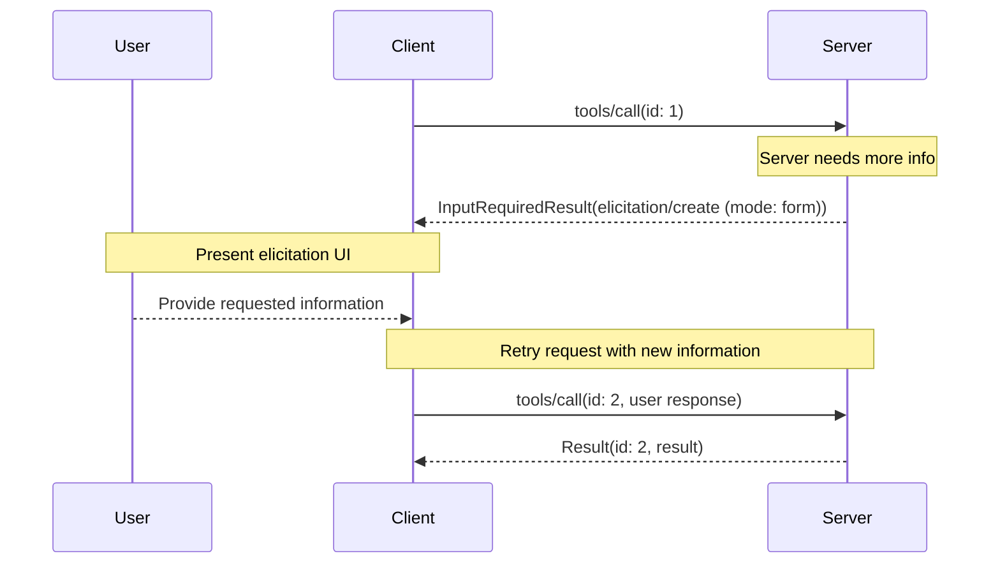
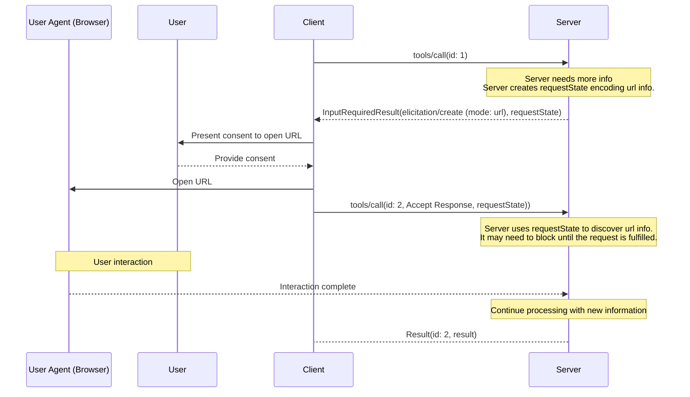
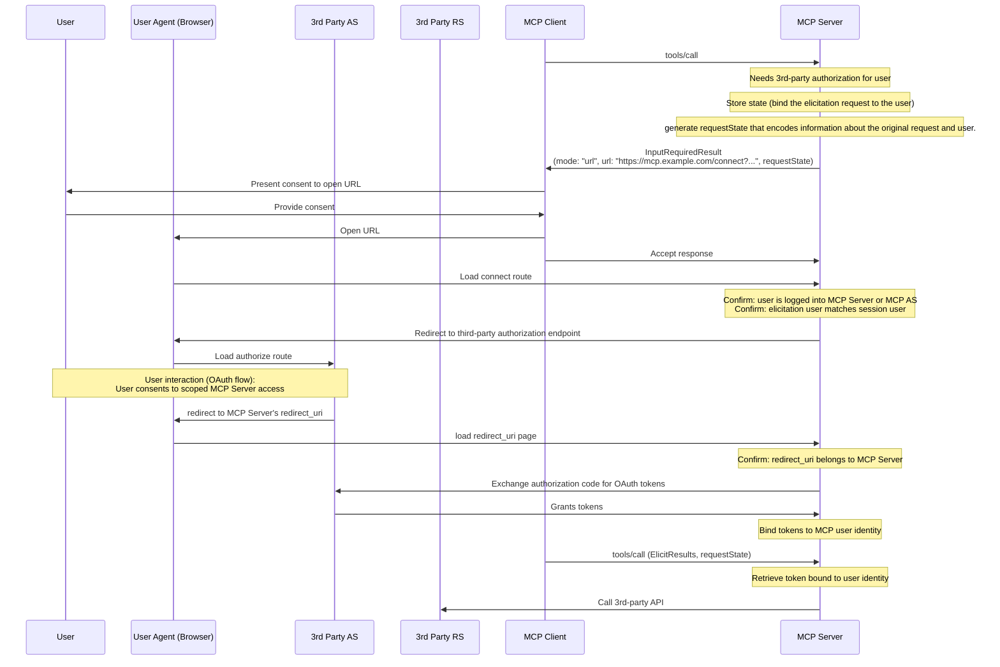

# MCP 用户信息请求规范

定义服务经客户端向用户请求表单或 URL 信息的流程、响应、敏感数据和实现注意事项。

- 来源：通用规范／MCP
- 资料类型：存档文档
- 文档时间：官网现页更新：[2026-10-11](<https://modelcontextprotocol.io/specification/2026-07-28/client/elicitation>)；规范版本：[2026-07-28](<https://modelcontextprotocol.io/specification/2026-07-28/client/elicitation>)；本地抓取：2026-10-11
- 阅读状态：完整中文机器译文，由 Google 翻译；代码、命令与配置保留原样，未逐句人工校对。

[原文发布页](<https://modelcontextprotocol.io/specification/2026-07-28/client/elicitation>) · [原始文件](<../../../../原始抓取备份/原文/官方/通用规范/MCP/MCP 用户信息请求规范.md>) · [返回资料总览](<../../../资料总览.md>)

[查看原文对照](#原文对照)

## 中文全文

> ## 文档索引
> 在以下位置获取完整的文档索引： https://modelcontextprotocol.io/llms.txt
> 在进一步探索之前使用此文件来发现所有可用页面。

# 启发

<div id="enable-section-numbers" />

Model Context Protocol (MCP) 为服务器在交互过程中通过客户端向用户请求附加 
 信息提供了一种标准化方法。此流程允许客户端
保持对用户交互和数据共享的控制，同时使服务器能够动态收集
必要的信息。

启发支持两种模式：

* **表单模式**：服务器可以使用可选的JSON架构向用户请求结构化数据以验证响应
* **URL 模式**：服务器可以将用户定向到外部 URL 进行敏感交互，这些交互必须 * 而不是 * 通过 MCP 客户端

## 用户交互模型

MCP 中的启发允许服务器通过允许用户输入 
 请求在其他 MCP 服务器功能中发生 * 嵌套 * 来实现交互式工作流程。

实现可以通过任何适合
其需求的接口模式自由地公开启发——协议本身不强制要求任何特定的用户交互
模型。


**注意：**

为了信任和安全：

  * 服务器 **MUST NOT** 使用表单模式诱导来请求敏感信息，例如
密码、API 密钥、访问令牌或支付凭证
  * 服务器**MUST**使用[URL模式](<#url-模式获取请求>)进行交互，涉及
如此敏感的信息

本文中的“敏感信息”是指授予访问权限或
授权交易的秘密和凭证。一般联系方式或个人资料信息（例如姓名、电子邮件地址、
 或用户名）并未明确禁止；是否通过表单模式请求此类数据由服务器决定
，并取决于用户审查和拒绝的能力。

MCP客户**MUST**：

  * 提供UI，明确哪个服务器正在请求信息
  * 尊重用户隐私并提供明确的拒绝和取消选项
  * 对于表单模式，允许用户在发送之前查看和修改他们的回复
  * 对于 URL 模式，清楚地显示目标 domain/host 并在导航到目标 URL 之前收集用户同意


## 能力

支持诱导 **MUST** 的客户端在每个请求的 
`_meta.io.modelcontextprotocol/clientCapabilities` 中声明 `elicitation` 功能：

```json theme={null}
{
  "_meta": {
    "io.modelcontextprotocol/clientCapabilities": {
      "elicitation": {
        "form": {},
        "url": {}
      }
    }
  }
}
```

为了向后兼容，空的功能对象相当于声明仅支持 `form` 模式：

```jsonc theme={null}
{
  "_meta": {
    "io.modelcontextprotocol/clientCapabilities": {
      "elicitation": {}, // Equivalent to { "form": {} }
    },
  },
}
```

声明 `elicitation` 功能 **MUST** 的客户端支持至少一种模式（`form` 或 `url`）。

服务器 **MUST NOT** 使用客户端不支持的模式发送启发请求。

## 协议消息

### 启发请求

服务器 **MAY** 在处理客户端请求期间通过发送包含 `elicitation/create` 请求的 [`InputRequiredResult`](<https://modelcontextprotocol.io/specification/2026-07-28/basic/patterns/mrtr#inputrequiredresult>)
 向用户请求信息。

所有诱导请求 **MUST** 均包含以下参数：

|名称|类型|选项|描述|
| - | - | - | - |
| `mode` |字符串| `form`, `url` |诱导的模式。对于表单模式可选（如果省略，则默认为 `"form"`）。|
| `message` |字符串| |一条人类可读的消息，解释为什么需要交互。|

`mode` 参数指定启发类型：

* `"form"`：带内结构化数据收集，具有可选的模式验证。数据暴露给客户端。
* `"url"`：通过URL导航进行带外交互。数据（除了URL本身）**不**暴露给客户端。

为了向后兼容，服务器 **MAY** 省略表单模式引发请求的 `mode` 字段。客户端 **MUST** 将没有 `mode` 字段的请求视为表单模式。

### 表单模式启发请求

表单模式启发允许服务器直接通过MCP客户端收集结构化数据。

表单模式诱导请求 **MUST** 指定 `mode: "form"` 或省略 `mode` 字段，并包含以下附加参数：

|名称|类型|描述|
| - | - | - |
| `requestedSchema` |对象|定义预期响应结构的 JSON 模式。|

#### 请求的架构

`requestedSchema` 参数允许服务器使用 JSON 架构的受限子集来定义预期 
 响应的结构。

为了简化客户端用户体验，表单模式引出模式仅限于仅具有原始属性的平面对象
。

该模式仅限于这些原始类型：

1. **字符串架构**

   ```json theme={null}
   {
     "type": "string",
     "title": "Display Name",
     "description": "Description text",
     "minLength": 3,
     "maxLength": 50,
     "format": "email",
     "default": "user@example.com"
   }
   ```

支持的格式：`email`、`uri`、`date`、`date-time`

2. **数字架构**

   ```json theme={null}
   {
     "type": "number", // or "integer"
     "title": "Display Name",
     "description": "Description text",
     "minimum": 0,
     "maximum": 100,
     "default": 50
   }
   ```

3. **布尔模式**

   ```json theme={null}
   {
     "type": "boolean",
     "title": "Display Name",
     "description": "Description text",
     "default": false
   }
   ```

4. **枚举架构**

单选枚举（无标题）：

   ```json theme={null}
   {
     "type": "string",
     "title": "Color Selection",
     "description": "Choose your favorite color",
     "enum": ["Red", "Green", "Blue"],
     "default": "Red"
   }
   ```

单选枚举（带标题）：

   ```json theme={null}
   {
     "type": "string",
     "title": "Color Selection",
     "description": "Choose your favorite color",
     "oneOf": [
       { "const": "#FF0000", "title": "Red" },
       { "const": "#00FF00", "title": "Green" },
       { "const": "#0000FF", "title": "Blue" }
     ],
     "default": "#FF0000"
   }
   ```

多选枚举（无标题）：

   ```json theme={null}
   {
     "type": "array",
     "title": "Color Selection",
     "description": "Choose your favorite colors",
     "minItems": 1,
     "maxItems": 2,
     "items": {
       "type": "string",
       "enum": ["Red", "Green", "Blue"]
     },
     "default": ["Red", "Green"]
   }
   ```

多选枚举（带标题）：

   ```json theme={null}
   {
     "type": "array",
     "title": "Color Selection",
     "description": "Choose your favorite colors",
     "minItems": 1,
     "maxItems": 2,
     "items": {
       "anyOf": [
         { "const": "#FF0000", "title": "Red" },
         { "const": "#00FF00", "title": "Green" },
         { "const": "#0000FF", "title": "Blue" }
       ]
     },
     "default": ["#FF0000", "#00FF00"]
   }
   ```

客户端可以使用此架构来：

1. 生成适当的输入表格
2. 发送前验证用户输入
3. 为用户提供更好的指导

所有基元类型都支持可选的默认值以提供合理的起点。支持默认值 SHOULD 的客户端会使用这些值预填充表单字段。

请注意，为了简化客户端用户体验，故意不支持复杂的嵌套结构、对象数组（超出枚举）和其他高级 JSON 架构功能。

#### 示例：简单的文本请求

**输入请求（在[`InputRequiredResult.inputRequests`](<https://modelcontextprotocol.io/specification/2026-07-28/basic/patterns/mrtr#inputrequests>)内传递）：**

```json theme={null}
{
  "method": "elicitation/create",
  "params": {
    "mode": "form",
    "message": "Please provide your GitHub username",
    "requestedSchema": {
      "type": "object",
      "properties": {
        "name": {
          "type": "string"
        }
      },
      "required": ["name"]
    }
  }
}
```

**客户端结果（在重试请求时在`inputResponses`内返回）：**

```json theme={null}
{
  "action": "accept",
  "content": {
    "name": "octocat"
  }
}
```

#### 示例：结构化数据请求

**输入请求（在`InputRequiredResult.inputRequests`内传递）：**

```json theme={null}
{
  "method": "elicitation/create",
  "params": {
    "mode": "form",
    "message": "Please provide your contact information",
    "requestedSchema": {
      "type": "object",
      "properties": {
        "name": {
          "type": "string",
          "description": "Your full name"
        },
        "email": {
          "type": "string",
          "format": "email",
          "description": "Your email address"
        },
        "age": {
          "type": "number",
          "minimum": 18,
          "description": "Your age"
        }
      },
      "required": ["name", "email"]
    }
  }
}
```

**客户端结果（在重试请求时在`inputResponses`内返回）：**

```json theme={null}
{
  "action": "accept",
  "content": {
    "name": "Monalisa Octocat",
    "email": "octocat@github.com",
    "age": 30
  }
}
```

### URL 模式获取请求


**注释：**

**新功能：** URL 模式导出在 MCP 规范的 `2025-11-25` 版本中引入。其设计和实现可能会在未来的协议修订中发生变化。


URL 模式引出使服务器能够将用户定向到外部 URL 进行带外交互，这些交互不得通过 MCP 客户端。这对于身份验证流程、支付处理和其他敏感或安全操作至关重要。

URL 模式诱导请求 **MUST** 指定 `mode: "url"`、`message`，并包含以下附加参数：

|名称|类型|描述|
| - | - | - |
| `url` |字符串|用户应导航到的 URL。|

`url` 参数 **MUST** 包含有效的 URL。


**注释：**

**重要**：URL模式引出是*而不是*，用于授权MCP客户端
访问MCP服务器（由[MCP
授权](<https://modelcontextprotocol.io/specification/2026-07-28/basic/authorization>)处理）。相反，当MCP
服务器需要代表用户获取
的敏感信息或第三方授权时使用。 MCP 客户端的不记名令牌保持不变。 
 客户端的唯一责任是向用户提供有关服务器希望他们打开的 
 引出 URL 的上下文。


#### 示例：请求敏感数据

此示例显示了一个 URL 模式诱导请求，将用户引导至安全的 URL，用户可以在其中提供敏感信息（例如 API 密钥）。
相同的请求可以引导用户进入 OAuth 授权流或支付流。唯一的区别是 URL 和消息。

**输入请求（在`InputRequiredResult.inputRequests`内传递）：**

```json theme={null}
{
  "method": "elicitation/create",
  "params": {
    "mode": "url",
    "url": "https://mcp.example.com/ui/set_api_key",
    "message": "Please provide your API key to continue."
  }
}
```

**客户端结果（在重试请求时在`inputResponses`内返回）：**

```json theme={null}
{
  "action": "accept"
}
```

`action: "accept"` 的响应表示用户已同意 
 交互。这并不意味着交互已经完成。交互发生在
范围之外，并且客户端不会直接得知结果。当客户端重试
原始请求时，服务器根据回显的`requestState`（或其自己的
存储状态）确定带外交互是否已完成，并返回
最终结果或用另一个`InputRequiredResult`进行响应。客户端 **SHOULD** 提供 
 手动控件，让用户重试或取消原始请求（或者 
 恢复与客户端交互）。

## 消息流

### 表单模式流程



### URL 模式流程



## 应对措施

启发响应使用三操作模型来清楚地区分不同的用户操作。这些操作适用于表单和 URL 启发模式。

```json theme={null}
{
  "action": "accept", // or "decline" or "cancel"
  "content": {
    "propertyName": "value",
    "anotherProperty": 42
  }
}
```

这三个响应操作是：

1. **接受**（`action: "accept"`）：用户明确批准并提交数据
   * 对于表单模式：`content`字段包含与请求的模式匹配的提交数据
   * 对于 URL 模式：省略 `content` 字段
   * 示例：用户点击“提交”、“OK”、“确认”等。

2. **拒绝** (`action: "decline"`)：用户明确拒绝请求
   * `content` 字段通常被省略
   * 示例：用户单击“拒绝”、“拒绝”、“否”等。

3. **取消** (`action: "cancel"`)：用户在未做出明确选择的情况下被解雇
   * `content` 字段通常被省略
   * 示例：用户关闭对话框、单击外部、按 Escape、浏览器加载失败等。

服务器应该适当地处理每个状态：

* **接受**：处理提交的数据
* **拒绝**：处理明确拒绝（例如，提供替代方案）
* **取消**：处理解雇（例如稍后再次提示）

## 实施注意事项

### 状态性

诱导不需要服务器通过[多往返请求](<https://modelcontextprotocol.io/specification/2026-07-28/basic/patterns/mrtr#multi-round-trip-requests>)机制维护有关用户的状态。

但是，如果存储状态，则实现诱导 **MUST** 的服务器会按照 [ 安全最佳实践 ](<https://modelcontextprotocol.io/docs/2026-07-28/tutorials/security/security_best_practices>) 文档中的指南安全地将此状态与单个用户关联起来。具体来说：

* 状态存储 **MUST** 受到保护，防止未经授权的访问
* 对于远程 MCP 服务器，用户标识 **MUST** 可以从通过 [MCP 授权 ](<https://modelcontextprotocol.io/specification/2026-07-28/basic/authorization>) 获取的凭证中派生（例如 `sub` 声明）


**注释：**

本节中的示例是非规范性的，说明了启发的潜在用途
。实施者应根据其特定的
 要求调整这些模式，同时保持安全最佳实践。


### URL 敏感数据的模式获取

对于与需要敏感信息（例如凭证、支付信息）的外部 API 交互的服务器，URL 模式获取提供了一种安全机制，让用户可以提供此信息，而无需将其暴露给 MCP 客户端。

在这个模式中：

1. 服务器将用户定向到安全网页（通过 HTTPS 提供）
2. 该页面在用户信任的域上显示品牌表单 UI
3. 用户直接在安全表单中输入敏感凭据
4. 服务器安全地存储凭据，与用户的身份绑定
5. 后续的 MCP 请求使用这些存储的凭据进行 API 访问

这种方法可确保敏感凭证永远不会通过 LLM 上下文、MCP 客户端或任何中间 MCP 服务器，从而降低通过客户端日志记录或其他攻击媒介暴露的风险。

### URL OAuth 流程的模式获取

URL 模式引发启用了一种模式，其中 MCP 服务器充当第三方资源服务器的 OAuth 客户端。
通过 URL 模式引发启用的外部 API 授权与 [MCP 授权 ](<https://modelcontextprotocol.io/specification/2026-07-28/basic/authorization>) 是分开的。 MCP 服务器 **MUST NOT** 依靠 URL 模式诱导为自己授权用户。

#### 理解区别

* **MCP 授权 **：MCP 客户端和 MCP 服务器之间所需的 OAuth 流程（在 [ 授权规范 ](<https://modelcontextprotocol.io/specification/2026-07-28/basic/authorization>) 中介绍）
* **外部（第三方）授权**：MCP服务器与第三方资源服务器之间的可选授权，通过URL模式引出发起

在外部授权中，服务器充当以下两个角色：

* OAuth 资源服务器（到 MCP 客户端）
* OAuth客户端（到第三方资源服务器）

示例场景：

* MCP 客户端连接到 MCP 服务器
* MCP服务器与各种不同的第三方服务集成
* 当 MCP 客户端调用需要访问第三方服务的工具时，MCP 服务器需要该服务的凭据

关键的安全要求是：

1. **第三方凭证MUSTNOT通过MCP客户端传输**：客户端绝不能看到第三方凭证以保护安全边界
2. **MCP服务器MUSTNOT使用客户端的凭据进行第三方服务**：这将是[令牌直通](<https://modelcontextprotocol.io/docs/2026-07-28/tutorials/security/security_best_practices#token-passthrough>)，这是被禁止的
3. **用户MUST直接授权MCP服务器**：交互发生在MCP协议之外，不涉及MCP客户端
4. **MCP服务器负责令牌**：MCP服务器负责存储和管理通过URL方式获取的第三方令牌（也就是说，MCP服务器必须是有状态的）。

通过 URL 模式获取的凭据与 MCP 客户端使用的 MCP 服务器凭据不同。 MCP服务器**MUSTNOT**将通过URL模式获取的凭证传输到MCP客户端。


**注释：**

有关其他背景信息，请参阅安全最佳实践文档的 [ 令牌直通 
 部分 ](<https://modelcontextprotocol.io/docs/2026-07-28/tutorials/security/security_best_practices#token-passthrough>)
，以了解为什么 MCP 服务器无法 
 充当直通代理。


#### 实施模式

通过URL模式引出实现外部授权时：

1. MCP服务器生成授权URL，充当第三方服务的OAuth客户端
2. MCP服务器存储将启发请求与用户身份相关联（绑定）的内部状态。
3. MCP 服务器向客户端发送 URL 模式诱导请求，其中包含可以启动授权流程的 URL 和对有关诱导请求和用户的信息进行编码的可选 `requestState`（如果需要）。
4. 用户直接与第三方授权服务器完成OAuth流程
5. 第三方授权服务器重定向回MCP服务器
6. MCP服务器安全地存储与用户身份绑定的第三方令牌
7. 未来的 MCP 请求可以利用这些存储的令牌来 API 访问第三方资源服务器

以下是如何实现此模式的非规范示例：



此模式保持清晰的安全边界，同时支持与需要用户授权的第三方服务的丰富集成。

## 错误处理

服务器 **SHOULD NOT** 假定引出请求始终会成功，并且 **MUST** 处理用户拒绝或取消引出或客户端无法处理请求的情况。

## 安全考虑

1. 服务器 **MUST** 将诱导请求绑定到客户端和用户身份
2. 客户端 **MUST** 明确指示哪个服务器正在请求信息
3. 客户端 **SHOULD** 实施用户审批控制
4. 客户端 **SHOULD** 允许用户随时拒绝启发请求
5. 客户 **SHOULD** 以明确要求提供哪些信息以及原因的方式提出启发请求

### 安全 URL 处理

MCP服务器请求获取：

1. **MUST NOT** 在 URL 中以 URL 诱导请求发送给客户端，其中包括有关最终用户的敏感信息，包括凭据、个人身份信息等。
2. **MUST NOT** 提供了一个 URL，它经过预先身份验证以访问受保护的资源，因为 URL 可能会被恶意客户端用来冒充用户。
3. **SHOULD NOT** 包括可在表单模式引发请求的任何字段中单击的 URL。
4. **SHOULD** 对于非开发环境使用 HTTPS URL。

这些服务器要求确保客户端实现对于何时向用户呈现 URL 有明确的规则，以便可以一致地应用客户端规则（如下）。

实施 URL 模式诱导 **MUST** 的客户端会仔细处理 URL，以防止用户在不知情的情况下点击恶意链接。

在处理 URL 模式诱导请求时，MCP 客户端：

1. **MUST NOT** 自动预取 URL 或其任何元数据。
2. **MUST NOT**在未经用户明确同意的情况下打开URL。
3. **MUST**在同意之前向用户显示完整的URL以供检查。
4. **MUST**以安全方式打开服务器提供的URL，不允许客户端或LLM检查内容或用户输入。
例如，在 iOS 上，[SFSafariViewController](<https://developer.apple.com/documentation/safariservices/sfsafariviewcontroller>) 很好，但 [WkWebView](<https://developer.apple.com/documentation/webkit/wkwebview>) 则不好。
5. **SHOULD** 突出显示 URL 的域以减轻子域欺骗。
6. **SHOULD** 对 ambiguous/suspicious URI（即包含 Punycode）有警告。
7. **SHOULD NOT** 将 URL 呈现为可在诱导请求的任何字段中单击，但 URL 诱导请求中的 `url` 字段除外（具有上面详述的限制）。

### 识别用户

服务器 **MUST NOT** 依赖客户端提供的用户标识，无需服务器验证，因为这可以伪造。
相反，服务器 **SHOULD** 遵循 [ 安全最佳实践 ](<https://modelcontextprotocol.io/docs/2026-07-28/tutorials/security/security_best_practices>)。

非规范示例：

* 错误：将“我是 [joe@example.com](<mailto:joe@example.com>)”等用户输入视为权威
* 正确：依靠[授权](<https://modelcontextprotocol.io/specification/2026-07-28/basic/authorization>)来识别用户

### 表单模式安全性

1. 服务器 **MUST NOT** 通过表单模式请求敏感信息（密码、API 密钥等）
2. 客户端 **SHOULD** 根据提供的模式验证所有响应
3. 服务器 **SHOULD** 验证接收到的数据是否与请求的模式匹配

#### 网络钓鱼

URL 模式诱导返回一个 URL，攻击者可以使用它发送给受害者。 MCP服务器**MUST**在接受信息之前验证打开URL的用户的身份。

通常，身份验证是通过利用 [MCP 授权服务器 ](<https://modelcontextprotocol.io/specification/2026-07-28/basic/authorization>) 通过会话 cookie 或浏览器中的等效项来识别用户来完成的。

例如，URL 模式引发可用于执行 OAuth 流，其中服务器充当另一个资源服务器的 OAuth 客户端。如果没有适当的缓解措施，可能会发生以下网络钓鱼攻击：

1. 连接到良性服务器的恶意用户（Alice）触发了引出请求
2. 良性服务器生成授权URL，充当第三方授权服务器的OAuth客户端
3. Alice的客户端显示URL并请求同意
4. Alice 没有点击该链接，而是欺骗同一良性服务器的受害者用户 (Bob) 点击该链接
5. Bob 打开链接并完成授权，认为他们正在授权自己与良性服务器的连接
6. 良性服务器从第三方授权服务器收到callback/redirect，并假设这是Alice的请求
7. 第三方服务器的令牌绑定到 Alice 的会话和身份，而不是 Bob 的会话和身份，从而导致帐户被接管

为了防止这种攻击，服务器**MUST**确保启动启发请求的用户（通过MCP客户端访问服务器的最终用户）与完成授权流程的用户是同一用户。

实现这一目标的方法有很多种，最好的方法取决于具体的实现。

作为一个常见的非规范示例，考虑这样一种情况：MCP服务器可通过网络访问，并且希望执行第三方授权代码流。
为了防止网络钓鱼攻击，服务器将创建对`https://mcp.example.com/connect?...`而不是第三方授权的URL模式引出端点。
此“连接 URL”必须确保打开页面的用户与生成启发的用户是同一用户。
例如，它会检查该用户是否具有有效的会话 cookie，以及该会话 cookie 是否与使用 MCP 客户端的同一用户生成URL模式诱导。
这可以通过将MCP服务器的授权服务器的权威主体（`sub`声明）与会话cookie中的主体进行比较来完成。
一旦该页面确保相同的用户，它可以将用户发送到第三方授权服务器`https://example.com/authorize?...` 可以完成正常的 OAuth 流程。

在其他情况下，服务器可能无法通过 Web 访问，并且可能无法使用会话 cookie 来识别用户。
在这种情况下，服务器必须使用不同的机制来识别打开诱导 URL 的用户与为其生成诱导的用户是同一用户。

在所有实现中，服务器 **MUST** 确保确定用户身份的机制能够抵御攻击者可以修改诱导的攻击 URL。


## 原文对照

<details>
<summary>展开完整原文</summary>

> ## Documentation Index
> Fetch the complete documentation index at: https://modelcontextprotocol.io/llms.txt
> Use this file to discover all available pages before exploring further.

# Elicitation

<div id="enable-section-numbers" />

The Model Context Protocol (MCP) provides a standardized way for servers to request additional
information from users through the client during interactions. This flow allows clients to
maintain control over user interactions and data sharing while enabling servers to gather
necessary information dynamically.

Elicitation supports two modes:

* **Form mode**: Servers can request structured data from users with optional JSON schemas to validate responses
* **URL mode**: Servers can direct users to external URLs for sensitive interactions that must *not* pass through the MCP client

## User Interaction Model

Elicitation in MCP allows servers to implement interactive workflows by enabling user input
requests to occur *nested* inside other MCP server features.

Implementations are free to expose elicitation through any interface pattern that suits
their needs—the protocol itself does not mandate any specific user interaction
model.


**注意：**

  For trust & safety and security:

  * Servers **MUST NOT** use form mode elicitation to request sensitive information such as
    passwords, API keys, access tokens, or payment credentials
  * Servers **MUST** use [URL mode](<#url-mode-elicitation-requests>) for interactions involving
    such sensitive information

  "Sensitive information" in this context refers to secrets and credentials that grant access or
  authorize transactions. General contact or profile information (such as a name, email address,
  or username) is not categorically prohibited; whether to request such data via form mode is at
  the discretion of the server and subject to the user's ability to review and decline.

  MCP clients **MUST**:

  * Provide UI that makes it clear which server is requesting information
  * Respect user privacy and provide clear decline and cancel options
  * For form mode, allow users to review and modify their responses before sending
  * For URL mode, clearly display the target domain/host and gather user consent before navigation to the target URL


## Capabilities

Clients that support elicitation **MUST** declare the `elicitation` capability in
`_meta.io.modelcontextprotocol/clientCapabilities` on each request:

```json theme={null}
{
  "_meta": {
    "io.modelcontextprotocol/clientCapabilities": {
      "elicitation": {
        "form": {},
        "url": {}
      }
    }
  }
}
```

For backwards compatibility, an empty capabilities object is equivalent to declaring support for `form` mode only:

```jsonc theme={null}
{
  "_meta": {
    "io.modelcontextprotocol/clientCapabilities": {
      "elicitation": {}, // Equivalent to { "form": {} }
    },
  },
}
```

Clients declaring the `elicitation` capability **MUST** support at least one mode (`form` or `url`).

Servers **MUST NOT** send elicitation requests with modes that are not supported by the client.

## Protocol Messages

### Elicitation Requests

Servers **MAY** request information from a user during the processing of a client request, by sending an [`InputRequiredResult`](<https://modelcontextprotocol.io/specification/2026-07-28/basic/patterns/mrtr#inputrequiredresult>)
containing an `elicitation/create` request.

All elicitation requests **MUST** include the following parameters:

| Name | Type | Options | Description |
| - | - | - | - |
| `mode` | string | `form`, `url` | The mode of the elicitation. Optional for form mode (defaults to `"form"` if omitted). |
| `message` | string | | A human-readable message explaining why the interaction is needed. |

The `mode` parameter specifies the type of elicitation:

* `"form"`: In-band structured data collection with optional schema validation. Data is exposed to the client.
* `"url"`: Out-of-band interaction via URL navigation. Data (other than the URL itself) is **not** exposed to the client.

For backwards compatibility, servers **MAY** omit the `mode` field for form mode elicitation requests. Clients **MUST** treat requests without a `mode` field as form mode.

### Form Mode Elicitation Requests

Form mode elicitation allows servers to collect structured data directly through the MCP client.

Form mode elicitation requests **MUST** either specify `mode: "form"` or omit the `mode` field, and include these additional parameters:

| Name | Type | Description |
| - | - | - |
| `requestedSchema` | object | A JSON Schema defining the structure of the expected response. |

#### Requested Schema

The `requestedSchema` parameter allows servers to define the structure of the expected
response using a restricted subset of JSON Schema.

To simplify client user experience, form mode elicitation schemas are limited to flat objects
with primitive properties only.

The schema is restricted to these primitive types:

1. **String Schema**

   ```json theme={null}
   {
     "type": "string",
     "title": "Display Name",
     "description": "Description text",
     "minLength": 3,
     "maxLength": 50,
     "format": "email",
     "default": "user@example.com"
   }
   ```

   Supported formats: `email`, `uri`, `date`, `date-time`

2. **Number Schema**

   ```json theme={null}
   {
     "type": "number", // or "integer"
     "title": "Display Name",
     "description": "Description text",
     "minimum": 0,
     "maximum": 100,
     "default": 50
   }
   ```

3. **Boolean Schema**

   ```json theme={null}
   {
     "type": "boolean",
     "title": "Display Name",
     "description": "Description text",
     "default": false
   }
   ```

4. **Enum Schema**

   Single-select enum (without titles):

   ```json theme={null}
   {
     "type": "string",
     "title": "Color Selection",
     "description": "Choose your favorite color",
     "enum": ["Red", "Green", "Blue"],
     "default": "Red"
   }
   ```

   Single-select enum (with titles):

   ```json theme={null}
   {
     "type": "string",
     "title": "Color Selection",
     "description": "Choose your favorite color",
     "oneOf": [
       { "const": "#FF0000", "title": "Red" },
       { "const": "#00FF00", "title": "Green" },
       { "const": "#0000FF", "title": "Blue" }
     ],
     "default": "#FF0000"
   }
   ```

   Multi-select enum (without titles):

   ```json theme={null}
   {
     "type": "array",
     "title": "Color Selection",
     "description": "Choose your favorite colors",
     "minItems": 1,
     "maxItems": 2,
     "items": {
       "type": "string",
       "enum": ["Red", "Green", "Blue"]
     },
     "default": ["Red", "Green"]
   }
   ```

   Multi-select enum (with titles):

   ```json theme={null}
   {
     "type": "array",
     "title": "Color Selection",
     "description": "Choose your favorite colors",
     "minItems": 1,
     "maxItems": 2,
     "items": {
       "anyOf": [
         { "const": "#FF0000", "title": "Red" },
         { "const": "#00FF00", "title": "Green" },
         { "const": "#0000FF", "title": "Blue" }
       ]
     },
     "default": ["#FF0000", "#00FF00"]
   }
   ```

Clients can use this schema to:

1. Generate appropriate input forms
2. Validate user input before sending
3. Provide better guidance to users

All primitive types support optional default values to provide sensible starting points. Clients that support defaults SHOULD pre-populate form fields with these values.

Note that complex nested structures, arrays of objects (beyond enums), and other advanced JSON Schema features are intentionally not supported to simplify client user experience.

#### Example: Simple Text Request

**Input request (delivered inside [`InputRequiredResult.inputRequests`](<https://modelcontextprotocol.io/specification/2026-07-28/basic/patterns/mrtr#inputrequests>)):**

```json theme={null}
{
  "method": "elicitation/create",
  "params": {
    "mode": "form",
    "message": "Please provide your GitHub username",
    "requestedSchema": {
      "type": "object",
      "properties": {
        "name": {
          "type": "string"
        }
      },
      "required": ["name"]
    }
  }
}
```

**Client result (returned inside `inputResponses` on the retried request):**

```json theme={null}
{
  "action": "accept",
  "content": {
    "name": "octocat"
  }
}
```

#### Example: Structured Data Request

**Input request (delivered inside `InputRequiredResult.inputRequests`):**

```json theme={null}
{
  "method": "elicitation/create",
  "params": {
    "mode": "form",
    "message": "Please provide your contact information",
    "requestedSchema": {
      "type": "object",
      "properties": {
        "name": {
          "type": "string",
          "description": "Your full name"
        },
        "email": {
          "type": "string",
          "format": "email",
          "description": "Your email address"
        },
        "age": {
          "type": "number",
          "minimum": 18,
          "description": "Your age"
        }
      },
      "required": ["name", "email"]
    }
  }
}
```

**Client result (returned inside `inputResponses` on the retried request):**

```json theme={null}
{
  "action": "accept",
  "content": {
    "name": "Monalisa Octocat",
    "email": "octocat@github.com",
    "age": 30
  }
}
```

### URL Mode Elicitation Requests


**注释：**

  **New feature:** URL mode elicitation is introduced in the `2025-11-25` version of the MCP specification. Its design and implementation may change in future protocol revisions.


URL mode elicitation enables servers to direct users to external URLs for out-of-band interactions that must not pass through the MCP client. This is essential for auth flows, payment processing, and other sensitive or secure operations.

URL mode elicitation requests **MUST** specify `mode: "url"`, a `message`, and include these additional parameters:

| Name | Type | Description |
| - | - | - |
| `url` | string | The URL that the user should navigate to. |

The `url` parameter **MUST** contain a valid URL.


**注释：**

  **Important**: URL mode elicitation is *not* for authorizing the MCP client's
  access to the MCP server (that's handled by [MCP
  authorization](<https://modelcontextprotocol.io/specification/2026-07-28/basic/authorization>)). Instead, it's used when the MCP
  server needs to obtain sensitive information or third-party authorization on
  behalf of the user. The MCP client's bearer token remains unchanged. The
  client's only responsibility is to provide the user with context about the
  elicitation URL the server wants them to open.


#### Example: Request Sensitive Data

This example shows a URL mode elicitation request directing the user to a secure URL where they can provide sensitive information (an API key, for example).
The same request could direct the user into an OAuth authorization flow, or a payment flow. The only difference is the URL and the message.

**Input request (delivered inside `InputRequiredResult.inputRequests`):**

```json theme={null}
{
  "method": "elicitation/create",
  "params": {
    "mode": "url",
    "url": "https://mcp.example.com/ui/set_api_key",
    "message": "Please provide your API key to continue."
  }
}
```

**Client result (returned inside `inputResponses` on the retried request):**

```json theme={null}
{
  "action": "accept"
}
```

The response with `action: "accept"` indicates that the user has consented to the
interaction. It does not mean that the interaction is complete. The interaction occurs out
of band and the client is not directly informed of the outcome. When the client retries
the original request, the server determines from the echoed `requestState` (or its own
stored state) whether the out-of-band interaction has completed, and either returns the
final result or responds with another `InputRequiredResult`. Clients **SHOULD** provide
manual controls that let the user retry or cancel the original request (or otherwise
resume interacting with the client).

## Message Flow

### Form Mode Flow


### URL Mode Flow


## Response Actions

Elicitation responses use a three-action model to clearly distinguish between different user actions. These actions apply to both form and URL elicitation modes.

```json theme={null}
{
  "action": "accept", // or "decline" or "cancel"
  "content": {
    "propertyName": "value",
    "anotherProperty": 42
  }
}
```

The three response actions are:

1. **Accept** (`action: "accept"`): User explicitly approved and submitted with data
   * For form mode: The `content` field contains the submitted data matching the requested schema
   * For URL mode: The `content` field is omitted
   * Example: User clicked "Submit", "OK", "Confirm", etc.

2. **Decline** (`action: "decline"`): User explicitly declined the request
   * The `content` field is typically omitted
   * Example: User clicked "Reject", "Decline", "No", etc.

3. **Cancel** (`action: "cancel"`): User dismissed without making an explicit choice
   * The `content` field is typically omitted
   * Example: User closed the dialog, clicked outside, pressed Escape, browser failed to load, etc.

Servers should handle each state appropriately:

* **Accept**: Process the submitted data
* **Decline**: Handle explicit decline (e.g., offer alternatives)
* **Cancel**: Handle dismissal (e.g., prompt again later)

## Implementation Considerations

### Statefulness

Elicitations do not require that the server maintain state about users with the [multi round-trip requests](<https://modelcontextprotocol.io/specification/2026-07-28/basic/patterns/mrtr#multi-round-trip-requests>) mechanism.

However, if state is stored, servers implementing elicitation **MUST** securely associate this state with individual users following the guidelines in the [security best practices](<https://modelcontextprotocol.io/docs/2026-07-28/tutorials/security/security_best_practices>) document. Specifically:

* State storage **MUST** be protected against unauthorized access
* For remote MCP servers, user identification **MUST** be derived from credentials acquired via [MCP authorization](<https://modelcontextprotocol.io/specification/2026-07-28/basic/authorization>) when possible (e.g. `sub` claim)


**注释：**

  The examples in this section are non-normative and illustrate potential uses
  of elicitation. Implementers should adapt these patterns to their specific
  requirements while maintaining security best practices.


### URL Mode Elicitation for Sensitive Data

For servers that interact with external APIs requiring sensitive information (e.g., credentials, payment information), URL mode elicitation provides a secure mechanism for users to provide this information without exposing it to the MCP client.

In this pattern:

1. The server directs users to a secure web page (served over HTTPS)
2. The page presents a branded form UI on a domain the user trusts
3. Users enter sensitive credentials directly into the secure form
4. The server stores credentials securely, bound to the user's identity
5. Subsequent MCP requests use these stored credentials for API access

This approach ensures that sensitive credentials never pass through the LLM context, MCP client or any intermediate MCP servers, reducing the risk of exposure through client-side logging or other attack vectors.

### URL Mode Elicitation for OAuth Flows

URL mode elicitation enables a pattern where MCP servers act as OAuth clients to third-party resource servers.
Authorization with external APIs enabled by URL mode elicitation is separate from [MCP authorization](<https://modelcontextprotocol.io/specification/2026-07-28/basic/authorization>). MCP servers **MUST NOT** rely on URL mode elicitation to authorize users for themselves.

#### Understanding the Distinction

* **MCP Authorization**: Required OAuth flow between the MCP client and MCP server (covered in the [authorization specification](<https://modelcontextprotocol.io/specification/2026-07-28/basic/authorization>))
* **External (third-party) Authorization**: Optional authorization between the MCP server and a third-party resource server, initiated via URL mode elicitation

In external authorization, the server acts as both:

* An OAuth resource server (to the MCP client)
* An OAuth client (to the third-party resource server)

Example scenario:

* An MCP client connects to an MCP server
* The MCP server integrates with various different third-party services
* When the MCP client calls a tool that requires access to a third-party service, the MCP server needs credentials for that service

The critical security requirements are:

1. **The third-party credentials MUST NOT transit through the MCP client**: The client must never see third-party credentials to protect the security boundary
2. **The MCP server MUST NOT use the client's credentials for the third-party service**: That would be [token passthrough](<https://modelcontextprotocol.io/docs/2026-07-28/tutorials/security/security_best_practices#token-passthrough>), which is forbidden
3. **The user MUST authorize the MCP server directly**: The interaction happens outside the MCP protocol, without involving the MCP client
4. **The MCP server is responsible for tokens**: The MCP server is responsible for storing and managing the third-party tokens obtained through the URL mode elicitation (in other words, the MCP server must be stateful).

Credentials obtained via URL mode elicitation are distinct from the MCP server credentials used by the MCP client. The MCP server **MUST NOT** transmit credentials obtained through URL mode elicitation to the MCP client.


**注释：**

  For additional background, refer to the [token passthrough
  section](<https://modelcontextprotocol.io/docs/2026-07-28/tutorials/security/security_best_practices#token-passthrough>)
  of the Security Best Practices document to understand why MCP servers cannot
  act as pass-through proxies.


#### Implementation Pattern

When implementing external authorization via URL mode elicitation:

1. The MCP server generates an authorization URL, acting as an OAuth client to the third-party service
2. The MCP server stores internal state that associates (binds) the elicitation request with the user's identity.
3. The MCP server sends a URL mode elicitation request to the client with a URL that can start the authorization flow and an optional `requestState` that encodes information about the elicitation request and user (if needed).
4. The user completes the OAuth flow directly with the third-party authorization server
5. The third-party authorization server redirects back to the MCP server
6. The MCP server securely stores the third-party tokens, bound to the user's identity
7. Future MCP requests can leverage these stored tokens for API access to the third-party resource server

The following is a non-normative example of how this pattern could be implemented:


This pattern maintains clear security boundaries while enabling rich integrations with third-party services that require user authorization.

## Error Handling

Servers **SHOULD NOT** assume that elicitation requests will always succeed, and **MUST** handle cases where the user declines or cancels the elicitation, or where the client fails to process the request.

## Security Considerations

1. Servers **MUST** bind elicitation requests to the client and user identity
2. Clients **MUST** provide clear indication of which server is requesting information
3. Clients **SHOULD** implement user approval controls
4. Clients **SHOULD** allow users to decline elicitation requests at any time
5. Clients **SHOULD** present elicitation requests in a way that makes it clear what information is being requested and why

### Safe URL Handling

MCP servers requesting elicitation:

1. **MUST NOT** include sensitive information about the end-user, including credentials, personally identifiable information, etc., in the URL sent to the client in a URL elicitation request.
2. **MUST NOT** provide a URL which is pre-authenticated to access a protected resource, as the URL could be used to impersonate the user by a malicious client.
3. **SHOULD NOT** include URLs intended to be clickable in any field of a form mode elicitation request.
4. **SHOULD** use HTTPS URLs for non-development environments.

These server requirements ensure that client implementations have clear rules about when to present a URL to the user, so that the client-side rules (below) can be consistently applied.

Clients implementing URL mode elicitation **MUST** handle URLs carefully to prevent users from unknowingly clicking malicious links.

When handling URL mode elicitation requests, MCP clients:

1. **MUST NOT** automatically pre-fetch the URL or any of its metadata.
2. **MUST NOT** open the URL without explicit consent from the user.
3. **MUST** show the full URL to the user for examination before consent.
4. **MUST** open the URL provided by the server in a secure manner that does not enable the client or LLM to inspect the content or user inputs.
   For example, on iOS, [SFSafariViewController](<https://developer.apple.com/documentation/safariservices/sfsafariviewcontroller>) is good, but [WkWebView](<https://developer.apple.com/documentation/webkit/wkwebview>) is not.
5. **SHOULD** highlight the domain of the URL to mitigate subdomain spoofing.
6. **SHOULD** have warnings for ambiguous/suspicious URIs (i.e., containing Punycode).
7. **SHOULD NOT** render URLs as clickable in any field of an elicitation request, except for the `url` field in a URL elicitation request (with the restrictions detailed above).

### Identifying the User

Servers **MUST NOT** rely on client-provided user identification without server verification, as this can be forged.
Instead, servers **SHOULD** follow [security best practices](<https://modelcontextprotocol.io/docs/2026-07-28/tutorials/security/security_best_practices>).

Non-normative examples:

* Incorrect: Treat user input like "I am [joe@example.com](<mailto:joe@example.com>)" as authoritative
* Correct: Rely on [authorization](<https://modelcontextprotocol.io/specification/2026-07-28/basic/authorization>) to identify the user

### Form Mode Security

1. Servers **MUST NOT** request sensitive information (passwords, API keys, etc.) via form mode
2. Clients **SHOULD** validate all responses against the provided schema
3. Servers **SHOULD** validate received data matches the requested schema

#### Phishing

URL mode elicitation returns a URL that an attacker can use to send to a victim. The MCP Server **MUST** verify the identity of the user who opens the URL before accepting information.

Typically identity verification is done by leveraging the [MCP authorization server](<https://modelcontextprotocol.io/specification/2026-07-28/basic/authorization>) to identify the user, through a session cookie or equivalent in the browser.

For example, URL mode elicitation may be used to perform OAuth flows where the server acts as an OAuth client of another resource server. Without proper mitigation, the following phishing attack is possible:

1. A malicious user (Alice) connected to a benign server triggers an elicitation request
2. The benign server generates an authorization URL, acting as an OAuth client of a third-party authorization server
3. Alice's client displays the URL and asks for consent
4. Instead of clicking on the link, Alice tricks a victim user (Bob) of the same benign server into clicking it
5. Bob opens the link and completes the authorization, thinking they are authorizing their own connection to the benign server
6. The benign server receives a callback/redirect from the third-party authorization server, and assumes it's Alice's request
7. The tokens for the third-party server are bound to Alice's session and identity, instead of Bob's, resulting in an account takeover

To prevent this attack, the server **MUST** ensure that the user who started the elicitation request (the end-user who is accessing the server via the MCP client) is the same user who completes the authorization flow.

There are many ways to achieve this and the best way will depend on the specific implementation.

As a common, non-normative example, consider a case where the MCP server is accessible via the web and desires to perform a third-party authorization code flow.
To prevent the phishing attack, the server would create a URL mode elicitation to `https://mcp.example.com/connect?...` rather than the third-party authorization endpoint.
This "connect URL" must ensure the user who opened the page is the same user for whom the elicitation was generated.
It would, for example, check that the user has a valid session cookie and that the session cookie is for the same user who was using the MCP client to generate the URL mode elicitation.
This could be done by comparing the authoritative subject (`sub` claim) from the MCP server's authorization server to the subject from the session cookie.
Once that page ensures the same user, it can send the user to the third-party authorization server at `https://example.com/authorize?...` where a normal OAuth flow can be completed.

In other cases, the server may not be accessible via the web and may not be able to use a session cookie to identify the user.
In this case, the server must use a different mechanism to identify that the user who opens the elicitation URL is the same user for whom the elicitation was generated.

In all implementations, the server **MUST** ensure that the mechanism to determine the user's identity is resilient to attacks where an attacker can modify the elicitation URL.


</details>
