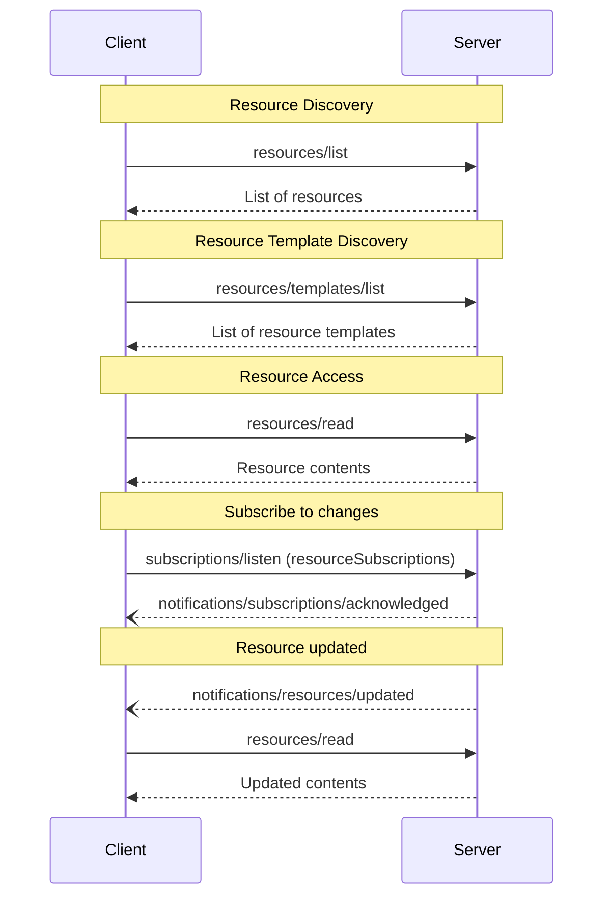

# MCP 资源规范

定义资源列表、读取、模板、订阅、内容及 URI，帮助实现文件和数据上下文接入。

- 来源：通用规范／MCP
- 资料类型：存档文档
- 文档时间：官网现页更新：[2026-10-11](<https://modelcontextprotocol.io/specification/2026-07-28/server/resources>)；规范版本：[2026-07-28](<https://modelcontextprotocol.io/specification/2026-07-28/server/resources>)；本地抓取：2026-10-11
- 阅读状态：完整中文机器译文，由 Google 翻译；代码、命令与配置保留原样，未逐句人工校对。

[原文发布页](<https://modelcontextprotocol.io/specification/2026-07-28/server/resources>) · [原始文件](<../../../../原始抓取备份/原文/官方/通用规范/MCP/MCP 资源规范.md>) · [返回资料总览](<../../../资料总览.md>)

[查看原文对照](#原文对照)

## 中文全文

> ## 文档索引
> 在以下位置获取完整的文档索引： https://modelcontextprotocol.io/llms.txt
> 在进一步探索之前使用此文件来发现所有可用页面。

# 资源

<div id="enable-section-numbers" />

Model Context Protocol (MCP) 为服务器提供了一种标准化方法来向客户端公开 
 资源。资源允许服务器共享为
语言模型提供上下文的数据，例如文件、数据库模式或特定于应用程序的信息。
每个资源都由
[URI](<https://datatracker.ietf.org/doc/html/rfc3986>)唯一标识。


**注释：**

为简洁起见，本页面上的请求示例省略了 `_meta` 请求 
 元数据（`io.modelcontextprotocol/protocolVersion`、
 `io.modelcontextprotocol/clientInfo` 和 
 `io.modelcontextprotocol/clientCapabilities`）。每个请求**MUST**都包含
所需的`_meta`字段；参见
 [`_meta`](<https://modelcontextprotocol.io/specification/2026-07-28/basic/index#meta>)。


## 用户交互模型

MCP 中的资源被设计为 ** 应用程序驱动的 **，主机应用程序 
 确定如何根据其需求合并上下文。

例如，应用程序可以：

* 通过 UI 元素公开资源，以便在树视图或列表视图中进行显式选择
* 允许用户搜索和过滤可用资源
* 根据启发式或 AI 模型的选择实现自动上下文包含


然而，实现可以通过任何满足其需求的接口模式
自由地公开资源——协议本身不强制要求任何特定的用户
交互模型。

## 能力

支持资源 **MUST** 的服务器声明 `resources` 功能：

```json theme={null}
{
  "capabilities": {
    "resources": {
      "listChanged": true,
      "subscribe": true
    }
  }
}
```

该功能支持两个可选功能：

* `listChanged`：当列表可用时服务器是否会发出通知
资源变化。
* `subscribe` ：服务器是否支持特定于资源的更新通知
使用 resourceSubscriptions
 过滤器通过 subscriptions/listen 请求的资源。

服务器可以单独、一起或两者都不通告任一功能。

既不支持 `listChanged` 也不支持 `subscribe` 的服务器可能会忽略它：

```json theme={null}
{
  "capabilities": {
    "resources": {}
  }
}
```

声明 `resources` 功能 **MUST** 的服务器使用请求客户端当前可用的资源集响应 `resources/list`
 请求。该集合
**MAY**为空，并且**MAY**随时间变化（参见
[列表更改通知](<#列表更改通知>)），但**MUSTNOT**随连接变化
或作为其他请求的副作用连接。集合 
**MAY** 根据请求上提供的授权而变化 - 例如，仅返回调用者授予范围允许的资源 
 \- 因为凭据是 
 每个请求输入，而不是连接状态。

## 协议消息

### 上市资源

要发现可用资源，客户端会发送 `resources/list` 请求。此操作
支持[分页](<https://modelcontextprotocol.io/specification/2026-07-28/server/utilities/pagination>)和[缓存](<https://modelcontextprotocol.io/specification/2026-07-28/server/utilities/caching>)。

**请求：**

```json theme={null}
{
  "jsonrpc": "2.0",
  "id": 1,
  "method": "resources/list",
  "params": {
    "cursor": "optional-cursor-value"
  }
}
```

**回复：**

```json theme={null}
{
  "jsonrpc": "2.0",
  "id": 1,
  "result": {
    "resultType": "complete",
    "resources": [
      {
        "uri": "file:///project/src/main.rs",
        "name": "main.rs",
        "title": "Rust Software Application Main File",
        "description": "Primary application entry point",
        "mimeType": "text/x-rust",
        "icons": [
          {
            "src": "https://example.com/rust-file-icon.png",
            "mimeType": "image/png",
            "sizes": ["48x48"]
          }
        ]
      }
    ],
    "nextCursor": "next-page-cursor",
    "ttlMs": 300000,
    "cacheScope": "public"
  }
}
```

### 阅读资源

要检索资源内容，客户端发送 `resources/read` 请求。此操作
支持[缓存](<https://modelcontextprotocol.io/specification/2026-07-28/server/utilities/caching>)。

**请求：**

```json theme={null}
{
  "jsonrpc": "2.0",
  "id": 2,
  "method": "resources/read",
  "params": {
    "uri": "file:///project/src/main.rs"
  }
}
```

**回复：**

```json theme={null}
{
  "jsonrpc": "2.0",
  "id": 2,
  "result": {
    "resultType": "complete",
    "contents": [
      {
        "uri": "file:///project/src/main.rs",
        "mimeType": "text/x-rust",
        "text": "fn main() {\n    println!(\"Hello world!\");\n}"
      }
    ],
    "ttlMs": 60000,
    "cacheScope": "private"
  }
}
```

服务器**MAY**返回多个资源内容以响应单个
`resources/read`请求。例如，当读取目录资源时，服务器可以返回
多个文件的内容。

服务器 **MAY** 还使用 [`InputRequiredResult`](<https://modelcontextprotocol.io/specification/2026-07-28/basic/patterns/mrtr#inputrequiredresult>) 响应 `resources/read`，以指示在读取资源之前需要额外的输入。这遵循[多往返请求](<https://modelcontextprotocol.io/specification/2026-07-28/basic/patterns/mrtr#multi-round-trip-requests>)机制。重试请求时，客户端在请求参数中包含 `inputResponses`，如果服务器提供了 `requestState`。

或者，如果`uri`的方案是`https://`，则客户端可以直接从网络获取资源。有关更多信息，请参阅[通用URI方案部分](<#https%3A%2F%2F>)。

### 资源模板

资源模板允许服务器使用
[URI模板](<https://datatracker.ietf.org/doc/html/rfc6570>)公开参数化资源。参数可以是
通过[完成API](<https://modelcontextprotocol.io/specification/2026-07-28/server/utilities/completion>)自动完成。
此操作支持[分页](<https://modelcontextprotocol.io/specification/2026-07-28/server/utilities/pagination>)和[缓存](<https://modelcontextprotocol.io/specification/2026-07-28/server/utilities/caching>)。

**请求：**

```json theme={null}
{
  "jsonrpc": "2.0",
  "id": 3,
  "method": "resources/templates/list",
  "params": {
    "cursor": "optional-cursor-value"
  }
}
```

**回复：**

```json theme={null}
{
  "jsonrpc": "2.0",
  "id": 3,
  "result": {
    "resultType": "complete",
    "resourceTemplates": [
      {
        "uriTemplate": "file:///{path}",
        "name": "Project Files",
        "title": "📁 Project Files",
        "description": "Access files in the project directory",
        "mimeType": "application/octet-stream",
        "icons": [
          {
            "src": "https://example.com/folder-icon.png",
            "mimeType": "image/png",
            "sizes": ["48x48"]
          }
        ]
      }
    ],
    "nextCursor": "next-page-cursor",
    "ttlMs": 300000,
    "cacheScope": "public"
  }
}
```

### 列表更改通知

当可用资源列表发生变化时，声明了 `listChanged`
 能力 **SHOULD** 的服务器会发送通知：

```json theme={null}
{
  "jsonrpc": "2.0",
  "method": "notifications/resources/list_changed"
}
```

### 订阅

客户端通过发送一个消息来订阅特定资源的更改通知
[`subscriptions/listen`][订阅-收听] 使用中列出的资源 URI 进行请求
`notifications.resourceSubscriptions`。服务器交付
`notifications/resources/updated` 每当观看资源时都会在结果流上
变化。

```json theme={null}
{
  "jsonrpc": "2.0",
  "method": "notifications/resources/updated",
  "params": {
    "_meta": { "io.modelcontextprotocol/subscriptionId": 4 },
    "uri": "file:///project/src/main.rs"
  }
}
```

参见 [订阅][订阅] 对于完整的协议机制（致谢，
`subscriptionId` 相关性和取消）。

[subscriptions-listen]: <https://modelcontextprotocol.io/specification/2026-07-28/schema#subscriptionslistenrequest>

[subscriptions]: <https://modelcontextprotocol.io/specification/2026-07-28/basic/patterns/subscriptions>

## 消息流



## 数据类型

### 资源

资源定义包括：

* `uri`：资源的唯一标识符
* `name`：资源的名称。
* `title`：用于显示目的的可选人类可读资源名称。
* `description`：可选说明
* `icons`：用于在用户界面中显示的可选图标数组
* `mimeType`：可选MIME型
* `size`：可选大小（以字节为单位）

### 资源内容

资源可以包含文本或二进制数据：

#### 文字内容

```json theme={null}
{
  "uri": "file:///example.txt",
  "mimeType": "text/plain",
  "text": "Resource content"
}
```

#### 二进制内容

```json theme={null}
{
  "uri": "file:///example.png",
  "mimeType": "image/png",
  "blob": "base64-encoded-data"
}
```

### 注释

资源、资源模板和内容块支持可选注释，为客户端提供有关如何使用或显示资源的提示：

* **`audience`**：指示该资源的目标受众的数组。有效值为 `"user"` 和 `"assistant"`。例如，`["user", "assistant"]` 表示对两者都有用的内容。
* **`priority`**：从0.0到1.0的数字，表示该资源的重要性。值 1 表示“最重要”（实际上是必需的），而 0 表示“最不重要”（完全可选）。
* **`lastModified`**：ISO 8601 格式的时间戳，指示资源上次修改的时间（例如，`"2025-01-12T15:00:58Z"`）。

带注释的示例资源：

```json theme={null}
{
  "uri": "file:///project/README.md",
  "name": "README.md",
  "title": "Project Documentation",
  "mimeType": "text/markdown",
  "annotations": {
    "audience": ["user"],
    "priority": 0.8,
    "lastModified": "2025-01-12T15:00:58Z"
  }
}
```

客户端可以使用这些注释来：

* 根据目标受众过滤资源
* 确定上下文中要包含的资源的优先级
* 显示修改时间或按新近度排序

## 常见URI方案

该协议定义了几个标准的URI方案。此列表并不 
 详尽 — 实现始终可以免费使用其他自定义 URI 方案。

### https\://

用于表示网络上可用的资源。

仅当客户端能够直接从网络上自行获取和加载
资源时，服务器**SHOULD**才使用此方案，也就是说，它不需要通过MCP服务器读取资源
。

对于其他用例，服务器 **SHOULD** 更喜欢使用另一种 URI 方案，或定义一个 
 自定义方案，即使服务器本身将通过 
 互联网下载资源内容。

### 文件：//

用于识别行为类似于文件系统的资源。但是，资源不需要
映射到实际的物理文件系统。

MCP 服务器 **MAY** 标识文件：// 具有 
[XDG MIME 类型 ](<https://specifications.freedesktop.org/shared-mime-info-spec/0.14/ar01s02.html#id-1.3.14>)、
 的资源，如 `inode/directory`，表示非常规文件（例如目录）不
否则具有标准MIME类型。

### git://

Git 版本控制集成。

### 自定义 URI 方案

自定义URI方案**MUST**应根据[RFC3986](<https://datatracker.ietf.org/doc/html/rfc3986>)、
考虑上述指导。

## 错误处理

如果请求的资源不存在，服务器**MUST**将返回JSON-RPC错误，并带有
代码`-32602`（无效参数）。服务器 **SHOULD** 针对内部错误返回 `-32603`。

为了向后兼容，客户端 **SHOULD** 也接受 `-32002` 作为 
资源未找到错误，因为早期协议版本使用此代码。

服务器 **MUST NOT** 针对不存在的资源返回空 `contents` 数组。空数组是不明确的——它可能意味着资源存在但没有内容，或者根本不存在。

错误示例：

```json theme={null}
{
  "jsonrpc": "2.0",
  "id": 5,
  "error": {
    "code": -32602,
    "message": "Resource not found",
    "data": {
      "uri": "file:///nonexistent.txt"
    }
  }
}
```

## 安全考虑

1. 服务器 **MUST** 验证所有资源 URI
2. 对敏感资源实施访问控制 **SHOULD**
3. 二进制数据 **MUST** 被正确编码
4. 操作前检查资源权限**SHOULD**
5. 服务器 **MUST** 清理文件路径以防止目录遍历攻击
提供 `file://` 资源时


## 原文对照

<details>
<summary>展开完整原文</summary>

> ## Documentation Index
> Fetch the complete documentation index at: https://modelcontextprotocol.io/llms.txt
> Use this file to discover all available pages before exploring further.

# Resources

<div id="enable-section-numbers" />

The Model Context Protocol (MCP) provides a standardized way for servers to expose
resources to clients. Resources allow servers to share data that provides context to
language models, such as files, database schemas, or application-specific information.
Each resource is uniquely identified by a
[URI](<https://datatracker.ietf.org/doc/html/rfc3986>).


**注释：**

  For brevity, the request examples on this page omit the `_meta` request
  metadata (`io.modelcontextprotocol/protocolVersion`,
  `io.modelcontextprotocol/clientInfo`, and
  `io.modelcontextprotocol/clientCapabilities`). Every request **MUST** include
  the required `_meta` fields; see
  [`_meta`](<https://modelcontextprotocol.io/specification/2026-07-28/basic/index#meta>).


## User Interaction Model

Resources in MCP are designed to be **application-driven**, with host applications
determining how to incorporate context based on their needs.

For example, applications could:

* Expose resources through UI elements for explicit selection, in a tree or list view
* Allow the user to search through and filter available resources
* Implement automatic context inclusion, based on heuristics or the AI model's selection


However, implementations are free to expose resources through any interface pattern that
suits their needs—the protocol itself does not mandate any specific user
interaction model.

## Capabilities

Servers that support resources **MUST** declare the `resources` capability:

```json theme={null}
{
  "capabilities": {
    "resources": {
      "listChanged": true,
      "subscribe": true
    }
  }
}
```

The capability supports two optional features:

* `listChanged`: whether the server will emit notifications when the list of available
  resources changes.
* `subscribe` : whether the server supports resource-specific update notifications
  for resources requested through subscriptions/listen using the resourceSubscriptions
  filter.

Servers may advertise either feature independently, together or neither.

Servers that support neither `listChanged` nor `subscribe` may omit it:

```json theme={null}
{
  "capabilities": {
    "resources": {}
  }
}
```

Servers that declare the `resources` capability **MUST** respond to `resources/list`
requests with the set of resources currently available to the requesting client. This set
**MAY** be empty and **MAY** change over time (see
[List Changed Notification](<#list-changed-notification>)), but **MUST NOT** vary
per-connection or as a side effect of other requests on the connection. The set
**MAY** vary by the authorization presented on the request — for example, returning
only the resources the caller's granted scopes permit — since credentials are
per-request input, not connection state.

## Protocol Messages

### Listing Resources

To discover available resources, clients send a `resources/list` request. This operation
supports [pagination](<https://modelcontextprotocol.io/specification/2026-07-28/server/utilities/pagination>) and [caching](<https://modelcontextprotocol.io/specification/2026-07-28/server/utilities/caching>).

**Request:**

```json theme={null}
{
  "jsonrpc": "2.0",
  "id": 1,
  "method": "resources/list",
  "params": {
    "cursor": "optional-cursor-value"
  }
}
```

**Response:**

```json theme={null}
{
  "jsonrpc": "2.0",
  "id": 1,
  "result": {
    "resultType": "complete",
    "resources": [
      {
        "uri": "file:///project/src/main.rs",
        "name": "main.rs",
        "title": "Rust Software Application Main File",
        "description": "Primary application entry point",
        "mimeType": "text/x-rust",
        "icons": [
          {
            "src": "https://example.com/rust-file-icon.png",
            "mimeType": "image/png",
            "sizes": ["48x48"]
          }
        ]
      }
    ],
    "nextCursor": "next-page-cursor",
    "ttlMs": 300000,
    "cacheScope": "public"
  }
}
```

### Reading Resources

To retrieve resource contents, clients send a `resources/read` request. This operation
supports [caching](<https://modelcontextprotocol.io/specification/2026-07-28/server/utilities/caching>).

**Request:**

```json theme={null}
{
  "jsonrpc": "2.0",
  "id": 2,
  "method": "resources/read",
  "params": {
    "uri": "file:///project/src/main.rs"
  }
}
```

**Response:**

```json theme={null}
{
  "jsonrpc": "2.0",
  "id": 2,
  "result": {
    "resultType": "complete",
    "contents": [
      {
        "uri": "file:///project/src/main.rs",
        "mimeType": "text/x-rust",
        "text": "fn main() {\n    println!(\"Hello world!\");\n}"
      }
    ],
    "ttlMs": 60000,
    "cacheScope": "private"
  }
}
```

Servers **MAY** return multiple resource contents in response to a single
`resources/read` request. For example, a server could return the contents of
several files when a directory resource is read.

Servers **MAY** also respond to `resources/read` with an [`InputRequiredResult`](<https://modelcontextprotocol.io/specification/2026-07-28/basic/patterns/mrtr#inputrequiredresult>) to indicate that additional input is needed before the resource can be read. This follows the [multi round-trip requests](<https://modelcontextprotocol.io/specification/2026-07-28/basic/patterns/mrtr#multi-round-trip-requests>) mechanism. When retrying the request, clients include `inputResponses` and, if provided by the server, `requestState` in the request parameters.

Alternatively, if the scheme of `uri` is `https://`, clients may fetch the resource directly from the web. See the [Common URI Schemes section](<#https%3A%2F%2F>) for more information.

### Resource Templates

Resource templates allow servers to expose parameterized resources using
[URI templates](<https://datatracker.ietf.org/doc/html/rfc6570>). Arguments may be
auto-completed through [the completion API](<https://modelcontextprotocol.io/specification/2026-07-28/server/utilities/completion>).
This operation supports [pagination](<https://modelcontextprotocol.io/specification/2026-07-28/server/utilities/pagination>) and [caching](<https://modelcontextprotocol.io/specification/2026-07-28/server/utilities/caching>).

**Request:**

```json theme={null}
{
  "jsonrpc": "2.0",
  "id": 3,
  "method": "resources/templates/list",
  "params": {
    "cursor": "optional-cursor-value"
  }
}
```

**Response:**

```json theme={null}
{
  "jsonrpc": "2.0",
  "id": 3,
  "result": {
    "resultType": "complete",
    "resourceTemplates": [
      {
        "uriTemplate": "file:///{path}",
        "name": "Project Files",
        "title": "📁 Project Files",
        "description": "Access files in the project directory",
        "mimeType": "application/octet-stream",
        "icons": [
          {
            "src": "https://example.com/folder-icon.png",
            "mimeType": "image/png",
            "sizes": ["48x48"]
          }
        ]
      }
    ],
    "nextCursor": "next-page-cursor",
    "ttlMs": 300000,
    "cacheScope": "public"
  }
}
```

### List Changed Notification

When the list of available resources changes, servers that declared the `listChanged`
capability **SHOULD** send a notification:

```json theme={null}
{
  "jsonrpc": "2.0",
  "method": "notifications/resources/list_changed"
}
```

### Subscriptions

Clients subscribe to change notifications for specific resources by sending a
[`subscriptions/listen`][subscriptions-listen] request with the resource URIs listed in
`notifications.resourceSubscriptions`. The server delivers
`notifications/resources/updated` on the resulting stream whenever a watched resource
changes.

```json theme={null}
{
  "jsonrpc": "2.0",
  "method": "notifications/resources/updated",
  "params": {
    "_meta": { "io.modelcontextprotocol/subscriptionId": 4 },
    "uri": "file:///project/src/main.rs"
  }
}
```

See [Subscriptions][subscriptions] for the full protocol mechanics (acknowledgment,
`subscriptionId` correlation, and cancellation).

[subscriptions-listen]: <https://modelcontextprotocol.io/specification/2026-07-28/schema#subscriptionslistenrequest>

[subscriptions]: <https://modelcontextprotocol.io/specification/2026-07-28/basic/patterns/subscriptions>

## Message Flow


## Data Types

### Resource

A resource definition includes:

* `uri`: Unique identifier for the resource
* `name`: The name of the resource.
* `title`: Optional human-readable name of the resource for display purposes.
* `description`: Optional description
* `icons`: Optional array of icons for display in user interfaces
* `mimeType`: Optional MIME type
* `size`: Optional size in bytes

### Resource Contents

Resources can contain either text or binary data:

#### Text Content

```json theme={null}
{
  "uri": "file:///example.txt",
  "mimeType": "text/plain",
  "text": "Resource content"
}
```

#### Binary Content

```json theme={null}
{
  "uri": "file:///example.png",
  "mimeType": "image/png",
  "blob": "base64-encoded-data"
}
```

### Annotations

Resources, resource templates and content blocks support optional annotations that provide hints to clients about how to use or display the resource:

* **`audience`**: An array indicating the intended audience(s) for this resource. Valid values are `"user"` and `"assistant"`. For example, `["user", "assistant"]` indicates content useful for both.
* **`priority`**: A number from 0.0 to 1.0 indicating the importance of this resource. A value of 1 means "most important" (effectively required), while 0 means "least important" (entirely optional).
* **`lastModified`**: An ISO 8601 formatted timestamp indicating when the resource was last modified (e.g., `"2025-01-12T15:00:58Z"`).

Example resource with annotations:

```json theme={null}
{
  "uri": "file:///project/README.md",
  "name": "README.md",
  "title": "Project Documentation",
  "mimeType": "text/markdown",
  "annotations": {
    "audience": ["user"],
    "priority": 0.8,
    "lastModified": "2025-01-12T15:00:58Z"
  }
}
```

Clients can use these annotations to:

* Filter resources based on their intended audience
* Prioritize which resources to include in context
* Display modification times or sort by recency

## Common URI Schemes

The protocol defines several standard URI schemes. This list is not
exhaustive—implementations are always free to use additional, custom URI schemes.

### https\://

Used to represent a resource available on the web.

Servers **SHOULD** use this scheme only when the client is able to fetch and load the
resource directly from the web on its own—that is, it doesn’t need to read the resource
via the MCP server.

For other use cases, servers **SHOULD** prefer to use another URI scheme, or define a
custom one, even if the server will itself be downloading resource contents over the
internet.

### file://

Used to identify resources that behave like a filesystem. However, the resources do not
need to map to an actual physical filesystem.

MCP servers **MAY** identify file:// resources with an
[XDG MIME type](<https://specifications.freedesktop.org/shared-mime-info-spec/0.14/ar01s02.html#id-1.3.14>),
like `inode/directory`, to represent non-regular files (such as directories) that don’t
otherwise have a standard MIME type.

### git://

Git version control integration.

### Custom URI Schemes

Custom URI schemes **MUST** be in accordance with [RFC3986](<https://datatracker.ietf.org/doc/html/rfc3986>),
taking the above guidance in to account.

## Error Handling

If the requested resource does not exist, servers **MUST** return a JSON-RPC error with
code `-32602` (Invalid Params). Servers **SHOULD** return `-32603` for internal errors.

For backwards compatibility, clients **SHOULD** also accept `-32002` as a
resource not found error, as earlier protocol versions used this code.

Servers **MUST NOT** return an empty `contents` array for a non-existent resource. An empty array is ambiguous—it could mean the resource exists but has no content, or that it doesn't exist at all.

Example error:

```json theme={null}
{
  "jsonrpc": "2.0",
  "id": 5,
  "error": {
    "code": -32602,
    "message": "Resource not found",
    "data": {
      "uri": "file:///nonexistent.txt"
    }
  }
}
```

## Security Considerations

1. Servers **MUST** validate all resource URIs
2. Access controls **SHOULD** be implemented for sensitive resources
3. Binary data **MUST** be properly encoded
4. Resource permissions **SHOULD** be checked before operations
5. Servers **MUST** sanitize file paths to prevent directory traversal attacks
   when serving `file://` resources


</details>
